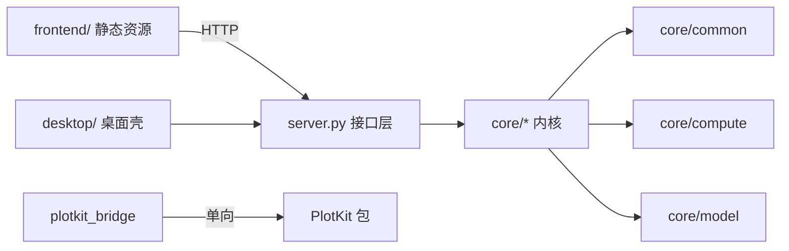

# Netlab 架构

> 读完这份文档，你应该能回答：**代码分成哪几层、各自在哪个目录**、**一次仿真步怎么走完**、**数据从画布到求解器再回到曲线经过了谁**、**想加功能该动哪里**。

## 0. 一句话

Netlab 是**单进程**应用：一个 Python 后端（FastAPI 服务 + 常驻仿真线程 + 场景状态）负责计算，一个纯静态前端负责显示。浏览器/桌面壳只是这个进程的显示层，不参与计算。

> 结构图：[docs/assets/netlab-structure.svg](docs/assets/netlab-structure.svg)

## 1. 目录即分层

```
NetlabHome/
├─ frontend/                  ← 前端（浏览器里跑，纯静态、无构建）
│   ├─ index.html             页面骨架
│   ├─ app.js                 全部交互与 Canvas 2D 绘制（单文件）
│   ├─ style.css              主题与布局
│   └─ desktop-shim.js        桌面壳注入（无边框窗口按钮等）
│
└─ netlab/                    ← 后端（Python 包）
    ├─ server.py              HTTP 接口层（/api/*，约 90 个端点，薄封装）
    ├─ run.py                 命令行启动（uvicorn + 可选打开浏览器）
    ├─ plotkit_bridge.py      把 PlotKit 以子应用挂到 /plotkit（单向依赖）
    ├─ desktop/               桌面壳（pywebview + WebView2；无边框窗口）
    ├─ core/                  ← 内核层（不含任何 HTTP / UI 代码）
    │   ├─ compute/           计算：求解器、元件模型、有限元、数字逻辑
    │   ├─ model/             连接与网络：场景、图、工程、块、扩展、工作区
    │   └─ common/            公共：错误与限额（limits）
    ├─ tests/                 pytest（HTTP + 纯函数 + 像素）
    ├─ docs/                  规格、进度、经验、数学与代码导读
    └─ <name>.py              历史兼容 shim（转发到 core/*，见 §8）
```

**分层规则**：

| 层 | 目录 | 可以做 | 不可以做 |
| --- | --- | --- | --- |
| 前端 | `frontend/` | DOM / Canvas / HTTP 调用 | import Python、直接读文件 |
| 接口层 | `netlab/server.py`、`run.py`、`plotkit_bridge.py` | 校验请求、调 `SERVICE`、序列化 | 写求解算法 |
| 桌面壳 | `netlab/desktop/` | 开窗口、注入 shim、桥接文件对话框 | 写求解算法 |
| 内核层 | `netlab/core/{compute,model,common}/` | 纯 Python 计算与数据模型 | import server / desktop / 前端 |

## 2. 总体形状

```
┌──────────────────────────────────────────────────────────────────────┐
│ 前端 frontend/（index.html + app.js + style.css）                     │
│  画布渲染 · 参数面板 · 曲线/回放 · 轮询 /api/state + /api/live         │
└───────────────▲──────────────────────────────────┬───────────────────┘
                │ JSON（HTTP/本机）                 │ 用户操作
┌───────────────┴──────────────────────────────────▼───────────────────┐
│ 接口层 netlab/server.py（FastAPI）                                    │
│  请求校验 · 场景增删改 · 工程/工作区文件 · 分析接口 · 控制接口          │
└───────┬───────────────────────┬───────────────────────┬──────────────┘
        │                       │                       │
┌───────▼─────────┐    ┌────────▼─────────┐    ┌────────▼──────────┐
│ NetworkContainer│    │ FemSimulation    │    │ BlockLibrary      │
│ 多个 Simulation │    │ Q4 有限元 + 线程  │    │ 复用子图 / 块定义  │
└───────┬─────────┘    └──────────────────┘    └───────────────────┘
        │
┌───────▼──────────────────────────────────────────────────────────────┐
│ Simulation（core/compute/simulation.py）                              │
│  配置 · 线程循环 · 实时节拍 · 录制器 Recorder · 预计算                 │
└───────┬──────────────────────────────────────────────────────────────┘
        │
┌───────▼──────────────────────────────────────────────────────────────┐
│ Scene（core/model/scene.py）：网络 + 引擎 + 参数校验                   │
│   signal/vector → SignalEngine     circuit → CircuitEngine            │
└───────┬──────────────────────────────────────────────────────────────┘
        │
┌───────▼──────────────────────────┐   ┌────────────────────────────────┐
│ graph.Network（信号流，core/model）│   │ nodal.CircuitSolver（MNA，compute）│
│ 节点字典 + 拓扑步进 + 代数环延迟   │   │ 伴随模型 + Newton + 稀疏 LU      │
└──────────────────────────────────┘   └────────────────────────────────┘
```

## 3. 场景数据模型

一个工程（`*.netlab`）是版本化 JSON：

```json
{
  "format": "netlab-project", "version": 5,
  "networks": [ { "id", "name", "mode": "signal|vector|circuit",
                  "nodes": [ { "id", "name", "kind", "position", "params", "data" } ],
                  "edges": [ { "id", "name", "source", "target", "kind", "params" } ] } ],
  "current": "网络 1",
  "fem": {}, "ui": {}, "blocks": [], "extensions": {},
  "metadata": { "name", "saved_at" },
  "checksum": "<sha256>"
}
```

- **节点**：画布上的圆形实体。`kind` 决定用哪套处理逻辑；`params` 是静态参数；`data` 是每步更新的动态数据。
- **连接**：有向边。`kind` 决定连接函数；信号模式下是纯函数，电路模式下连接代表元件。
- **网络**：一个工程可含多个网络，`mode` 在网络级固定；同一进程只有一个「当前网络」在跑。
- **校验和**：`core/model/project.py:compute_checksum` 对除 `checksum` 外的负载规范化后取 sha256；任何迁移都要重算。

运行时对象由 `Scene` 持有：`nodes: dict[str, NodeRecord]`、`edges: dict[str, EdgeRecord]`，带 `params`（校验后）与 `state`（跨步状态）。

## 4. 三种计算内核

### 4.1 信号流与矢量（`core/model/graph.py:Network`）

- 每个节点持有一个字典；每条连接是 `(source_view, target_view, params, state, dt) -> dict` 的纯函数。
- 每步按**拓扑顺序**逐个 `update`：连接先从上游取值算出目标输入，再调用节点处理函数。
- 代数环：`algebraic_cycles` 检测，环内边自动插入一步延迟（`delayed=True`），保证可解。
- **事务**：`Network.step` 先 `capture_step_state()`，任一步抛错就 `restore_step_state()`；失败不留半更新现场。
- 不可信（`trusted=False`）处理器拿到的是隔离副本 `state`，成功后原地回写。

### 4.2 电路（`core/compute/nodal.py:CircuitSolver`）

标准 MNA：未知量 = 非接地节点电压 + 需支路电流的元件（独立电压源、VCVS、运放等）。

**一步求解**（`_step_locked`）：

1. `time += dt`，所有元件 `prepare(dt, time)`：电容/电感把储能转成伴随电导 + 电流源；独立源刷新当前值。
2. `_newton_with_strategies()` 求非线性方程组：初始猜值取上一步状态；每轮 `_blank_matrix()` 新建矩阵，逐元件 `stamp()`（`_stamp_conductance` / `_stamp_current`），解 `A·x=b`；残差用**尺度无关的后向误差**；不收敛依次尝试 gmin stepping、source stepping；规模大时用 SciPy 稀疏 LU + 行列均衡。
3. 收敛后逐元件 `commit()`：写 `state` 与 `result`（`current`/`voltage_difference`/`power`…），供 UI 探针读取。
4. 失败恢复本步快照——**一步要么完整推进，要么完全不动**。

**积分方法**（`Scene.integration`）：

| 方法 | 伴随模型 | 特点 |
| --- | --- | --- |
| `trapezoidal` | `g=2C/dt` 等 | 默认，二阶，开关电路可能振铃 |
| `backward_euler` | `g=C/dt` 等 | 一阶，强阻尼，最稳 |
| `gear2` | BDF2 | 二阶，固定步长；历史不足或 dt 变化时退回 BE |

**分析接口**：`operating_point()`（DC 工作点，电容开路、电感 `1e5 S`、源取 t=0，求完恢复检查点）；`ac_sweep(freqs, ...)`（工作点线性化后按 jω 构复数 MNA 逐频求解，含非线性器件会明确报错）。

### 4.3 有限元（`core/compute/fem.py`）

单位方板二维 Q4 瞬态热传导，独立线程、独立录制，与拓扑网络互不影响；`/api/fem/state`、`/api/fem/live` 提供色图与探针。

## 5. 参数、元件与扩展

- `core/compute/params.py:ParamSpec` 描述参数键/类型/默认值/单位/范围；`Scene` 增删改时统一 `validate_params`。
- `core/compute/nodal.py:ELEMENT_SPECS` 是元件目录（名称、参数、公式文本、引脚、分组）；`transistors.py`/`logic.py`/`timers.py`/`digital.py`/`magnetics.py` 的规格在导入时合并。
- 目录里的 `formula` 是给人看的，必须与实现一致。
- `core/model/extensions.py`：从 `extensions/nodes/*.py`、`extensions/methods/*.py` 动态加载自定义节点/连接，白名单校验后注册。
- `core/model/blocks.py`：把一组节点封装成可复用块（`encapsulate_nodes`），块实例运行时是嵌套 `Scene`，暴露输入/输出端口。

## 6. 线程与数据流

```
用户操作 → POST /api/* → 修改 Scene（持有 Simulation.lock）
仿真线程 → Simulation._advance_locked(dt) → Scene.step(dt) → 引擎.step
        → Recorder.push(frame)（含 t、节点电压、元件探针）
前端     → GET /api/state（低频，结构/参数）
        → GET /api/live?cursor=N（高频，仅新帧，≤600 帧/次）
```

- 仿真线程按 `realtime` 决定是否按 `fps × steps_per_frame` sleep。
- `steps_per_frame` 只影响每帧步数，`sample_every` 只影响录制密度，都不改物理步长 `dt`。
- 录制环 1200 帧；超出容量**等间隔降采样**（保留首尾），不截断。

## 7. 前端（`frontend/`）

无构建步骤：`index.html` 加载 `app.js` 与 `style.css`。

- 画布用 Canvas 2D 绘制节点/连线/网格，支持缩放、平移、框选、正交连线。
- 参数面板由 `/api/catalog` 描述数据动态生成，前端不硬编码元件字段。
- 曲线面板维护自己的帧缓冲与回放游标。
- 所有请求走同一个 `api()` 包装（统一超时、错误提示、token 头）。
- 绘图（PlotKit）三种承载：右侧面板内嵌 / 浮窗 / 独立浏览器窗口。

## 8. 依赖规则



- **禁止**：`core/**` 不得 import `server`、`desktop`、`frontend`；`PlotKit` 不得 import `netlab`。
- 内核内部 `compute` 与 `model` 目前**允许双向**（例如 `blocks`(model) 用 `computes`(compute)，`computes`(compute) 用 `graph`(model)），这是历史事实；新增代码优先让 `model` 依赖 `compute`。
- 历史模块名（`netlab/core/model/scene.py` 等）是**兼容 shim**：只做转发，不含逻辑。新代码请 import `netlab.core.model.scene`。它们由 `tools/reorg_core.py` 一次性生成，保留是为了不破坏旧 import 与外部扩展。

## 9. 想改功能，去哪

| 需求 | 位置 |
| --- | --- |
| 新增电路元件 | `core/compute/nodal.py` 或对应元件模块：子类 + `ELEMENT_SPECS` 条目 + 参数表 |
| 新增信号节点/连接 | `core/compute/computes.py` / `methods.py` + 前端 `AddMenu` 描述 |
| 新增模板 | `core/model/templates.py:TEMPLATES` |
| 新增分析接口 | `server.py` 端点 → `Simulation`/`Scene` 方法 → 引擎实现 |
| 改参数校验 | `core/compute/params.py` + 对应 spec |
| 改工程格式 | `core/model/project.py`（版本迁移 + checksum） |
| 改画布交互 | `frontend/app.js` + `frontend/style.css` |
| 改窗口外观 | `netlab/desktop/webview_app.py` + `frontend/desktop-shim.js` |
| 改绘图接入 | `netlab/plotkit_bridge.py` + `frontend/app.js` 的 placePlotkit |

## 10. 不变式（改动时别破坏）

1. **场景可序列化**：任何状态都能进 `to_payload`，并能从 payload 完整重建。
2. **一步事务**：`Scene.step` 失败后，时间、解、元件状态必须与调用前一致。
3. **参数即契约**：`spec.params` 是校验与 UI 的唯一来源。
4. **公式即文档**：`ELEMENT_SPECS.formula` 必须描述实际算法。
5. **分层单向**：内核不依赖接口层与前端；PlotKit 单向。
6. **本机优先**：默认只监听 `127.0.0.1`，无外链资源与遥测。

---

配套文档：数学推导见 [netlab/docs/MATH.md](netlab/docs/MATH.md)，逐模块导读见 [netlab/docs/CODE_GUIDE.md](netlab/docs/CODE_GUIDE.md)，需求与决策见 [netlab/docs/REQUIREMENTS_AND_RULES.md](netlab/docs/REQUIREMENTS_AND_RULES.md)。
