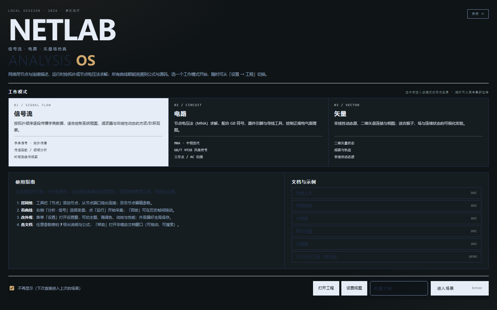
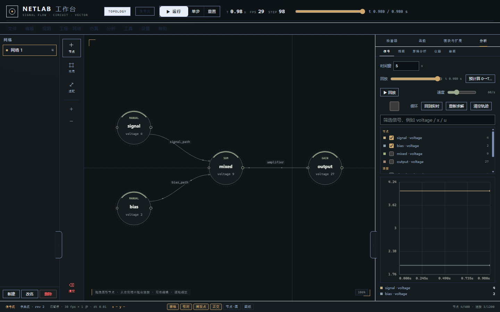
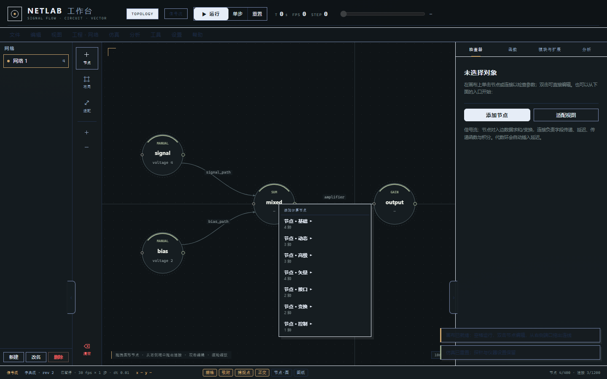
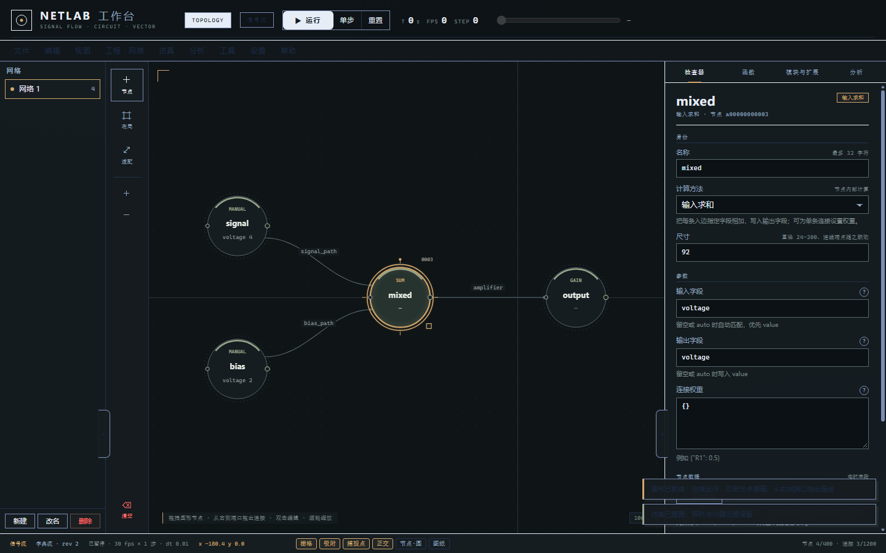
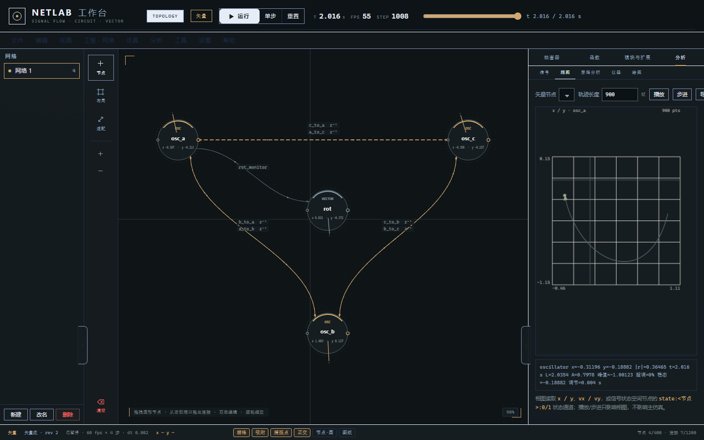
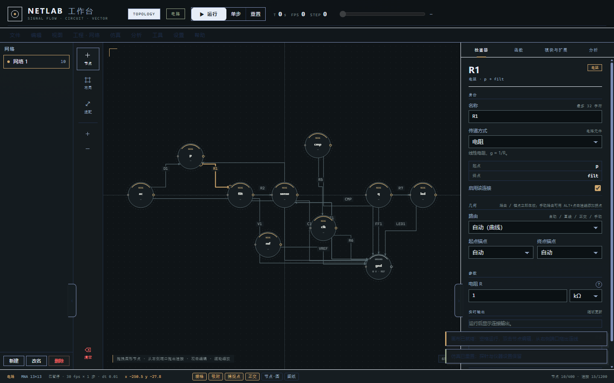
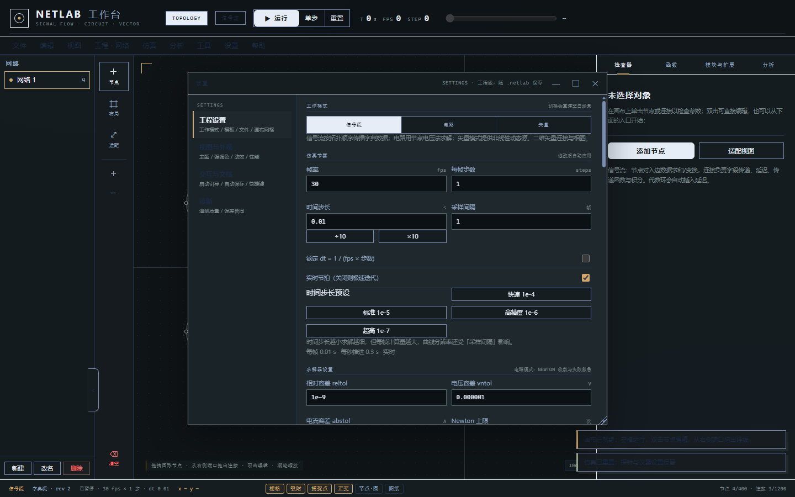
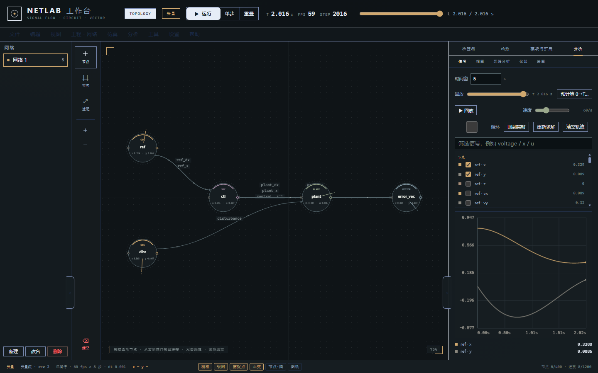

# 操作指南

> 最后更新：2026-11-07（全部截图按新版深色 UI 重拍；新增引导页 / 添加节点 / 检查器 / 工程设置 / circuit 的分步截图；补 Ctrl+K 文档搜索、Bode 光标读数/方向键吸附、周期多窗口估计）
> 目标：10 分钟内知道界面每一块是干什么的、怎么搭一个能跑的网络或电路、怎么保存与回放。

## 1. 启动与界面速览

```bash
python -m netlab.run
```

打开 <http://127.0.0.1:8010/>，界面分四块：

```
┌──────────────────────────────────────────────────────────────────────┐
│ 顶栏：工作区切换 · 运行/单步/重置 · T / FPS / STEP · 时间轴 · 会话时钟  │
├──────────┬───────────────────────────────────────────┬───────────────┤
│ 网络列表  │               画布（节点 + 连线）           │   右侧面板     │
│ 新建/改名 │                                           │ 检查器/场景/   │
│ /删除     │                                           │ 扩展/模板/分析 │
│          │                                           │ /信号/相图     │
├──────────┴───────────────────────────────────────────┴───────────────┤
│ 状态栏：光标坐标 · 网格/吸附/正交/节点/线 · 提示                          │
└──────────────────────────────────────────────────────────────────────┘
```

- **顶栏左侧**：`TOPOLOGY` 切到拓扑网络。
- **运行 / 单步 / 重置**：运行=连续推进（再点一次暂停），单步=推进一帧，重置=回到 t=0 并清空状态。
- **T / FPS / STEP**：当前仿真时间（秒）、实际帧率、已推进步数。
- **顶栏时间轴**：拖动可查看历史帧（只读回放），双击回到实时；右侧面板的「图纸」页也有同样的时间轴。
- **左侧网络列表**：一个工程可含多个网络，选中即切换；`+` 新建、`✎` 改名、`🗑` 删除。
- **底部状态栏**：显示坐标、缩放，以及网格/吸附/正交连线等开关。

首次启动会弹出「使用引导」页：先选工作模式（信号流 / 电路 / 矢量），再按「使用指南」四步上手；点「进入场景」即可开始，之后可在「设置 → 重新打开引导页」随时再看。



进入主界面后，信号流工作区大致如下（左侧网络列表、中间画布、右侧四个分组面板：检查器 / 函数 / 模块与扩展 / 分析）：



## 2. 快捷键

| 按键 | 作用 |
| --- | --- |
| `Space` | 运行 / 暂停 |
| `S` | 单步（推进一帧） |
| `R` | 重置 |
| `F` | 适配视图（缩放到全部节点） |
| `A` | 在画布中心打开「新建节点」菜单 |
| `Delete` / `Backspace` | 删除选中节点/连线 |
| `+` / `-` | 放大 / 缩小 |
| `Ctrl+S` | 保存工程 |
| `Ctrl+Alt+S` | 另存为 |
| `Ctrl+Shift+E` | 导出当前场景 JSON |
| `Ctrl+Z` / `Ctrl+Shift+Z` / `Ctrl+Y` | 撤销 / 重做 |
| `Ctrl+C` / `Ctrl+X` / `Ctrl+V` | 复制 / 剪切 / 粘贴 |
| `Ctrl+A` | 全选 |
| `?` | 打开帮助 |
| `Ctrl+K` | 打开文档中心并聚焦搜索（帮助全局搜索） |
| `←` / `→`（Bode 图聚焦时） | 吸附相邻采样点；按住 `Shift` 步进 ×10 采样点 |
| `Esc` | 关闭弹窗 / 取消连线 |

鼠标：拖动节点移动；从节点右侧端口拖出连线；滚轮缩放；空白处拖动框选；右键打开上下文菜单；Bode 图上移动/按住拖动可连续读数（光标旁显示频率与幅相）。

## 3. 工作区一：信号流 / 矢量

1. 顶栏选 `TOPOLOGY`，网络模式选「信号流」。
2. 按 `A` 或点左侧工具栏的 `+ 节点`，弹出「添加节点」菜单，按分组（节点·基础 / 动态 / 高级 / 矢量 / 接口 / 变换 / 控制）挑一个节点类型放到画布。

   

3. 从节点端口拖到另一个节点建立连接；连接上会标出它的函数名。
4. 选中节点/连接，在右侧「检查器」里改参数（名称、计算方法、尺寸、参数、输入/输出字段、连接权重）。

   

5. 点「运行」看曲线；再点「分析 → 信号」页看实时波形。

矢量化/非线性网络也是同一套操作，只是节点表示二维向量或微分方程，可以在「相图」页看轨迹。

**模板**：右侧面板「模板」页里有现成的信号链、状态空间、非线性控制、电路示例，点一下即载入当前网络。



## 4. 工作区二：电路

1. 新建网络时选「电路」模式。
2. 放节点：普通节点（电势点）、接地节点（`GROUND`，一个电路必须有且只有一个地）。
3. 放元件：工具栏 `+` 里选电阻、电容、独立源、二极管、BJT/MOS、运放、逻辑门等；元件的两个端点分别连到节点。
4. 在检查器里设参数（阻值、容值、源波形、晶体管参数……）。
5. 点「运行」：求解器按 `dt` 推进；探针读数出现在检查器与「分析」曲线里。

下面是载入 `trip_unit` 电路并选中电阻 R1 的样子：画布上器件按国标（GB/T 4728 矩形符号）绘制，右侧检查器显示「电阻 · p→filt」的线性电阻参数。



要点：

- **每个节点必须有直流通路**，否则会报「悬空节点」——用电阻或源把它接到地。
- 独立源参数里 `wave` 可选 `dc`/`sine`/`pulse` 等，DC 值由 `offset` 决定。
- 电容/电感初始电压（电流）在参数里设置；不设置即从 0 开始。
- 非线性电路偶尔不收敛时，先减小 `dt` 或换 `backward_euler` 积分方法（见「设置 → 工程设置」页），再检查有无强反馈/悬空。
- 求解器容差与积分方法在「设置 → 工程设置」里调（工作模式、仿真节奏、时间步长预设、相对/绝对容差、Gmin、Newton 迭代等）：

  



## 5. 曲线、回放与预计算

- 「图纸」页维护一个滚动时间窗（可改「时间窗」秒数），勾选信号即可绘制。
- **回放**：拖动时间轴进入只读历史帧；「回到实时」或双击时间轴退出。
- **回放速度**：点「▶ 回放」后，用旁边的「速度」滑块调节播放快慢（5–240 帧/秒，默认 60；拖动立即生效，设置会被记住）。速度只影响回放推进，不影响仿真结果。
- **循环**：让回放在窗口内循环。
- **清空轨迹**：清掉已录制的曲线，不影响运行。
- **预计算**：给定持续时间与步长，一次性算完整个窗口并回放（不按实时节拍），适合先看结果再慢慢分析。窗口很长时会自动降采样，保证覆盖完整时间段。

> 采样间隔（`sample_every`）只影响录制密度，不影响物理步长；想提高精度请改 `dt`。

## 6. 分析

右侧「分析」页提供基于当前轨迹的指标：均值/有效值/峰峰值、频谱、周期估计、传递关系等。电路模式下还提供：

- **DC 工作点**：各节点稳态电压与元件电流（电容视为开路、电感视为短路）。
- **AC 扫频**：在指定工作点线性化，输出幅频/相频（Bode）数据；Bode 图上移动鼠标即可连续读数，`←/→` 吸附相邻采样点（`Shift` ×10）。
- **周期估计**：全窗 + 前 65% 子窗 + 后 35% 子窗逐窗打分（R11 多窗口），并给出 `score_std/period_std`，越小说明周期性越稳定。
- **统一频响（R39）**：信号流与电路都可走 `POST /api/analysis/frequency`，返回 `real/imag/magnitude/phase_deg/db`；信号流用复数图 `(I-W(jω))y=b`，延迟边按精确 `e^{-jωT}`，电路复用复数 MNA。

这些接口也可通过 HTTP 调用（`GET /api/operating-point`、`GET /api/ac-sweep`、`POST /api/analysis/frequency`），方便脚本化。

## 7. 工程文件

- 工程是单个 `*.netlab` 文件（版本化 JSON，带校验和），**保存即写盘**，原子替换，不会写坏原文件。
- `Ctrl+S` 保存到当前文件；`Ctrl+Alt+S` 另存为。
- 打开/导入工程会先做结构与校验和检查；若文件被外部程序改动导致校验失败，会明确提示，可用备份或「另存为」重建。
- 工程包含：多个网络、当前网络、UI 状态、块定义、扩展启用状态。

## 8. 扩展、插件与块

- **插件（推荐）**：把插件包放到 `extensions/plugins/<plugin-id>/`（含 `plugin.json`），在块库工具栏点「插件管理」→「扫描」→「启用」。插件可注册节点计算、连接函数、电路元件、分析算法、数据格式、面板、视觉、模板和独立引擎模式；只允许从 `netlab.plugin_api.v1` 导入稳定接口。完整规范见 [PLUGIN_GUIDE.md](netlab/docs/PLUGIN_GUIDE.md)。
- **旧扩展**：`.py` 放到 `extensions/nodes/`（节点）或 `extensions/methods/`（连接函数），在「扩展」页扫描并激活；这是 legacy 兼容层，新能力建议使用插件包。
- **块**：选中一组节点 → 右键「封装为块」→ 成为一个可复用子图，出现在「模板/块」列表；块实例暴露输入/输出端口，双击可进入内部编辑。
- **视图设计**：块库工具栏点「视图设计」，选择 simple / professional，调整颜色、网格、面板宽度、节点尺寸、节点字段开关（显示节点类型/端口、显示节点数值）；颜色行「调色」按钮打开发光色轮（离线 iro.js 5.5.2）。「应用并保存」写入运行期 UI 配置（`netlab-ui/1`）；工程文件的 `ui` 段仍是旧的视图偏好，其中 `cardDetail/cardValue` 跟随上述两个开关。

## 10. 并网逆变器示例（R31）

`MyProject/` 下有三个可载入的示例工程：

| 工程 | 内容 | 用途 |
| --- | --- | --- |
| `grid_inverter_avg.netlab` | 三相电网 + `abc_dq` + 6 状态 LCL 平均模型 + 测量节点 | P11-01/02 平均模型地基 |
| `pll_template.netlab` | 三相源 + SRF-PLL + 频率/相位测量 | P11-03 PLL |
| `grid_inverter_current.netlab` | dq RL + 双 PI + 前馈解耦 | P11-04 电流环 |
| `grid_inverter_switch.netlab` | 六开关三相桥 + LCL + 50 Hz 栅极趋势验证 | P11-06 开关级趋势（理想 nmos，非 10 kHz PWM/损耗模型） |

打开工程后直接「预计算」即可复现；长预计算可点预计算窗口的「停止计算」中断（P11-07）。

## 11. 性能提示

| 想要 | 做法 |
| --- | --- |
| 更快看到结果 | 关闭实时节拍（顶栏运行设置），或提高每帧步数 |
| 更长的历史 | 加大「时间窗」或减小采样间隔的录制密度 |
| 更准的波形 | 减小 `dt`；开关电路优先 `backward_euler`，平滑动态可选 `gear2` |
| 更大电路 | 节点数多时稀疏矩阵会自动启用（可在场景设置里强制 `sparse=on`） |

---

遇到问题先看 [INSTALL.md](INSTALL.md#5-常见问题)；想理解内部实现看 [ARCHITECTURE.md](ARCHITECTURE.md)。
