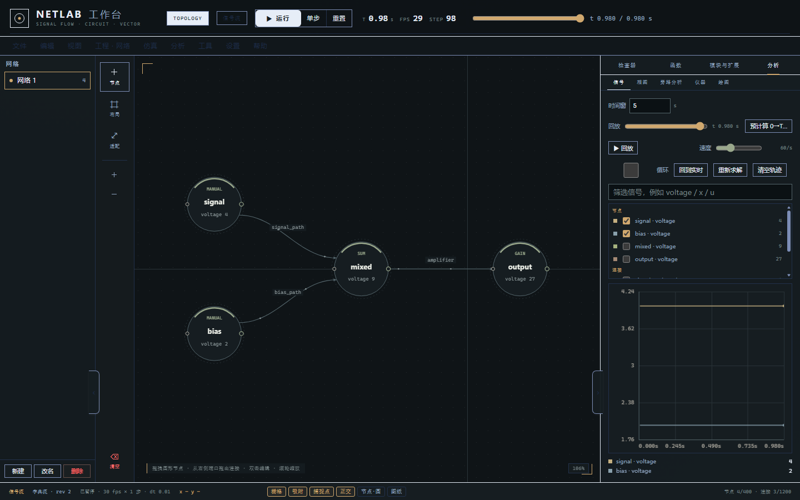
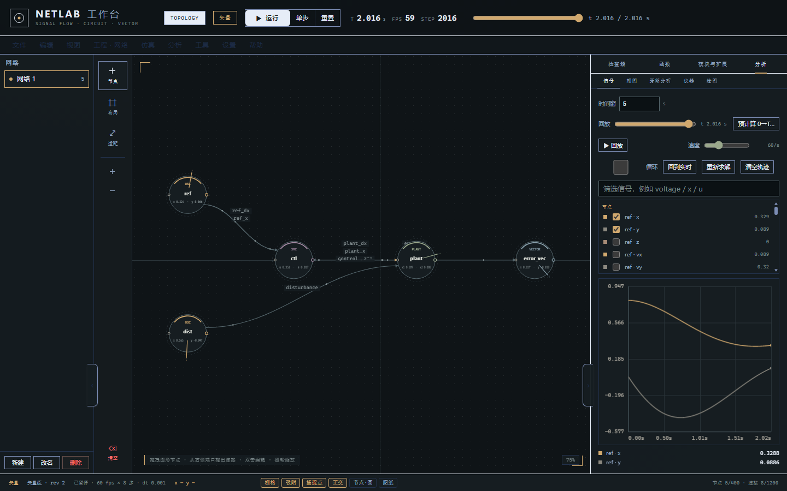

# RHINE LAB · NETLAB

> 最后更新：2026-11-06

> **节点拓扑、非线性动态、二维矢量与并网逆变器控制，放在同一个可操作的本地仿真台。**
> 纯本地运行：一个 Python 进程 + 一个浏览器页面，不依赖任何云服务或外网资源。



[▶ 观看 28 秒介绍视频](docs/assets/netlab-demo.mp4) · [架构图](docs/assets/netlab-architecture.svg)

---

## 这是什么

Netlab 是一个面向电子、动态系统与电力电子的交互式仿真工作台。它把不同的计算内核放进同一套界面与数据模型里：

| 工作区 / 能力 | 计算内核 | 适合表达 |
| --- | --- | --- |
| **信号流 / 矢量** | 有向图，节点持有数据字典，连接是纯函数 | 信号链、滤波器、状态空间、非线性振子、相图 |
| **电路** | 节点电压法（MNA）+ Newton 迭代 | R/L/C、二极管、BJT/MOSFET、运放、比较器、逻辑门、555、变压器…… |
| **并网逆变器（R31）** | 平均模型 + `abc_dq` + SRF-PLL + dq 电流环 | 三相电网、LCL 滤波、PWM 平均、开关级六桥臂趋势验证 |
| **复数分析层（R39）** | 复数图 `(I-W(jω))y=b` / 复数 MNA | 频响、Bode、精确 `e^{-jωT}` 延迟、RC/RLC 网络、MIMO 相位 |
| **插件扩展（R40）** | 插件 API v1 + 独立引擎模式 | 自定义节点/连接/元件/分析算法/数据格式/面板/视觉/模板 |

所有工作区共享：网格化画布、实时曲线、回放时间轴、工程文件（`*.netlab`，当前 `version: 6`）、插件与扩展机制。

## 主要能力

- **电路求解器**
  - 梯形法 / 后向欧拉 / **Gear2（BDF2）** 三种积分方法
  - Newton-Raphson + gmin stepping + source stepping 自愈收敛
  - **稀疏矩阵**求解（节点数较大时自动启用，可手动强制）
  - **DC 工作点**（`.op`）与 **AC 小信号扫频 / Bode**（工作点线性化 + 复数 MNA）
- **信号流与动态系统**：R34 s 域传递函数、R35 字段自动匹配、R36 非线性/非定常求解、R37 全局总传函与 A/B/C/D 导出、R38 相图与动态性能指标
- **并网逆变器链路（R31）**：L1 平均模型、`abc_dq`、SRF-PLL、dq 双 PI + 前馈解耦、`sensor`/`actuator` 跨域桥、六开关三相桥、可中断长仿真
- **复数分析层（R39）**：`complex_support.py` 边界转换、`analysis.frequency_response()` 统一频响入口、复数 MNA、精确延迟
- **插件扩展（R40）**：`netlab-plugin/1` manifest、独立插件包、`netlab.plugin_api.v1`、自定义分析/数据格式/面板/视觉/模板、独立 `EngineProtocol` 引擎模式
- **元件库**：电阻、电容、电感、独立/受控源、二极管、稳压管、LED、开关、NPN/PNP、NMOS/PMOS、运放、比较器、D 触发器、逻辑门、555、LDO、计数器/移位寄存器、ADC/DAC、变压器与耦合电感
- **交互**：实时曲线、波形回放与时间轴拖拽、采样间隔、预计算窗口、工程保存/加载、画布模板与全局扩展
- **简单画布与可调节 UI**：`netlab-ui/1` profile、simple/professional 双模式、颜色令牌、布局参数、视图内设计均已接入；颜色编辑器离线 vendored iro.js 5.5.2 色轮，保留原生颜色输入回退
- **离线优先**：静态资源全部随包分发，无 CDN、无外部字体、无遥测



## 快速开始

需要 **Python 3.11+**（Windows / macOS / Linux 均可）。

```bash
python -m pip install -r netlab/requirements.txt
python -m netlab.run
```

浏览器会自动打开 <http://127.0.0.1:8010/>。Windows 也可以双击 `netlab/start.bat`。

常用参数：

```bash
python -m netlab.run --port 8020 --no-browser
```

桌面窗口版（可选，需要 pywebview + WebView2）：

```bash
python -m pip install -r netlab/requirements-desktop.txt
python -m netlab.desktop
```

更完整的安装方式（含**完全离线安装**、局域网共享、防火墙设置）见 [INSTALL.md](INSTALL.md)。

## 目录结构

```
.
├─ frontend/              前端（HTML/CSS/JS；源码 TypeScript，经 esbuild 构建）
│  ├─ index.html
│  ├─ style.css
│  ├─ app.ts / app.utils.ts  前端 TypeScript 源码（esbuild → app.js）
│  ├─ app.js
│  └─ desktop-shim.js     桌面壳注入（无边框窗控）
├─ netlab/                后端包（服务端 + 计算内核 + 模型 + 插件 API）
│  ├─ run.py              一键启动入口
│  ├─ server.py           HTTP API（/api/*、/plotkit/*、/api/plugins*）
│  ├─ plotkit_bridge.py   PlotKit 子应用挂载
│  ├─ plugin_api/v1/      插件稳定门面（只依赖这里，不 import 内核私有模块）
│  ├─ core/
│  │  ├─ compute/         计算内核：simulation / nodal / analysis / complex_support …
│  │  ├─ model/           连接与模型：scene / networks / project / plugins / ui_profile …
│  │  └─ common/          limits（输入边界与校验）
│  ├─ tests/              pytest（HTTP + 纯函数 + 工程回归）
│  └─ docs/               架构、数学、扩展、UI、进度、需求与规格
├─ docs/assets/           README 截图、结构图、演示视频
├─ library/               共享库（运行时生成，默认空）
├─ extensions/plugins/    插件包目录（运行时生成，默认空）
├─ README.md
├─ ARCHITECTURE.md        架构与数据流
├─ OPERATION.md           操作指南
└─ INSTALL.md             安装与离线部署
```

## 扩展与插件

- 插件包放在 `extensions/plugins/<plugin-id>/`，每个包包含 `plugin.json`、Python 入口与可选说明。
- 插件只能从 `netlab.plugin_api.v1` 导入稳定接口；现有 `signal`/`circuit`/`vector` 内核不可替换，但可以注册新的引擎 mode。
- 插件能力：节点计算、连接函数、电路元件、分析算法、数据导入导出、面板、视觉、模板、独立引擎。
- 完整规范见 [EXTENSIBILITY_ARCHITECTURE.md](netlab/docs/EXTENSIBILITY_ARCHITECTURE.md)，上手示例见 [PLUGIN_GUIDE.md](netlab/docs/PLUGIN_GUIDE.md)，扩展点清单见 [EXTENDING.md](netlab/docs/EXTENDING.md)。

<!-- BEGIN LAST 10 UPDATES -->

## 最近更新（自动记录最近 10 次）

| 日期 | 更新内容 |
|---|---|
| 2026-11-09 | ci(container): 容器烟测排除 D-4 e2e（镜像未装 PlotKit） |
| 2026-11-09 | docs(d4): PROGRESS §7.139 记录端到端验收闭环 |
| 2026-11-09 | test(d4): 入仓变异体反证产物（plant +5% 判红） |
| 2026-11-09 | test(d4): 入仓 D-4 绿色端到端产物（error_table/plot_spec/csv/netlab/svg） |
| 2026-11-09 | ci(d4): e2e 绿色门 + 变异必然变红门，入仓 reports/e2e |
| 2026-11-09 | feat(tools): D-4 e2e 端到端闭环（误差表/PlotKit 出图/变异入口） |
| 2026-11-09 | fix(ci): 恢复 python-tests.yml 原 CRLF 换行 |
| 2026-11-09 | ci(b2): 需求可验证性抽查移到样例工程准备之后（R43 依赖 MyProject） |
| 2026-11-09 | fix(docs): B-3 提交恢复两点 CRLF 误转为 LF 的换行，避免整文件 diff |
| 2026-11-09 | docs(b3): D 编号命名空间 D-NL/D-PK 统一 + 里程碑基线更新 |

<!-- END LAST 10 UPDATES -->

## 文档

- [ARCHITECTURE.md](ARCHITECTURE.md) —— 分层、场景数据模型、求解器、插件层与前端数据流（含[结构图](docs/assets/netlab-architecture.svg)）
- [netlab/docs/CODE_GUIDE.md](netlab/docs/CODE_GUIDE.md) —— 目录地图、模块职责、关键符号与调用链
- [netlab/docs/MATH.md](netlab/docs/MATH.md) —— 数学原理：MNA、伴随模型、Newton、状态空间、复数频响
- [netlab/docs/EXTENSIBILITY_ARCHITECTURE.md](netlab/docs/EXTENSIBILITY_ARCHITECTURE.md) —— 插件 API v1、工程 v6、UI profile、EngineProtocol
- [netlab/docs/PLUGIN_GUIDE.md](netlab/docs/PLUGIN_GUIDE.md) —— 插件包开发与本地加载
- [OPERATION.md](OPERATION.md) —— 界面速览、快捷键、建图/建电路、曲线与回放、工程文件
- [INSTALL.md](INSTALL.md) —— 安装、离线部署、局域网访问、故障排查
- [netlab/docs/DOCS_INDEX.md](netlab/docs/DOCS_INDEX.md) —— 活跃/历史文档索引

## 离线使用

Netlab 设计为**每人一份、本机运行**：服务默认只监听 `127.0.0.1`，你在自己电脑上打开 `http://127.0.0.1:8010/`，数据不出本机。

没有网络的电脑也能装：在有网机器上执行一次 `pip download` 把依赖 wheels 存成目录，拷过去后用 `--no-index --find-links` 安装，全程不联网。步骤见 [INSTALL.md](INSTALL.md#完全离线的电脑)。

## 许可

[MIT License](LICENSE)
