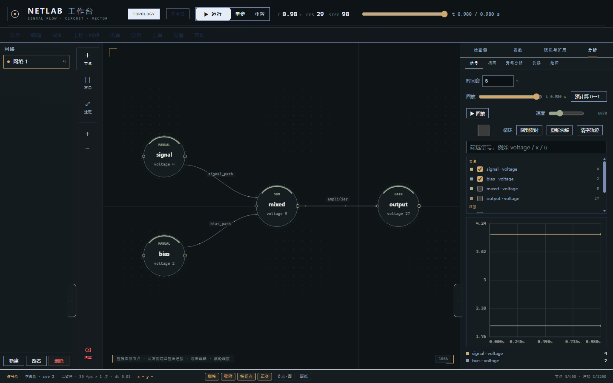
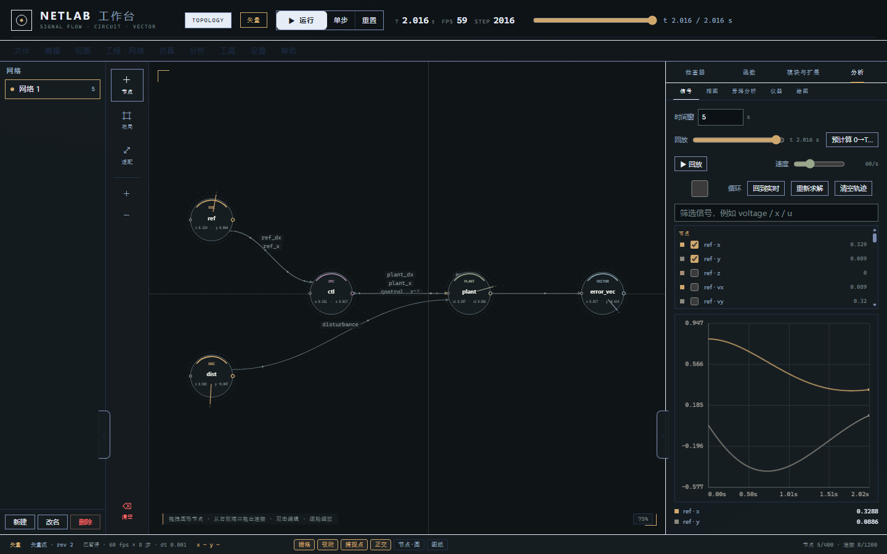

# RHINE LAB · NETLAB

> 最后更新：2026-11-18

> **节点拓扑、非线性动态、二维矢量，放在同一个可操作的本地仿真台。**
> 纯本地运行：一个 Python 进程 + 一个浏览器页面，不依赖任何云服务或外网资源。



[架构图](docs/assets/netlab-architecture.svg)

---

## 这是什么

Netlab 是一个面向电子、动态系统与电力电子的交互式仿真工作台。它把不同的计算内核放进同一套界面与数据模型里：

| 工作区 / 能力 | 计算内核 | 适合表达 |
| --- | --- | --- |
| **信号流 / 矢量** | 有向图，节点持有数据字典，连接是纯函数 | 信号链、滤波器、状态空间、非线性振子、相图 |
| **电路** | 节点电压法（MNA）+ Newton 迭代 | R/L/C、二极管、BJT/MOSFET、运放、比较器、逻辑门、555、变压器…… |
| **复数分析层（R39）** | 复数图 `(I-W(jω))y=b` / 复数 MNA | 频响、Bode、精确 `e^{-jωT}` 延迟、RC/RLC 网络、MIMO 相位 |
| **插件扩展（R40）** | 插件 API v1 + 独立引擎模式 | 自定义节点/连接/元件/分析算法/数据格式/面板/视觉/模板 |

所有工作区共享：网格化画布、实时曲线、回放时间轴、工程文件（`*.netlab`，当前 `version: 8`）、插件与扩展机制。

## 主要能力

- **电路求解器**
  - 梯形法 / 后向欧拉 / **Gear2（BDF2）** 三种积分方法
  - Newton-Raphson + gmin stepping + source stepping 自愈收敛
  - **稀疏矩阵**求解（节点数较大时自动启用，可手动强制）
  - **DC 工作点**（`.op`）与 **AC 小信号扫频 / Bode**（工作点线性化 + 复数 MNA）
- **信号流与动态系统**：R34 s 域传递函数、R35 字段自动匹配、R36 非线性/非定常求解、R37 全局总传函与 A/B/C/D 导出、R38 相图与动态性能指标
- **复数分析层（R39）**：`complex_support.py` 边界转换、`analysis.frequency_response()` 统一频响入口、复数 MNA、精确延迟
- **插件扩展（R40）**：`netlab-plugin/1` manifest、独立插件包、`netlab.plugin_api.v1`、自定义分析/数据格式/面板/视觉/模板、独立 `EngineProtocol` 引擎模式
- **元件库**：电阻、电容、电感、独立/受控源、二极管、稳压管、LED、开关、NPN/PNP、NMOS/PMOS、运放、比较器、D 触发器、逻辑门、555、LDO、计数器/移位寄存器、ADC/DAC、变压器与耦合电感
- **交互**：实时曲线、波形回放与时间轴拖拽、采样间隔、预计算窗口、工程保存/加载、画布模板与全局扩展
- **简单画布与可调节 UI**：`netlab-ui/1` profile、simple/professional 双模式、颜色令牌、布局参数、视图内设计均已接入；颜色编辑器离线 vendored iro.js 5.5.2 色轮，保留原生颜色输入回退
- **离线优先**：静态资源全部随包分发，无 CDN、无外部字体、无遥测

## 示例应用

`MyProject/`（本地示例目录：已被 `.gitignore` 排除、不随仓库分发）用于放置可直接打开的运行示例（信号流、电路与跨域组合）；仓库内同名工程作为测试夹具存于 `netlab/tests/fixtures/projects/`，可复制到 `MyProject/` 后打开。例如并网逆变器控制链示例：平均模型 `grid_inverter_avg.netlab`（三相电网 + `abc_dq` + LCL `state_space`）、`pll_template.netlab`（SRF-PLL）、`grid_inverter_current.netlab`（dq 电流环 + 双 PI + 前馈解耦）、`grid_inverter_switch.netlab`（六开关三相桥趋势验证）。



## 快速开始

需要 **Python 3.11+**（Windows / macOS / Linux 均可）。

```bash
python -m pip install -r netlab/requirements.txt
python -m netlab.run
```

浏览器会自动打开 <http://127.0.0.1:8010/>。Windows 也可以双击 `netlab/start.bat`。

常用参数：

```bash
python -m netlab.run --port 8020 --no-browser
```

桌面窗口版（可选，需要 pywebview + WebView2）：

```bash
python -m pip install -r netlab/requirements-desktop.txt
python -m netlab.desktop
```

更完整的安装方式（含**完全离线安装**、局域网共享、防火墙设置）见 [INSTALL.md](INSTALL.md)。

## 目录结构

```
.
├─ frontend/              前端（HTML/CSS/JS；源码 TypeScript，经 esbuild 构建）
│  ├─ index.html
│  ├─ style.css
│  ├─ app.ts / app.utils.ts  前端 TypeScript 源码（esbuild → app.js）
│  ├─ app.js
│  └─ desktop-shim.js     桌面壳注入（无边框窗控）
├─ netlab/                后端包（服务端 + 计算内核 + 模型 + 插件 API）
│  ├─ run.py              一键启动入口
│  ├─ server.py           HTTP API（/api/*、/plotkit/*、/api/plugins*）
│  ├─ plotkit_bridge.py   PlotKit 子应用挂载
│  ├─ plugin_api/v1/      插件稳定门面（只依赖这里，不 import 内核私有模块）
│  ├─ core/
│  │  ├─ compute/         计算内核：simulation / nodal / analysis / complex_support …
│  │  ├─ model/           连接与模型：scene / networks / project / plugins / ui_profile …
│  │  └─ common/          limits（输入边界与校验）
│  ├─ tests/              pytest（HTTP + 纯函数 + 工程回归）
│  └─ docs/               架构、数学、扩展、UI、进度、需求与规格
├─ docs/assets/           README 截图、结构图
├─ library/               共享库（运行时生成，默认空）
├─ extensions/plugins/    插件包目录（运行时生成，默认空）
├─ README.md
├─ ARCHITECTURE.md        架构与数据流
├─ OPERATION.md           操作指南
└─ INSTALL.md             安装与离线部署
```

## 扩展与插件

- 插件包放在 `extensions/plugins/<plugin-id>/`，每个包包含 `plugin.json`、Python 入口与可选说明。
- 插件只能从 `netlab.plugin_api.v1` 导入稳定接口；现有 `signal`/`circuit`/`vector` 内核不可替换，但可以注册新的引擎 mode。
- 插件能力：节点计算、连接函数、电路元件、分析算法、数据导入导出、面板、视觉、模板、独立引擎。
- 完整规范见 [EXTENSIBILITY_ARCHITECTURE.md](netlab/docs/EXTENSIBILITY_ARCHITECTURE.md)，上手示例见 [PLUGIN_GUIDE.md](netlab/docs/PLUGIN_GUIDE.md)，扩展点清单见 [EXTENDING.md](netlab/docs/EXTENDING.md)。

<!-- BEGIN LAST 20 UPDATES -->

## 最近更新（自动记录最近 20 次）

| 日期 | 更新内容 |
|---|---|
| 2026-11-26 | feat(tools): automate README recent updates |
| 2026-11-26 | chore(evidence): regenerate D-5 shadow report for feedback polarity fixes |
| 2026-11-26 | fix(workbench): require feedback polarity confirmation for Nyquist and step analyses |
| 2026-11-26 | fix(model): preserve nested block state when cloning runtime block instances |
| 2026-11-26 | fix(loop-analysis): require explicit feedback polarity confirmation |
| 2026-11-26 | chore(evidence): add D-5 shadow report for loop analysis |
| 2026-11-26 | docs(changelog): record runtime hardening and polarity confirmation |
| 2026-11-26 | fix(model): isolate block state and support plugin scene stepping |
| 2026-11-26 | fix(loop-analysis): require explicit feedback polarity confirmation |
| 2026-11-26 | docs(changelog): record three-layer model architecture and loop-sign fixes |
| 2026-11-26 | feat(model): isolate runtime scene and component state |
| 2026-11-26 | fix(loop-analysis): propagate physical feedback sign through loop synthesis |
| 2026-11-26 | feat(model): separate Model, CompiledModel and Runtime layers |
| 2026-11-26 | fix(loop-analysis): unify signed loop gain and Nyquist critical point |
| 2026-11-26 | docs: sync audit status to PR #76 merge 1596c370 |
| 2026-11-26 | test(analysis): add D-5 shadow report for LM-05/06/07 compute changes |
| 2026-11-26 | fix(analysis): 修复 Nyquist 正反馈临界点与裕度基准并显式化运放断环近似 |
| 2026-11-26 | docs: sync audit status to PR #75 merge 3817422 and add LM-05/06/07 plan |
| 2026-11-26 | test(solver): 生成 D-5 影子对拍报告（PR #75） |
| 2026-11-26 | docs: sign off G8 after all six CI checks passed |

<!-- END LAST 20 UPDATES -->

## 文档

- [ARCHITECTURE.md](ARCHITECTURE.md) —— 分层、场景数据模型、求解器、插件层与前端数据流（含[结构图](docs/assets/netlab-architecture.svg)）
- [netlab/docs/CODE_GUIDE.md](netlab/docs/CODE_GUIDE.md) —— 目录地图、模块职责、关键符号与调用链
- [netlab/docs/MATH.md](netlab/docs/MATH.md) —— 数学原理导航：网络架构、信号流与电路元件、仿真分析三份专题
- [netlab/docs/EXTENSIBILITY_ARCHITECTURE.md](netlab/docs/EXTENSIBILITY_ARCHITECTURE.md) —— 插件 API v1、工程格式 v8、UI profile、EngineProtocol
- [netlab/docs/PLUGIN_GUIDE.md](netlab/docs/PLUGIN_GUIDE.md) —— 插件包开发与本地加载
- [OPERATION.md](OPERATION.md) —— 界面速览、快捷键、建图/建电路、曲线与回放、工程文件
- [INSTALL.md](INSTALL.md) —— 安装、离线部署、局域网访问、故障排查

## 离线使用

Netlab 设计为**每人一份、本机运行**：服务默认只监听 `127.0.0.1`，你在自己电脑上打开 `http://127.0.0.1:8010/`，数据不出本机。

没有网络的电脑也能装：在有网机器上执行一次 `pip download` 把依赖 wheels 存成目录，拷过去后用 `--no-index --find-links` 安装，全程不联网。步骤见 [INSTALL.md](INSTALL.md#完全离线的电脑)。

## 许可

[MIT License](LICENSE)

---

## 参考资料与知识树（References & Knowledge Tree）

> 本节汇总本项目所参考的开源库、理论文献与内部知识树（文档索引）。开源库链接均按上游官方仓库/文档给出；（内部文档索引已迁至私有仓 Private-Docs）。

### 一、运行时依赖（Python）

| 库 | 版本约束 | 用途 | 链接 |
| --- | --- | --- | --- |
| NumPy | >=1.26,<3.0 | 数值数组、线性代数 | <https://github.com/numpy/numpy> |
| SciPy | >=1.10,<2.0 | 稀疏矩阵、信号处理、数值积分 | <https://github.com/scipy/scipy> |
| FastAPI | >=0.110,<1.0 | HTTP API 框架 | <https://github.com/fastapi/fastapi> |
| Uvicorn | >=0.27,<1.0 | ASGI 服务器 | <https://github.com/encode/uvicorn> |
| Pydantic | 随 FastAPI（v2） | 数据模型与校验 | <https://github.com/pydantic/pydantic> |
| Starlette | 随 FastAPI / Uvicorn | ASGI 基础框架 | <https://github.com/encode/starlette> |
| PlotKit（必需内部插件） | >=0.3,<0.4 | 绘图子系统（本项目独立目录 `PlotKit/`，D7 起为必需依赖） | 见 `PlotKit/docs` |

### 二、桌面端与前端构建（可选）

| 组件 | 版本约束 | 用途 | 链接 |
| --- | --- | --- | --- |
| pywebview | >=4.0 | 桌面窗口壳（WebView2） | <https://github.com/r0x0r/pywebview> |
| pythonnet | >=3.0 | 驱动 Windows WebView2 | <https://github.com/pythonnet/pythonnet> |
| PySide6（旧壳） | >=6.6,<7.0 | Qt WebEngine 旧桌面壳 | <https://github.com/qtproject/pyside-pyside-setup> |
| Microsoft Edge WebView2 | 运行时 | 桌面壳内核 | <https://learn.microsoft.com/microsoft-edge/webview2/> |
| esbuild | ^0.28.2 | 前端 TypeScript 打包 | <https://github.com/evanw/esbuild> |
| TypeScript | 5.6.3 | 前端语言 | <https://github.com/microsoft/TypeScript> |
| playwright-core | ^1.65.0 | 前端 E2E 测试 | <https://github.com/microsoft/playwright> |
| Node.js | >=20 | 前端构建/测试运行时 | <https://github.com/nodejs/node> |
| iro.js | 5.5.2（随包 vendored） | 颜色选择器（`frontend/vendor/iro.min.js`） | <https://github.com/jaames/iro.js> |

### 三、开发与测试依赖（Python）

| 库 | 版本约束 | 用途 | 链接 |
| --- | --- | --- | --- |
| pytest | >=8.0,<9.0 | 测试框架 | <https://github.com/pytest-dev/pytest> |
| pytest-cov | >=6.0,<7.0 | 覆盖率统计 | <https://github.com/pytest-dev/pytest-cov> |
| httpx | >=0.27,<1.0 | HTTP 客户端（测试） | <https://github.com/encode/httpx> |
| sympy | >=1.12,<2.0 | 符号推导（测试） | <https://github.com/sympy/sympy> |
| jsonschema | >=4.0,<5.0 | JSON Schema 校验 | <https://github.com/python-jsonschema/jsonschema> |
| PyYAML | >=6.0,<7.0 | YAML 解析 | <https://github.com/yaml/pyyaml> |
| schemdraw | >=0.19,<1.0 | 电路示意图（测试/文档） | <https://github.com/cdelker/schemdraw> |

### 四、构建与扩展生态（补充）

| 组件 | 版本约束 | 用途 | 链接 |
| --- | --- | --- | --- |
| setuptools | >=68 | Python 打包后端（`pyproject.toml` build-system） | <https://github.com/pypa/setuptools> |
| wheel | 最新 | 构建 wheel 发行包 | <https://github.com/pypa/wheel> |
| VS Code（扩展宿主） | ^1.80.0 | `vscode-extensions/netlab-sidebar` 侧边栏扩展宿主 | <https://code.visualstudio.com/api> |

### 五、参考文献（核心理论与数值方法）

- **改进节点分析法（MNA）**：Ho, C.-W., Ruehli, A. E., Brennan, P. A. *The Modified Nodal Approach to Network Analysis*. IEEE Trans. Circuits and Systems, CAS-22(6):504–509, 1975. <https://doi.org/10.1109/TCS.1975.1084079>
- **SPICE2 与非线性电路仿真**：Nagel, L. W. *SPICE2: A Computer Program to Simulate Semiconductor Circuits*. Memorandum ERL-M520, UC Berkeley, 1975. <https://www2.eecs.berkeley.edu/Pubs/TechRpts/1975/ERL-M520.pdf>
- **牛顿–拉夫逊法与阻尼（Newton-Raphson / damping）**：用于非线性求解（`R36/P3 阻尼 Newton`），见 <https://en.wikipedia.org/wiki/Newton%27s_method>
- **刚性常微分方程与 BDF（Gear）方法**：Gear, C. W. *Numerical Initial Value Problems in Ordinary Differential Equations*. Prentice-Hall, 1971.
- **梯形法 / 后向欧拉积分**：SciPy `solve_ivp` 文档 <https://docs.scipy.org/doc/scipy/reference/generated/scipy.integrate.solve_ivp.html>
- **稀疏直接求解（SuperLU）**：Li, X. S. *SuperLU* <https://github.com/xiaoyeli/superlu>；SciPy 稀疏线性代数 <https://docs.scipy.org/doc/scipy/reference/sparse.linalg.html>
- **稀疏矩阵带宽/填充优化（RCM、最小度排序）**：George, A., Liu, J. W.-H. *Computer Solution of Large Sparse Positive Definite Systems*. Prentice-Hall, 1981.
- **非线性动力学与相图**：Strogatz, S. H. *Nonlinear Dynamics and Chaos*. Westview/CRC Press, 1994/2015.

### 六、专题参考文献索引（完整书目所在文档）

> 项目在多个研究/专题文档中保留了更大规模的文献清单（含 DOI/arXiv/URL 与核验状态）。README 仅列核心理论文献以避免重复；**全部专题文献按下列位置索引**：

- （以上专题文档已迁 Private-Docs，主库不再提供条目索引）
- [mathspec/README.md](mathspec/README.md) —— mathspec 数学规范总览与来源说明。

### 七、项目知识树（内部文档索引）

> （内部文档索引已迁至私有仓）。下表按主题分组列出全部文档入口。

**根文档**
- [README.md](README.md)（本文件）、[ARCHITECTURE.md](ARCHITECTURE.md)（分层/场景/求解器/插件/前端数据流）、[CHANGELOG.md](CHANGELOG.md)、[INSTALL.md](INSTALL.md)、[OPERATION.md](OPERATION.md)

**总览、规范与计划**
- [GLOSSARY.md](netlab/docs/GLOSSARY.md)

**架构与代码**
- [netlab/docs/ARCHITECTURE.md](netlab/docs/ARCHITECTURE.md)、[ARCHITECTURE_BOUNDARIES.md](netlab/docs/ARCHITECTURE_BOUNDARIES.md)、[CODE_GUIDE.md](netlab/docs/CODE_GUIDE.md)
- [CORE_INTERFACE_CONTRACTS.md](netlab/docs/CORE_INTERFACE_CONTRACTS.md)、[CORE_OBJECT_RELATIONSHIP.md](netlab/docs/CORE_OBJECT_RELATIONSHIP.md)、[MODULES_HOWTO.md](netlab/docs/MODULES_HOWTO.md)、[SOLVER_CODE_MAP.md](netlab/docs/SOLVER_CODE_MAP.md)
- [EXTENDING.md](netlab/docs/EXTENDING.md)、[EXTENSIBILITY_ARCHITECTURE.md](netlab/docs/EXTENSIBILITY_ARCHITECTURE.md)、[PLUGIN_GUIDE.md](netlab/docs/PLUGIN_GUIDE.md)、[VSCODE_INTEGRATION.md](netlab/docs/VSCODE_INTEGRATION.md)

**模型与接口设计**
- [CORE_MODEL_V2.md](netlab/docs/CORE_MODEL_V2.md)、[CORE_ARCHITECTURE_V2.md](netlab/docs/CORE_ARCHITECTURE_V2.md)、[MINIMAL_DATA_MODEL_EXAMPLE.md](netlab/docs/MINIMAL_DATA_MODEL_EXAMPLE.md)、[TYPED_PORT_SYSTEM.md](netlab/docs/TYPED_PORT_SYSTEM.md)
- [MIGRATION_AND_COMPATIBILITY.md](netlab/docs/MIGRATION_AND_COMPATIBILITY.md)
- [ENGINE_LIFECYCLE.md](netlab/docs/ENGINE_LIFECYCLE.md)、[ENGINE_SPI_V2.md](netlab/docs/ENGINE_SPI_V2.md)、[APPEARANCE_ENGINE_DESIGN.md](netlab/docs/APPEARANCE_ENGINE_DESIGN.md)、[UI_SPEC.md](netlab/docs/UI_SPEC.md)、[SCHEMATIC_DRAWING_SPEC.md](netlab/docs/SCHEMATIC_DRAWING_SPEC.md)、[BUILD_AND_PACKAGING.md](netlab/docs/BUILD_AND_PACKAGING.md)

**数学与仿真原理**
- [MATH.md](netlab/docs/MATH.md)、[UNIFIED_SIM_MATH_SPEC.md](netlab/docs/UNIFIED_SIM_MATH_SPEC.md)
- [math/ARCHITECTURE_MATH.md](netlab/docs/math/ARCHITECTURE_MATH.md)、[math/ELEMENT_MATH.md](netlab/docs/math/ELEMENT_MATH.md)、[math/ANALYSIS_MATH.md](netlab/docs/math/ANALYSIS_MATH.md)

**决策记录（ADR）**

**研究与专题**
- mathspec：[mathspec/README.md](mathspec/README.md)

**经验与速查**

**用户文档**
- [user/quickstart.md](netlab/docs/user/quickstart.md)、[user/interface.md](netlab/docs/user/interface.md)、[user/shortcuts.md](netlab/docs/user/shortcuts.md)、[user/faq.md](netlab/docs/user/faq.md)、[user/glossary.md](netlab/docs/user/glossary.md)

**近期审计 / 评审（仅列最近两次；更早的历史审计记录不进入本 README）**

**历史特性规格（specs，18 篇）与调查**
- [docs/specs/2026-11-09-c5-path-token.md](docs/specs/2026-11-09-c5-path-token.md)、[docs/specs/2026-11-09-n08-channel-key.md](docs/specs/2026-11-09-n08-channel-key.md)
- [extensions/plugins/README.md](extensions/plugins/README.md)
