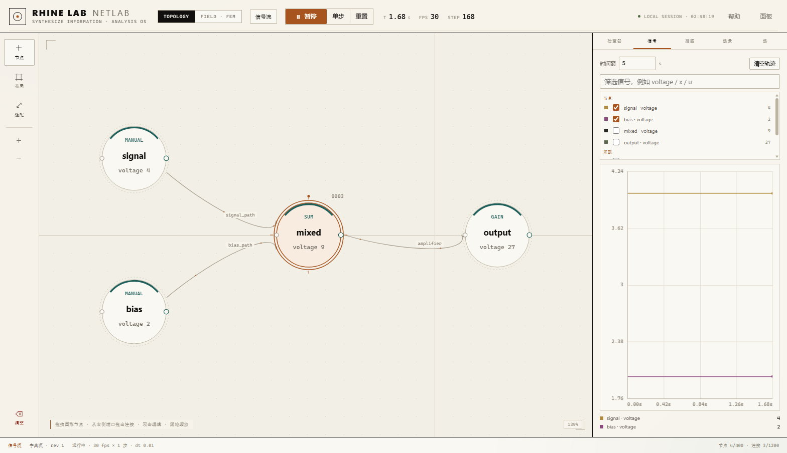
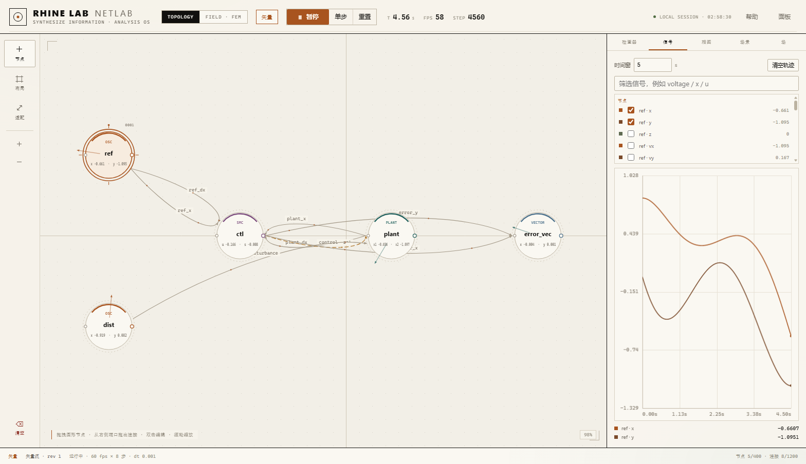

# RHINE LAB · NETLAB

> **节点拓扑、非线性动态、二维矢量与二维有限元场，放在同一个可操作的本地仿真台。**
> 纯本地运行：一个 Python 进程 + 一个浏览器页面，不依赖任何云服务或外网资源。



---

## 这是什么

Netlab 是一个面向电子与动态系统的交互式仿真工作台。它把三类完全不同的计算内核放进同一套界面与数据模型里：

| 工作区 | 计算内核 | 适合表达 |
| --- | --- | --- |
| **信号流 / 矢量** | 有向图，节点持有数据字典，连接是纯函数 | 信号链、滤波器、状态空间、非线性振子、相图 |
| **电路** | 节点电压法（MNA）+ Newton 迭代 | R/L/C、二极管、BJT/MOSFET、运放、比较器、逻辑门、555、变压器…… |
| **FIELD · FEM** | 二维 Q4 有限元瞬态热传导 | 方板温度场、Dirichlet 边界、实时色图 |

所有工作区共享：网格化画布、实时曲线、回放时间轴、工程文件（`*.netlab`，版本化 JSON）、扩展机制。

## 主要能力

- **电路求解器**
  - 梯形法 / 后向欧拉 / **Gear2（BDF2）** 三种积分方法
  - Newton-Raphson + gmin stepping + source stepping 自愈收敛
  - **稀疏矩阵**求解（节点数较大时自动启用，可手动强制）
  - **DC 工作点**（`.op`）与 **AC 小信号扫频 / Bode**（工作点线性化 + 复数 MNA）
- **元件库**：电阻、电容、电感、独立/受控源、二极管、稳压管、LED、开关、NPN/PNP、NMOS/PMOS、运放、比较器、D 触发器、逻辑门、555、LDO、计数器/移位寄存器、ADC/DAC、变压器与耦合电感
- **交互**：实时曲线、波形回放与时间轴拖拽、采样间隔、预计算窗口、工程保存/加载、画布模板与全局扩展
- **离线优先**：静态资源全部随包分发，无 CDN、无外部字体、无遥测



## 快速开始

需要 **Python 3.11+**（Windows / macOS / Linux 均可）。

```bash
python -m pip install -r netlab/requirements.txt
python -m netlab.run
```

浏览器会自动打开 <http://127.0.0.1:8010/>。Windows 也可以双击 `netlab/start.bat`。

常用参数：

```bash
python -m netlab.run --port 8020 --no-browser
```

桌面窗口版（可选，需要 PySide6）：

```bash
python -m pip install -r netlab/requirements-desktop.txt
python -m netlab.desktop
```

更完整的安装方式（含**完全离线安装**、局域网共享、防火墙设置）见 [INSTALL.md](INSTALL.md)。

## 浏览器内演示（无需安装）

在线版：<https://qgfn106-blip.github.io/NetLab/> —— 页面用 Pyodide（CPython 编译到 WebAssembly）在浏览器里直接加载 `web/netlab.zip` 中的求解器，跑一个 R–C 低通并绘图，全程没有后端服务器。首次打开需下载约 20 MB Pyodide 运行时（较慢），之后走浏览器缓存。

本地预览同一页面：`python -m http.server 8010 --directory web`。

## 目录结构

```
.
├─ netlab/                应用包（服务端 + 元件库 + 静态前端）
│  ├─ run.py              一键启动入口
│  ├─ desktop/            可选的桌面窗口壳
│  ├─ static/             原生 JS / CSS / HTML 前端（无构建步骤）
│  ├─ requirements.txt    运行依赖
│  └─ requirements-desktop.txt
├─ docs/assets/           README 截图
├─ web/                   浏览器内演示（Pyodide + GitHub Pages）
├─ library/               共享库（运行时生成，默认空）
├─ extensions/            扩展目录（运行时生成，默认空）
├─ README.md
├─ ARCHITECTURE.md        架构与数据流
├─ OPERATION.md           操作指南
└─ INSTALL.md             安装与离线部署
```

## 文档

- [ARCHITECTURE.md](ARCHITECTURE.md) —— 分层、场景数据模型、求解器与前端数据流
- [OPERATION.md](OPERATION.md) —— 界面速览、快捷键、建图/建电路、曲线与回放、工程文件
- [INSTALL.md](INSTALL.md) —— 安装、离线部署、局域网访问、故障排查

## 离线使用

Netlab 设计为**每人一份、本机运行**：服务只监听 `127.0.0.1`，你在自己电脑上打开 `http://127.0.0.1:8010/`，数据不出本机。

没有网络的电脑也能装：在有网机器上执行一次 `pip download` 把依赖 wheels 存成目录，拷过去后用 `--no-index --find-links` 安装，全程不联网。步骤见 [INSTALL.md](INSTALL.md#完全离线的电脑)。

## 许可

[MIT License](LICENSE)
