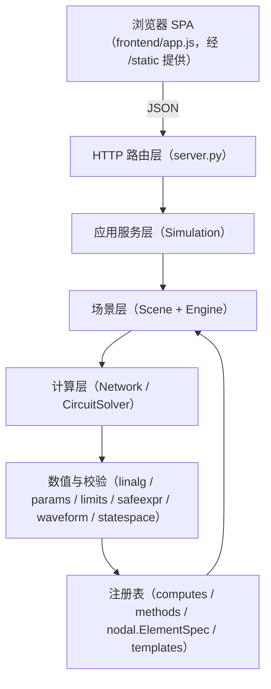
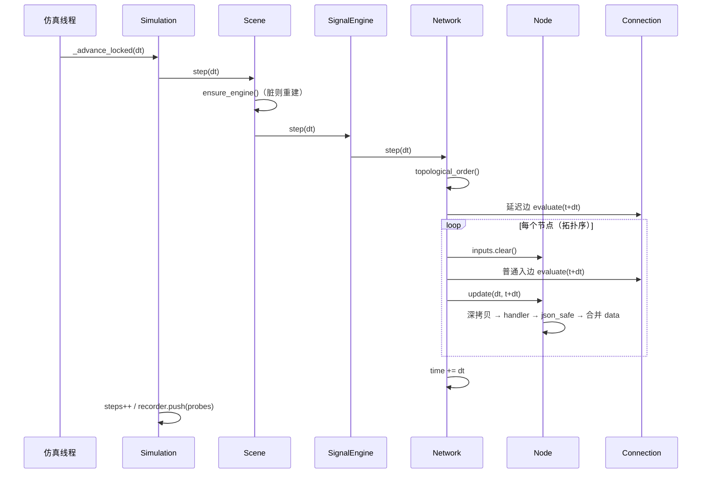

# Netlab 架构与运作原理

> 适用版本：`netlab 3.20.1`（Python 3.11+，FastAPI + NumPy/SciPy）
> 配套文档：[EXTENDING.md](EXTENDING.md) —— 新增节点、连接、元件、模板的分步指南；[EXTENSIBILITY_ARCHITECTURE.md](EXTENSIBILITY_ARCHITECTURE.md) —— 插件包、插件 API 与全栈扩展规范
> 目标：读完能回答三个问题——**代码怎么分层**、**一拍仿真怎么走完**、**改功能该动哪个文件**。

---

## 0. 怎么读这份文档

| 你的目的 | 建议顺序 |
| --- | --- |
| 第一次接手项目 | 1 → 2 → 3 → 5 → 7 |
| 想加一种节点/连接 | 8 → [EXTENDING.md](EXTENDING.md) 第 1、2 节 |
| 想加电路元件 | 5.7 → 8 → [EXTENDING.md](EXTENDING.md) 第 3 节 |
| 想改前端交互/画面 | 11 → [EXTENDING.md](EXTENDING.md) 第 8 节 |
| 线上报错/结果不对 | 12、15、16 |
| 要动代码 / 改文件 | 先读 [CODE_STANDARDS.md](CODE_STANDARDS.md)（Python black+flake8、前端 TypeScript+esbuild，D119 规范 SSOT） |

文档里的“文件/符号”都指源码中的真实名字，不用记行号，改版后仍然可搜。

---

## 1. 系统是什么

Netlab 是一个**单进程、单工作区**的交互式仿真台：

- **TOPOLOGY（拓扑网络）**：圆形节点 + 有向连接。节点持有数据字典，连接是纯函数。

TOPOLOGY 内部有 3 种模式，共用同一套 HTTP 与场景模型：

| 模式 | 计算内核 | 适合表达 |
| --- | --- | --- |
| `signal` | `graph.Network`（字典沿有向边传播） | 信号链、滤波器、状态空间、反馈回路 |
| `vector` | 与 `signal` **同一个** `SignalEngine` | 非线性振子、二维矢量、扩散耦合、相图 |
| `circuit` | `nodal.CircuitSolver`（MNA 节点电压法） | R/L/C、电源、二极管、开关、受控源，天然支持反馈 |

技术栈：

| 层 | 选型 | 说明 |
| --- | --- | --- |
| HTTP | FastAPI + Pydantic | 请求体 `extra="forbid"`，统一错误体 `{"detail": ...}` |
| 服务 | Uvicorn | `run.py` 负责端口探测与自动开浏览器 |
| 数值 | NumPy（必需）、SciPy（可选） | `linalg.py` 自带 Padé `expm`，不依赖 SciPy |
| 前端 | TypeScript（编译到 ES2020）+ Canvas | `frontend/app.ts` 等源码经 esbuild 构建为 `app.js`/`app.utils.js`/`desktop-shim.js`，无第三方运行时库 |
| 测试 | pytest + httpx/TestClient | 679 项回归用例（2026-11-08：678 passed / 1 skipped），覆盖数值、场景与 API |

运行形态：

```text
一个 Python 进程
├─ HTTP 线程（uvicorn）        ← 所有 REST 请求
├─ netlab-simulation 线程      ← 网络仿真，固定步长
└─ 共享内存：SERVICE 单例（一把 RLock）
```

**没有数据库、没有消息队列、没有用户系统。** 场景只在内存里，重启即回到默认信号链。

---

## 2. 目录与模块职责

> 结构图：[docs/assets/netlab-structure.svg](../../docs/assets/netlab-structure.svg)

> **2026-11-02 结构整理后**（D79/D85）：前后端彻底分目录；后端按“计算 / 模型 / 公共”三类放进 `netlab/core/` 的子文件夹。旧的 `netlab/<name>.py` 转发 shim 已在 D85 全部删除，仓库内所有引用改写为规范路径 `netlab.core.<bucket>.<name>`；包根只留入口与适配模块。

```text
NetlabHome/
├─ frontend/                  ★ 前端（浏览器侧：TS 源 + esbuild 产物，另有 package.json/tsconfig.json）
│  ├─ index.html              两工作区外壳
│  ├─ style.css               纸白/黑墨/铜色主题
│  ├─ app.ts / app.js         前端逻辑源码（app.ts，另有 app.utils.ts；esbuild 编译为 app.js/app.utils.js）：画布、交互、动态表单、信号图、相图、渲染
│  └─ desktop-shim.ts/.js     桌面壳注入（desktop-shim.ts → desktop-shim.js）：无边框窗控、拖拽区
│
├─ netlab/                    后端 Python 包
│  ├─ run.py                  启动入口：参数、端口探测、延迟打开浏览器
│  ├─ __init__.py             包门面：导出 Network / Node / Connection / Scene / NetlabError
│  ├─ server.py               FastAPI 路由、Pydantic 请求模型、前端目录解析
│  ├─ plotkit_bridge.py       PlotKit 子应用挂载 + 源码定位（ensure_plotkit_importable）
│  ├─ desktop/                桌面壳：webview_app / webview_bridge / server_host
│  │
│  ├─ core/
│  │  ├─ common/              （2）跨层公共
│  │  │  ├─ limits.py         ★ 输入边界：异常类型、数值/名称/JSON 校验、硬上限常量
│  │  │  └─ fastcopy.py       状态快拷贝工具（只读路径加速）
│  │  │
│  │  ├─ compute/             （26）底层计算内核——不含任何 I/O、HTTP、UI
│  │  │  ├─ simulation.py     ★ 固定步长线程、SimConfig、Recorder、增量查询
│  │  │  ├─ nodal.py          ★ 电路层：MNA 求解器 + 39 种元件 + ElementSpec
│  │  │  ├─ linalg.py         线性求解、Padé expm、连续→离散（ZOH/Tustin/欧拉）
│  │  │  ├─ statespace.py    x'=Ax+Bu, y=Cx+Du 与四种离散化
│  │  │  ├─ computes.py       ★ 节点计算注册表（22 种 kind）
│  │  │  ├─ methods.py        ★ 连接函数注册表（12 种 kind）
│  │  │  ├─ circuit_modules.py 电路封装/展开、端口标记与合并
│  │  │  ├─ digital.py / logic.py / transistors.py / magnetics.py / powerelectronics.py
│  │  │  ├─ schematic_export.py 电路场景 → SchemDraw 原理图导出（可选依赖）
│  │  │  ├─ waveform.py / params.py / safeexpr.py / telemetry_quality.py
│  │  │  └─ accel.py / analysis.py / analysis_plugins.py / introspection.py / profiling.py / timers.py / complex_support.py / fields.py
│  │  │
│  │  └─ model/               （17）连接与场景模型——定义“网络长什么样”
│  │     ├─ graph.py          ★ 信号层运行时：Node / Connection / Network
│  │     ├─ scene.py          ★ 场景层：NodeRecord/EdgeRecord、Scene、SignalEngine、CircuitEngine
│  │     ├─ networks.py       ★ 多网络容器：当前网络、增删改、降级只读、工程打包
│  │     ├─ project.py        ★ .netlab 工程文件：构建/校验/迁移/原子写/校验和
│  │     ├─ workspace.py      ★ 工作区目录、共享库、快照、用户设置
│  │     ├─ blocklib.py / blocks.py / block_behavior.py / block_validate.py / extensions.py / plugins.py / builtins.py / engine_registry.py
│  │     ├─ ports.py / schematic.py / ui_profile.py（R40 netlab-ui/1 视图配置）
│  │     └─ templates.py      16 个可复现场景（builder + SIM_PRESETS）
│  │
│  ├─ tests/                  conftest.py + test_*.py（2026-11-08 全量 678 passed / 1 skipped）
│  ├─ docs/                   截图 + 文档（本文件、CODE_GUIDE、MATH…）
│  └─ tools/                  可选 Edge CDP 冒烟脚本 / 结构整理脚本
└─ （无兼容层）netlab/ 包根只剩 __init__ / server / run / plotkit_bridge / plotkit_vendor / vscode_bridge / cache_guard / desktop / core
```

带 ★ 的是“改功能时最常碰”的模块。依赖方向只有一个：

```text
server.py / desktop/*
  └─ core.model.networks ── core.model.project
       └─ core.model.workspace ── core.model.project
            └─ core.compute.simulation
                 └─ core.model.scene
                      ├─ core.model.graph  ← core.compute.computes / core.compute.methods
                      ├─ core.compute.nodal
                      └─ core.compute.{params,limits,linalg,waveform,statespace}
```

三条边界：

- **frontend 只经 HTTP 访问后端**（`/api/*`、`/plotkit/*`）；后端不知道前端的任何 DOM 结构。
- **core 不 import server / desktop / frontend**；计算层不碰 I/O。
- `graph.py`、`nodal.py` **不 import `scene.py`**；注册表只依赖参数与校验层。新增功能保持这个方向，循环 import 就不会出现。

`project.py` 的 `build_project_for()` 按对象分派：`NetworkContainer` 用自己的 `build_project()` 打包全部网络，普通 `Simulation` 走单场景构建；`networks.py` 反向 import 构建函数，因此 `project.py` 对容器只做 `TYPE_CHECKING` 注解。

---

## 3. 分层架构



| 层 | 职责 | 不允许做的事 |
| --- | --- | --- |
| 前端 | 渲染、交互、把 catalog 变成表单 | 执行用户代码、拼 HTML |
| 路由 | 解析请求、调服务、映射异常 | 直接改 `Scene` 内部字段 |
| 服务 | 锁、线程、节拍、录制、快照 | 做具体数值计算 |
| 场景 | 记录 ↔ 运行时对象、参数归一化、环检测 | 自己起线程 |
| 计算 | 单步数值推进 | 读写 HTTP/UI 状态 |
| 数值/校验 | 纯函数与小工具 | 持有全局可变状态 |

---

## 4. 启动过程

```text
python run.py
  ├─ setup_console()                  Windows 控制台 UTF-8
  ├─ parse_args()                     --host/--port/--no-browser/--log-level
  ├─ socket.create_server(host,port)  端口占用时给出中文提示并退出 1
  ├─ 打印 URL，线程里轮询 /api/health 后再 webbrowser.open
  └─ import netlab.server
       ├─ STATIC_DIR = FRONTEND_DIR（NetlabHome/frontend/，保留旧名兼容）
       ├─ SERVICE = default_simulation()
       │    ├─ Scene("signal")
       │    ├─ scene.load_payload(build_template("signal_chain"))
       │    ├─ Simulation(scene)
       │    └─ apply_config(fps=30, dt=0.01, steps_per_frame=1)
       ├─ FastAPI(title=..., lifespan=lifespan)
       ├─ 注册异常处理器与全部路由
       └─ uvicorn.run(app, ...)
            └─ lifespan 启动时：
                 SERVICE.ensure_thread()   线程存在但 running=False
```

要点：

- **默认场景不是空场景**，打开页面就能看到 4 V / 2 V → 9 V → 27 V 的信号链。
- 仿真线程在启动时就创建，但只有收到 `run` 后 `running` 才为 `True`，空闲时每 8–10 ms 轮询一次标志位。
- 前端 `boot()` 并行拉 `/api/catalog` 与 `/api/state`，然后首次 `fitView()`、启动轮询。

`lifespan` 的退出路径会 `SERVICE.shutdown()`，join 仿真线程（2 s 超时）。

---

## 5. 一拍仿真是怎么走完的

这是理解整个后端的核心。以 TOPOLOGY 为例。

### 5.1 线程循环：`Simulation._loop`

```python
while not stop:
    with lock:
        running, fps, steps_per_frame, dt, sample_every, realtime = 读配置
    if not running:
        sleep(0.008); continue

    started = perf_counter()
    with lock:
        for _ in range(steps_per_frame):
            if not _advance_locked(dt, sample_every):
                break
        _frame_times.append(started)      # 每秒滑窗统计实际 fps
    if realtime:
        sleep(剩余时间)                    # 关闭 realtime 则全速迭代
```

`_advance_locked` 做三件事：

1. `scene.step(dt)`；
2. `time += dt`、`steps += 1`；
3. 命中 `sample_every` 时 `recorder.push(time, scene.probes())`。

任何异常都会 `_record_error`：写入 `error / error_at`，把 `running` 置 `False`，**保留现场**等待用户修复。前端横幅显示的就是这条错误。

### 5.2 `Scene.step` → 引擎

```text
Simulation._advance_locked
  └─ Scene.step(dt)
       ├─ ensure_engine()    # _engine 为空或 _dirty 时重建
       │    ├─ mode == "circuit" ? CircuitEngine(self)
       │    └─ 否则               SignalEngine(self)
       ├─ engine.step(dt)
       ├─ 记录 last_step_ms
       └─ engine.stats() + step_ms
```

`_dirty` 在**结构/参数变化**时置位（`Scene._touch()`）：增删节点/连接、改名称、改 kind、改参数、切换积分方法。只改坐标不会标脏，只 `revision += 1`，所以拖动节点不会重建引擎。

### 5.3 `SignalEngine.step` → `Network.step`

`SignalEngine` 在构造时把记录装配成运行时对象：

```text
NodeRecord  →  Node(name, data, state, inputs, params, kind, handler)
EdgeRecord  →  Connection(source, target, method, params, state, kind, delay)
```

注意 **`data` / `state` 字典按引用共享**：记录与运行时对象指向同一个 dict，所以每一步结果直接回写到记录，界面 `runtime_state()` 无需额外同步。`inputs` 也是共享的，但每步会先清空。

`Network.step(dt)` 的顺序是固定的：

```text
1. 校验 dt：必须是正的有限数
2. 取拓扑序（有缓存，结构变化时 invalidate）
3. 延迟边统一求值：此时所有节点仍是上一拍的值 → 输出严格等于 z⁻¹
4. 按拓扑序遍历节点：
     a. node.inputs.clear()
     b. 对每条入边：
          - 延迟边：取第 3 步缓存的输出
          - 普通边：connection.evaluate(dt, time+dt)
     c. node.update(dt, time+dt)
5. network.time += dt
```

关键设计：

- **连接不直接写目标节点的 `data`**。它把结果写进 `node.inputs[连接名]`，由节点自己的 handler 决定怎么用。这样“边”和“节点”的职责不会混。
- **延迟边不参与拓扑排序**（只参与入边收集），所以反馈回路只会被延迟边切断，不会形成无解环。
- **延迟边先于所有节点求值**，因此与节点遍历顺序无关，严格等于上一拍。
- 普通边在源节点已更新后求值（拓扑序保证），所以同一拍内数据是“新鲜”的。

### 5.4 数据隔离：深拷贝与只读视图

| 位置 | 保护方式 | 目的 |
| --- | --- | --- |
| `Node.update` | `inputs` / `data` 深拷贝后传给 handler | handler 改副本不会污染现场 |
| `Connection.evaluate` | `NodeView` + `MappingProxyType` | 连接函数只能读端点数据与参数 |
| 参数 | `validate_params` 预校验并补默认值 | 工厂闭包拿到的一定是合法值 |
| 返回值 | `json_safe` | 拒绝 NaN/Inf、非法类型、过大结构 |
| 节点状态 | `state` 直接按引用传入 | 积分器、滤波器需要跨步保存历史 |

副作用：深拷贝意味着每步都有分配开销。当前规模（≤400 节点、≤1200 连接）下可接受；若要跑更大网络，这是第一个要优化的点。

### 5.5 代数环

两条路径都会检测：

1. `Scene.add_edge`：非电路模式下，若新边会形成环，默认 `auto_delay=True` 自动改为延迟边；`auto_delay=False` 时抛 409。
2. `Network.topological_order`：若排除延迟边后仍有环，用 Tarjan 找强连通分量，抛 `ComputeError` 并给出 `a→b→a` 的可读路径。

导入场景时，`Scene.load_payload` 会为 **signal 模式**自动把成环的边设为延迟；注意它**不会为 vector 模式做这件事**（见第 17 节）。

### 5.6 探针与录制

`Scene.probes()` 返回扁平的 `dict[str, float]`，键名是前端解析的契约：

```text
n:<节点名>:<字段>     例：n:mixed:voltage
e:<连接名>:<字段>     例：e:signal_path:voltage
```

- `SignalEngine.probes`：每个节点最多 6 个有限数值字段，每条边最多 4 个；总数超过 240 截断。
- `CircuitEngine.probes`：每个节点固定 `voltage`，每条元件取 `current` / `voltage_difference` / `power`。
- `Recorder` 是 `deque(maxlen=1200)`，每帧存 `{seq, t, v}`；`seq` 单调递增。
- `/api/live?cursor=N` 只返回 `seq > N` 的帧，最多 600 条；前端用 cursor 做增量拉取。

### 5.7 电路模式：`CircuitEngine` → `CircuitSolver`

电路不走拓扑排序，而是一步解一个线性/非线性方程组：

```text
未知量 = 所有非接地节点电压 + 需要支路电流的元件（独立电压源、VCVS）
每一拍：
  for element: element.prepare(dt, time)     # 波形值、伴随模型系数
  if 有非线性元件（二极管）：
      最多 60 次 Newton：
          A, rhs 清零
          for element: element.stamp(ctx)    # 把贡献盖进 MNA 矩阵
          检查悬空节点（整行为 0 → 可读错误）
          solve_linear(A, rhs)
          收敛判据（绝对/相对）
          for 非线性元件: update_guess(ctx)  # 限制结电压
  else 只解一次
  for element: commit(ctx)                   # 计算 current/电压差/功率
  element.state.update(element.result)
  写回 node_voltages
```

要点：

- 元件通过 `stamp` 往 `ctx.A` / `ctx.rhs` 盖章；`_stamp_conductance` / `_stamp_current` 是现成工具。
- 电容/电感在 `prepare` 里按积分方法生成伴随电导与历史电流源，`commit` 里更新 `state.v` / `state.i`。
- 二极管是 `nonlinear=True`，`update_guess` 里做 PN 结电压限幅，避免指数区过冲。
- 电路模式**禁止延迟边**、禁止自环；每个电路必须且只能有一个 `ground` 节点。
- 常见错误都有中文提示：悬空节点、奇异矩阵、两个接地、未收敛、电压超过 1e9 V 发散。

### 5.7.1 跨域桥：signal ↔ circuit（R31 P11-05）

`CircuitEngine.step()` 在 MNA 求解前后各加一步，形成显式一拍延迟：

```text
每一拍：
  _apply_bridge_actuators()   # 读 signal 侧上一拍值 → 写 actuator 源
  solver.step(dt)             # 纯电路 MNA；不反向影响 signal
  写回 node_voltages
  _sample_bridge_sensors()    # sensor 高阻采样 → 写 record.data[signal]
```

- `sensor`：`SensorElement` 以 `1e-12` 高阻跨接在 IN/GND 上，MNA 解后把节点电压写入 `record.data["voltage"]` 与 `record.data[signal]`；不改变原电路方程。
- `actuator`：`ActuatorSource` 继承电压源，`prepare()` 从 `state["drive"]` 读取 signal 侧上一拍值，输出 `gain*signal + offset`；因此信号必须先于电路一步产生驱动，不能同拍直通。
- 旧工程没有 `sensor`/`actuator` 时，桥列表为空，`CircuitEngine.step` 的额外两步是空操作，行为与 checksum 均不变（`test_circuit_bridge.py` 覆盖）。

### 5.8 一拍时序（signal/vector）



---

## 6. HTTP 请求的生命周期

### 6.1 两类请求

**读请求**（`GET`）直接在锁内取快照：

| 接口 | 返回 | 频率 |
| --- | --- | --- |
| `/api/state` | 完整场景 + sim 信息 + limits | 启动、变更后、运行中每 4 s |
| `/api/live` | 增量帧 + cursor + sim 信息 | 运行中约 110 ms |
| `/api/catalog` | 节点/连接/元件/积分/模式/模板/上限 | 页面加载一次 |

**写请求**（`POST/PATCH/DELETE`）统一走 `SERVICE.mutate` 模式：

```python
record = SERVICE.mutate(
    lambda scene: scene.add_node(name=..., kind=..., params=..., data=...)
)
```

`Simulation.mutate` 的语义是：

```python
with self.lock:
    result = function(self.scene)   # 在锁内改场景
    self.scene.ensure_engine()      # 立即重建/校验，错误在本次请求内暴露
    return result
```

因此：

- 参数错误、拓扑错误都会以 4xx 返回，不会等到下一帧才炸。
- 写操作之间天然串行；前端再用 `task()` 的单飞标志避免连点。
- 写操作返回的一般是**新快照**（有的接口只返回 `{node, sim, revision}`），前端直接 `applySnapshot` 或局部更新。

### 6.2 错误模型

所有可预期错误继承 `limits.NetlabError`，带 HTTP 状态码：

| 异常 | 状态码 | 典型场景 |
| --- | --- | --- |
| `ValidationError` | 422 | 类型/范围/未知参数/名称非法 |
| `NotFoundError` | 404 | 节点、连接、模板不存在 |
| `ConflictError` | 409 | 名称重复、会成环、第二个接地 |
| `LimitError` | 413 | 超过节点/连接/字段上限 |
| `ComputeError` | 422 | 代数环、悬空、奇异、未收敛、发散 |

`server.py` 的异常处理器把它们转成 `{"detail": "..."}`；Pydantic 校验错误会被汇总成 `"loc: 消息；..."`，最多 5 条。

### 6.3 请求模型

Pydantic 模型全部 `extra="forbid"`，未知字段直接 422；`NodeUpdate` / `EdgeUpdate` 用 `exclude_unset=True` 区分“没传”和“传了 null”。这是“改一半”能安全工作的前提。

### 6.4 快照结构

`/api/state` 顶层：

```text
{
  "scene": {
    "mode": "signal|circuit|vector",
    "integration": "trapezoidal|backward_euler",
    "revision": int,
    "nodes": [{id,name,kind,params,data,state,inputs,position}],
    "edges": [{id,name,source,target,kind,params,state,delay,enabled,output}],
    "stats": {mode, revision, step_ms, node_count, edge_count, ...engine stats}
  },
  "sim": {
    running, time, steps, actual_fps, steps_per_second,
    config, scene: stats, error, error_at,
    frames_recorded, cursor, probe_keys
  },
  "limits": {"max_steps": 1000}
}
```

`/api/live` 顶层：`{frames, cursor, oldest, keys, sim}`，每帧 `{seq, t, v}`。

---

## 7. 数据模型与状态归属

### 7.1 三层对象

| 层 | 类型 | 存在哪里 | 作用 |
| --- | --- | --- | --- |
| 持久记录 | `NodeRecord` / `EdgeRecord` | `Scene.nodes` / `Scene.edges`（按 id） | 可序列化、可导入导出、界面快照 |
| 运行时 | `Node` / `Connection` / `CircuitElement` | 引擎内部（按 name） | 每步计算，持有闭包与数值状态 |
| 传输 | `dict` | JSON | 前后端契约 |

**id 与 name 的分工**：

- `id` 是 12 位十六进制（导入时可用 `[0-9a-fA-F-]{1,40}`），用于 CRUD 与 UI 选择，永不变。
- `name` 是用户可见、场景内唯一，用于运行时连接键、探针键 `n:name:field`。
- 改名会 `_touch()`，下一帧重建引擎，运行时按新名字重新装配。

### 7.2 字段语义

`NodeRecord`：

| 字段 | 含义 |
| --- | --- |
| `id` | 主键 |
| `name` | 唯一名，探针键的一部分 |
| `kind` | 计算类型，对应 `COMPUTE_SPECS` 的 key（电路模式为 `node`/`ground`） |
| `params` | 已校验的参数，工厂闭包的输入 |
| `data` | 节点当前数据字典，handler 的输出合并到这里 |
| `state` | 跨步历史（积分累计、滤波器状态、振子 x/y/z…） |
| `inputs` | 上一步各入边的输出（调试/展示用） |
| `position` | 画布坐标，只影响显示 |

`EdgeRecord`：

| 字段 | 含义 |
| --- | --- |
| `id` / `name` / `source` / `target` | 身份与端点 |
| `kind` | 连接函数或电路元件类型 |
| `params` | 已校验参数 |
| `state` | 该边独立历史（延迟值、滤波器抽头、电容电压…） |
| `delay` | 单步延迟标记（电路模式恒为 False） |
| `enabled` | 停用后不参与计算 |

### 7.3 状态归属

| 状态 | 存放位置 | 谁写 | 生命周期 |
| --- | --- | --- | --- |
| 节点动态历史 | `NodeRecord.state` = `Node.state` | 节点 handler | `reset` 清空；改 kind 清空 |
| 连接动态历史 | `EdgeRecord.state` = `Connection.state` | 连接函数 / 元件 | `reset` 清空；改 kind 清空 |
| 连接本拍输出 | `Connection.output` | `evaluate` | 每步覆盖 |
| 仿真时间/步数 | `Simulation.time/steps` | 仿真线程 | `reset` 归零 |
| 录制帧 | `Simulation.recorder` | 仿真线程 | `reset` 清空 |

**不要在 `data` 里放跨步状态**：`data` 会被界面编辑、导出、深拷贝；跨步量必须放 `state`。

### 7.4 JSON 边界

所有来自 HTTP 的数据先过：

```text
Pydantic（类型/必填）
  → Scene 参数归一化（validate_params）
  → json_safe（只允许 JSON 原生类型；拒绝 NaN/Inf、控制字符、超深嵌套、超大数组）
```

`json_safe` 同时用于 handler 返回值与连接输出。这意味着：

- 自定义 handler 返回 `numpy.float64` 会失败，**先 `float(...)`**。
- 返回 `set`、`bytes`、自定义对象会失败。
- 数值必须在 `±1e15` 内，数组长度与矩阵尺寸受 `limits.py` 限制。

---

## 8. 注册表与 catalog：扩展的骨架

项目里所有“可增加的种类”都由注册表驱动，新增一种类型通常**不需要动前端**。

### 8.1 四个注册表

| 注册表 | 位置 | 条目类型 | 数量 | 用途 |
| --- | --- | --- | --- | --- |
| `COMPUTE_SPECS` | `computes.py` | `ComputeSpec` | 22 | 节点计算方式 |
| `METHOD_SPECS` | `methods.py` | `MethodSpec` | 12 | 连接函数 |
| `ELEMENT_SPECS` | `nodal.py` | `ElementSpec` | 39 | 电路元件 |
| `TEMPLATES` | `templates.py` | dict + builder | 16 | 场景模板 |

### 8.2 规格对象长什么样

```python
@dataclass(frozen=True)
class ComputeSpec:
    kind: str                 # 唯一 key，前后端都靠它
    label: str                # 界面显示名
    group: str                # 分组（基础/动态/高级/矢量/信号/电路/数学）
    description: str          # 检查器里的说明
    params: tuple[ParamSpec, ...]
    factory: Factory          # 参数 → handler 或 None
    outputs: tuple[str, ...]  # 输出字段提示（文档/调试用）
    notes: str = ""           # 额外说明（状态字段、限制…）
```

`MethodSpec` 形状相同，`factory` 返回连接函数；`ElementSpec` 多一个 `cls`，`factory` 由 `create_element` 内部完成。

注册方式：

```python
register(ComputeSpec(...))                 # computes / methods
ELEMENT_SPECS["fuse"] = ElementSpec(...)   # nodal：直接写 dict
TEMPLATES["my_template"] = {...}           # templates：直接写 dict
```

`register` 会拒绝重复 `kind`（抛 `RuntimeError`），避免不同模块静默覆盖。

### 8.3 装配链路

```text
前端打开
  └─ GET /api/catalog
       └─ Scene.catalog()
            ├─ compute_catalog()   → [{kind,label,group,description,outputs,notes,params}]
            ├─ method_catalog()
            ├─ element_catalog()
            ├─ node_catalog()      → 电路模式的 node / ground
            ├─ integration_methods()
            └─ modes / limits
  ← 前端 state.catalog
       ├─ 添加菜单：按 group 列出 kind
       ├─ 检查器：buildParamFields(spec, params)
       └─ 每个 ParamSpec 决定控件类型与范围

用户点“应用”
  └─ PATCH /api/nodes/{id}
       └─ Scene.update_node
            └─ _normalize_node_params
                 └─ validate_params(spec.params, raw)   # 服务端权威校验
```

因此**只要注册表正确，前端表单会自动出现**；服务端再校验一次，形成双保险。

### 8.4 ParamSpec 类型与前端控件

| `type` | 前端控件 | 关键字段 |
| --- | --- | --- |
| `float` | number | `min/max/step/unit/positive` |
| `int` | number（step=1） | `min/max` |
| `bool` | checkbox | — |
| `choice` | select | `choices=(("value","标签"),...)` |
| `text` | text | `placeholder` |
| `json` | textarea + JSON 校验 | `default/help` |
| `matrix` | textarea（高） | `max_size` |
| `list` | textarea | — |
| `mapping` | textarea | 键必须是非空字符串 |
| `node` | select（列出场景节点） | 值是节点 id |

`ParamSpec.coerce` 是唯一权威转换；`to_dict` 是传输格式。**新增参数类型必须同时改这两处和前端 `buildParamField` / `collectParamValues`**，否则会出现“能提交但界面不认”或反之。

### 8.5 模板注册表

`TEMPLATES` 的条目是 `{label, mode, description, builder}`；`SIM_PRESETS` 单独给每个模板一组 `{fps, dt, steps_per_frame}`。`build_template(name)` 返回：

```json
{
  "mode": "signal",
  "nodes": [...],
  "edges": [...],
  "sim": {"fps": 30, "dt": 0.01, "steps_per_frame": 1}
}
```

注意：`Scene.load_payload` **忽略 `sim`**；`Simulation.load_scene` 在场景装好后读取 `payload["sim"]` 并 `apply_config`。两段逻辑分开，模板可以只描述拓扑。

### 8.6 插件包与全栈扩展（首版已实现）

四个注册表仍是内置扩展骨架；面向用户的可分发扩展升级为 **plugin package + `netlab.plugin_api.v1`**：

- 插件通过 `plugin.json` 声明 id、版本、API、能力、依赖、入口；
- compute/method/element/analysis/data-format/template/panel 全部走稳定门面；
- 自定义求解引擎只能注册为新 mode，`EngineProtocol` 固定为 `build/step/reset/probes/stats`；
- `NodeRecord`/`EdgeRecord` 核心字段不变，插件私有持久化数据只进 `ext[plugin_id]`；
- 工程 `format_version` 已升 6，新增 `plugins` 锁段；缺插件时降级打开并标“未解析”；
- UI 增加简洁画布与视图内设计，配置存为 `netlab-ui/1` profile。

完整规范与验收矩阵见 [EXTENSIBILITY_ARCHITECTURE.md](EXTENSIBILITY_ARCHITECTURE.md)，决策见 [adr/0002-plugin-extension-architecture.md](adr/0002-plugin-extension-architecture.md)。

---

## 9. 三种模式的差异

| 维度 | `signal` | `vector` | `circuit` |
| --- | --- | --- | --- |
| 运行时引擎 | `SignalEngine` | `SignalEngine`（同一个） | `CircuitEngine` |
| 节点 kind 来源 | `COMPUTE_SPECS` | `COMPUTE_SPECS` | 固定 `node` / `ground` |
| 边 kind 来源 | `METHOD_SPECS` | `METHOD_SPECS` | `ELEMENT_SPECS` |
| 求解方式 | 拓扑序逐节点 | 同左 | 每步解 MNA 方程 |
| 反馈 | 必须至少一条延迟边 | 同左 | 天然支持，无延迟 |
| 自环 | 需延迟 | 需延迟 | 禁止 |
| 导入时自动加延迟 | **是** | **否** | 不适用 |
| 探针 | 节点最多 6 字段 + 边最多 4 字段 | 同左 | 节点电压 + 元件 3 字段 |
| 前端特色 | 信号图 | 相图、矢量箭头 | 元件参数、矩阵大小、Newton 次数 |
| 推荐 kind | 基础/动态/高级 | `group == "矢量"` 排前 | 39 种元件 |

### 9.1 为什么 vector 和 signal 共用一个引擎

矢量层的本质仍是“节点持有 `x/y/vx/vy`，边传递差分或变换”，没有新的求解语义。共用引擎的收益：

- 延迟、拓扑排序、数据隔离、录制逻辑只维护一份；
- 模板、导入导出、API 全部复用；
- 相图只是前端对 `x/y`、`vx/vy` 的另一种画法。

差异只体现在：

1. `Scene.catalog()` 里 `modes` 的标签与描述；
2. 前端 `kindListFor` 把 `group === "矢量"` 排到前面；
3. 相图面板读取节点数据中的 `x/y` 或 `vx/vy`；
4. 画布对矢量节点多画一支箭头；
5. 模板默认配置不同（`SIM_PRESETS`）。

### 9.2 电路模式的关键约束

- 必须恰好一个 `ground`；两个接地 → 422，没有接地 → 422。
- 元件端点不能相同；电压源两端都接地 → 422。
- 不能有悬空节点（某行全 0）→ 422，提示“没有任何直流通路”。
- 非线性元件存在时走 Newton；60 次不收敛 → 422。
- 电压超过 `1e9 V` 判为发散。
- 延迟边在电路里没有意义，添加会被拒绝。

### 9.3 模式切换的副作用

`POST /api/mode` 不是“保留当前场景换引擎”，而是**载入对应的空白模板**：

```python
name = {"signal": "blank_signal", "circuit": "blank_circuit", "vector": "blank_vector"}[mode]
SERVICE.load_scene(build_template(name))
```

所以切换模式会清空当前场景（前端有确认弹窗）。要保留工作，先导出 JSON。

> 已知小问题：`POST /api/scene/clear` 只区分 `signal` 与“其他”，vector 会落到 `blank_circuit`。如果你在改模式相关逻辑，这里值得顺手修正。

---

## 11. 前端架构

`frontend/app.ts` 是前端逻辑源码（esbuild 编译为 `app.js`），按注释分成 10 个主段，另有 6.5 / 8.5 / 8.6 / 8.7 等小节（行号为 `app.ts` 分区起点）：

| 段 | 内容 | 关键函数 |
| --- | --- | --- |
| 0 | 常量、DOM 引用、`state`、小工具 | `el/div/button/fmt/clamp` |
| 1 | 请求与提示 | `api`（15 s 超时）、`jsonRequest`、`toast`、`showBanner`、`task`（单飞） |
| 2 | 快照同步与全局 UI | `applySnapshot`、`syncUI`、`updateModeUI`、`ingestFrame` |
| 3 | 画布尺寸、视图、渲染 | `resizeGraph`、`worldToScreen`、`drawGraph`、`drawNodes`、`drawEdges`、`animationLoop` |
| 4 | 画布交互 | `bindCanvas`、`onPointerDown/Move/Up`、`onWheel`、`flushPositions` |
| 5 | 弹层与模态 | `openAddMenu`、`openLinkMenu`、`confirmModal`、`showHelp` |
| 6 | 检查器动态表单 | `buildParamField`、`renderNodeInspector`、`renderEdgeInspector`、`applyInspector` |
| 6.5 | 规格查看与 Python 扩展面板 | `renderSpecPane`、扩展面板 |
| 7 | 节点/连接/场景变更 | `addNodeAt`、`createEdge`、`deleteNode`、`autoLayout` |
| 8 | 场景面板 | `renderScenePanel`、`applySimConfig`、`switchMode`、`loadTemplate`、`importSceneFile` |
| 8.5 | 工程文件 `.netlab` | 保存/打开/自动保存/最近/信任确认 |
| 8.6 | 外壳菜单栏 / 左侧网络栏 / 顶部信息条（R08） | 菜单栏、网络切换、状态信息条 |
| 8.7 | 模块库面板（R02） | 模块/扩展库卡片与拖放 |
| 9 | 信号图、相图、轮询 | `renderSignalList`、`drawChart`、`drawPhase`、`pollLive`、`pollLoop` |
| 10 | 控制、快捷键、启动 | `control`、`shutdownApp`、`bindStaticEvents`、`boot` |

### 11.1 状态与数据流

```text
state.scene   ← /api/state 或写操作返回的 scene
state.sim     ← /api/state、/api/live、/api/control 的 sim
state.catalog ← /api/catalog（只加载一次）
state.frames  ← /api/live 增量，本地最多 5000 帧
state.nodeValues / edgeValues ← 从帧键解析出的最新值，用于节点/边上的实时数字
state.selection / inspectorDirty / view / drag … ← 纯 UI 状态
```

刷新节奏：

| 数据 | 触发 | 周期 |
| --- | --- | --- |
| `/api/live` | `pollLoop` | 运行中 110 ms，暂停 500 ms |
| `/api/state` | 启动、写操作、运行中 | 4 s 一次（只在 running 时） |
| 图表/相图重绘 | `scheduleChartDraw` / `schedulePhaseDraw` | 约 70–80 ms 节流 |
| 画布重绘 | `requestDraw` → `requestAnimationFrame` | 每帧最多一次 |

### 11.2 渲染

- 画布按 `devicePixelRatio`（限制 1–2.5）缩放，交互命中在屏幕坐标做。
- `state.needsDraw` 控制按需重绘；`animationLoop` 只在需要时画。
- 边先做包围盒剔除；超过 220 条边关闭流动光点。
- 所有用户文本用 `textContent` / `value` 写入；画布文字由 Canvas API 绘制，不存在 HTML 注入。

### 11.3 动态表单

检查器完全由 catalog 驱动：

```text
getNodeSpec(kind) / getEdgeSpec(kind)
  → buildParamFields(spec, params)
       → 每个 ParamSpec → buildParamField（float/choice/json/…）
用户点“应用”
  → collectParamValues(container)  # 前端先做一次类型/JSON 检查
  → PATCH /api/nodes/{id} 或 /api/edges/{id}
  → 服务端 validate_params 再校验
  → applySnapshot / 局部更新
```

`getNodeSpec` / `getEdgeSpec` 只查 catalog；所以新增 kind 后表单自动出现，前提是 `ParamSpec` 与前端支持的类型一致。

### 11.4 启动顺序

```text
boot()
  ├─ bindStaticEvents() / bindCanvas() / 尺寸
  ├─ ResizeObserver + window.resize
  ├─ requestAnimationFrame(animationLoop)
  ├─ Promise.all([/api/catalog, /api/state])
  ├─ applySnapshot → renderScenePanel / renderSignalList / renderInspector
  ├─ fitView()
  ├─ 若已有录制游标 → pollLive()
  ├─ pollLoop()（220 ms 后）
  ├─ stateTimer（4 s）
  └─ maybeAutostart()：每个标签页会话只自动运行一次
```

### 11.5 新增 UI 能力（2026-11）

- **多窗口周期推荐（R11）**：后端 `analysis._period_windows()`（`netlab/core/compute/analysis.py:257`）与 `recommend_period()`（`:266`）用「全窗/前后子窗平移一致性」打分，返回 `score_std`（`:308`）/`period_std`（`:332`）；路由 `GET /api/analysis/period`（`netlab/server.py:1725`）；前端 `runAnalysisPeriod()`（`frontend/app.ts:11894`）、「周期」按钮（`app.ts:12568`）。
- **帮助面板全局搜索（R14）**：前端 `showHelp()`（`app.ts:5006`）调用 `GET /api/help/search`（`netlab/server.py:462`），支持分组结果。
- **Bode 光标/拖动读数（R34）**：`drawTFBode()`（`app.ts:12034`）、`tfBodeCursorFromEvent()`（`:12168`）、`attachTfCursor()`（`:12200`），在幅频/相频曲线上取点显示频率与幅相。
- **视图设计节点字段开关（R40 `netlab-ui/1`）**：`core/model/ui_profile.py:41` 的 `DEFAULT_UI.node`（`show_ports`/`show_values`/`show_detail`/`show_value`、`radius`）声明式控制节点显示；前端对应 `state.ui.cardDetail`/`cardValue`（`app.ts:3166-3167`）等，令牌映射为 CSS 变量，不执行插件 HTML/CSS/JS。

---

## 12. 并发、错误与一致性

### 12.1 线程与锁

| 线程 | 入口 | 锁 |
| --- | --- | --- |
| HTTP（uvicorn 线程池） | FastAPI 路由 | `SERVICE.lock`（`RLock`） |
| `netlab-simulation` | `Simulation._loop` | 每帧短暂持锁 |
| `netlab-open-browser` | `run.py` | 无 |

规则：

- **场景的所有读写必须在 `SERVICE.lock` 内**；路由通过 `mutate` / 快照方法进入。
- 仿真线程整步持锁，所以 HTTP 读到的永远是“步边界”的一致状态。
- 不要在 handler / 连接函数里调用 HTTP 或起线程；它们已经在锁内。

### 12.2 错误策略

- 计算错误 → 暂停并保留现场（`error`、`error_at`），前端横幅 + 状态栏。
- 请求错误 → 4xx + `detail`。注意 `Scene` 的方法不是事务性的：参数校验发生在赋值前，但批量操作中途失败可能留下部分修改；新增批量接口时要么先整体校验，要么自己保证原子性。
- 前端 `task()` 捕获错误、toast，特定关键词（电路/代数环/接地/引擎/求逆/奇异/发散/未收敛）同时显示横幅。

### 12.3 一致性边界

- 引擎在 `_dirty` 时**整机重建**，所以改参数后第一帧可能略慢。
- `update_positions` 只改坐标，不重建引擎，避免拖拽时每帧重建。
- 场景导入/模板/模式切换都是**替换整个 `Scene` 对象**，旧引擎与录制一起丢弃。
- 没有持久化；进程退出即丢失未导出的场景。

---

## 13. 性能与硬上限

`limits.py` 的常量定义系统输入边界（`RECORDER_CAPACITY` 在 `simulation.py`）：

| 常量 | 值 | 作用 |
| --- | --- | --- |
| `MAX_NODES` | 400 | 单场景节点数 |
| `MAX_EDGES` | 1200 | 单场景连接数 |
| `MAX_FIELDS` | 64 | 单节点数据字段 |
| `MAX_STRING` | 400 | 字符串长度 |
| `MAX_DEPTH` | 8 | JSON 嵌套深度 |
| `MAX_ARRAY` | 256 | 数组长度 |
| `MAX_MATRIX` | 12 | 矩阵维度 |
| `MAX_NUMBER` | 1e15 | 数值上限 |
| `MAX_NAME` | 32 | 名称长度 |
| `RECORDER_CAPACITY` | 6000 | 网络录制帧（`simulation.py:36`） |

已有优化：

- `/api/live` 只传增量。
- 探针数量按节点/边上限截断，避免大场景每帧生成巨大字典。
- 画布 DPR 上限、按需重绘、边包围盒剔除、光点数量阈值。
- 图表 70–80 ms 节流；本地帧上限 5000。

如果要突破 400 节点：先把 `Node.update` 的深拷贝改成结构化只读视图或写时复制，再评估探针与序列化开销。

---

## 13.5 数据结构与数据通路（审计 + 优化，D80）

三个问题：数据长什么样、沿哪条路走、哪里慢。数字均为本机实测（`time.perf_counter`
中位数），护栏测试见 `netlab/tests/test_data_path.py`。

### 13.5.1 数据结构

| 结构 | 位置 | 形状 | 说明 |
| --- | --- | --- | --- |
| `Scene.nodes` / `Scene.edges` | `netlab/core/model/scene.py` | `dict[str, NodeRecord]` / `dict[str, EdgeRecord]` | 插入顺序即绘制顺序；边用节点 id 引用端点 |
| `NodeRecord` | 同上 | id / name / kind / params / data / state / inputs / position{x,y} / size{w} | `params`=元件参数；`state`=每拍变化的求解状态 |
| `EdgeRecord` | 同上 | id / name / source / target / kind / params / state / delay / enabled / route / waypoints / anchors / layout / source_pin,target_pin,source_port,target_port | |
| `SimConfig` | `core/compute/simulation.py` | fps / dt / steps_per_frame / sample_every / integrator / sparse… | `info()` 用 `asdict` 展开 |
| `Recorder.frames` | 同上 | `deque(maxlen=1200)`，元素 `{"seq": int, "t": float, "v": {探针: float}}` | 环形缓冲，丢最旧 |
| 探针键 | 引擎 | `n:<节点名>:<字段>` / `e:<边名>:<字段>` | 前端据此拆 `nodeValues` / `edgeValues` |

### 13.5.2 跨层载荷

| 端点 | 载荷 | 参考体积 |
| --- | --- | --- |
| `GET /api/state` | `{scene: to_payload(include_state=True), sim: info(), limits}` | 204 节点 ≈ 47 KB |
| `GET /api/live?cursor&limit` | `{frames, cursor, oldest, keys, sim}`；`limit ≤ 600`，超出等间隔降采样并保留首尾 | 600 帧 × 7 探针 ≈ 120 KB |
| `GET /api/scene/export` / `POST /api/scene` | `to_payload(include_state=?)` 形状 | 同上 |

### 13.5.3 运行中的数据通路

```
求解线程 _loop ─step─► 引擎.evaluate() ─probes{n:…,e:…}─► Recorder.push(t, probes)  deque(1200)、seq 自增、帧不可变
                                                                  │
GET /api/live?cursor=N ─► SERVICE.live → recorder.since(N,600) → {frames,cursor,keys,sim} → fast_json 紧凑字节
                                                                  │
前端 pollLive 110ms（暂停 500ms）─► ingestFrame → state.values/nodeValues/edgeValues + state.frames(≤5000)
                                                                  │
scheduleChartDraw 70–80ms ─► drawChart：二分定位时间窗 → 稠密抽稀 → Canvas 2D
```

### 13.5.4 实测（改前 → 改后）

| 热点 | 改前 | 改后 | 手段 |
| --- | --- | --- | --- |
| 600 帧 × 7 探针序列化 | `jsonable_encoder` 10.6 ms | 1.6 ms | `/api/live`、`/api/state`、`/api/scene/export` 改走 `server.fast_json()`，跳过 FastAPI 逐字段编码 |
| 同一响应字节数 | 131,756 B | 120,247 B | `separators=(",",":")` + `ensure_ascii=False` |
| 204 节点场景序列化 | 6.3 ms | 0.5 ms | 同上 |
| `Recorder.since` 尾部增量（3 帧 / 容量 5000） | 52 µs | 0.8 µs | `reversed(deque)` 反向收集，遇 `seq<=cursor` 即停，并按连续 seq 提前结束 |
| `Recorder.keys()` | 每次重建 list | 0.2 µs | 探针集合不变时复用缓存；`push` 比对、`clear` 清空 |
| `to_payload(include_state=False)`（204 节点） | 1.74 ms | 1.07 ms | `snapshot(include_state=False)` 不再深拷贝 `state`/`inputs` |
| 前端 `drawChart`（5000 帧） | 每帧从 0 扫、每点建对象 | 二分定位窗起点 + 每像素 >4 点抽稀 | 抽稀只影响绘制、保留末点，不改 `state.frames` |
| 前端无新帧轮询 | 全量刷 DOM/图例/检视器 | 只刷状态条 | `pollLive` 在 `frames` 空且未重置时跳过重活 |

### 13.5.5 有意保留的开销

- `to_payload` ≈5 µs/节点（`params`/`data` 深拷贝）。节点上限 400 → 单次 ≤2 ms，只在场景变更时发生；不做写时复制。
- 首次加载 `cursor=0` 需收集并降采样 ≤1200 帧（≈0.27 ms），一次性。
- `sim.info()` 的 `asdict(SimConfig)` + `scene.stats()` ≈20 µs/次（110 ms 一次）。
- 帧仍是「每帧一个 dict」以保持 `/api/live` 契约与 `ingestFrame` 简单；若要再省 3–4 倍体积，可加 `?format=columnar`（键只传一次、值为行数组），列为后续可选。

> 结论：瓶颈不在求解、也不在 JSON 编码本身，而在**框架默认的逐字段编码**和
> **整窗扫描**这两个"每请求都做一次"的固定开销；替换后成本与增量帧数成正比。

---

## 14. 安全模型

- **不执行用户代码**：表达式节点走 `safeexpr.py` 的受限 AST 解释器（只允许数字、四则、幂、比较、三元与固定数学函数），没有 `eval`、属性访问、下标、lambda。
- **输入白名单**：Pydantic `extra="forbid"` + `validate_params` 拒绝未知参数 + `json_safe` 拒绝非 JSON 类型/NaN/Inf/超限结构。
- **输出隔离**：连接拿到只读视图；节点拿到深拷贝；返回值再校验。
- **前端不拼 HTML**：全部 `textContent` / `value`；Canvas 绘制文本。
- **默认只监听 127.0.0.1**，无 CORS、无认证、无 TLS。暴露到公网前必须自己加认证、限流与反向代理。
- **关闭接口只允许本机**（`request.client.host` 必须是 loopback）且必须 `confirm=true`；关闭时 `os._exit(0)` 释放端口。
- 场景导入上限 2 MB，导入/清空/切模式/删模板都有前端确认。

---

## 15. 改哪里：快速索引

| 需求 | 主要文件 | 入口符号 |
| --- | --- | --- |
| 新增节点计算方式 | `core/compute/computes.py` | `ComputeSpec` + `register` |
| 新增连接函数 | `core/compute/methods.py` | `MethodSpec` + `register` |
| 新增电路元件 | `core/compute/nodal.py` | `CircuitElement` 子类 + `ELEMENT_SPECS` |
| 新增场景模板 | `core/model/templates.py` | builder + `TEMPLATES` / `SIM_PRESETS` |
| 新增参数类型 | `core/compute/params.py` + `frontend/app.ts` | `ParamSpec.coerce` / `to_dict`；`buildParamField` / `collectParamValues` |
| 新增模式 | `core/model/scene.py` + `server.py` + `frontend/app.ts` + `core/model/templates.py` | `MODES`、`ensure_engine`、`/api/mode`、`kindListFor`、空白模板 |
| 新增 HTTP 接口 | `server.py` | Pydantic 模型 + 路由 + `SERVICE.mutate` |
| 改节点/边外观 | `frontend/app.ts` | `drawNodes` / `drawEdges` / `nodeValueText` |
| 改信号图/相图 | `frontend/app.ts` | `drawChart` / `drawPhase` |
| 改数值算法 | `core/compute/linalg.py` / `statespace.py` / `waveform.py` | 对应函数 |
| 改校验/上限 | `core/common/limits.py` | 常量与 `as_*` 函数 |
| 改视图配置 | `core/model/ui_profile.py` | `UI_PROFILE`、`normalize_ui`、`ui_catalog` |
| 图纸导出 | `core/compute/schematic_export.py` / `core/model/schematic.py` | `scene_to_svg`、`auto_layout`、`validate_schematic` |
| 新增模板/接口测试 | `tests/`（`test_*.py`） | `client` fixture、`template_scene` |

详细步骤与可复制代码见 [EXTENDING.md](EXTENDING.md)。

---

## 16. 调试手册

### 16.1 跑测试

```bash
cd NetlabHome
python -m pytest netlab/tests -q                 # 全量 678 passed, 1 skipped（679 collected）
python -m pytest netlab/tests -q -k "circuit"    # 按关键字
python -m pytest netlab/tests -q -x              # 首个失败即停
```

### 16.2 只起后端

```bash
cd netlab
python run.py --no-browser --port 8020
# 或
python -m uvicorn netlab.server:app --host 127.0.0.1 --port 8010
```

### 16.3 常用探测

```bash
curl http://127.0.0.1:8010/api/health
curl http://127.0.0.1:8010/api/catalog | python -m json.tool
curl -X POST http://127.0.0.1:8010/api/templates/rc_step
curl -X POST http://127.0.0.1:8010/api/control \
  -H "Content-Type: application/json" -d '{"action":"step","steps":20}'
curl "http://127.0.0.1:8010/api/live?cursor=0&limit=5"
```

### 16.4 错误对照

| 现象 | 常见原因 | 处理 |
| --- | --- | --- |
| `网络中存在代数环（a→b→a）` | 非延迟边成环 | 把环上一条边设为延迟；或改用电路模式 |
| `电路需要至少一个接地节点` | 忘放 `ground` | 添加接地节点 |
| `电路只能有一个接地节点` | 两个 `ground` | 删一个 |
| `节点 'x' 没有任何直流通路（悬空）` | 节点只连了电容等 | 加电阻/电源/接地 |
| `电路求解出现奇异矩阵` | 拓扑退化、受控源参数错 | 检查元件连接与增益 |
| `非线性电路在 60 次 Newton 迭代内未收敛` | dt 太大、二极管参数极端 | 减小 dt、检查 `Is/n` |
| `…发散了` | 增益/耦合过大、dt 太大 | 减小 dt 或增益 |
| `未知参数：xxx` (422) | 参数名不在 spec | 对照 `/api/catalog` |
| `该连接会形成代数环` (409) | `auto_delay=false` | 允许自动延迟或手设延迟 |
| 页面空白、`无法连接后端` | 端口被占用/进程退出 | 看终端；换 `--port` |

### 16.5 可选浏览器冒烟（本机 Edge + 9333 调试端口）

```bash
node tools/cdp_check.mjs --screenshot tools/ui-shot.png
node tools/cdp_interact.mjs
node tools/cdp_features.mjs
node tools/cdp_eval.mjs "document.title"
```

---

## 17. 已知边界与设计取舍

这些不是“待办清单”，而是读代码时容易误判的地方：

1. **内存场景，无持久化**：没有数据库/文件存储；导出 JSON 是唯一保存方式。
2. **单实例单用户**：`SERVICE` 是模块级单例，同一进程只有一个场景。
3. **vector 导入不自动加延迟**：`Scene.load_payload` 只在 `mode == "signal"` 时自动把成环边设为延迟。手工构造 vector 模板时要显式写 `"delay": true`。
4. **清空按钮对 vector 不准确**：`/api/scene/clear` 目前是 `signal ? blank_signal : blank_circuit`，vector 会变成电路空白场景。改模式逻辑时顺手修。
5. **模式切换是“换空白场景”**，不是保留拓扑换引擎；会丢当前工作。
6. **前端零框架、单一入口**：源码 `app.ts` 约 1.5 万行单文件（esbuild 编译为 `app.js`），好处是零第三方运行时依赖、打开即用，坏处是搜索与拆分成本高；改大功能建议按段落边界加注释或拆模块。
7. **每步深拷贝**：数据隔离的代价；超大网络需重构。
8. **没有认证/CORS**：设计为本地工具；不要直接暴露公网。
9. **模板 id 固定**：模板里写的是 12 位十六进制 id；重复载入同一模板会得到相同 id（因为每次是新 `Scene`，不会冲突），但同一场景内不能重复。

---

## 18. 术语表

| 术语 | 含义 |
| --- | --- |
| 节点（Node） | 持有数据字典与计算方式的运行时对象 |
| 连接（Connection） | 有向边；纯函数 `(source, target, params, state, dt) → dict` |
| 记录（Record） | 可序列化的 `NodeRecord` / `EdgeRecord` |
| 场景（Scene） | 模式 + 记录集合 + 引擎 |
| 引擎（Engine） | `SignalEngine` / `CircuitEngine`，把记录装配成可步进对象 |
| 代数环 | 不含延迟边的有向环，无法拓扑排序 |
| 延迟边 | 输出严格等于上一拍的边，用来切断环 |
| 探针（Probe） | 每步写入录制的扁平数值字典 |
| 规格（Spec） | 注册表条目：kind、标签、参数、工厂 |
| 工厂（Factory） | 参数 → 计算闭包；在装配时调用一次 |
| MNA | Modified Nodal Analysis，节点电压法 |
| 端口契约（PortSpec / PinSpec） | `netlab/core/model/ports.py` 里设备的输入/输出/电源等角色与引脚几何声明，供图纸与校验用 |
| 视图配置（netlab-ui/1） | `netlab/core/model/ui_profile.py` 的声明式 UI profile：令牌/布局/节点卡片字段 → CSS 变量，不执行插件代码 |
| 原理图导出 | `netlab/core/compute/schematic_export.py` 用 SchemDraw（可选依赖）把电路场景导出 SVG |

---

## 19. 一句话总结

**记录（Scene）描述拓扑，规格（Spec）描述种类，引擎（Engine）把两者装配成每步可执行的闭包；服务层用线程、锁与录制把它变成可增量读取的实时状态；前端只是 catalog 驱动的一套视图。**

掌握这条链，新增功能就只剩三件事：写一个 handler/元件、注册一个 Spec、补一个模板或测试。
