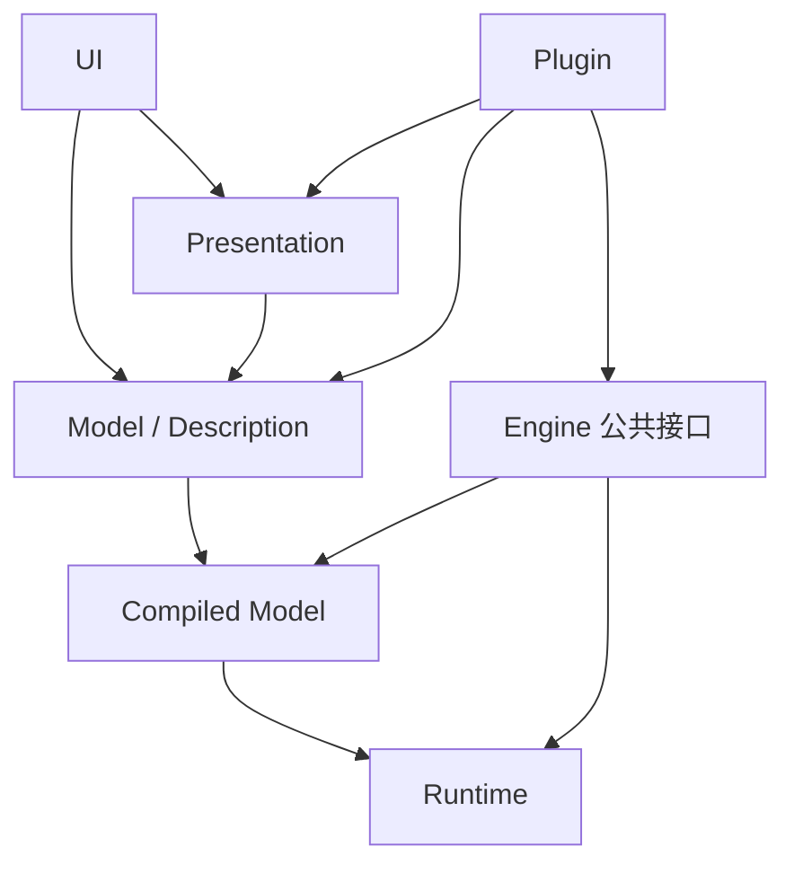

# 架构层边界设计冻结（阶段 4 / P1-A）

> 状态：`Proposed`（设计冻结草案，待评审）。本文是目标设计口径，不是当前实现；ADR 不是实施授权。
> 依据：`NETLAB_V2_PLANNING_REVIEW.md:100-108`（补 6 份文档第 1 份：层边界与依赖方向）、`PROJECT_OPTIMIZATION_EXECUTION_PLAN.md:44`、七项裁决 ②（外观默认持久化在 SceneDoc 的 Presentation 层）、`ADR-005`（lite，Accepted）。
> 边界：不写生产代码；不改 `graph.py`/`scene.py` 冻结区；不迁移旧工程；不改 FEM；Plugin v1 不是沙箱。

## 1. 六层定义

| 层 | 职责 | 代表对象 | 可变性 |
| --- | --- | --- | --- |
| Model（Description） | 描述物理/逻辑结构、端口、方程、参数、初值、边值 | `ProjectDesc`、`SceneDesc`、`NodeDesc`、`EdgeDesc`、`PortType` | 仅 `SceneEdit` 事务 |
| Compiled Model | 校验后的只读编译产物：变量注册、方程映射、稀疏结构、执行计划、诊断 | `CompiledModel`、`VariableRegistry`、`ExecutionPlan`、`Diagnostic` | 编译期写入，运行期只读 |
| Runtime | 状态、积分器、求解器、步进、探针、快照 | `NodeRuntime`、`ConnectionRuntime`、`Runtime` | Engine 独占可写 |
| Presentation | 外观、卡片字段、视图配置、图纸布局 | `appearance`、`card_fields`、`LayoutEdge` | `SceneEdit` 事务，`revision += 1` |
| UI | 画布、面板、菜单、事件、前端状态 | 前端组件 | 前端状态机 |
| Plugin | 注册领域 kind / PortType / 算法 / 数据格式 / 声明式 UI | `EngineSpec`、`PortTypeRegistry`、`PluginFacade` | 注册期 |

## 2. 依赖方向（哪些层可以互相 import）

允许方向（箭头 = 允许依赖/调用，反向禁止）：

| 从 \ 到 | Model | Compiled Model | Runtime | Presentation | UI | Plugin |
| --- | --- | --- | --- | --- | --- | --- |
| Model | 自身 | 允许（编译输入） | **禁止** | 允许持有外观记录 | **禁止** | **禁止** |
| Compiled Model | 只读引用 | 自身 | 允许（创建 Runtime） | **禁止** | **禁止** | **禁止** |
| Runtime | 只读 Desc 快照 | 只读 | 自身 | **禁止** | **禁止** | **禁止**（经 facade） |
| Presentation | 允许 | **禁止** | **禁止** | 自身 | **禁止** | **禁止** |
| UI | 允许（经 API） | 只读摘要 | **禁止** | 允许 | 自身 | 声明式挂载 |
| Plugin | 允许（注册） | 只读摘要 | **禁止直接** | 声明式 | 声明式面板 | 自身 |

三条红线：

1. **Runtime 不得反向修改 Description**（运行态只存在 Runtime）；Description 不持有 Runtime 引用。
2. **Presentation 不进 Runtime、不进编译缓存键**：外观/卡片字段/布局变化只增 `revision`，不触发 `ensure_engine()`。这是阶段 2 已验证的机制断言（`test_appearance_batch.py` 的 `ensure_engine() is engine`）；ADR-005-lite §1/§4。
3. **Plugin 不得直接访问底层 Runtime**：只经 `PluginFacade` / Engine 公共接口 / Port 读写。

## 3. 编译缓存键的组成

缓存键 = `hash(Desc 内容 + 编译配置 + SPI 版本 + EngineSpec 版本)`。

明确**不进**缓存键：外观（`appearance`）、卡片字段（`card_fields`）、`LayoutEdge`、视图配置、Runtime 状态、UI 状态、Recorder 数据。这条约束是七项裁决 ② 与 ADR-005-lite 的落地口径。

现状偏差（审计已记录）：外观字段确实存在于 `netlab/core/model/records.py:27`（`NodeRecord.appearance`）与 `netlab/core/model/records.py:79`（`EdgeRecord.appearance`）的**记录层**。因此准确措辞是「外观存于 SceneDoc 记录层 `records.py`，不进 NodeRuntime / 物理参数 / 编译缓存键」，而不是「不进 NodeRecord/EdgeRecord」。与 `ADR-005:14` 的既存张力登记为 **P2 架构观察项**，不在阶段 4 裁定。

## 4. 与现状偏差（审计证据）

| 现状 | 位置 | 违反的边界 |
| --- | --- | --- |
| `Node` 同时有 `data/state/compute/handler` 与描述字段 | `netlab/core/model/graph.py:163` | Model 与 Runtime 未分层 |
| `Node.__post_init__` 保持 `data/state` 引用，engine 与 UI 共享可变字典 | `netlab/core/model/graph.py:164-188` | 双份可变状态 |
| model ↔ compute 双向包依赖、27 模块同一 SCC | `CORE_ARCHITECTURE_AUDIT.md` §5 | 依赖方向无约束 |
| `netlab/__init__.py:15-17` 顶层导入连带加载全模型/compute | 审计 §5 | 层隔离缺失 |
| `decode_project_bytes` 先解压后限 8 MB | 审计 §5 | 安全边界（非本阶段修复项） |
| 外观更新曾触发 `_dirty` 重编译 | `netlab/core/model/scene_edit.py:151` | 已在阶段 2 修复 |

## 5. ADR 与授权

- `ADR-005`（lite）= `Accepted`（2026-11-11），只界定外观 Presentation 归属，**不是代码实施授权**。
- `ADR-001/002/003/004/006/007` = `Proposed`，`adr/README.md:18` 明确「ADR 不是实施授权」。
- 本文是设计冻结草案，不升格任何 ADR、不代表任何阶段已获代码实施授权。

## 6. 待用户裁定的开放问题（Open Question / PENDING_USER_AUTHORIZATION）

来自 `NETLAB_V2_PLANNING_REVIEW.md:136`，本阶段不代替用户裁定：

1. **Plugin 权限边界（只读/可写哪些层）**：§2 表格给出候选（Plugin 可注册 Model、可声明式挂载 UI，不得直接访问 Runtime），但「是否可写 Presentation 层」「是否可读 Compiled Model 细节」未裁定。未裁定前按最小只读实现。
2. 项目保存是否允许显式 Runtime 快照：见 `ENGINE_LIFECYCLE.md` §5。
3. 兼容窗口是否必须支持 v6 旧工程：见 `MIGRATION_AND_COMPATIBILITY.md` §3。

三项均标为 `PENDING_USER_AUTHORIZATION`，不进入实现。
