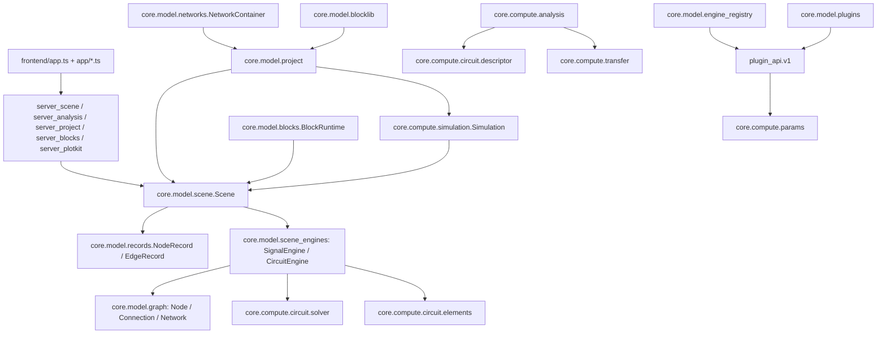
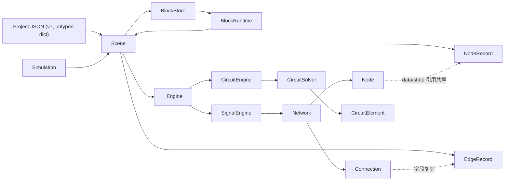

# NetLab Core Architecture V2 · P1 架构审计

> **状态：P1 只读审计报告（不是实施方案）**
> 审计日期：2026-11-11
> 审计范围：NetLabHome 当前工作树（只读）
> 代码事实基线：HEAD `eb27dedc15a3f2fa061310cb5f5b33cf521f039b`（阶段 B status-only），代码提交 `e56d4431edf045b793d6f4c6c8a54a4ffca21794`；`origin/main` 同步，ahead 0 / behind 0。
> 测试事实：**881 passed / 1 skipped / 4 warnings**；core 覆盖率 **81.312%**（12408/14583，missing 2175）；CI python-tests `42966071451`、container `42966071512`、frontend-ts-build `42966071459` 三绿。
> 用户指定审计基线为 `8e6ed222cbbfcf33f1598d7d07408a1223795474`（872 passed / 81.11%）；阶段 B 已使当前代码前进到 `e56d443`（881 passed / 81.312%），相对指定基线没有退化。本文以当前实际代码为证据，同时标注文档中的旧基线。
> 约束：本报告只读；不修改核心代码、不修改工程文件、不 commit、不 push。唯一新增文件为 `netlab/docs/CORE_ARCHITECTURE_AUDIT.md`。

## 0. 结论摘要

NetLab 目前是一个**可运行、测试覆盖较好、但扩展边界尚未收口**的“单仓多域”架构：signal 域有成熟的 Node/Connection/Network 执行图，circuit 域有独立的 CircuitEngine/MNA 求解器，analysis 则在 signal 的 `transfer_math` 与 circuit 的 `DescriptorModel` 之间做适配。当前功能可用，但新增一个计算领域仍需要在 Scene、Engine、Project、Block、UI 多处做条件分支，不能仅通过插件完成。

按严重度排序的 Top 问题：

| 编号 | 级别 | 问题 | 核心证据 |
|---|---|---|---|
| P1-B1 | 阻塞 | 物理拓扑与计算依赖共用 `EdgeRecord`/`Connection` 一套模型，语义由 `Scene.mode` 隐式选择 | `records.py:53-105`、`graph.py:291-359`、`scene_engines.py:425-544` |
| P1-B2 | 阻塞 | `Scene`/`NetworkContainer`/`BlockDef` 硬编码内建 mode，插件引擎项目无法端到端加载 | `scene.py:113-127`、`scene_io.py:85`、`networks.py:990-998`、`blocks.py:148` |
| P1-H1 | 高 | `Node`/`Connection` 同时承担文档、运行时状态、计算回调与求解策略；`NodeRecord`/`EdgeRecord` 又复制字段，靠共享可变字典同步 | `graph.py:164-288`、`records.py:14-105`、`scene_engines.py:93-140` |
| P1-H2 | 高 | `CircuitElement.stamp()` 与 `DescriptorModel._assemble_matrices()` 双套元件语义；线性元件按 `kind` 分支，非线性元件部分复用 `stamp()` | `elements.py:16-58`、`descriptor.py:445-539`、`:542-622` |
| P1-H3 | 高 | AC/DC/时域数值语义分裂：Legacy MNA `ac_sweep`、Descriptor `frequency_response`、`descriptor_step_response` 各有独立近似与积分策略 | `solver.py:969`、`descriptor.py:844`、`descriptor_analysis.py:809`、`test_descriptor_dc.py` |
| P1-H4 | 高 | `plugin_api/v1` 不是独立 facade；插件注册写进程全局 registry，无项目级隔离；engine 能力声明未被消费 | `plugin_api/v1/__init__.py:15,53-64`、`plugins.py:429-523`、`engine_registry.py:11` |
| P1-H5 | 高 | Project 是未类型化 dict + 两套手写 schema（project / scene payload）；版本迁移为单条 if 链，校验会执行运行时构造器 | `project.py:191-292,576-740,1035-1042`、`scene_io.py:64-280` |
| P1-H6 | 高 | Analysis/Server/Frontend 边界靠手写字段协议连接，缺统一 schema；前端 API body 分散在多个 TS 文件 | `server_analysis/__init__.py:27-94,161+`、`analysis.py:904,1176,1204`、`frontend/app/*.ts` |
| P1-M1 | 中 | Vector mode 是 SignalEngine 的别名，没有专用向量求解器；mode 目录在多处硬编码 | `scene.py:120-124`、`scene_engines.py:1-5`、`blocks.py:148` |
| P1-M2 | 中 | Block 版本引用被忽略、块库与 project 持久化反向依赖、块实例嵌套 Scene 增加生命周期复杂度 | `blocklib.py:422-463`、`blocks.py:376-390` |
| P1-M3 | 中 | 每步 `capture_step_state` 深拷贝全部节点/连接状态；`NodeRecord.snapshot` 在只保存配置时也深拷贝 data | `graph.py:1061-1081`、`records.py:29-50` |
| P1-M4 | 中 | checksum 可选（字段缺失时返回 True）、校验/迁移逻辑重复 | `project.py:102-105,779-862,1045-1063` |
| P1-M5 | 中 | V2 文档写旧基线 `8e6ed22`/872，ROADMAP 仍标“P1 待启动”；records docstring 与共享 data 语义冲突 | `CORE_ARCHITECTURE_V2.md:5`、`CORE_ARCHITECTURE_V2_ROADMAP.md:3`、`records.py:1-5` |
| P1-L1 | 低 | 内建 mode catalog、schematic 的 circuit-only 假设、server_scene 直接 import migration helper | `scene_io.py:276-287`、`computes.py:1511`、`server_scene/__init__.py:15` |

**总体判断：**

- **应保留**：`graph.py` 的 `Node/Connection/Network` 运行时内核、`records.py` 的序列化形状、`engine_registry.py` 的小型注册接口、`plugin_api/v1` 的 public path、`project.py` 的 bytes-level 持久化原语、`workspace.py` 的冻结根目录视图、`core/compute/computes.py` 的 compute registry、`simulation.py` 的线程/锁/Recorder 边界。
- **应先做 P2 设计、不要先大改**：P1-R1（CircuitElement 统一）与 P1-R2（AC/Bode 数值统一）是最高杠杆；它们可以在不推翻现有 schema 的前提下把“新增域”成本降下来。
- **不要在 P1 阶段动**：FEM（明确不改）、`graph.py`/`scene.py` 冻结区（按项目规则）、默认 `MAX_NODES=400`（需 D 阶段探针数据后再决定）。

## 1. 审计范围与方法

### 1.1 覆盖文件

- Core Model：`netlab/core/model/{graph,scene,scene_engines,scene_edit,scene_io,records,networks,project,workspace,plugins,extensions,engine_registry,ports,blocks,blocklib,scene_types}.py`
- Plugin API：`netlab/plugin_api/v1/__init__.py`
- Compute：`netlab/core/compute/{analysis,simulation,computes,transfer,statespace}.py`、`netlab/core/compute/circuit/{descriptor,descriptor_analysis,elements,solver,stamps}.py`
- Server：`netlab/server_scene/__init__.py`、`netlab/server_project/__init__.py`、`netlab/server_analysis/__init__.py`、`netlab/server_blocks/__init__.py`、`netlab/server_plotkit/__init__.py`
- Frontend：`frontend/app.ts`、`frontend/app/analysis.ts`、`frontend/app/ac_analysis.ts`、`frontend/app/plotkit_data.ts`
- 文档：`CORE_ARCHITECTURE_V2.md`、`CORE_ARCHITECTURE_V2_ROADMAP.md`、`PROGRESS.md`、`REQUIREMENTS_AND_RULES.md` 的对应段落

### 1.2 方法

1. 先读文档的目标口径，再以 `grep`/`sed` 核对实际类、函数、字段与调用点；每个问题至少给一条 `file:line` 证据。
2. 不把“文档中希望实现的能力”当作现状；文档与代码冲突时，以代码和测试为准，并把冲突单列为文档问题。
3. 只读检查，不运行会修改仓库的命令；测试统计引用当前 `status.json`/`reports/test_status.json` 与已有测试结果。
4. 明确区分“结构性建议”与“本轮已实现修复”：本报告不实施任何改造。

## 2. 现状架构模块地图

### 2.1 分层概览

### 2.2 依赖方向的主要问题

- `Scene` → `SignalEngine`/`CircuitEngine` → `graph`/`solver` 是主路径；但 `blocks.BlockRuntime` 在函数内 lazy import `Scene`（`blocks.py:377`），形成隐藏的 Scene ↔ BlockRuntime 环。
- `blocklib.py:32-35` 依赖 `project` 的 `atomic_write`/`canonical_json`，而 `project.py:790` 又 lazy import `blocklib`，库与持久化层反向依赖。
- `engine_registry.py:11` 从 `plugin_api.v1` import `EngineSpec`，而 `plugin_api/v1/__init__.py:15` 从 `core.compute.params` import `ParamSpec`：public facade ↔ core 互相依赖，public API 不能独立演进。
- `project.py:28-30` 直接 import `Scene`、`engine_registry`、`Simulation`，持久化层因此依赖运行时引擎；`project.py:833-853` 的校验会构造 `Scene` 和 `Simulation`。
- `server_scene/__init__.py:15` 直接 import `migrate_scene_to_devices`，HTTP adapter 触达 migration 内部。

### 2.3 当前模块规模（`wc -l`）

| 模块 | 行数 | 备注 |
|---|---:|---|
| `core/compute/computes.py` | 1550 | signal/vector compute registry + 内建实现 |
| `core/compute/analysis.py` | 1385 | transfer / AC / operating point 适配层 |
| `core/compute/circuit/solver.py` | 1330 | MNA/Newton/AC/OP |
| `core/compute/simulation.py` | 983 | 线程、Recorder、播放器边界 |
| `core/compute/circuit/descriptor.py` | 901 | DescriptorIndex/Model/System，独立 circuit 装配 |
| `core/compute/circuit/descriptor_analysis.py` | 844 | Poles/Zeros/Step/Transfer Function |
| `core/compute/circuit/elements.py` | 843 | CircuitElement + 16 类元件 |
| `core/compute/transfer.py` | 841 | 解析/状态空间传递函数 |
| `core/compute/circuit_modules.py` | 826 | 电路模板/模块 |
| `core/compute/methods.py` | 726 | 连接方法 |
| `core/compute/circuit/catalog.py` | 715 | 元件目录 |
| `core/model/project.py` | 1133 | 持久化/迁移/校验 |
| `core/model/networks.py` | 1227 | 多网络容器 |
| `frontend/app.ts` | 7959 | 前端主入口（仍是大文件） |

## 3. 核心数据结构关系图

### 3.1 数据结构清单

| 结构 | 文件:行 | 职责 | 性质 |
|---|---|---|---|
| `NodeView` | `graph.py:89-95` | 对 compute 回调的只读 name/data 视图 | 运行时 |
| `SolverStage` / `SolverPlan` | `graph.py:97-114` | SCC 分层、breakpoints、代数/线性/非线性/有状态标记 | 运行时 |
| `ComputeContext` | `graph.py:149-160` | handler 调用上下文 | 运行时 |
| `Node` | `graph.py:164-288` | name/data/compute/inputs/ports/kind/params/state/handler/trusted/linear/stateful/direct_feedthrough/time_varying/nonlinear/_view/_initial_data | 混合：文档身份+运行时状态+算法策略 |
| `Connection` | `graph.py:291-359` | source/target Node、method、params/state/kind/delay/auto_delay/enabled/source_port/target_port/output | 运行时（含 trust 标记） |
| `Network` | `graph.py:362-1125` | nodes/connections、SimClock、Tarjan SCC、solver plan、step/snapshot | 运行时 |
| `NodeRecord` | `records.py:14-50` | id/name/kind/params/data/state/inputs/position/size/appearance；`snapshot()` 深拷贝 | 序列化/UI |
| `EdgeRecord` | `records.py:53-105` | id/name/source/target/kind/params/state/delay/auto_delay/enabled/route/waypoints/anchors/layout/source_pin/target_pin/source_port/target_port/appearance | 序列化/UI |
| `ChannelKey` | `core/model/channels.py:19-74` | `kind:ident:field` 稳定通道键 | 序列化/UI |
| `Scene` | `scene.py:81-629` | mode/integration/clock/NodeRecord dict/EdgeRecord dict/blocks/block_instances/revision/_engine；`ensure_engine()` | 混合：文档聚合+运行时会话 |
| `_Engine` | `scene_engines.py:61-76` | `step/reset/zero_time/probes/stats` | 运行时 |
| `SignalEngine` | `scene_engines.py:79-424` | NodeRecord→Node、EdgeRecord→Connection、Network 执行 | 运行时 |
| `CircuitEngine` | `scene_engines.py:425-800` | flatten_circuit、union-find 电网络、solver 元件表 | 运行时 |
| `PortDef` / `BlockDef` / `BlockStore` / `BlockRuntime` | `blocks.py:80-343,345-1092` | 块端口、块定义、块集合、嵌套 Scene | 文档+运行时 |
| `NetworkContainer` | `networks.py:38-1227` | `{network_id: Simulation}`、当前网络、每状态缓存 | 文档+运行时 |
| `PluginManifest` / `PluginRecord` / `PluginManager` | `plugins.py:107-638` | 插件清单、加载记录、安装/卸载 | 文档+运行时 |
| `EngineSpec` / `EngineProtocol` / `PluginContext` | `plugin_api/v1/__init__.py:137-212` | 引擎声明/协议/注册上下文 | 文档+运行时 |
| `Simulation` | `simulation.py:296-330` | Scene + RLock + SimConfig + Recorder + worker thread | 运行时 |
| Project schema | `project.py:191-292` | untyped dict：networks/current/states/blocks/extensions/plugins/fem/ui/checksum | 文档 |

## 4. 按严重度分级的问题清单

### 4.1 阻塞

#### P1-B1 物理拓扑与计算依赖混用一套 Edge 模型

**证据**

- `EdgeRecord` 同时携带 `source/target`、`source_port/target_port`、`source_pin/target_pin`、`route/waypoints/anchors/layout`（`records.py:53-105`）。
- `Connection` 同时携带 `source/target` 的 `Node` 对象、`method` 回调、`params/state/delay`、`source_port/target_port`、`output`（`graph.py:291-359`）。
- `SignalEngine` 把所有 `EdgeRecord` 当作 `Connection` 执行（`scene_engines.py:130-140`）。
- `CircuitEngine` 把 wire 边 union-find 成电网络、非 wire 边转成元件，并明确**不使用 `graph.Network`**（`scene_engines.py:425-544`）。
- `Scene` 对同一 `edges` 的分支处理见 `scene.py:368-395`：signal/vector 与 circuit 的 `_normalize_edge_params`、`_normalize_wire_pins` 分别判断。
- `graph.py:983-1059` 的“通用”求解器内部仍有 `"sum"`、`"gain"`、`"manual"`、`"voltage"` 等 signal 专属分支。

**影响**

新增计算域必须选择伪装成 signal 域，或在 `Scene`/`Engine` 增加新的 `if mode == ...` 分支；SCC/延迟/代数环只作用于依赖边，物理网络无法参与统一编译；插件引擎无法声明自己的拓扑语义。这是 P1 的第一阻塞项。

**建议**

P2 设计时把 `DependencyEdge`（source_port/target_port/method/delay）与 `PhysicalEdge`（source_pin/target_pin/net membership）建模为 discriminated union；`LayoutEdge`（route/waypoints/anchors）完全独立。`Scene` 只持有拓扑层，由 Engine 在 `compile()` 时选择物理/依赖视图。

#### P1-B2 Scene/NetworkContainer/BlockDef 硬编码内建 mode

**证据**

- `Scene.ensure_engine`：`CircuitEngine(self) if self.mode == "circuit" else SignalEngine(self)`（`scene.py:113-127`）。
- `Scene.load_payload` 对 mode 的白名单校验在 `scene_io.py:85`；插件 mode 会被拒绝。
- `NetworkContainer.add_network` 先拒绝非 `MODES`（`networks.py:990-991`），随后模板映射硬编码 `{"signal":"blank_signal","circuit":"blank_circuit","vector":"blank_vector"}[chosen]`（`networks.py:992-998`）。
- `BlockDef.__post_init__` 把 mode 固定为 `("signal","vector","circuit")`（`blocks.py:148`）。
- `project.validate_project` 的 mode 分支允许 plugin mode（`project.py:829`），但随后 `trial.load_payload` 会在 `scene_io.py:85` 失败，说明校验路径与加载路径不一致。
- `EngineSpec` 有 `node_kinds`/`edge_kinds`（`plugin_api/v1/__init__.py:137-144`），但 `Scene._normalize_node_params`（`scene.py:273-296`）和 `Scene.load_payload` 完全不消费这些声明。

**影响**

插件可以注册 `EngineSpec`，但不能加载一个 plugin-mode 项目、不能创建 plugin-mode 网络、不能定义 plugin-mode block；所谓“插件领域扩展”目前只能修改核心代码。

**建议**

引入 Engine SPI v2：`EngineSpec` 声明 `node_kinds/edge_kinds`、`validate/compile/snapshot/restore`；`Scene` 把 mode 校验委托给注册表；`NetworkContainer` 使用 `engine_catalog()` 生成模板而不是硬编码 map；`BlockDef` 使用 `EngineSpec` 的 mode 列表。

### 4.2 高

#### P1-H1 Node/Connection/Record 职责过重与双份状态

**证据**

- `Node` 同时有 `data`（运行结果）、`compute`/`handler`（计算）、`trusted`、`linear/stateful/direct_feedthrough/time_varying/nonlinear`（求解策略）、`_initial_data`（初值）和 `kind/params`（文档身份）；`__post_init__` 明确 `data/state` 与 `NodeRecord` 共享引用（`graph.py:191-192`）。
- `NodeRecord.snapshot` 总是深拷贝 `data`，即使 `include_state=False`（`records.py:41`）；`build_project` 调用 `to_payload(include_state=False)`（`project.py:207`）。运行后保存会把计算值当作者数据持久化，`_initial_data` 又捕获构造时值（`graph.py:187-188`），重新打开后 reset 会恢复到最后一次保存值。
- `Graph.capture_step_state` 每步深拷贝所有 node 的 `data/state/inputs` 与 connection 的 `state/output`（`graph.py:1061-1081`）；`NodeRecord.snapshot` 的深拷贝在 204 节点规模已构成保存成本。
- `Node.set_data(replace=True)` 会重新绑定 `self.data` 并重建 `_view`（`graph.py:211-220`），破坏“共享引用”的注释契约。
- SignalEngine 恢复时原地 `record.data.clear()/update()`（`scene_engines.py:290-322`），CircuitEngine 直接赋值 `record.state = element.state`（`scene_engines.py:646-650`）：两种引擎的 identity 语义不同。

**影响**

文档层与运行层无法独立演进；保存/恢复和 Undo 的“作者数据 vs 计算数据”边界不清晰；跨引擎行为不一致。

**建议**

P2 拆成 `NodeDesc`/`NodeRuntime`、`EdgeDesc`/`ConnectionRuntime`；记录层只保留 authored data；runtime state 由 Engine 私有并显式 snapshot/restore；禁止共享可变 dict 作为跨层同步机制。

#### P1-H2 CircuitElement 与 DescriptorModel 双套元件语义

**证据**

- `CircuitElement` 是元件基类，`stamp(ctx)` 为抽象（`elements.py:16-58`）；16 个元件类各自实现 `stamp/prepare/reset`。
- `DescriptorModel._assemble_matrices()` 对线性元件按 `kind` 重写装配：resistor/switch/capacitor/inductor/vsource/vcvs/vccs（`descriptor.py:445-539`）。
- `_apply_operating_point()` 又按 kind 处理 diode/zener/led 的 `_conductance`、BJT/MOSFET 的 `element.stamp(context)`、opamp/comparator 的 `_linearize_opamp`（`descriptor.py:542-622`）。
- `descriptor.py:27` 虽 import `CircuitElement`，但线性装配路径未统一调用 `element.stamp`，而是自己算 A/E。

**影响**

每新增一个元件或修改一个元件方程，需要同时改 `elements.py`、`descriptor.py`（以及可能的 `solver.py`/`analysis.py`）；两套实现的数值细节容易漂移。当前非线性 BJT/MOSFET 已复用 `stamp()`，说明统一路径可行，但线性元件尚未统一。

**建议（P1-R1）**

以 `CircuitElement` 为唯一元件模型：新增 `DescriptorStampContext`（或复用 `StampContext` 的 A/rhs/index 适配），让每个元件提供 `descriptor_stamp(ctx)`（默认可由 `stamp(ctx)` 适配）；`DescriptorModel._assemble_matrices` 删除 kind 分支，只遍历 `element.descriptor_stamp()`；`_apply_operating_point` 同样走元件 hook。先以 RC/RLC/二极管/运放/BJT/MOSFET 的 A/E 对拍测试保证等价，再合并。

#### P1-H3 AC/DC/时域数值语义分裂

**证据**

- `CircuitSolver.ac_sweep` 走 MNA `AC_KINDS`，拒绝非线性元件（`solver.py:969`）。
- `DescriptorModel.frequency_response` 走 `A + jωE`，`analysis.py:1176 _circuit_frequency_response` 目前调用它（`descriptor.py:844`）。
- `descriptor_analysis.descriptor_step_response` 使用隐式 Euler，默认 `dt=1e-4`；`descriptor.py` 的 `_assemble_matrices` 没有积分方法参数（`descriptor_analysis.py:809`、`descriptor.py:445`）。
- `solver.py:126` 的 CircuitSolver 支持 trapezoidal/backward_euler/gear2；legacy 与 descriptor 的 DC 电感语义不同：`test_descriptor_dc.py` 记录理想电感 Descriptor `v_L=0`、Legacy `DC_CONDUCTANCE=1e5` 残压 `>0 且 <1e-3`。
- `analysis.py:904 tf_analysis` 的 signal 路径走 `transfer_math`；circuit 路径走 `DescriptorModel`，两条路径的 error/数值语义未统一。

**影响**

同一电路在 AC/DC/时域可能得到不同“正确”答案；测试无法用一个统一阈值判断。对于插件/多域，这会让“数值结果可复现”不可保证。

**建议（P1-R2）**

明确 canonical：`CircuitSolver.ac_sweep` 作为 AC/Bode 唯一后端——它已有用户契约、`Element.stamp` 的稀疏 LU/平衡/悬空诊断和线性元件路径；`DescriptorModel.frequency_response` 降级为兼容包装（保持 `omega_rad_s`/`omega` 与 probe 字段），新前端/API 不再直接调用 descriptor 的频响路径。建立线性/非线性/奇异 E/多端口 parity matrix 与误差阈值；`descriptor_step_response` 增加 `integration` 参数并与 solver 对齐；所有 DC 语义以显式 `operating_point` 为准。

#### P1-H4 Plugin API 不是独立 facade，registry 为进程全局

**证据**

- `plugin_api/v1/__init__.py:15` import `ParamSpec` 自 `core.compute.params`；`engine_registry.py:11` 反向 import `EngineSpec`。
- `plugins.PluginManager._install` 直接写 `COMPUTE_SPECS`/`METHOD_SPECS`/`ELEMENT_SPECS` 等全局字典（`plugins.py:429-523`），`unload` 全局 pop（`plugins.py:548-549`）。
- `PluginManifest` 声明 `capabilities`/`permissions`（`plugins.py:107-120`），但 engine 分支只调用 `register_engine(spec, plugin_id)`（`plugins.py:518-523`）；项目引用只检查版本字符串非空（`project.py:876-887`）。
- `ElementSpec.pins` 是 `tuple[dict[str, Any], ...]`（`plugin_api/v1/__init__.py:64`），无类型/单位/方向 schema。
- `extensions.py:1-13` 明确“不是沙箱”；`plugins.py:1-6` 同样声明 trusted in-process，无隔离/超时。

**影响**

一个插件的加载会影响所有打开项目；无法做项目级插件版本锁定；public API 的变更可能直接破坏核心 import；插件声明的 capability 无法在项目加载前验证。

**建议**

将 `plugin_api` 依赖改为 `core` 提供的稳定 `Spec` 协议（或把 `ParamSpec` 下沉到 `plugin_api` 的独立 types 模块）；`PluginManager` 不再写全局，改为 `PluginRegistry` 注入 `Scene/Project` 上下文；项目保存显式 `{id, version, capabilities}`，加载前做版本/能力检查；引入可选 subprocess 边界和 capability manifest（先设计，不实施）。

#### P1-H5 Project schema 与迁移链脆弱

**证据**

- `project.py:191-292` 的 `build_project` 构建 untyped dict；`validate_project` 在 `:765-903` 逐字段手写校验；`Scene.to_payload/load_payload` 是第二套 schema（`scene_io.py:64-280`）。
- `PROJECT_VERSION=7`（`project.py:36`），但 `build_project` docstring 仍写“v2”（`project.py:205`），`migrate_project` 注释也写“v2”（`project.py:577`）。
- `migrate_project` 是单条 if 链，覆盖 v1/v2/v4/v5/v6（`project.py:611-740`）；legacy 迁移函数 `migrate_scene_to_devices`（`:293-459`）和 `migrate_scene_rails`（`:462-575`）。
- `validate_project` 会构造 `Scene`/`Simulation` 并 `ensure_engine()`（`project.py:833-853`）；`load_project` 正常路径也走 `Scene`，没有“静态校验不执行插件/引擎代码”的隔离。
- `verify_checksum` 字段缺失返回 `True`（`project.py:102-105`）；`validate_project` 校验后又无条件重算 checksum（`:861-862`）；`load_project_raw` 重复这段逻辑（`:1045-1063`）。

**影响**

新增 schema/version 需要改多处；损坏或旧项目可能在校验阶段执行插件；无法生成稳定的 JSON Schema/迁移 golden test；checksum 不是硬完整性门。

**建议**

P2 先做 `ProjectDTO/SceneDoc` 类型模型与 `schema_version` registry；静态校验与 runtime 构造分离；每版提供 golden fixture + migrate test；checksum 改为必需（或显式 `allow_missing_checksum` 仅用于 legacy）；`load_project_raw` 与 `load_project` 共享同一验证管线。

#### P1-H6 Analysis/Server/Frontend 边界缺少 schema

**证据**

- `server_analysis/__init__.py:27-94` 的 `AnalysisTFRequest`/`AnalysisFrequencyRequest` 是手写 Pydantic 字段，直接调 `core.compute.analysis`；`analysis.py:904 tf_analysis` 有 17 个 kwargs，`analysis.py:1204 frequency_response` 又有 8 个关键字参数。
- `analysis.py:9-29` 直接依赖 `circuit.descriptor`/`circuit.descriptor_analysis`/`transfer/statespace`；analysis 同时是 signal transfer 和 circuit descriptor 的适配层，域边界不清晰。
- 前端 API body 分散：`frontend/app/analysis.ts:101` 的 `runAnalysisTransfer`、`frontend/app/ac_analysis.ts:562` 的 `runCircuitBypass`、`frontend/app/plotkit_data.ts:223` 的 `runPrecomputeWithProgress` 各自手写 HTTP body；没有共享 schema/类型生成。
- `frontend/app.ts` 7959 行仍是主入口；`app/analysis.ts`、`app/ac_analysis.ts` 与 `app/plotkit_data.ts` 的 UI 状态/绘图/请求耦合，新增分析 tab 需要改 index.html、windows.ts、app.ts、analysis/ac_analysis 多处。

**影响**

前端/服务端/core 的字段变化没有单一真源；错误处理与校验分散；插件新增分析类型无法只靠 `AnalysisSpec` 接入 UI。对“新增计算领域”成本很高。

**建议**

以 `AnalysisSpec`/`AnalysisRequest` 生成服务端 OpenAPI/前端类型；把 `analysis.py` 拆为 `analysis/signal` 与 `analysis/circuit` 两个 adapter，通用 `AnalysisService` 只暴露统一结果；前端把分析 API 封装为 `app/analysis_client.ts`，UI 只消费结果 DTO；逐步缩小 `app.ts`。

### 4.3 中

| 编号 | 问题 | 证据 | 建议 |
|---|---|---|---|
| P1-M1 | Vector mode 是 SignalEngine 别名，无专用向量求解器；mode 目录多处硬编码 | `scene.py:120-124`、`scene_engines.py:1-5`、`blocks.py:148`、`computes.py:1511` | P2 明确 vector 语义；要么实现 VectorEngine，要么从公开 mode 移除并保留 legacy alias |
| P1-M2 | Block 版本引用被忽略；blocklib↔project 反向依赖；BlockRuntime 嵌套 Scene 生命周期复杂 | `blocklib.py:422-463`、`blocks.py:376-390`、`project.py:790` | BlockRef 保存 version 并在加载时做兼容选择；blocklib 只依赖纯 DTO/JSON 工具；BlockRuntime 的 Scene 通过接口注入而非直接构造 |
| P1-M3 | 每步深拷贝全图状态；只保存配置也深拷贝 data | `graph.py:1061-1081`、`records.py:41` | 引入 snapshot/transaction 接口；`snapshot()` 按 `include_state` 决定是否复制 data；基准 204/400/1000 节点 |
| P1-M4 | checksum 可选、校验/迁移/加载重复 | `project.py:102-105,779-862,1045-1063` | 统一 `validate_project` 管线；checksum 默认必需；legacy 迁移 fixture |
| P1-M5 | V2 文档基线旧、ROADMAP 状态旧；records docstring 与共享引用冲突 | `CORE_ARCHITECTURE_V2.md:5`、`CORE_ARCHITECTURE_V2_ROADMAP.md:3`、`records.py:1-5` | 文档统一用 status.json 实时生成基线；records docstring 改成“记录层不拥有引擎状态，但运行时共享 data 引用”的准确表述 |
| P1-M6 | 子图/模块循环校验不一致：project load 只检查 signal，交互 add 拒绝所有非 circuit 的循环 | `scene_io.py:242-260` vs `scene_edit.py:287-304` | 统一由 Engine 校验拓扑规则 |
| P1-M7 | 全图遍历/复制在 204 节点以上已有成本；`RECORDER_CAPACITY=6000` 固定窗口限制长时预计算精度 | `simulation.py:33-37,112-149`、`graph.py:1061-1081` | P2 性能基线；Recorder 容量可配置并按采样率反推；按需分块 |

### 4.4 低

- `scene_io.py:276-287` 的 mode catalog 与 `computes.py:1511` 的 `mode="signal"` 硬编码；新增 mode 要全库 grep。
- `server_scene/__init__.py:15` 直接 import migration helper；HTTP 层不应知道迁移细节。
- `blocklib.py:481` placeholder dtype/`blocklib.py:422-432` 版本处理；低风险但影响块兼容。
- `frontend/app.ts` 7959 行、`frontend/app/analysis.ts`/`ac_analysis.ts` 分工重叠；非功能正确性问题，但阻碍后续 P2 前端拆分。
- `CORE_ARCHITECTURE_V2.md:58-62` 明确当前模型没有 Typed Port/Eq/Compiler；这是正确的目标差距说明，不应误读成“已有能力”。

## 5. 必须回答的架构问题

### 5.1 哪些数据结构是核心基础设施

- **文档层核心**：`NodeRecord`/`EdgeRecord`（`records.py:14-105`）是 UI、项目 JSON、server_scene/API 的既有契约；`Scene` 的 `nodes/edges/blocks` 字典是工程聚合根（`scene.py:81-629`）。应保留形状并做加法演进。
- **运行层核心**：`Node`/`Connection`/`Network`（`graph.py:164-1125`）、`CircuitElement`（`elements.py:16-58`）、`_Engine` 接口（`scene_engines.py:61-76`）、`Simulation`（`simulation.py:296-330`）。
- **扩展层核心**：`EngineSpec/EngineProtocol/PluginContext`（`plugin_api/v1/__init__.py:137-212`）、`engine_registry`（`engine_registry.py:14-58`）、`PluginManifest`（`plugins.py:107-177`）。
- **持久化核心**：`PROJECT_FORMAT/PROJECT_VERSION/checksum/atomic_write`（`project.py:35-108`）。

### 5.2 哪些只服务特定领域

- **circuit 专用**：`CircuitElement` 及 16 个子类、`CircuitSolver`、`DescriptorIndex/Model/System`、`descriptor_analysis` 的 poles/zeros/step/transfer function、`circuit/catalog.py`、`circuit_modules.py`、`schematic.py` 的 circuit-only layout/validation。
- **signal/vector 专用**：`computes.py` 的 signal compute registry、`methods.py` 的连接方法、`transfer.py`/`statespace.py` 的解析传递函数、`SignalEngine` 的 Node/Connection 构造。
- **PlotKit/Recorder 专用**：`simulation.Recorder`/`ChannelKey`、`server_plotkit`/`plotkit_bridge`、`frontend/app/plotkit_data.ts`。
- **注意**：`analysis.py` 同时服务 signal 与 circuit，但内部已有 `transfer_math` 和 `DescriptorModel` 两条路径；应拆成两个 adapter，避免继续膨胀。

### 5.3 Node/Connection 是否职责过重

**是，而且过重是当前最核心的模型问题。** `Node` 同时是：文档身份（name/kind/params）、运行时状态（data/state/inputs/ports）、可执行回调（compute/handler）、求解器策略标签（linear/stateful/...）、块实例句柄（kind="block"）；`Connection` 同时是依赖边、计算方法、延迟语义、端口约定、运行时输出。`NodeRecord`/`EdgeRecord` 是另一套字段重复的文档对象。两者的唯一同步机制是 `data/state` 共享可变字典，且 `Node.set_data(replace=True)` 会打破共享契约（`graph.py:211-220`）。建议 P2 强制拆成 `Desc`（作者/序列化）与 `Runtime`（引擎私有）两层。

### 5.4 物理关系与计算依赖是否混用

**是，P1-B1 是阻塞级。** `EdgeRecord` 的 `source_pin/target_pin`（物理引脚）与 `source_port/target_port`（信号端口）同时存在；`route/waypoints/anchors/layout`（视觉）也挂在同一条记录上。`SignalEngine` 把 edge 当依赖边，`CircuitEngine` 把 wire edge 当电网络、非 wire edge 当元件，`Scene.mode` 决定语义。`Network` 只服务 signal 依赖图，circuit 完全不使用；物理网络无法进入统一编译/求解计划。P2 应拆 `PhysicalEdge`/`DependencyEdge`/`LayoutEdge` 三类，由 Engine 组合。

### 5.5 哪些模块稳定应保留

- `graph.py` 的 `Node/Connection/Network` 公共 API（add/connect/remove/set_delay/step）与 `SolverPlan` 结构，可保留并在内部替换策略。
- `records.py` 的 `NodeRecord/EdgeRecord` 字段形状；只做加法字段，不改名。
- `plugin_api/v1` 的 package path、`PLUGIN_API_VERSION`/`PLUGIN_SCHEMA`、`EngineSpec/EngineProtocol/PluginContext`。
- `engine_registry.py` 的 `register_engine/plugin_modes/create_engine/engine_catalog` 语义。
- `project.py` 的 `PROJECT_FORMAT/PROJECT_VERSION/canonical_json/compute_checksum/atomic_write`。
- `workspace.py:88-110` 的“只持有 root/library、不持运行时状态”。
- `core/compute/computes.py` 的 `register_compute/get_compute_spec/prepare_compute`。
- `simulation.py:296-330` 的线程/锁/Recorder 边界。

### 5.6 新增一个计算领域需要改多少核心代码

当前至少需要改 **8–10 个文件**，插件无法独立完成：

1. `core/model/scene_types.py` 的 `MODES`（新增 mode 常量）。
2. `scene.py` 的 `__init__` 校验、`ensure_engine`、`_normalize_node_params`、`_normalize_edge_params`、`_normalize_wire_pins`/`_normalize_signal_ports`、`next_breakpoint`。
3. `scene_engines.py` 新增 `_Engine` 子类，并在 `scene.py:74-77` import/分支。
4. `scene_io.py` 的 `load_payload` mode gate、node/edge 解析、`catalog`。
5. `project.py` 的 mode 字符串、`validate_project`、`build_project`。
6. `scene_edit.py` 的 `add_node`/`add_edge` 分支。
7. `blocks.py` 的 `BlockDef` mode tuple、dtype 分支、`instantiate_block`、`BlockRuntime._build`。
8. `networks.py` 的 `add_network` mode gate/template map、`load_project` 初始 `Scene("signal")`。
9. `templates.py` 的内建 mode 字面量。
10. `schematic.py` 的 circuit-only layout/validation（或新增通用策略）；
11. `computes.py` 的 `compute_catalog`、`blocklib.py` 的 dtype/version 逻辑。

**结论**：这是“核心代码多文件改动 + 插件只能注册局部 spec”的现状，不是可接受的领域扩展接口。

## 6. 推荐改造顺序、兼容性与迁移风险

### 6.1 推荐顺序（P1 输出，P2 执行）

1. **P1-A 设计冻结（P2 前置）**：先写 `CORE_MODEL_V2.md` / `TYPED_PORT_SYSTEM.md` / `ENGINE_SPI_V2.md`，确认 `Desc/Runtime` 分层、`DependencyEdge/PhysicalEdge/LayoutEdge` 三型、`EngineSpec` 生命周期接口。不要先改代码。
2. **P1-R1 CircuitElement 统一**：`descriptor_stamp` hook → 线性/非线性元件单源；先对拍 RC/RLC/二极管/运放/BJT/MOSFET 的 A/E，再删 `_assemble_matrices` 的 linear kind 分支。风险：元件 `stamp` 依赖 `StampContext` 的 `solution/dt/time/mode`，descriptor 的 DC/AC 上下文需完整适配；建议保留 legacy 分支一个版本作为 shadow parity。
3. **P1-R2 AC/Bode 数值统一**：`CircuitSolver.ac_sweep` canonical；`DescriptorModel.frequency_response` 兼容包装；建立 test matrix（linear/nonlinear/OP/奇异 E/多端口）；先 shadow，后切换默认。风险：非线性 OP 缺失时的 422 语义、复数端口方向、DC 电感语义差异需固定测试。
4. **P1-S1 Project/DTO 分层**：`ProjectDTO/SceneDoc` + schema registry + golden fixtures；先做 round-trip 和 v7→v8 迁移草稿，不改变外部 JSON。
5. **P1-S2 Engine SPI v2**：`EngineSpec` 声明 node/edge kinds、`compile/validate/snapshot/restore`；`Scene.load_payload` 支持 plugin mode；`NetworkContainer` 模板由 `engine_catalog()` 生成。
6. **P1-S3 排序**：P1-R1/R2 先于大规模 Node/Connection 拆分；否则拆模型会把两套数值路径的差异放大。最后做前端 `analysis_client`/`app.ts` 拆分。

### 6.2 兼容性/迁移风险

| 风险 | 说明 | 缓解 |
|---|---|---|
| R1 破坏现有元件数值 | `CircuitElement.stamp` 与 descriptor A/E 的 `dt/mode/omega` 上下文不同 | 先 shadow 对拍；保留 `_assemble_matrices` legacy 路径一个版本；逐元件迁移 |
| R2 改变 AC 结果 | Descriptor 理想电感 vs Legacy `DC_CONDUCTANCE=1e5`；复数端口 | 固化阈值/测试矩阵；保留 `DescriptorModel.frequency_response` wrapper；默认开关关闭 |
| Node/Record 拆分破坏工程格式 | `NodeRecord` 是 UI/JSON 契约 | 字段只加不删；v7→v8 迁移器；round-trip golden |
| Plugin 项目加载 | 插件 mode 当前被 `Scene.load_payload` 拒绝 | 先做 Engine SPI 和静态校验；插件项目不允许绕过 manifest 检查 |
| 前端改动影响交互 | `app.ts` 7959 行、手工 API body | 先抽 `analysis_client.ts` + 结果 DTO；UI 状态机独立测试 |
| 性能回归 | 每步深拷贝、204 节点保存成本 | 先加 204/400/1000 基准；snapshot 接口逐步替换；不在 P1 改默认 |

## 7. P2 前置设计任务（不在本报告实施）

1. **Typed Project/Document Model**：`ProjectDTO`/`NetworkDoc`/`SceneDoc`；schema_version + migration registry；authoring vs runtime state 分离。
2. **Core Model V2**：`NodeDesc`/`NodeRuntime`、`EdgeDesc`/`ConnectionRuntime`；`PhysicalEdge`/`DependencyEdge`/`LayoutEdge`；`Node`/`Connection` 的公共 API 兼容层。
3. **Typed Port System**：`PortDef` 增加 dtype/unit/direction/range；`ElementSpec.pins` 使用 typed spec；端口兼容性静态检查。
4. **Engine SPI v2**：`EngineSpec` 声明 node/edge kinds、`validate/compile/step/reset/snapshot/restore`；`Scene` 委托校验/编译；plugin mode 与 builtin mode 同路径。
5. **Plugin lifecycle**：项目级 `{id, version, capabilities}`、加载前版本解析、可选 subprocess 隔离；registry 从 global 变 project-scoped。
6. **Block contract**：`BlockDef` 去 mode 硬编码，端口类型化，块实例通过 Engine SPI 构建；块库/项目持久化分层。
7. **Frontend analysis contract**：`analysis_client.ts` + DTO 类型；`app.ts` 拆分计划；API 请求统一 `api()` token-aware helper。
8. **验证计划**：golden round-trip `Project→Scene→Engine→Project`；fixture plugin engine 加载/步进/snapshot；204/400/1000 节点基准；依赖图测试禁止 persistence→runtime、server→model internals。

## 8. 测试、验证与性能现状

- **全量测试**：`881 passed / 1 skipped / 4 warnings`（`reports/test_status.json`；core 81.312%，14583 statements / 12408 covered / 2175 missing）。
- **阶段 B 新增**：`test_descriptor_transfer_function.py` 9 tests；`test_analysis_circuit_bypass.py` 5 tests；`test_ui_analysis_entry.py` 3 tests；UX e2e `analysis_ux.mjs` 覆盖 mode 入口、metrics、ticks、export、context export、precompute。
- **现有覆盖盲区**：
  - 没有 plugin-mode 项目的端到端加载测试（`scene_io.py:85` 会直接挡住）。
  - 没有 v1→v7 每版 golden fixture；`migrate_project` 只有 if 链逻辑。
  - 没有 `descriptor.py` 与 `CircuitElement.stamp` 的逐元件 A/E parity 测试（目前仅部分电路测试）。
  - 没有 server request schema 与前端 TypeScript DTO 的生成/契约测试。
  - 没有 204/400/1000 节点统一 benchmark；现有 `RECORDER_CAPACITY=6000` 与每步深拷贝需在 D 阶段量化。
- **性能注意**：`graph.capture_step_state` 每步深拷贝全图（`graph.py:1061-1081`）；`NodeRecord.snapshot` 只保存配置也复制 data（`records.py:41`）；`Simulation` 的 Recorder 容量固定（`simulation.py:33-37`）；这些是 P2 前必须量化的点。

## 9. 文档与代码一致性

| 文档 | 文档说法 | 实际代码/状态 | 处理建议 |
|---|---|---|---|
| `CORE_ARCHITECTURE_V2.md:5` | `8e6ed22`、872 passed / 81.11%、CI run IDs | 当前 `eb27ded`/`e56d443`、881 passed / 81.312%、CI `42966071451/42966071512/42966071459` | 以 status.json 重生成；文档保留“规划基线”并注明“审计快照日期” |
| `CORE_ARCHITECTURE_V2_ROADMAP.md:3` | “P1 待启动” | P1 审计报告即本文件；P1 已完成 | 更新为“P1 审计完成，P2 待启动” |
| `CORE_ARCHITECTURE_V2.md:58-62` | 当前 Core Model 只有单一 Node/Connection/Network、无 Typed Port/Eq/Compiler | 与代码一致 | 保留为现状差距说明 |
| `records.py:1-5` | “只描述工程数据，不持有引擎状态” | `NodeRecord.data/state` 与 `Node` 共享可变引用（`graph.py:191-192`） | 改写 docstring，明确“记录层不拥有引擎状态，但运行期共享 data 引用是已知耦合” |
| `project.py:205,577` | build/migrate docstring 说 v2 | `PROJECT_VERSION=7` | 统一版本注释，避免误读 |

## 10. 审计覆盖与限制

**已覆盖**：Core Model（graph/scene/scene_engines/scene_edit/scene_io/records/networks/blocks/blocklib/project/workspace/plugins/extensions/engine_registry/ports）、Plugin API v1、Compute（analysis/simulation/computes/transfer/statespace/circuit 核心）、Server（scene/project/analysis）、Frontend（app.ts、analysis.ts、ac_analysis.ts、plotkit_data.ts）、相关文档。

**未完全覆盖**：

- `scene_channels.py`、`schematic.py` 只做 spot-check，未逐行审计布局/通道边界。
- `server_*` 除 `server_scene`/`server_project`/`server_analysis` 外的路由只按调用面抽查，未做完整 API 契约测试。
- `templates.py` 通过 mode 字面量 grep 检查，未完整阅读所有模板。
- `frontend` 其余 UI 文件（`plotkit_data.ts` 之外的 app/*.ts）未逐文件审计。
- 本报告为 P1 架构审计，不包含 P2 实施、性能实测数据或代码修改。

**结论**：当前系统应视为“可用的单仓多域平台”，而不是“已经具备通用插件领域扩展能力”的平台。P1-R1/P1-R2 是近期最值得做的两项；P2 首要任务是 `ProjectDTO`/`NodeDesc-Runtime` 分层与 Engine SPI v2。任何改造都必须先通过现有 881 passed/81.312% 基线的回归与 P1-R1/R2 的 shadow parity 测试。
