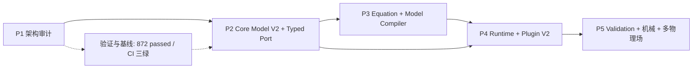

# NetLab Core Architecture V2 · 执行路线图

> **状态：规划基线；P1 架构审计已完成（`CORE_ARCHITECTURE_AUDIT.md`，2026-11-11），当前按用户 2026-11-11 正式裁决的阶段 0–13 顺序推进。** 目标能力与当前实现差距见 [CORE_ARCHITECTURE_V2.md](CORE_ARCHITECTURE_V2.md)。
> 当前事实基线（2026-11-13 复核纠偏）：`origin/main`（已推送基线）=`c70091d788524b75134a5a00946e7cce5f8fa095`；tested_head `aa2e30bd59b7fb1fa5c5491d231bae596348bf8e`（`status.json`，953 passed / 1 skipped / 0 failed、400.41s；`c70091d` 为 status-only 尾提交不自引用）；最后生产代码提交 `212a8908c190aa9fde018bda974b69413ea1e5bf`；core line 81.53%；CI `CI_VERIFIED`（`c70091d`：3 workflow run `43274818892` / `43274818886` / `43274818874` 与 5 check-run 全部 `completed/success`，2026-11-13 经 GitHub REST API 直连取得，Run URL 见 `PROJECT_STATUS.md §1`；历史 `4dc7bdd` success 仅作历史）。阶段 3 历史基线（`b667e517...` / 909 / 81.404692%）仅作历史引用。

## 0. 路线总览

| 阶段 | 优先级 | 目标 | 前置依赖 | 主要交付物 |
|---|---|---|---|---|
| P1 | P0（先做） | 现有架构审计与问题定位 | 无 | `CORE_ARCHITECTURE_AUDIT.md`、模块依赖图、核心数据结构关系图、问题分级、改造顺序、迁移风险 |
| P2 | P1 | Core Model V2 + Typed Port 设计 | P1 | `CORE_MODEL_V2.md`、`TYPED_PORT_SYSTEM.md`、四类图关系图、Python 类型接口草案、适配方案 |
| P3 | P2 | Equation / Constraint + Model Compiler 最小垂直切片 | P2 | `EQUATION_SYSTEM.md`、`MODEL_COMPILER.md`、变量注册、最小编译链、诊断 |
| P4 | P2 | Runtime 三层 + Plugin V2 | P2/P3 | `RUNTIME_ARCHITECTURE.md`、`PLUGIN_ARCHITECTURE_V2.md`、三层边界、插件 v2 适配 |
| P5 | P3 | Scientific Validation → 机械动力学 → 多物理场 | P4 + 验证基线 | `SCIENTIFIC_VALIDATION.md`、机械试验引擎、`MULTIPHYSICS.md`、验证报告 |

## 1. P1：现有架构审计（最高优先级，先做）

**目标**：建立可信现状认知，明确“已实现 / 文档描述 / 规划能力”三类边界，找出真实架构问题，不修改核心代码。

**范围**：
1. Core Model：Node、Edge、Port、Network、Scene。
2. Compute：各计算引擎的组织与依赖关系。
3. Simulation：时钟、状态更新、调度、线程安全。
4. Model 与 Compute 的双向依赖。
5. Plugin API 与领域扩展边界。
6. 工程文件格式、序列化、版本兼容。
7. Recorder、Analysis、PlotKit 数据交互。
8. 前后端接口与用户自定义计算函数。
9. 测试体系、数值验证、性能基准。
10. 文档与代码一致性。
11. 结构性冗余与双轨实现审计：**P1-R1 元件 Stamp 双轨**（`circuit/elements.py` 各元件 `stamp()` vs `circuit/descriptor.py:445 _assemble_matrices()` 重写）与 **P1-R2 AC/Bode 双后端**（`circuit/solver.py:969 ac_sweep()` vs `circuit/descriptor.py:844 frequency_response()`）。

**必须交付**：
- `CORE_ARCHITECTURE_AUDIT.md`；
- 当前架构模块依赖图；
- 当前核心数据结构关系图；
- 主要架构问题清单（按严重程度分级：阻塞/高/中/低）；
- 推荐改造顺序；
- 兼容性与迁移风险分析；
- **P1-R1（必答）元件 Stamp 单一化收敛方案**：以 `circuit/elements.py` 各元件 `stamp()` 为唯一元件模型，`circuit/descriptor.py:445 _assemble_matrices()` 只承担矩阵布局/后处理；明确新增元件需改动的唯一位置、元件级与整机级对拍用例、迁移与兼容风险；
- **P1-R2（必答）AC/Bode 单一后端收敛方案**：`circuit/solver.py:969 ac_sweep()` 与 `circuit/descriptor.py:844 frequency_response()` 二选一定为 canonical，另一个做兼容包装或删除；给出非奇异/奇异、病态、多端口等价性对拍、性能与误差阈值、回滚方案。

**验收标准**：
- 每个问题必须对应真实 `file:line`、类、函数或模块，不允许凭架构理念猜测；
- 明确标出稳定模块（建议保留）与适合渐进升级的模块；
- 明确列出“新增一个计算领域需要改哪些核心代码”的具体清单；
- **必须回答 P1-R1/P1-R2 两条结构性冗余的收敛方案、对拍方式与迁移风险；只列问题不给方案，视为 P1 未完成**；
- 不修改任何核心代码、不做 git commit、不改工程文件；
- 基线不退化：872 passed / 1 skipped、core ≥81%、三 CI 绿。

## 2. P2：Core Model V2 + Typed Port 设计

**目标**：统一模型管理语义，不强制统一所有领域的数据结构和计算方式。

**交付物**：
- `CORE_MODEL_V2.md`；
- 物理拓扑图、计算依赖图、方程约束图、场景组织图的四类关系图；
- Project/Model/Domain/Node/Port/Connection/Equation/Constraint/Variable/Parameter/InitialCondition/BoundaryCondition/Scene 的对象定义与 Python 类型接口草案；
- 与当前 `Node`/`Connection`/`Network`/`Scene` 的差异分析与渐进式迁移方案；
- `TYPED_PORT_SYSTEM.md`：domain、quantity_type、unit、direction、shape、connection_semantics、coordinate_frame、metadata；单位/量纲检查；Causal/Acausal/Physical Conserving/Multi-port 连接语义。

**验收标准**：
- 先用 Circuit + 一个最小机械域验证 Typed Port，不要求全平台铺开；
- 旧工程可通过适配层读取，旧 API 不破坏；
- 至少能表达 voltage/current/force/velocity 等 4 类物理量的端口；
- 设计评审通过前不实施 Core Model 替换。

## 3. P3：Equation / Constraint + Model Compiler 最小垂直切片

**目标**：建立非因果、多变量、多方程模型描述与最小编译链，不在第一步引入大型符号编译器。

**交付物**：
- `EQUATION_SYSTEM.md`：Equation/Constraint 接口、Variable Registry、全局方程组装方案、与 Signal/Circuit 的兼容方案；
- `MODEL_COMPILER.md`：Model Loading → Validation → Port Resolution → Unit Checking → Graph Analysis → Variable Registration → Equation Assembly → Solver Selection → Execution Plan → Diagnostics；
- Compiled Model 数据结构：Compiled Nodes、Resolved Connections、Variable/Equation Mapping、Sparse Structure、Dependency Graph、Solver Configuration、Execution Plan、Diagnostics；
- 增量编译与缓存失效规则；
- 编译诊断（端口/单位/未定义变量/方程数量/奇异系统等，定位到组件/端口/方程/参数）。

**验收标准**：
- 只做 Signal/Circuit 一条最小可运行链路；
- 同一模型编译结果可复现；
- 缓存失效规则有测试，不能静默使用过期模型；
- 不改变现有引擎默认行为，通过适配器接入。

## 4. P4：Runtime 三层 + Plugin V2

**目标**：把 Model、Compiled Model、Runtime 彻底分离；把领域能力交给插件。

**交付物**：
- `RUNTIME_ARCHITECTURE.md`：三层边界、Execution Plan、状态/调度/并行、Recorder 与 Runtime 分离；
- `PLUGIN_ARCHITECTURE_V2.md`：Domain/Component/PortType/EquationProvider/Solver/Analysis/Visualization/DataFormat/UI Panel/Template 注册协议；
- v1 插件兼容适配层；
- 最小外部插件示例（不改 Core 即可接入新领域）；
- 插件版本、依赖、冲突、显式启用与异常隔离规则。

**验收标准**：
- Model/Compiled/Runtime 不共享可被意外修改的内部状态；
- Recorder 只依赖 Runtime；
- 现有 v1 插件不改代码即可运行；
- 至少一个最小外部插件完成“注册→编译→运行→出结果”。

## 5. P5：Scientific Validation → 机械动力学 → 多物理场

**目标**：先建立独立于具体引擎的科学验证体系，再用机械集中参数系统验证通用模型体系，最后研究空间分布与多物理场。

**交付物**：
- `SCIENTIFIC_VALIDATION.md`：解析解（RC/RLC/简单机械振动/弹簧阻尼/线性状态空间）、步长收敛、物理守恒、参考软件对照、Property-based 图算法测试、工程稳定性；
- 机械试验引擎：Mass/Spring/Damper/Rotational Inertia/Torque Source/Force Source/Gear/Motor/Load；机械端口；`M q̈ + C q̇ + K q = F(t)`；单质量/双质量/耦合/扭转/齿轮/电机驱动案例；
- `MULTIPHYSICS.md`：Mesh/Vertex/Edge/Face/Cell/Element/DOF/Field/BC/Material、FEM 流程、电热/机电/热结构/流固耦合、场可视化；
- 每阶段性能报告（优化前后耗时、规模、误差、内存、CPU/GPU、可复现 benchmark）。

**验收标准**：
- 每个领域必须有解析解或独立高精度参考模型对拍；
- 不允许用“能跑”替代正确性；
- 机械组件不得把公式写进 Core，必须由独立引擎/插件管理；
- 多物理场只做架构研究与最小验证，不先做完整产品化。

## 6. 依赖关系

## 7. P1 启动指令（交给「项目优化」执行）

> **P1 启动指令（原样转交）**
>
> 任务：只读完成 NetLab Core Architecture V2 的 P1 架构审计，写 `NetlabHome/netlab/docs/CORE_ARCHITECTURE_AUDIT.md`。不改核心代码、不做 git commit、不 push、不改工程文件。
>
> 基线：HEAD `8e6ed222cbbfcf33f1598d7d07408a1223795474`，origin/main 同步，ahead 0/behind 0；872 passed / 1 skipped，core 覆盖率 81.11%；python-tests `42950221580`、frontend-ts-build `42950221592`、container `42950221772` 三绿。任何审计结论不得让基线退化。
>
> 必做内容：
> 1. 盘点 Core Model（`Node`/`Connection`/`Network`/`Scene`）、Compute 引擎、Simulation、Plugin API、Project 格式、Recorder/Analysis/PlotKit、前后端接口、测试/验证/性能、文档与代码一致性。
> 2. 输出当前架构模块依赖图和核心数据结构关系图（Mermaid 或文本均可）。
> 3. 输出问题清单，按「阻塞 / 高 / 中 / 低」分级；每个问题必须给 `file:line`、类/函数/模块证据，不允许凭理念猜。
> 4. 明确回答：哪些数据结构是核心基础设施；哪些只服务特定领域；节点/连接是否职责过重；物理关系与计算依赖是否混用；哪些模块稳定应保留；新增一个计算领域需要改多少核心代码。
> 5. 给出推荐改造顺序与兼容性/迁移风险；提出 P2 的前置设计任务，但不要开始 P2 实施。
>
> 验收：报告可复审、问题可定位、建议可执行；不修改代码/配置/分支；仅在 `netlab/docs/` 新增审计文档；完成后回报文件路径、核心结论、Top 问题清单与下一步建议。