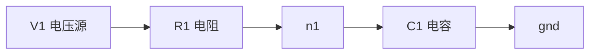
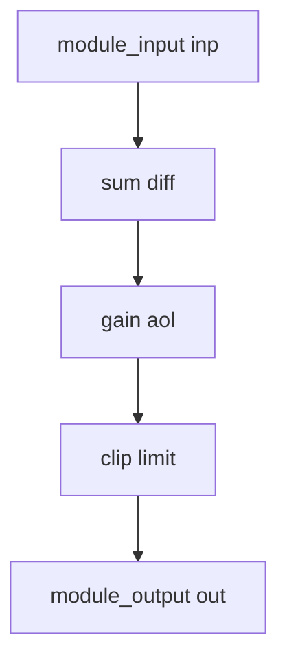
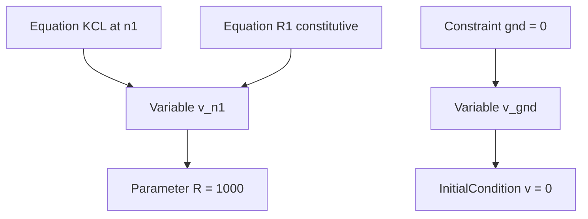
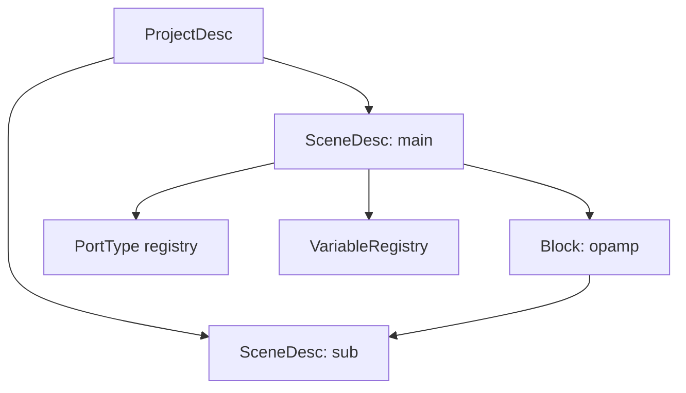

# Core Model V2 设计冻结（阶段 4 / P1-A）

> 状态：`Proposed`（设计冻结草案，待评审）。本文是**目标设计口径**，不是当前实现；ADR 不是实施授权，Proposed 不得伪装 Accepted。
> 阶段 4 开工时基线以 `git rev-parse HEAD`、`status.json` 与 GitHub branches/main 为准；本文不写死运行态数字，避免旧基线残留。
> 依据：`PROJECT_OPTIMIZATION_EXECUTION_PLAN.md:44`、`NETLAB_V2_PLANNING_REVIEW.md:97-136`、`CORE_ARCHITECTURE_V2_ROADMAP.md:54-66`、`CORE_ARCHITECTURE_AUDIT.md:385`、`CORE_ARCHITECTURE_AUDIT.md:394-400`。
> 边界：本阶段不写任何生产代码；不改 `netlab/core/model/graph.py`、`netlab/core/model/scene.py` 冻结区；不迁移旧工程；不放宽 `MAX_NODES=400`；不改 FEM；不擅自放量 `NETLAB_MATH_ACCEL`。

## 1. 目标与非目标

目标：把「物理拓扑、计算依赖、方程约束、场景组织」四类关系从同一份 `NodeRecord` / `EdgeRecord` / `Node` / `Connection` 中分离，给出 Description（Desc）与 Runtime 两层对象、13 类核心对象的接口草案、四类关系图、与现状差异及渐进迁移路线，作为 P2 及之后阶段的设计基线。

非目标（明确不做）：不实施 Core Model 替换、不写生产代码、不改外部工程 JSON、不删字段、不升格 ADR、不裁定 §11 的三项开放问题。设计评审通过前不实施替换（`CORE_ARCHITECTURE_V2_ROADMAP.md:60`）。

## 2. 分层与依赖方向

六层边界详见 [ARCHITECTURE_BOUNDARIES.md](ARCHITECTURE_BOUNDARIES.md)。与本文直接相关的三层：

| 层 | 本文对象 | 可变性 | 是否进编译缓存键 |
| --- | --- | --- | --- |
| Description（Model） | `ProjectDesc`、`SceneDesc`、`NodeDesc`、`EdgeDesc`、`PortDesc`、方程/约束/变量/参数/初值/边值 | 只在 `SceneEdit` 事务中改，改后产生新 `revision` | 是（Desc 内容 + 编译配置） |
| Compiled Model | `CompiledModel`、`VariableRegistry`、`ExecutionPlan`、`Diagnostic` 列表 | 编译产物，只读 | 否（是缓存值本身） |
| Runtime | `NodeRuntime`、`ConnectionRuntime`、状态/积分器/求解器状态 | Engine 独占可写 | 否 |
| Presentation | `appearance`、卡片字段、视图配置 | `SceneEdit` 事务改，`revision += 1` | **否**（ADR-005-lite） |

依赖方向：Runtime 读 Compiled Model 与只读 Desc 快照；Runtime **不得**反向写 Desc；Presentation 不进 Runtime、不进编译缓存键。

## 3. 13 类核心对象定义

| 对象 | 职责 | 层 | 可变性 | 序列化 |
| --- | --- | --- | --- | --- |
| `Project` / `ProjectDesc` | 工程根：版本、Scene 集合、库引用、元信息 | Description | 事务改 | 工程 JSON |
| `Model` | 一个可编译的领域模型单元：Desc + 领域声明 | Description | 事务改 | 工程 JSON |
| `Domain` | 领域标识与能力声明（signal / circuit / mechanical 及插件域） | Description | 注册表 | manifest |
| `Node` / `NodeDesc` | 物理或功能节点描述：id、kind、ports、params（外观不入 Description） | Description | 事务改 | 工程 JSON |
| `Port` / `PortDesc` | 端口描述：名称、方向、`PortType`、cardinality | Description | 事务改 | 工程 JSON |
| `Connection` / `EdgeDesc` | 三型边（见 §7）的描述，含端点与端口绑定 | Description | 事务改 | 工程 JSON |
| `Equation` | 方程声明（线性/非线性、关联变量、源节点） | Description | 事务改 | 工程 JSON |
| `Constraint` | 约束声明（接地、初值约束、代数约束） | Description | 事务改 | 工程 JSON |
| `Variable` | 变量声明：名称、类型、单位、量纲；归属由 Equation/Constraint 的引用表达 | Description | 事务改 | 工程 JSON |
| `Parameter` | 参数声明：名称、值、单位、可写性 | Description | 事务改 | 工程 JSON |
| `InitialCondition` | 初值声明（关联变量与取值） | Description | 事务改 | 工程 JSON |
| `BoundaryCondition` | 边值/激励声明（电压源、力源、速度源等） | Description | 事务改 | 工程 JSON |
| `Scene` / `SceneDesc` | 场景：mode、id、domain、Node/Edge 集合、方程集合、revision | Description | 事务改 | 工程 JSON |

补充对象（不属于 13 类但为设计必要）：`CompiledModel`、`VariableRegistry`、`ExecutionPlan`、`Diagnostic`、`RuntimeSnapshot`、`EngineSpec`、`NodeRuntime`、`ConnectionRuntime`、`Block`。精确签名见 [CORE_INTERFACE_CONTRACTS.md](CORE_INTERFACE_CONTRACTS.md)。

## 4. Python 类型接口草案

以下为**接口草案**（`ast.parse` 可解析，不是生产代码，不导入不执行）；精确方法签名/参数/返回/异常见 `CORE_INTERFACE_CONTRACTS.md`。

```python
from __future__ import annotations

from dataclasses import dataclass, field
from enum import Enum
from typing import Any, Mapping, Sequence


class EdgeKind(str, Enum):
    DEPENDENCY = "dependency"
    PHYSICAL = "physical"
    LAYOUT = "layout"


@dataclass(frozen=True)
class PortType:
    domain: str
    quantity: str
    unit: str
    dimension: tuple[int, int, int, int, int, int, int]
    direction: str
    cardinality: str = "one"
    shape: tuple[int, ...] = ()
    dtype: str = "float"
    connection_semantics: str = "causal"
    coordinate_frame: str = ""
    metadata: Mapping[str, Any] = field(default_factory=dict)


PortDirection = Literal["input", "output", "bidirectional"]


@dataclass(frozen=True)
class PortDesc:
    port_id: str
    direction: PortDirection
    port_type: PortType
    cardinality: str = "one"  # one | many
    reference: str = "node"  # node | ground
    component_id: str = ""
    coordinate_frame: str = ""
    metadata: Mapping[str, Any] = field(default_factory=dict)


@dataclass(frozen=True)
class NodeDesc:
    id: str
    kind: str
    name: str = ""
    ports: tuple["PortDesc", ...] = ()
    params: Mapping[str, Any] = field(default_factory=dict)
    initial_data: Mapping[str, Any] = field(default_factory=dict)
    # 外观不在 Description：Presentation 层按 id 关联，见 ARCHITECTURE_BOUNDARIES.md


@dataclass(frozen=True)
class EdgeDesc:
    id: str
    kind: EdgeKind
    source: str
    target: str
    source_port: str = ""
    target_port: str = ""
    params: Mapping[str, Any] = field(default_factory=dict)
    # 外观不在 Description：Presentation 层按 id 关联，见 ARCHITECTURE_BOUNDARIES.md


@dataclass(frozen=True)
class Equation:
    id: str
    expression: str
    variables: tuple[str, ...] = ()
    linear: bool = True


@dataclass(frozen=True)
class Constraint:
    id: str
    kind: str
    target: str
    value: float = 0.0


@dataclass(frozen=True)
class Variable:
    id: str
    quantity: str
    unit: str
    dimension: tuple[int, int, int, int, int, int, int]


@dataclass(frozen=True)
class Parameter:
    id: str
    value: float
    unit: str = ""
    writable: bool = True


@dataclass(frozen=True)
class InitialCondition:
    variable: str
    value: float


@dataclass(frozen=True)
class BoundaryCondition:
    variable: str
    expression: str


@dataclass(frozen=True)
class SceneDesc:
    mode: str
    id: str = ""
    domain: str = ""
    presentation: Mapping[str, Any] = field(default_factory=dict)
    compat: Mapping[str, Any] = field(default_factory=dict)
    nodes: tuple[NodeDesc, ...] = ()
    edges: tuple[EdgeDesc, ...] = ()
    equations: tuple[Equation, ...] = ()
    constraints: tuple[Constraint, ...] = ()
    variables: tuple[Variable, ...] = ()
    parameters: tuple[Parameter, ...] = ()
    initial_conditions: tuple[InitialCondition, ...] = ()
    boundary_conditions: tuple[BoundaryCondition, ...] = ()
    revision: int = 0


@dataclass(frozen=True)
class ProjectDesc:
    version: int
    scenes: tuple[SceneDesc, ...] = ()
    metadata: Mapping[str, Any] = field(default_factory=dict)


@dataclass
class NodeRuntime:
    """运行时节点：持有可变状态，不反向修改 NodeDesc。"""
    desc: NodeDesc
    inputs: dict[str, float] = field(default_factory=dict)
    state: dict[str, float] = field(default_factory=dict)


@dataclass
class ConnectionRuntime:
    """运行时连接：持有连接状态，不反向修改 EdgeDesc。"""
    desc: EdgeDesc
    state: dict[str, float] = field(default_factory=dict)
    delay_state: dict[str, float] = field(default_factory=dict)


@dataclass(frozen=True)
class Model:
    domain: str
    desc: SceneDesc


@dataclass(frozen=True)
class Domain:
    id: str
    node_kinds: Sequence[str] = ()
    edge_kinds: Sequence[str] = ()
```

## 5. 四类关系图

图 1 · 物理拓扑（PhysicalEdge，守恒连接、acausal）：



上图中每条箭头都是一条 `PhysicalEdge`：端点为节点势变量、无因果方向、编译进方程组装。为避免 Mermaid 裸竖线/括号解析歧义，边名以节点表示，不在箭头标签里写括号或竖线。

图 2 · 计算依赖（DependencyEdge，因果、signal 域）：



图 3 · 方程约束（Equation / Constraint / Variable）：



图 4 · 场景组织（Project / Scene / Block）：



四图分别回答：谁与谁物理相连、谁的计算依赖谁、哪些方程约束哪些变量、场景与块如何组织。现状把这四类关系压在同一份 `EdgeRecord` / `Connection`（P1-B1，见 `CORE_ARCHITECTURE_AUDIT.md` §5）。

## 6. 与现状差异与渐进迁移

| 现状 | 位置 | 问题 | V2 目标 | 迁移步骤 |
| --- | --- | --- | --- | --- |
| `Node` 承载 compute/handler/state/data/inputs/ports/trusted 等 | `netlab/core/model/graph.py:163` | 描述与运行态混在一个对象 | `NodeDesc` + `NodeRuntime` 分离 | P1-S1 DTO 分层 → P2-A 字段只加不删 → P2-B 适配器 → P2-C shadow → P2-D 切换 |
| `Connection` 承载 source/target 为 Node 对象、method 回调、state、delay、output | `netlab/core/model/graph.py:290` | 物理拓扑与计算依赖共用 | 三型边（§7）+ `ConnectionRuntime` | 同上 |
| `Network` = nodes/connections + SimClock + SCC/Tarjan | `netlab/core/model/graph.py:362` | 信号域执行图当通用物理图 | `CompiledModel` + `ExecutionPlan` | P3 引入编译器 |
| `NodeRecord` / `EdgeRecord` 为 UI/JSON 记录，字段与运行时重复 | `netlab/core/model/records.py:14`、`:81` | 双份可变状态、外观与物理字段混放 | Desc 单源 + Presentation 旁路 | 保留记录层，字段只加不删 |
| `Scene` 用 `mode` 选 Circuit/Signal 引擎 | `netlab/core/model/scene.py:81` | 插件 mode 端到端断路（P1-B2） | `EngineSpec` 注册表 + `engine_catalog()` | P1-S2 |
| 外观更新走 `SceneEdit`，`_touch()` 置 `_dirty` 触发重编译 | `netlab/core/model/scene_edit.py:151` | 曾违反 ADR-005-lite | appearance-only 用 `revision += 1` | 已在阶段 2 修复，作为 V2 约束保留 |

迁移原则：字段只加不删；每个网络先经适配层可读；golden round-trip fixtures；默认行为不变；每步独立可回退提交。风险表 R1–R6 见 `CORE_ARCHITECTURE_AUDIT.md:394-400`。

## 7. 三型边

| 型 | 语义 | 域 | 方向 | 编译产物 |
| --- | --- | --- | --- | --- |
| `PhysicalEdge` | 物理/守恒连接，端点为节点电压/力等势变量 | circuit / mechanical | acausal，无因果方向 | 方程组装（KCL/KVL 或力平衡） |
| `DependencyEdge` | 计算依赖，上游输出驱动下游输入 | signal | causal，有向 | 有向执行计划、SCC/Tarjan |
| `LayoutEdge` | 视图/文档连线，仅表达图纸布局与外观 | 全部 | 无计算含义 | **不进**方程、不进编译缓存键 |

判定：`LayoutEdge` 只影响 Presentation；`PhysicalEdge` 与 `DependencyEdge` 不得互相隐式转换。

## 8. Desc / Runtime 五问（索引）

逐条答复见 [ENGINE_LIFECYCLE.md](ENGINE_LIFECYCLE.md) §2 与 [CORE_OBJECT_RELATIONSHIP.md](CORE_OBJECT_RELATIONSHIP.md) §3：①Desc 运行期不可直接改，只能经 `SceneEdit` 事务、改后新版本/脏标记；②Runtime 不得反向改 Desc，只读 Desc 快照；③Runtime 有独立生命周期，Engine 创建/销毁；④项目保存默认不含 Runtime 状态，只存 Desc + 可选显式快照；⑤快照/恢复由 Engine/RuntimeManager 负责，Node/Connection 不负责跨对象快照。

## 9. 三组五问索引（供评审检索）

| 组 | 位置 |
| --- | --- |
| Description vs Runtime 五问 | `ENGINE_LIFECYCLE.md` §2、`CORE_OBJECT_RELATIONSHIP.md` §3 |
| Engine 五问 | `ENGINE_SPI_V2.md` §2 |
| Typed Port 五问 | `TYPED_PORT_SYSTEM.md` §7 |

## 10. 验收对照（ROADMAP §2）

| 验收项 | 本文/关联文档证据 |
| --- | --- |
| 四类关系图 | §5 四张 Mermaid |
| 13 类对象定义 + Python 接口草案 | §3 表格 + §4 代码块 |
| 与现状差异及渐进迁移 | §6 |
| 至少表达 voltage / current / force / velocity | `TYPED_PORT_SYSTEM.md` §2 |
| Circuit + 最小机械域验证 | `MINIMAL_DATA_MODEL_EXAMPLE.md` §3 / §4 |
| 旧工程适配层可读 | `MIGRATION_AND_COMPATIBILITY.md` §4 |
| 设计评审通过前不实施替换 | §1 非目标、§11 开放问题 |

## 11. 待用户裁定的开放问题（Open Question / PENDING_USER_AUTHORIZATION）

以下三项来自 `NETLAB_V2_PLANNING_REVIEW.md:136`，**本阶段不代替用户裁定**，仅给出候选与影响，标为 `PENDING_USER_AUTHORIZATION`：

1. 项目保存是否允许**显式** Runtime 快照：已裁决的默认是「普通保存不含 Runtime 快照，Project Save 与 Runtime Snapshot 归属分离」；是否开放用户主动导出/断点快照入口仍待裁定。影响 `RuntimeSnapshot` 是否进工程 schema。
2. Plugin 权限边界（只读/可写哪些层）：见 `ARCHITECTURE_BOUNDARIES.md` §6、`ENGINE_SPI_V2.md` §4。影响 `PluginFacade` 能力白名单。
3. 兼容窗口是否必须支持 v6 旧工程：见 `MIGRATION_AND_COMPATIBILITY.md` §3。影响迁移器范围与 golden fixtures 数量。

在用户裁定前，三项均不进入实现，不写入 ADR 状态，不改变 `ADR-001/002/003/004/006/007 = Proposed` 的事实。

## 12. P1-05 三型边独立数据结构（整改补充）

> 说明：§4 的 `EdgeDesc` 仅作为旧工程兼容容器，不参与新代码内部表示；新代码必须使用以下三个独立类型。三者共享 `EdgeBase`，但验证规则、编译参与度和 Presentation 影响不同。

### 12.1 数据类定义

```python
from dataclasses import dataclass, field
from typing import Any, Mapping, Tuple

@dataclass(frozen=True)
class EdgeBase:
    id: str
    source: str
    target: str

@dataclass(frozen=True)
class DependencyEdge(EdgeBase):
    kind: str = "dependency"
    delay: float = 0.0
    enabled: bool = True
    params: Mapping[str, Any] = field(default_factory=dict)

@dataclass(frozen=True)
class PhysicalEdge(EdgeBase):
    kind: str = "physical"
    source_port: str | None = None
    target_port: str | None = None
    params: Mapping[str, Any] = field(default_factory=dict)

@dataclass(frozen=True)
class LayoutEdge(EdgeBase):
    kind: str = "layout"
    points: Tuple[Tuple[float, float], ...] = ()
    style: Mapping[str, Any] = field(default_factory=dict)
```

### 12.2 三种 Edge 的 JSON 示例

```json
[
  {"kind": "dependency", "id": "d1", "source": "counter4.out", "target": "dff.d", "delay": 0.0, "enabled": true},
  {"kind": "physical", "id": "R1", "source": "vin", "target": "vout", "source_port": "p1", "target_port": "p2", "params": {"R": 1000.0}},
  {"kind": "layout", "id": "l1", "source": "vin", "target": "vout", "points": [[80, 120], [240, 120]], "style": {"stroke": "#3366ff"}}
]
```

### 12.3 校验逻辑

```python
def validate_edge(value: dict) -> str:
    kind = value.get("kind")
    if kind == "dependency":
        if not value.get("source") or not value.get("target"):
            raise ModelValidationError("DependencyEdge 需要 source/target")
        if float(value.get("delay", 0.0)) < 0:
            raise ModelValidationError("DependencyEdge.delay 不能为负")
        return "dependency"
    if kind == "physical":
        if not value.get("source_port") or not value.get("target_port"):
            raise ModelValidationError("PhysicalEdge 需要 source_port/target_port")
        return "physical"
    if kind == "layout":
        return "layout"
    raise ModelValidationError(f"未知边类型：{kind!r}")
```

### 12.4 判定规则

| 问题 | DependencyEdge | PhysicalEdge | LayoutEdge |
| --- | --- | --- | --- |
| 参与拓扑排序 | 是 | 否 | 否 |
| 参与方程构建 | 否（只定顺序） | 是（守恒/本构） | 否 |
| 参与编译 | 是 | 是 | 否 |
| 影响 Presentation | 否 | 可显示 | 是（唯一职责） |
| 允许延迟 | 是（`delay`） | 否 | 否 |
| 允许多对多 | 否（单 source→target） | 由端口 cardinality 决定 | 是（纯画布） |

**禁止**：`LayoutEdge` 不得被当作 `PhysicalEdge` 参与方程；`PhysicalEdge` 不得自动当作 `DependencyEdge` 进入拓扑排序；三者转换必须显式经过迁移/校验工具并记录原因。
