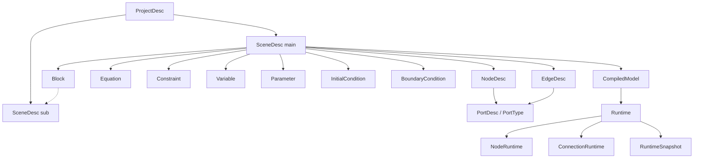

# 核心对象关系设计冻结（阶段 4 / P1-A）

> 状态：`Proposed`（设计冻结草案，待评审）。本文是目标设计口径，不是当前实现；ADR 不是实施授权。
> 依据：`NETLAB_V2_PLANNING_REVIEW.md:100-108`（补 6 份文档第 2 份：对象关系图与所有权）、`:110-116`（Desc/Runtime 五问）、`CORE_ARCHITECTURE_AUDIT.md` §5（P1-H1 职责过重与双份状态）。
> 边界：不写生产代码；不改 `graph.py`/`scene.py` 冻结区；不删字段；不改 FEM。

## 1. 对象关系图

实线 = 拥有/包含；虚线 = 引用（Block 引用内部 SceneDesc，不拥有其生命周期）。

## 2. 所有权表

| 对象 | 创建者 | 拥有者 | 销毁者 | 生命周期 |
| --- | --- | --- | --- | --- |
| `ProjectDesc` | 工程加载/新建 | 工作区 | 关闭工程 | 工程会话 |
| `SceneDesc` | `SceneEdit` 事务 / 加载器 | `ProjectDesc` | 工程关闭 | 工程会话 |
| `NodeDesc` / `EdgeDesc` | `SceneEdit` | `SceneDesc` | 事务删除或工程关闭 | 同 SceneDesc |
| `PortDesc` / `PortType` | 注册表 / `SceneEdit` | `NodeDesc` 引用，注册表拥有类型定义 | 注销/工程关闭 | 注册表会话 |
| `Equation` / `Constraint` / `Variable` / `Parameter` / `InitialCondition` / `BoundaryCondition` | `SceneEdit` | `SceneDesc` | 同 SceneDesc | 同 SceneDesc |
| `Block` | 块库 | `BlockDef` 注册表；实例由 `SceneDesc` 持有 | 注销/工程关闭 | 注册表会话 |
| `CompiledModel` | `Engine.compile(desc)` | `RuntimeManager` | 重编译/工程关闭 | 编译世代 |
| `Runtime` / `NodeRuntime` / `ConnectionRuntime` | `Engine.create_runtime(compiled)` | Engine / `RuntimeManager` | `Engine.dispose(runtime)` | 运行世代，独立于 Desc |
| `RuntimeSnapshot` | `Engine.snapshot(runtime)` | 调用方 | 显式释放 | 快照世代 |
| Presentation（外观/卡片字段/布局） | `SceneEdit` | `SceneDesc` 记录层 | 事务删除 | 同 Desc，但不进编译缓存键 |

关键结论：**Runtime 由 Engine 创建/销毁，不由 Scene / Node / Connection 创建**。现状 `BlockRuntime` 每个实例都嵌套一个 `Scene`（审计 §5），V2 改为共享 `CompiledModel` 与 `EngineSpec`，避免 N 个嵌套 Scene。

## 3. Desc / Runtime 五问（逐条）

1. **Description 是否允许运行期修改？** 默认不允许直接修改；只能经 `SceneEdit` 事务（`begin` / `apply` / `commit` / `rollback`），修改后生成新 `revision` 并标脏，触发重编译。运行期 Runtime 不得写 Desc。
2. **Runtime 是否允许反向修改 Description？** 不允许。Runtime 只读 Desc 快照（编译产物 `CompiledModel` 中冻结的那一份）。运行期状态（电压、电流、积分器历史、步数）只存在 `Runtime` / `NodeRuntime` / `ConnectionRuntime`。
3. **Runtime 是否拥有独立生命周期？** 拥有。由 `Engine.create_runtime(compiled)` 创建、`Engine.dispose(runtime)` 销毁；可独立 `reset()` / `snapshot()` / `restore()`，全过程不改变 Description，也不需要重建 Desc。
4. **项目保存是否包含运行时状态？** 默认**不包含**。只保存 Description + 可选显式快照（用户主动导出/断点），不能让每次保存夹带运行态。是否开放「显式 Runtime 快照」入口是待用户裁定的开放问题（§5）。
5. **快照与恢复由谁负责？** 由 Engine / `RuntimeManager` 负责，提供 `snapshot(runtime)` / `restore(runtime, snapshot)`；`Node` / `Connection` 不负责跨对象快照。快照只覆盖 Runtime 状态，不含 Desc、不含 Presentation。

## 4. NodeDesc / NodeRuntime 与 EdgeDesc / ConnectionRuntime 字段对照

| Desc 字段 | Runtime 字段 | 说明 |
| --- | --- | --- |
| `NodeDesc.id/kind/ports/params` | `NodeRuntime.state`、`value` | 描述静态，状态动态 |
| `Presentation.node_styles[id]`（`NodeDesc` 不含 `appearance`） | 不进入 Runtime | Presentation 层，只增 `revision` |
| `EdgeDesc.kind/source/target/source_port/target_port` | `ConnectionRuntime.current`、`delay_state` | 描述拓扑，状态为支路量/延迟历史 |
| `Presentation.edge_styles[id]`（`EdgeDesc` 不含 `appearance`） | 不进入 Runtime | 同上 |
| `LayoutEdge` | 不进入 Runtime | 纯布局，不进方程、不进缓存键 |

现状 `netlab/core/model/graph.py:164-188` 的 `Node.__post_init__` 让 `data/state` 与 `NodeRecord` **共享同一个可变字典引用**（审计 §5 的 P1-H1），是双份状态的根因；V2 用不可变 `frozen=True` dataclass 作 Desc、可变对象单独放 Runtime，从结构上消除共享引用。

## 5. 待用户裁定的开放问题（Open Question / PENDING_USER_AUTHORIZATION）

1. **项目保存是否允许显式 Runtime 快照**（`NETLAB_V2_PLANNING_REVIEW.md:136`）：已裁决默认是「普通保存不含 Runtime 快照，Project Save 与 Runtime Snapshot 归属分离」；是否开放用户主动导出/断点快照入口未裁定，影响 `RuntimeSnapshot` 是否进工程 schema。本文只给接口草案，不裁定。
2. Plugin 权限边界（只读/可写哪些层）：见 `ARCHITECTURE_BOUNDARIES.md` §6。
3. 兼容窗口是否必须支持 v6 旧工程：见 `MIGRATION_AND_COMPATIBILITY.md` §3。

三项均标为 `PENDING_USER_AUTHORIZATION`，不进入实现；ADR 状态不变。
