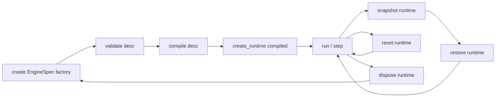

# Engine 生命周期设计冻结（阶段 4 / P1-A）

> 状态：`Proposed`（设计冻结草案，待评审）。本文是目标设计口径，不是当前实现；ADR 不是实施授权。
> 依据：`NETLAB_V2_PLANNING_REVIEW.md:100-108`（补 6 份文档第 3 份：create→validate→compile→run→snapshot→restore→destroy，谁创建/销毁 Runtime）、`:110-116`（Desc/Runtime 五问 3/4/5）、`CORE_ARCHITECTURE_AUDIT.md` §5（`_Engine` 无 checkpoint 接口）。
> 边界：不写生产代码；不改 `scene_engines.py`/`simulation.py` 冻结区；不改 FEM。

## 1. 生命周期状态机

| 阶段 | 输入 | 输出 | 责任方 | 失败语义 |
| --- | --- | --- | --- | --- |
| `create` | `EngineSpec` | `Engine` 实例 | `EngineSpec.factory` / `RuntimeManager` | 未知 mode → `EngineNotFoundError` |
| `validate` | `SceneDesc` | `Sequence[Diagnostic]` | Engine | 单位/端口/方程数错误 → `Diagnostic` 列表，不抛异常；致命结构错 → `ModelValidationError` |
| `compile` | `SceneDesc` | `CompiledModel` | Engine | `CompilationError`（含定位到组件/端口/方程的诊断） |
| `create_runtime` | `CompiledModel` | `Runtime` | **Engine** | `EngineStateError`；Runtime 独占状态 |
| `run` / `step` | `dt`、运行配置 | 探针映射 | Runtime | 数值失败 → `NumericalError`，不静默回退 |
| `snapshot` | `Runtime` | `RuntimeSnapshot` | **Engine** | `SnapshotError`；只含 Runtime 状态 |
| `restore` | `Runtime`, `RuntimeSnapshot` | `None` | **Engine** | 世代/版本不匹配 → `SnapshotRestoreError` |
| `reset` | `Runtime` | `None` | Engine/Runtime | 幂等，不改变 Desc |
| `dispose` | `Runtime` | `None` | **Engine** | 幂等；释放状态与缓存引用 |

## 2. Desc / Runtime 五问（生命周期视角，逐条）

1. **Description 是否允许运行期修改？** 不允许。运行期（`run`/`step`/`snapshot`/`restore`）不得写 Desc；修改必须回到 `SceneEdit` 事务并产生新 `revision`，随后重新 `validate → compile → create_runtime`。
2. **Runtime 是否允许反向修改 Description？** 不允许。Runtime 只读编译产物里冻结的 Desc 快照；`restore` 只还原 Runtime 状态。
3. **Runtime 是否拥有独立生命周期？** 拥有，见 §1：由 Engine 创建/销毁，可独立 reset/snapshot/restore，全过程不改 Desc。这是与现状最大的差别（现状 `Scene` 用 `_engine` 字段持有引擎，`_dirty` 触发 `ensure_engine()` 重建，Runtime 与 Desc 生命周期耦合）。
4. **项目保存是否包含运行时状态？** 默认不包含，只保存 Desc + 可选显式快照。见 §5。
5. **快照与恢复由谁负责？** Engine / `RuntimeManager`；Node/Connection 不负责跨对象快照。见 §3。

## 3. 快照契约

- `snapshot(runtime)` 返回 `RuntimeSnapshot`：包含 `version`（SPI 版本）、`generation`（编译世代 id）、`state`（各 `NodeRuntime`/`ConnectionRuntime` 状态、时间、积分器历史、Recorder 游标）、`checksum`。
- `restore(runtime, snapshot)` 校验 `version` 与 `generation`；不匹配抛 `SnapshotRestoreError`，**不静默接受过期快照**（对应 P3 的「缓存失效规则有测试，不能静默使用过期模型」）。
- 快照**不含**：Desc、`appearance`/`card_fields`/`LayoutEdge`、`CompiledModel` 本体、UI 状态。
- 快照不含 Desc 的理由：Desc 由工程文件单独持久化，快照只负责运行态；两者混合会让「保存工程」与「恢复断点」语义纠缠。

## 4. 失败与回滚

| 失败点 | 保留什么 | 回滚动作 |
| --- | --- | --- |
| `validate` 出诊断 | Desc 不变、Runtime 未创建 | 修正 Desc 后重新 validate |
| `compile` 失败 | 上一代 `CompiledModel` 与 Runtime 继续可用 | 不切换默认，保留旧编译产物 |
| `create_runtime` 失败 | `CompiledModel` 保留 | 重新 create，不销毁 Desc |
| `step` 数值失败 | Runtime 状态冻结在失败前一步 | 显式报错 + 可选 rollback 到上一个快照，禁止静默数值回退 |
| `restore` 失败 | 目标 Runtime 状态不变 | 抛 `SnapshotRestoreError` |
| `dispose` | Desc / CompiledModel 保留 | 可重新 `create_runtime` |

现状差距（审计 §5）：`_Engine` 只有 `step/reset/zero_time/probes/stats`，没有 `capture_checkpoint`/`restore_checkpoint`/`rollback_last_step`；`Simulation` 有三层重复回滚且每步深拷贝。V2 把快照统一到 Engine 接口，消除重复。

## 5. 项目保存与快照（含开放问题）

- 已裁决默认（七项裁决 ③）：**普通保存不含 Runtime 快照**，Project Save 与 Runtime Snapshot 归属分离。
- 可选显式快照（用户主动导出/断点）由 Engine 生成 `RuntimeSnapshot` 字节；是否允许写进工程 schema **尚未裁定**。
- 待用户裁定后，若允许，需要：schema 版本递增、显式标记「含运行态」、加载时校验 `generation`、旧工程无该字段时按纯 Desc 加载。

## 6. 待用户裁定的开放问题（Open Question / PENDING_USER_AUTHORIZATION）

1. **项目保存是否允许显式 Runtime 快照**（`NETLAB_V2_PLANNING_REVIEW.md:136`）：见 §5，未裁定前不进工程 schema。
2. Plugin 权限边界（只读/可写哪些层）：见 `ARCHITECTURE_BOUNDARIES.md` §6、`ENGINE_SPI_V2.md` §4。
3. 兼容窗口是否必须支持 v6 旧工程：见 `MIGRATION_AND_COMPATIBILITY.md` §3。

三项均标为 `PENDING_USER_AUTHORIZATION`；本阶段不写生产代码、不升格 ADR。
