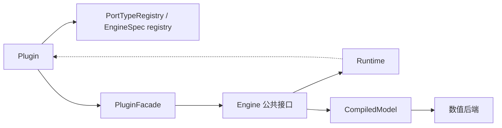

# Engine SPI V2 设计冻结（阶段 4 / P1-A）

> 状态：`Proposed`（设计冻结草案，待评审）。本文是目标设计口径，不是当前实现；ADR 不是实施授权，Plugin v1 不是沙箱。
> 依据：`NETLAB_V2_PLANNING_REVIEW.md:118-123`（Engine 五问）、`NETLAB_V2_PLANNING_REVIEW.md:128-136`、`CORE_ARCHITECTURE_AUDIT.md:385`（P1-A 先写三份文档不要先改代码）、`CORE_ARCHITECTURE_AUDIT.md §5`（P1-B2 插件 mode 端到端断路）。
> 边界：不写生产代码；不改 `netlab/core/model/scene.py`、`netlab/core/model/scene_engines.py`、`netlab/core/model/engine_registry.py`；Plugin 不能替换内建 Engine；不改 FEM。

## 1. EngineSpec 能力声明

`EngineSpec` 用声明式字段替代散落的 `if mode == ...` 分支：

| 字段 | 类型 | 含义 |
| --- | --- | --- |
| `mode` | `str` | 领域模式标识（signal / circuit / vector / 插件 mode） |
| `domain` | `str` | 计算领域 |
| `version` | `int` | SPI 契约版本 |
| `supported_node_kinds` | `Sequence[str]` | 该引擎接受的节点 kind 白名单 |
| `supported_edge_kinds` | `Sequence[str]` | 该引擎接受的边 kind 白名单（见 `CORE_MODEL_V2.md` §7） |
| `supported_port_types` | `Sequence[str]` | 该引擎接受的 PortType 标识白名单 |
| `factory` | 可调用 | Engine 实例工厂 |
| `plugin_id` | `str | None` | 注册来源；内建引擎为 `None` |
| `metadata` | 映射 | 扩展信息 |

规则：新增领域 = 注册一个 `EngineSpec` + 其 kind 白名单，不再修改 `Scene.ensure_engine()` / `NetworkContainer` 模板 / `scene_io.py` 的 mode 校验（当前这三处硬编码 mode 是 P1-B2 的根因）。

## 2. Engine 五问（逐条）

1. **Engine 负责 Runtime 创建和销毁？** 是，通过 `EngineSpec.factory` 得到 Engine 实例，由 `Engine.create_runtime(compiled)` / `Engine.dispose(runtime)` 管理；RuntimeManager 只调度，不直接构造。
2. **如何声明能力？** 用 `EngineSpec.supported_node_kinds / supported_edge_kinds / supported_port_types`；禁止散落 `if-mode`。校验时按白名单过滤并产出诊断。
3. **生命周期？** `validate(desc) -> Sequence[Diagnostic]` → `compile(desc) -> CompiledModel` → `create_runtime(compiled)` → `run/step` → `snapshot/restore` → `dispose`。状态机见 `ENGINE_LIFECYCLE.md` §1。
4. **Plugin 能否直接访问底层 Runtime？** **不能**。Plugin 只能经 Engine 公共接口 / Port 读写，权限由 `PluginFacade` 控制（只读探针、白名单参数写入）。Plugin v1 是受信任进程内代码，不是沙箱。
5. **Engine 与 Plugin 边界？** Engine 负责执行语义与数值（方程组装、求解、状态推进）；Plugin 负责注册领域 kind / 算法 / 数据格式 / 声明式 UI；Plugin 不能替换内建 Engine，不能绕过 manifest 检查。

## 3. 生命周期接口（精确签名见 CORE_INTERFACE_CONTRACTS.md）

| 方法 | 输入 | 输出 | 异常 |
| --- | --- | --- | --- |
| `validate` | `SceneDesc` | `Sequence[Diagnostic]` | `ModelValidationError` |
| `compile` | `SceneDesc` | `CompiledModel` | `CompilationError` |
| `create_runtime` | `CompiledModel` | `Runtime` | `EngineStateError` |
| `step` | `dt` / 运行配置 | 探针映射 | `NumericalError` |
| `snapshot` | `Runtime` | `RuntimeSnapshot` | `SnapshotError` |
| `restore` | `Runtime`, `RuntimeSnapshot` | `None` | `SnapshotRestoreError` |
| `dispose` | `Runtime` | `None` | 无（幂等） |

`Runtime` 的最小表面：`step(dt)` / `reset()` / `probes()` / `stats()` / `zero_time()`；状态只存在 Runtime，不回写 Desc。

## 4. Plugin 边界与 facade

上图中 `Runtime` 到 `Plugin` 的虚线表示**禁止**直接引用：Plugin 不得直接持有 `Runtime` 引用，只能经 `PluginFacade` 与 Engine 公共接口访问。

- Plugin 注册：`PortType`、`node_kind`、`edge_kind`、`analysis`、`data_format`、`panel`、`visual`、`template`、`engine_spec`。
- Plugin 读：`PluginFacade.read_probe(name)`、`read_compiled_summary()`。
- Plugin 写：`PluginFacade.write_parameter(name, value)`（仅白名单且 `writable=True` 的 Parameter）。
- Plugin 不得：直接持有 `Runtime` 引用、替换内建 Engine、绕过 `SceneEdit` 改 Desc、访问未授权层。
- 权限边界的**具体只读/可写层清单是待用户裁定的开放问题**（§7）。

## 5. 与现状差异（P1-B2 根因）

| 现状 | 位置 | 问题 | V2 目标 |
| --- | --- | --- | --- |
| `Scene.ensure_engine()` 按 `mode` 写死 Circuit/Signal | `netlab/core/model/scene.py:81` | 插件 mode 无法加载 | `EngineSpec` 注册表 + `engine_catalog()` |
| `scene_io.py` 拒绝非内建 mode | `netlab/core/model/scene_io.py:85` | 工程保存侧断路 | 按 `EngineSpec` 白名单校验 |
| `project.py:829` 允许插件 mode | `netlab/core/model/project.py:829` | 前后不一致 | 统一到同一注册表 |
| `_Engine` 定义 `step/reset/zero_time/probes/stats` | `netlab/core/model/scene_engines.py:61` | 无 `validate/compile/snapshot/restore/dispose` | 补 SPI v2 方法（P1-S2 实施） |
| `ENGINE_SPECS/ENGINE_OWNERS` 全局注册表 | `netlab/core/model/engine_registry.py:14` | 跨项目泄漏风险 | 注册表按 Project 作用域 |
| `EngineProtocol.build` 从未调用 | 审计 §5 | 声明与实现脱节 | `compile` 明确为唯一编译入口 |
| `Simulation.load_scene` 先 `ensure_engine()` 再 `set_solver_options`，后者不置 `_dirty` | `netlab/core/compute/simulation.py` | 工程求解器选项静默失效 | 编译前统一应用配置 |

## 6. 兼容迁移

- 内建 Circuit/Signal 引擎先以适配层实现 SPI v2 的默认方法；默认行为不变。
- `NetworkContainer` 模板由 `engine_catalog()` 生成，替换硬编码 mode 字典。
- 插件项目必须先过 manifest / `EngineSpec` 白名单静态校验，才允许 `compile`。
- 每步单独提交、可回退；先 shadow 对拍再切默认（与 `CORE_ARCHITECTURE_AUDIT.md §6.1` 顺序一致）。

## 7. 待用户裁定的开放问题（Open Question / PENDING_USER_AUTHORIZATION）

1. **Plugin 权限边界（只读/可写哪些层）**：§4 给出最小 facade 草案，但「Plugin 是否可写 Presentation 层 / 是否可读 Compiled Model 细节」尚未裁定。未裁定前按最小只读实现，不扩权。
2. 项目保存是否允许显式 Runtime 快照：见 `ENGINE_LIFECYCLE.md` §5、`MIGRATION_AND_COMPATIBILITY.md` §3。
3. 兼容窗口是否必须支持 v6 旧工程：见 `MIGRATION_AND_COMPATIBILITY.md` §3。

在用户裁定前，三项均不进入实现；`ADR-001/002/003/004/006/007` 保持 `Proposed`。
