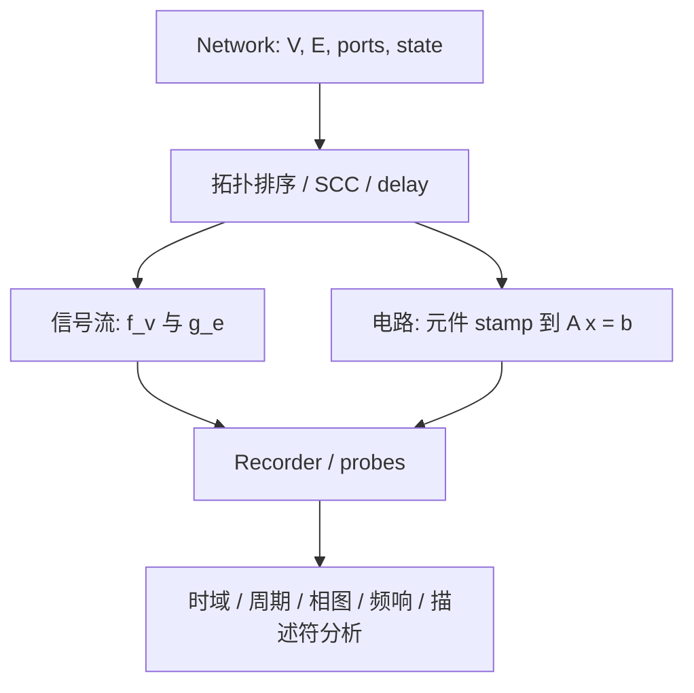

# Netlab 数学原理总览

> 本页是数学文档的入口与地图，不再复制求解器和元件的长篇推导。具体公式以三个专题文档为单一事实源；正文中的 `file:line` 是当前工作树锚点，重构后请优先按函数名复核。
>
> **范围声明**：本文档只覆盖节点连接网络、信号流、电路 MNA、数值求解和分析子系统。FEM 与并网逆变器控制链不属于本轮数学文档的对外说明范围。

## 0. 符号表

| 符号 | 含义 |
| --- | --- |
| `V, E` | 节点集合与有向连接集合 |
| `s(e), t(e)` | 连接 `e` 的源节点与目标节点 |
| `D` | 节点记录域：字段名到标量/数组的映射 |
| `S_v, S_e` | 节点与连接的跨步状态 |
| `Θ_v, Θ_e` | 节点与连接参数 |
| `f_v` | 节点更新算子 |
| `g_e` | 连接/方法传递算子 |
| `Δt` | 单步时间增量 |
| `z⁻¹` | 单步延迟算子 |
| `A x = b` | 电路 MNA 线性化系统 |
| `E ẋ = A x + B u` | 描述符状态空间形式 |

## 1. 全局地图

Netlab 把系统建模为“节点 + 有向连接”的离散网络：

四个层次分别在以下专题展开：

| 专题 | 内容 | 主要实现锚点 |
| --- | --- | --- |
| [架构数学](math/ARCHITECTURE_MATH.md) | 网络形式化、状态/参数、求值顺序、SCC、事务、MNA、Newton、离散积分、复杂度 | `netlab/core/model/graph.py`、`netlab/core/compute/circuit/solver.py` |
| [元件数学](math/ELEMENT_MATH.md) | 12 种信号流方法与电路元件 `prepare/stamp/update` 方程 | `netlab/core/compute/methods.py`、`netlab/core/compute/circuit/elements.py` |
| [分析数学](math/ANALYSIS_MATH.md) | 采样、指标、周期、频谱、相图、传递函数、Bode、M0–M4 描述符分析 | `netlab/core/compute/analysis.py`、`transfer.py`、`circuit/descriptor_analysis.py` |

## 2. 两种计算模式

| 模式 | 基本未知量 | 主要计算 | 拓扑/状态特点 |
| --- | --- | --- | --- |
| 信号流 | 节点记录 `D` | 连接方法传递数据，节点计算并更新记录 | 非延迟边按拓扑序；延迟边读取上一拍 |
| 电路 | 非地节点电压与支路电流 | 元件盖章，Newton 迭代线性化后求 MNA | 电容/电感保留历史状态，步失败回滚 |

二者共享 `dt`、场景时钟和记录/分析边界，但不共享同一套未知量。不要把信号层的 `resistor` 方法等同于电路层的物理电阻元件。

## 3. 阅读路径

1. 先读 [架构数学](math/ARCHITECTURE_MATH.md)，建立 `N=(V,E,s,t,Port,delay)`、算子和求解顺序。
2. 再读 [元件数学](math/ELEMENT_MATH.md)，查看每种连接方法和 MNA 元件的具体离散式。
3. 最后读 [分析数学](math/ANALYSIS_MATH.md)，把录制数据、频响和描述符结果接起来。
4. 需要代码导航时回到 [CODE_GUIDE.md](CODE_GUIDE.md)；需求/决策以 [REQUIREMENTS_AND_RULES.md](REQUIREMENTS_AND_RULES.md) 为准。

## 4. 图示索引

正文以 Mermaid 为可编辑主图；以下 SVG 是同一语义的静态阅读附件：

- [网络结构](math/assets/network-structure.svg)
- [信号流一拍求值](math/assets/signal-evaluation.svg)
- [MNA 装配与 Newton](math/assets/mna-newton.svg)
- [分析数据流](math/assets/analysis-pipeline.svg)

这些 SVG 是文档维护用的静态 companion，不是运行时生成的源码资产。Archify CLI 当前提供独立 HTML（内含 SVG）而没有直接写出单独 SVG 的命令；因此本目录保留 Mermaid 作为可编辑真源，SVG 只承担快速阅读和离线预览。

## 5. 实现边界

- 信号连接方法注册在 `netlab/core/compute/methods.py`，统一接收源/目标只读视图、参数、跨步状态和 `dt`。
- 电路真实实现位于 `netlab/core/compute/circuit/`；`core/compute/nodal.py` 是兼容导出层，不是推导的主要代码位置。
- M0–M4 描述符分析的 DC 工作点、频响、非线性线性化、极点/零点和阶跃数学已实现并有测试；后端 `POST /api/analysis/tf` 支持 `mode="circuit"`，前端「小信号旁路」入口（`frontend/app/ac_analysis.ts:575-587`）亦已发送电路负载（通用 `frontend/app/analysis.ts:108-112` 仍走信号负载），详见[分析数学 §7.5 接入状态](math/ANALYSIS_MATH.md)。
- 代码实现、测试结果和计划是三类不同事实。本文只描述已在源码中找到的实现；未执行的测试不在这里宣称通过。
