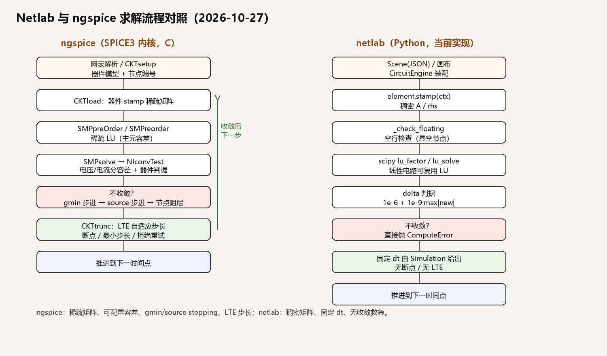

# Netlab 与 ngspice 求解内核对比（2026-10-27）

> 最后修改：2026-10-28 01:16
>
> 目的：以 [ngspice](https://github.com/ngspice/ngspice) 的 SPICE3 内核为参照，检查 netlab 当前
> MNA/Newton/时间积分实现的水平，列出**可改进点**与**可新增功能**。本文只做分析，不改代码。
> 对比基线：ngspice `master`（`configure.ac` 的 `AC_INIT([ngspice], [26])`），netlab 当前工作区
>（`pytest` 259 passed，静态 3.7.7）。
> 结论先行：**两者不是同一类产品**——ngspice 是工业级数值内核，netlab 是交互式教学/小型系统仿真器。
> netlab 的数值核心在“小规模、可交互、可解释”上够用，但在**收敛救急、时间步控制、器件模型、频域分析**
> 四块与 ngspice 有明显代差；矩阵稀疏化反而是次要问题。

---

## 0. 一句话结论

| 维度 | 谁更强 | 说明 |
| --- | --- | --- |
| 数值稳健性（非线性收敛） | **ngspice 明显强** | gmin stepping、source stepping、节点阻尼、器件级收敛判据、可配置迭代上限 |
| 时间积分/步长 | **ngspice 明显强** | 梯形/Gear 1–6 阶、LTE 自适应步长、断点、步长拒绝重试 |
| 器件模型 | **ngspice 明显强** | Gummel–Poon BJT、MOS Level 1–3 / BSIM3/4 等、结电容、温度、噪声、SOA |
| 分析类型 | **ngspice 明显强** | OP/DC/AC/TRAN/NOISE/DISTO/PZ/SENS/TF、`.measure`（参数扫描用 `.dc`/control 循环） |
| 小规模求解速度 | **netlab 不落后** | 稠密 LU + 线性电路 LU 复用，几百未知量内很快；Python 开销可接受 |
| 大规模性能 | **ngspice 强** | 稀疏矩阵 + C（部分器件支持 OpenMP）；netlab 稠密 O(n³)，大规模会爆内存/时间 |
| 工程/数据/交互 | **netlab 明显强** | JSON 工程、模块库、双模型、实时画布、校验和/快照、Python 扩展 |
| 可读性/可维护性 | **netlab 强** | Python 单文件求解器 + 测试；ngspice 是 30 多年历史的 C 代码，全局状态多 |
| 可扩展性 | 各有优势 | ngspice 的 C 器件/XSPICE 代码模型更“底层”；netlab 的 Python 行为元件更快落地 |

**判断**：netlab 不需要、也不应该变成第二个 ngspice；应优先补“让现有交互式仿真更可靠”的三件事
（收敛救急、DC 工作点、断点/自适应步长），再补“用户能直接看到价值”的 AC/Bode 与温度/噪声，
最后才考虑器件模型精度和稀疏矩阵。

---

## 1. 两边的求解骨架

### 1.1 ngspice（SPICE3 血统）

```
网表解析 → CKTsetup（器件实例/模型） → 分析循环（CKTdoJob）
  → 每个时间点/迭代：CKTload（器件 stamp 到稀疏矩阵）
  → SMPpreOrder / SMPreorder / SMPluFac / SMPsolve（稀疏 LU）
  → NIconvTest（节点电压/支路电流分别判据）+ 器件 CKTconvTest
  → 不收敛：gmin stepping → source stepping → 节点阻尼
  → 瞬态：CKTtrunc 用 LTE 截断误差决定下一步 delta；断点/最小步长
```

关键入口（均可直接对照源码）：

- `NIiter()`：`src/maths/ni/niiter.c`，Newton 主循环；内部至少按 100 次迭代处理
  （`if (maxIter < 100) maxIter = 100;`）。
- `NIconvTest()`：`src/maths/ni/niconv.c`，电压节点用 `reltol·max(|old|,|new|)+vntol`，
  电流/其他未知量用 `+abstol`，另外还有器件级 `CKTconvTest`。
- `CKToper()` / gmin/source stepping：`src/spicelib/analysis/cktop.c`，先直接 `NIiter`，
  失败后按 `CKTnumGminSteps` 走 `dynamic_gmin`/`spice3_gmin`，再走
  `gillespie_src`/`spice3_src`。
- `NIintegrate()`：`src/maths/ni/niinteg.c`，梯形法 1/2 阶、Gear 1–6 阶的 `CKTag` 系数。
- `CKTtrunc()`：`src/spicelib/analysis/ckttrunc.c`，按 LTE 计算 `timetemp` 并
  `*timeStep = MIN(2 * *timeStep, timetemp)` 限制下一步。
- `dctran.c`：瞬态主循环、`CKTdelta` 接受/拒绝、断点 `CKTbreaks`、最小步长 `CKTdelmin`。
- 稀疏线性代数：`src/maths/sparse/`（Sparse 1.3 血统），预排序 + 主元容差 + 稀疏 LU。

### 1.2 netlab（当前）

```
Scene(JSON) → CircuitEngine（网络合并/引脚装配） → CircuitSolver.step(dt)
  → element.prepare(dt) → Newton 循环
      → element.stamp(ctx)（逐个元件写稠密 A/rhs）
      → _check_floating（空行检查）
      → _solve_matrix（scipy.linalg.lu_factor / lu_solve，线性电路可复用 LU）
      → delta 判据
  → element.commit → 回写 node_voltages
```

关键位置：

- `CircuitSolver.step()`：`netlab/core/compute/nodal.py:1320`；Newton 循环 `:1332`；
  收敛判据 `:1359`（`delta <= 1e-6 + 1e-9·max|new|`）；失败直接抛错 `:1378`。
- `_build_index()`：`netlab/core/compute/nodal.py:1257`，稠密矩阵分配在 `:1297`。
- `_solve_matrix()`：`netlab/core/compute/nodal.py:1410`，线性电路 LU 缓存，非线性每次重新分解。
- `_check_floating()`：`netlab/core/compute/nodal.py:1451`，只检查“整行为 0”的悬空节点。
- 时间步：`Simulation._advance_locked(dt)`，`dt` 由 `SimConfig` 固定给出；`Scene.step(dt)` 透传。
- 详细代码地图见 [SOLVER_CODE_MAP.md](SOLVER_CODE_MAP.md)。

### 1.3 一张图看懂两条流程



> 左：ngspice 的稀疏 LU + 收敛救急 + LTE 步长；右：netlab 的稠密 LU + 固定 dt。
> 红色块是“失败分支”，也是当前 netlab 与 ngspice 差距最大的地方。
> 源图：本文件同目录 `assets/solver-compare.png`（Python/Pillow 生成，可重跑）。

---

## 2. 逐项对比

### 2.1 MNA 装配

| 项 | ngspice | netlab | 评价 |
| --- | --- | --- | --- |
| 方程形式 | 改进节点法，电压源/电感等作为支路未知量 | 同样是 MNA，`needs_branch` 元件追加支路未知量 | 同源 |
| 矩阵存储 | 稀疏表（行/列/值 + 预排序） | 稠密 `numpy.ndarray(n,n)` | netlab 小规模简单，大规模吃亏 |
| 装配方式 | 每个器件 `CKTload` 写矩阵 | 每个 `CircuitElement.stamp(ctx)` 写矩阵 | 同构；netlab 用 Python 对象，扩展容易但每次全量重装配 |
| 网络合并 | 节点由网表决定 | 纯导线 `wire` 做 union-find，合并为 MNA 代表节点 | netlab 特性，更贴近“画图即建模” |
| 接地/多接地 | 节点 0 为参考 | 多接地自动合并，支持 `ground` 节点 | netlab 更宽松（R21/D44） |
| 引脚映射 | 器件端口按网表顺序 | `PinSpec`/`PinMap`，支持单端运放等 | netlab 对“器件节点化”支持更好 |

### 2.2 线性代数

| 项 | ngspice | netlab |
| --- | --- | --- |
| 求解器 | 稀疏 LU（Sparse 1.3），主元绝对/相对容差，预排序 | 稠密 LU（SciPy `lu_factor/lu_solve`），无主元容差参数 |
| 复用 | 符号/数值分解按需复用 | 线性电路矩阵不变时复用 LU（`:1426-1433`） |
| 奇异诊断 | `SMPgetError` 报“哪两个节点导致奇异”；主元容差 + 缩放 | 空行/悬空检查 + LU 零主元映射；无行列缩放，细 dt 下条件数大时易误判 |
| GPU | 无（CPU 稀疏） | 稠密 CuPy 路径（`accel.py`，规模阈值 192；本机未验证 GPU） |
| 复杂度 | 稀疏近线性，适合数千~数十万未知量 | 稠密 O(n³) 分解、O(n²) 内存；数百未知量内很快 |

**结论**：netlab 的“线性电路 LU 复用”是聪明的工程优化；但非线性电路每个 Newton 迭代都要
重新 `lu_factor` 稠密矩阵，规模一大就被 ngspice 拉开。是否上稀疏，取决于 netlab 的目标规模；
若继续定位“几十~几百节点交互电路”，稀疏化优先级低于收敛与步长。

**条件数与细步长（2026-10-28 实测）**：netlab 的电容 companion 电导是 `2C/dt`，`dt` 从 `1e-4` 缩到 `1e-6` 时，100µF 的 `g` 会升到 200 S，和 1k/10k 电阻混在同一稠密矩阵里，条件数可到 `1e15`。这类“病态但可解”的矩阵在双精度下主元接近机器精度，不能被当成真奇异。ngspice 用**稀疏 LU + 主元容差 + 行列缩放/gmin**处理；netlab 目前只做阈值判断（已从 `1e-14` 放宽到 `1e-16`），正确做法是加**矩阵缩放（行/列均衡）**或**奇异时回退 gmin**，而不是继续放宽阈值。

### 2.3 非线性迭代（Newton）

| 项 | ngspice | netlab | 差距 |
| --- | --- | --- | --- |
| 迭代上限 | 可配置（`itl1/itl4`），`NIiter` 至少按 100 次 | 固定 60（`MAX_NEWTON_ITERATIONS`） | 中 |
| 收敛判据 | 电压/电流分开，`reltol+vntol/abstol`，器件级 `CKTconvTest` | 所有未知量统一 `1e-6 + 1e-9·max`，只看更新量 delta | **大** |
| 残差检查 | 器件方程/节点 KCL 残差参与判据 | 不检查残差 | **大** |
| 初始猜测 | `nodeset`/`ic`/上次解 | 上次解；无 `nodeset` | 中 |
| 失败救急 | gmin stepping、source stepping、节点阻尼 | 直接抛 `ComputeError`，提示“减小 dt” | **大** |
| 诊断 | `CKTtroubleNode`/`CKTtroubleElt`，可打印坏节点 | 只有“未收敛”一句 | 大 |
| 迭代信息 | 统计每步迭代/分解/求解耗时 | `last_iterations`/`last_solve_ms` | 接近 |

**netlab 的具体风险**：

1. `delta` 很小并不等于 KCL 残差小；在病态矩阵/近奇异时可能“假收敛”。
2. 所有未知量共用一个绝对容差，支路电流（可能几十 A）和节点电压（mV 级）用同一标准不合理。
3. 没有 gmin/source stepping，某些电路（强非线性、多解、上电瞬间）只能靠用户手动减小 dt，
   交互体验差。
4. 失败信息不带“哪个节点/哪个元件”，排查成本高。

### 2.4 时间积分与步长

| 项 | ngspice | netlab |
| --- | --- | --- |
| 方法 | 梯形法（1/2 阶）、Gear（1–6 阶），方法/阶数可配 | 每元件梯形法/后向欧拉（`integration` 配置），无 Gear |
| 步长 | LTE 自适应，`CKTtrtol` 控制；步长可增可减、可拒绝重试 | 固定 `dt`（`SimConfig`） |
| 断点 | `CKTbreaks`：源跳变、开关动作等强制落点 | 无断点；方波/PWM 边沿可能被跨过 |
| 最小步长 | `CKTdelmin` | 无；dt 由用户/UI 决定 |
| 预测/校正 | `CKTpred` + 校正，LTE 用预测-校正差 | 无预测；梯形法直接 companion |
| 刚性电路 | Gear 阶数可调，适合刚性 | 只有后向欧拉可选，精度低 |

**影响**：netlab 的固定 dt 让“回放/录制/测试”确定性强，这是优点；但方波边沿、开关抖动、
强刚性电路会出现“看起来不对”的结果，用户只能靠减小 dt。一个折中方案是**只在断点处强制
对齐 dt**，不改全局自适应，这样既保持确定性又避免漏边沿。

### 2.5 器件模型

| 器件 | ngspice | netlab |
| --- | --- | --- |
| BJT | Gummel–Poon（`bjt`），含结电容、Early、击穿、温度、噪声 | 行为级：B-E 分段线性 + β 放大；新增 datasheet 限值参数但不参与求解（`transistors.py`） |
| MOSFET | Level 1–3 / BSIM3/4 等，含体效应、沟道长度调制、电容 | 平方律，无体效应/电容/亚阈 |
| 二极管 | 肖克利 + 结电容 + 击穿 + 温度 + 噪声 | 肖克利 + 串联电阻（`nodal.py` Diode） |
| 运放/比较器 | 可用子电路/宏模型搭 | 行为级 tanh/饱和（`OpAmp/Comparator`） |
| 变压器/互感 | 耦合电感/理想变压器 | 有（`magnetics.py`），行为级 |
| 数字/逻辑 | XSPICE 事件驱动数字模型 | 行为级逻辑门/DFF/计数器/移位/ADC/DAC |
| 温度 | `.temp` 全局 + 器件温度 | 仅部分元件有 `temperature` 参数，未形成统一温度模型 |
| 噪声 | `NOISE` 分析 + 器件噪声源 | 无 |

**评价**：netlab 的器件模型是“够画、够讲、够跑趋势”，不是“够对数据手册”。如果目标包含
“和 LTspice/ngspice 对数值”，BJT/MOS 是最大短板；如果目标是教学与交互，行为级反而更稳、
更快、更容易解释。

### 2.6 分析类型

| 分析 | ngspice | netlab | 备注 |
| --- | --- | --- | --- |
| OP（工作点） | `dcop.c` / `cktop.c` | 隐式（瞬态第一拍），无独立 OP 入口 | 建议补 |
| DC 扫描 | `dctrcurv.c` / `dcpss.c` | 无 | 可补 |
| AC 小信号 | `acan.c` + `NIaciter`，复数 MNA | 无（只有录制 FFT 与符号传递函数） | **最值得补** |
| TRAN | `dctran.c` | 有，固定 dt | 见 2.4 |
| NOISE | `noisean.c` | 无 | 后置 |
| DISTO | `distoan.c` | 无 | 后置 |
| PZ（零极点） | `pzan.c` | 无 | 后置 |
| SENS（灵敏度） | `cktsens.c` | 无 | 后置 |
| TF | 支持 | 符号 `sympy` 逐级拼接（`analysis.py`） | netlab 的“可解释”是特色 |
| `.measure` | 支持 | 指标（超调/上升/调节）硬编码 | 可做通用 measure |
| 参数扫描 | `.dc` 嵌套/control 循环 | 无 | 可补 `.step` 式扫描 |

### 2.7 网表、子电路、模型卡

- ngspice：完整 SPICE 网表、`.model`、`.subckt`、`.param`、`.include`、`.lib`、`.if/.else`，
  以及 XSPICE 的 `A` 器件/代码模型；生态里有大量厂商模型。
- netlab：JSON 工程 + `.block` 模块（行为/结构双模型）+ Python 扩展；没有网表解析器，
  没有 SPICE `.model` 卡，不能直接吃厂商模型。

**判断**：不建议 netlab 自研完整 SPICE 解析器（工作量大、兼容坑多）。更划算的是：
**支持导入 ngspice/LTspice 的一个子集**（R/L/C/独立源/二极管/BJT/MOS/`.model`/`.subckt`），
把“外部模型”变成可运行的 netlab 模块；导出同理。这样既借生态，又不背全部历史包袱。

### 2.8 扩展机制

| 项 | ngspice | netlab |
| --- | --- | --- |
| 器件扩展 | C 代码 + XSPICE 代码模型（`src/xspice/`），需编译 | Python `@node/@method` 扩展（AST 限制），热加载；电路元件目前需改源码 |
| 行为建模 | B 源、XSPICE 模拟/数字代码模型 | 行为元件 + 节点/连接函数 + 模块 |
| 数字事件 | XSPICE 事件驱动（`src/xspice/evt/`） | 固定时间步的行为级数字 |
| 学习曲线 | 高（C/构建系统/全局状态） | 低（Python/JSON） |

**评价**：netlab 的扩展性对“快速加一个行为元件/自定义公式”更友好；ngspice 对“精确器件模型/
工业模型”更友好。两者互补。

### 2.9 性能与规模

- ngspice：稀疏 + C + 预排序，器件级 OpenMP（`configure.ac` 有 OpenMP 选项）；大规模优势明显。
- netlab：NumPy 稠密 + 逐元件 Python 循环；小矩阵向量化好，但每个 Newton 迭代都重新
  `stamp` 全部元件并 `lu_factor`，未知量上千后内存/时间会快速上升。
- 建议先做基准：用同一 RLC/二极管整流/共射电路，在 100/500/2000 未知量下对比 netlab 与
  ngspice 的单步耗时与内存；再决定是否上稀疏。**不要凭感觉上 KLU/SuperLU**。

### 2.10 工程、数据与交互

| 项 | ngspice | netlab |
| --- | --- | --- |
| 输入 | 网表/命令 | JSON 工程 + 画布 + 检查器 |
| 工程管理 | 文件 + 脚本 | 目录式工程、模块库、快照、校验和、备份 |
| 可视化 | nutmeg 波形 | 实时画布、曲线、分析面板、桌面壳 |
| 数据安全 | 用户自己管 | 原子写入、校验和、缺失库降级只读 |
| 可测试性 | 回归网表 | pytest 259 项 + CDP |

**这是 netlab 的核心优势，不要为了“像 SPICE”而牺牲。**

---

### 2.11 核心代码对照（原文摘录 + 数学注解）

> 下面只摘关键行，完整实现请按链接读源码。数学注解用来解释“这些行为什么这么写”，
> 而不是复述代码。

#### A. Newton 主循环

**ngspice**（`NIiter()`，`src/maths/ni/niiter.c`）：

```c
error = CKTload(ckt);                       /* 器件 stamp 到 A/rhs */
error = SMPreorder(ckt->CKTmatrix,          /* 稀疏 LU：预排序 + 主元容差 */
                  ckt->CKTpivotAbsTol,
                  ckt->CKTpivotRelTol,
                  ckt->CKTdiagGmin);
SMPsolve(ckt->CKTmatrix, ckt->CKTrhs, ckt->CKTrhsSpare);
...
if (ckt->CKTnoncon == 0 && iterno != 1)
    ckt->CKTnoncon = NIconvTest(ckt);       /* 节点/支路分别判据 */
```

**netlab**（`CircuitSolver.step()`，`netlab/core/compute/nodal.py:1332`）：

```python
for iteration in range(MAX_NEWTON_ITERATIONS if nonlinear_elements else 1):
    matrix.fill(0.0); rhs.fill(0.0)
    for element in self.elements:
        element.stamp(ctx)
    self._check_floating(matrix)
    new_solution = self._solve_matrix(matrix, rhs, dt)
    delta = float(np.max(np.abs(new_solution - solution)))
    if iteration > 0 and delta <= NEWTON_ABS_TOL + NEWTON_REL_TOL * magnitude:
        converged = True
        break
```

**共同数学**：解非线性代数方程 `F(x)=0`。Newton 每步在当前猜测 `x_k` 处线性化：

```
J(x_k) · Δx = −F(x_k),     x_{k+1} = x_k + Δx
```

MNA 里的 `J` 就是盖章后的 `A`，右端是 `−F`（历史项/源项移到右边）。两者都在做
“stamp → 解线性方程 → 更新猜测”的循环；差别在**判据**和**失败后的补救**：

- ngspice 用 `|x_new − x_old| ≤ reltol·max(|x_old|,|x_new|) + tol`，且电压用 `vntol`、
  电流/其他用 `abstol`；另外还有器件级 `CKTconvTest`（如 BJT 的结电压收敛）。
- netlab 对所有未知量统一 `1e-6 + 1e-9·max|new|`，只比较更新量，不检查 `F` 的残差。

#### B. 收敛救急：gmin / source stepping

**ngspice**（`cktop.c` 的 `CKToper()`）：

```c
converged = NIiter(ckt, iterlim);
if (converged != 0) {
    if (ckt->CKTnumGminSteps >= 1) ... dynamic_gmin / spice3_gmin ...
    if (!converged && ckt->CKTnumSrcSteps >= 1) ... source stepping ...
}
```

数学上，gmin stepping 先解一个“更容易”的电路：在每条节点方程的对角线加 `gmin`，

```
(G + gmin·I) · x = b
```

从较大的 `gmin` 开始收敛，再按因子缩小 `gmin`，用上一解作初值，直到 `gmin→0` 回到原电路。
source stepping 则把独立源统一乘以 `α`（0→1），用上一解的 `x` 作下一初值。

**netlab**：没有这一步，直接

```python
if not converged:
    raise ComputeError("非线性电路在 60 次 Newton 迭代内未收敛…")
```

所以用户只能“减小 dt”或改参数；这是交互体验上最明显的差距。

#### C. 时间积分：梯形法/后向欧拉

**ngspice**（`NIintegrate()`，`src/maths/ni/niinteg.c`）：

```c
case TRAPEZOIDAL:
  case 2:
    ckt->CKTstate0[ccap] = -ckt->CKTstate1[ccap] * ckt->CKTag[1]
        + ckt->CKTag[0] * (ckt->CKTstate0[qcap] - ckt->CKTstate1[qcap]);
...
*ceq = ckt->CKTstate0[ccap] - ckt->CKTag[0] * ckt->CKTstate0[qcap];
*geq = ckt->CKTag[0] * cap;
```

**netlab**（`Capacitor.prepare()`，`netlab/core/compute/nodal.py:195`）：

```python
if self.integration == "backward_euler":
    self.conductance = cache / dt
    self.source_current = -self.conductance * previous_v
else:
    self.conductance = 2.0 * cache / dt
    self.source_current = (-self.conductance * previous_v - previous_i)
```

**数学注解**：电容的梯形法离散为

```
i_k = (2C/h)·(v_k − v_{k−1}) − i_{k−1}
    = g·v_k + i_eq,     g = 2C/h,  i_eq = −g·v_{k−1} − i_{k−1}
```

后向欧拉是 `g = C/h, i_eq = −g·v_{k−1}`。这正是 netlab 的两行 companion 参数；
ngspice 用 `CKTag` 统一表达 1/2 阶梯形与 1–6 阶 Gear，所以能切阶数，netlab 只能二选一。

#### D. 步长控制：LTE

**ngspice**（`CKTtrunc()`，`src/spicelib/analysis/ckttrunc.c`，梯形 1 阶分支）：

```c
tol = MAX(fabs(ckt->CKTrhs[i]), fabs(ckt->CKTpred[i])) * ckt->CKTlteReltol
      + ckt->CKTlteAbstol;
diff = ckt->CKTrhs[i] - ckt->CKTpred[i];
tmp = ckt->CKTtrtol * tol * 2 / diff;
tmp = ckt->CKTdeltaOld[0] * sqrt(fabs(tmp));
timetemp = MIN(timetemp, tmp);
...
*timeStep = MIN(2 * *timeStep, timetemp);
```

**netlab**：`dt` 由 `Simulation` 固定给出，没有“预测-校正差 → 误差估计 → 缩步/拒绝”的闭环。

**数学注解**：LTE 用“校正值 `x_corr` 与预测值 `x_pred` 的差”估计局部截断误差：

```
h_new ≈ h · sqrt( trtol · tol / |x_corr − x_pred| )
```

误差大就缩步、重算该时间点；误差小才允许下一步放大（ngspice 限制最多 2×）。
netlab 缺这一层，所以方波边沿/刚性电路只能靠用户手动减小 `dt`。

---

> 每条都给出证据位置与影响；不把“没实现”当成 bug，但要把“会误导用户”的标出来。

## 3. netlab 当前实现的具体问题（按影响排序）

### 3.1 P0-1 收敛判据太粗，可能假收敛

- 证据：`netlab/core/compute/nodal.py:1359` 只比较 `new_solution - solution` 的最大值，
  阈值 `1e-6 + 1e-9·max|new|`；没有 KCL 残差、没有电压/电流分容差、没有器件级判据。
- 影响：病态/近奇异时可能提前宣布收敛；支路电流与节点电压共用容差不合理。
- 建议：引入 `vntol/abstol/reltol`，对节点电压与支路电流分别判据；增加残差范数检查
  `||A·x - b||`；把 `trouble node/element` 写进错误信息。

### 3.2 P0-2 没有收敛救急

- 证据：`netlab/core/compute/nodal.py:1378` 直接抛 `ComputeError`；无 gmin/source stepping/阻尼。
- 影响：强非线性电路只能靠用户减小 dt；交互体验差。
- 建议：先实现 **gmin stepping**（沿对角线加 `gmin`，逐步减小到 0），再实现 source stepping
  （源按 0→1 斜坡）；节点阻尼可作为可选。

### 3.3 P0-3 时间步无断点

- 证据：`Simulation._advance_locked` 固定 `dt`；`Scene.step(dt)` 无事件时间。
- 影响：方波/PWM/开关边沿可能被跨过；结果依赖 dt 相位。
- 建议：从波形参数计算跳变时刻，`Simulation` 在断点处缩短 dt 并精确落点；保持“录制时间戳”
  与实际步长一致。

### 3.4 P0-4 奇异矩阵诊断弱

- 证据：`_check_floating`（`:1451`）只查空行；SciPy 奇异异常没有节点名。
- 影响：用户只看到“求解失败”，不知道该接哪个节点。
- 建议：捕获 `LinAlgError`，用 LU 的 `U` 对角线找零主元对应未知量，映射回节点名；
  错误信息给“疑似悬空/缺少直流通路的节点”。

### 3.5 P1-1 无独立 DC 工作点

- 证据：`CircuitSolver.step` 从零状态开始，瞬态第一拍即工作点；没有 `.op` 入口。
- 影响：无法只算静态工作点；AC 分析也缺基础。
- 建议：抽出 `solve_operating_point()`（dt→∞ 或源置直流），UI 提供“计算工作点”。

### 3.6 P1-2 无自适应步长 / Gear

- 证据：`dt` 固定；积分方法只有梯形/后向欧拉。
- 影响：刚性电路精度/稳定性差；用户只能手动调 dt。
- 建议：先加“断点 + 最大步长”，再加 LTE 自适应（梯形/ Gear2），保留固定 dt 模式作为
  “确定性回放”选项。

### 3.7 P1-3 无 AC 小信号

- 证据：`analysis.py` 只有录制 FFT、指标、符号传递函数；无复数 MNA。
- 影响：无法画 Bode/阻抗/相位；R12/P3 的 Bode 一直悬着。
- 建议：在工作点线性化，构造 `G + jωC` 复数矩阵，扫频求节点响应；复用现有元件
  `stamp` 的线性部分，新增 `stamp_ac(ctx, s)`；UI 加 Bode 页。

### 3.8 P1-4 器件模型精度

- 证据：`transistors.py` 的 BJT 是分段线性 `vbe_on/rin/beta`；MOS 是平方律；无限值参与求解。
- 影响：与数据手册/ngspice 对不上；温度/结电容/击穿缺失。
- 建议：分阶段——BJT 加 Early/结电容/温度；MOS Level 1 加体效应/沟道长度调制；
  二极管加结电容。不要一次上 BSIM。

### 3.9 P2 其他

- 无 `.measure` 通用机制（指标写死）。
- 无 DC 扫描/参数扫描/Monte Carlo。
- 无噪声/失真/PZ/灵敏度。
- 无网表导入导出。
- 温度未统一。
- 无 SOA/限值告警（新加的 datasheet 限值目前只展示）。

---

## 4. 可改进路线（按性价比排序）

> 原则：先“让现有电路更可靠”，再“让用户看到新能力”，最后“追模型精度”。
> 每项都给出改动位置与验收方式，便于拆票。

### P0（稳定性，1–2 天/项）

0. **矩阵缩放/条件数保护（新增，优先于 gmin）**：对 MNA 的行/列做均衡（或按 `1/max|row|` 缩放）后再 LU；奇异时先尝试 gmin 回退，再报错。验收：用户的 `dt=1e-6` 工程不再因条件数被误判，且真奇异（双电压源并联）仍报错。

1. **求解器选项对象**
   - 位置：`project.py` 的 `sim` 配置 + `scene.py` 传给 `CircuitSolver`；`nodal.py` 读选项。
   - 内容：`reltol/abstol/vntol/max_iter/gmin/gmin_steps/src_steps/method/max_step`。
   - 验收：旧工程无该字段时用默认值；测试覆盖序列化往返。
2. **收敛判据升级 + 诊断**
   - 位置：`CircuitSolver.step` 的 delta 判断；新增 `_convergence_error`。
   - 内容：电压/电流分容差、残差范数、`trouble_node/trouble_element`。
   - 验收：构造“假收敛”用例（近奇异）能报错并指出节点。
3. **gmin stepping + source stepping**
   - 位置：`CircuitSolver.step` 失败分支；新增 `_gmin_step`/`_source_step`。
   - 验收：共集/二极管整流/上电瞬间在默认 dt 下可收敛；失败时才回退，不影响线性电路性能。
4. **断点对齐**
   - 位置：`Simulation._advance_locked` + `waveform` 的跳变时刻。
   - 验收：方波 1 kHz、dt=1e-4 时边沿不被跨过；录制时间戳严格递增。
5. **奇异诊断**
   - 位置：`_solve_matrix` 捕获 `LinAlgError`；`_check_floating` 扩展。
   - 验收：悬空节点错误信息含节点名；缺直流通路给出建议。

### P1（能力，3–5 天/项）

6. **DC 工作点入口**：`solve_operating_point()`；UI“计算工作点”；AC 的前置。
7. **自适应步长（LTE）**：先梯形法 LTE，再加 Gear2；保留固定步长模式。
8. **AC 小信号 + Bode**：复数 MNA、扫频、幅相曲线；与解析 RC/RL/RLC 对照。
9. **温度**：统一 `temperature`、`.temp` 扫描；器件参数随温度缩放。
10. **通用 `.measure`**：上升/超调/周期/均值/THD 等可配置指标。

### P2（生态，按需）

11. **模型精度**：BJT Gummel–Poon（先简化版）、MOS Level 1 体效应、二极管结电容。
12. **网表子集导入/导出**：R/L/C/源/二极管/BJT/MOS + `.model/.subckt`；映射到模块。
13. **DC/参数扫描、Monte Carlo、corner**：复用求解器，批量跑。
14. **噪声/失真/PZ/灵敏度**：优先级低于 AC。
15. **SOA/限值告警**：用已登记的 Vceo/Ic_max/Pd 做运行后检查。

### P3（性能，规模上来再做）

16. **稀疏矩阵**：先基准，再选 SuperLU/KLU；保留稠密小矩阵快路径。
17. **并行/批量**：Monte Carlo 并行；器件 stamp 的向量化。
18. **XSPICE 式代码模型/事件驱动**：只在数字混合仿真成为刚需时做。

### 4.5 功能候选清单（按用户价值）

| 功能 | 用户价值 | 依赖 | 粗略工作量 |
| --- | --- | --- | --- |
| AC 扫频 + Bode（幅/相） | 直接看到滤波/谐振/稳定性 | DC 工作点 + 复数 MNA | 3–5 天 |
| 工作点 / DC 扫描 | 静态偏置、传输特性曲线 | 现有 Newton | 1–2 天 |
| 断点 + 自适应步长 | 方波/PWM/开关电源结果可信 | 时间步改造 | 3–5 天 |
| gmin/source stepping + 诊断 | 难收敛电路不再“只会报错” | 现有 Newton | 2–3 天 |
| 温度 `.temp` 扫描 | 器件温漂/热设计 | 器件温度模型 | 2–4 天 |
| 参数扫描 / Monte Carlo | 容差、良率、最坏情况 | 批量求解 | 3–5 天 |
| 通用 `.measure` | 自动出上升/超调/THD/均值 | 录制数据 | 1–2 天 |
| 网表子集导入/导出 | 吃厂商模型、和外部工具互通 | 解析器 + 映射 | 1–2 周 |
| 收敛助手（推荐参数） | 失败时给“先试 gmin/减小 dt/加节点” | 诊断信息 | 2–3 天 |
| SOA/限值告警 | 用已登记的 Vceo/Ic/Pd 做运行后检查 | 元件限值参数 | 1–2 天 |
| 噪声分析 | 低噪声放大器/传感器设计 | 器件噪声模型 | 1–2 周（后置） |

---

## 5. 不建议做的事

1. **不要自研完整 SPICE 网表解析器**：兼容坑（续行、参数表达式、模型卡、子电路、单位后缀）
   会吞掉大量时间；先做子集导入。
2. **不要为了“像 ngspice”放弃固定 dt 的确定性**：回放、测试、教学都需要可复现；自适应步长
   应作为可选模式，且记录实际时间戳。
3. **不要直接复制 ngspice 代码**：先看仓库 `COPYING` 确认许可证兼容性；未确认前只能参考
   算法自行实现（MNA/Newton/LTE 都是公开教科书算法）。
4. **不要在未基准确认前上稀疏/KLU**：几百未知量内稠密 LU 更快；稀疏的预处理/排序开销
   可能反而拖慢交互。
5. **不要一次上 BSIM/Verilog-A**：维护成本极高，且与 netlab 的行为级/教学定位冲突。

---

## 6. 验证方案（把 ngspice 当 oracle）

1. **基准电路集**：RC 低通、RL 阶跃、RLC 谐振、二极管整流、共射放大、运放反相、555 方波、
   变压器/互感。
2. **对齐方式**：同一拓扑/参数/初始条件，netlab 用固定小 dt，ngspice 用 `trap` + 相同
   `maxstep`；比较节点电压/支路电流。
3. **容差**：线性电路相对误差 `<1e-6`；非线性 `<1e-3`（行为模型差异要单独标注）。
4. **收敛测试集**：上电瞬间、强非线性（二极管+运放饱和）、多解电路；验证 gmin/source stepping。
5. **AC 验证**：RC/RL/RLC 的截止频率/相位与解析解对比；与 ngspice `.ac` 对比。
6. **回归**：把基准结果存为 `.npz`/CSV，pytest 断言；CI 可选装 ngspice 做对照（无则跳过）。

---

## 7. 结论

- **ngspice 的优势在“数值内核的成熟度”**：收敛救急、LTE 步长、器件模型、分析类型，
  这些是 30 年积累，不是短期能追平的。
- **netlab 的优势在“可用性与架构”**：JSON 工程、模块化、双模型、实时交互、数据安全、
  Python 扩展；这些恰恰是 ngspice 的短板。
- **最划算的改进顺序**：收敛判据/救急 → 断点/工作点 → AC/Bode → 温度/测量 → 器件精度 →
  稀疏化。前三项能立刻减少“仿真失败/结果怪”的投诉，第四项能给用户新价值。
- **定位建议**：netlab 做“可解释、可交互、可扩展的小型系统仿真器”，ngspice 做“数值真值/
  模型库/批量分析”的后端或对照工具；两者可以共存，而不是互相替代。

---

## 8. 参考

### ngspice

- 仓库与 README：<https://github.com/ngspice/ngspice>、<https://github.com/ngspice/ngspice/blob/master/README>
- 版本：<https://github.com/ngspice/ngspice/blob/master/configure.ac>（`AC_INIT([ngspice], [26])`）
- Newton 主循环：<https://github.com/ngspice/ngspice/blob/master/src/maths/ni/niiter.c>
- 收敛判据：<https://github.com/ngspice/ngspice/blob/master/src/maths/ni/niconv.c>
- 积分方法：<https://github.com/ngspice/ngspice/blob/master/src/maths/ni/niinteg.c>
- 工作点与 gmin/source stepping：<https://github.com/ngspice/ngspice/blob/master/src/spicelib/analysis/cktop.c>
- LTE 步长控制：<https://github.com/ngspice/ngspice/blob/master/src/spicelib/analysis/ckttrunc.c>
- 瞬态主循环：<https://github.com/ngspice/ngspice/blob/master/src/spicelib/analysis/dctran.c>
- AC 分析：<https://github.com/ngspice/ngspice/blob/master/src/spicelib/analysis/acan.c>
- 噪声/失真/PZ/灵敏度：`noisean.c`、`distoan.c`、`pzan.c`、`cktsens.c`（同目录）
- 稀疏矩阵：<https://github.com/ngspice/ngspice/tree/master/src/maths/sparse>
- XSPICE：<https://github.com/ngspice/ngspice/tree/master/src/xspice>
- CIDER：<https://github.com/ngspice/ngspice/tree/master/src/ciderlib>

### netlab

- 求解器：`netlab/core/compute/nodal.py`（`CircuitSolver.step`、`_solve_matrix`、`_check_floating`）
- 场景/引擎：`netlab/core/model/scene.py`（`CircuitEngine`）
- 时间推进：`netlab/core/compute/simulation.py`（`_advance_locked`）
- 分析旁路：`netlab/core/compute/analysis.py`
- 代码地图：[SOLVER_CODE_MAP.md](SOLVER_CODE_MAP.md)
- 需求/决策：[REQUIREMENTS_AND_RULES.md](REQUIREMENTS_AND_RULES.md)（R12/Bode、R23/P7）

---

## 附录 A：当前实现关键位置速查

| 主题 | 位置 |
| --- | --- |
| Newton 迭代上限 | `netlab/core/compute/nodal.py:34`（60） |
| 收敛容差 | `netlab/core/compute/nodal.py:35-36`（1e-6 / 1e-9） |
| 发散电压上限 | `netlab/core/compute/nodal.py:37`（1e9 V） |
| 未知量索引/矩阵分配 | `netlab/core/compute/nodal.py:1257`、`:1297` |
| Newton 主循环 | `netlab/core/compute/nodal.py:1332` |
| 收敛判断 | `netlab/core/compute/nodal.py:1359` |
| 未收敛抛错 | `netlab/core/compute/nodal.py:1378` |
| 线性求解/LU 复用 | `netlab/core/compute/nodal.py:1410` |
| 悬空节点检查 | `netlab/core/compute/nodal.py:1451` |
| 元件 stamp 接口 | `netlab/core/compute/nodal.py:62`、`:74`（`_stamp_conductance/_stamp_current`） |
| 电路引擎装配 | `netlab/core/model/scene.py`（`CircuitEngine`） |
| 固定 dt | `netlab/core/compute/simulation.py`（`_advance_locked`） |

## 附录 B：术语

- **MNA**：改进节点法，把节点电压和电压源/电感支路电流一起作为未知量。
- **LTE**：局部截断误差，SPICE 用预测-校正差估计并控制步长。
- **gmin stepping**：在节点对地加一个小电导 `gmin` 先求容易的解，再逐步减小 `gmin`。
- **source stepping**：把独立源从 0 逐步升到目标值，用上一解作下一初值。
- **Gummel–Poon**：BJT 的经典紧凑模型，含 Early、结电容、β 随电流变化等。
- **BSIM**：工业级 MOSFET 紧凑模型系列，参数极多。
