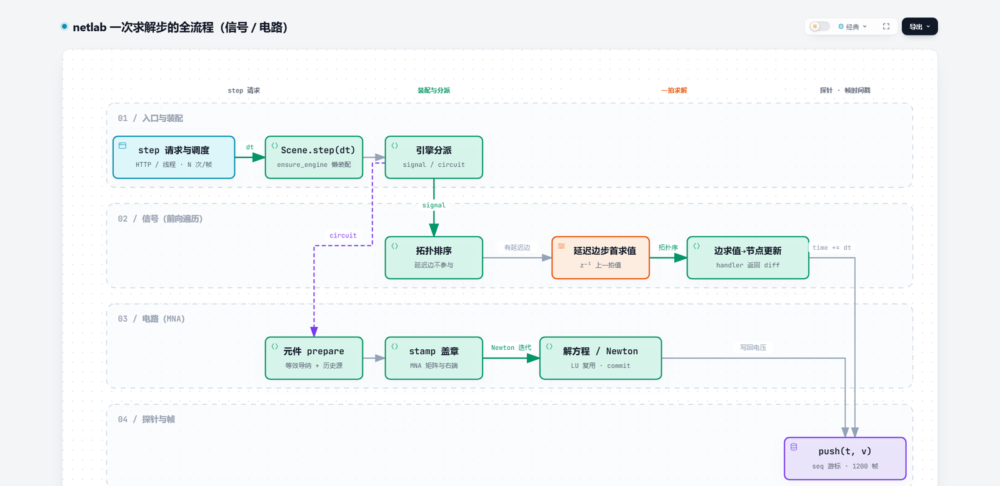

# 底层求解代码地图（节点 / 连接 / 计算 / 求解器 / 时间）

> 生成时间：2026-10-26。行号以当前工作区为准；代码改动后行号会漂，**以函数名 grep 定位为准**。
> 本文所有代码片段都是原文摘录（不是示意），可直接对照文件阅读。
> 最后修改：2026-11-06（§0 行数表按当前代码校准；正文行号仍为 2026-10-26 快照，以函数名 grep 定位为准）。
> 2026-10-26 增补：全流程原理图（§0.1，Archify 交互版）、全流程覆盖清单（§1.1）、时间相关计算代表（§4.7）、数学注解合集（§5.4）、时间语义注解（§6.7）。

---

## 0. 阅读路线（按这个顺序，约 1 小时能读完主干）

| 顺序 | 文件 | 看什么 | 行数 |
| --- | --- | --- | --- |
| 1 | `netlab/core/model/graph.py` | `Node` / `Connection` / `Network.step` —— 信号流的求解内核 | 1116 |
| 2 | `netlab/core/model/scene.py` | `NodeRecord` / `EdgeRecord` / `SignalEngine` —— 界面数据与内核的桥 | 2086 |
| 3 | `netlab/core/compute/computes.py`、`netlab/core/compute/methods.py` | 节点公式 / 连接函数的注册表与 handler | 1550 / 726 |
| 4 | `netlab/core/compute/nodal.py` | 电路 MNA 求解器 `CircuitSolver` 与元件 `stamp` | 2579 |
| 5 | `netlab/core/compute/simulation.py` | 后台线程、`dt`、帧时间戳、录制器 | 659 |
| 6 | `netlab/core/compute/fem.py` | 二维热场有限元（与信号/电路无关的另一条求解路径） | 684 |

### 0.1 全流程原理图（先看图，再读代码）



- 交互版（可悬停高亮、导出、深色模式）：[assets/solver-flow.html](assets/solver-flow.html)，源文件 `NetlabExtras/screenshots/archify/workflow-solver-flow-20261026-0110/candidate.json`。
- **怎么看这张图**：四条泳道对应「一次 step 经过的四层」——入口与节拍 → 场景与引擎 → 信号/电路两条求解路径 → 探针与帧时间戳。实线是主路径，虚线是分支（`mode=circuit`）与数据回写。
- 图解与代码的对应关系：`step 请求与调度` = `server.py` 控制端点 / `Simulation._loop`；`Scene.step(dt)` = `scene.py:473`；两条求解路径分别见 §5.1（`Network.step`）与 §5.2（`CircuitSolver.step`）；`push(t, v)` = `Recorder.push`。
- 图上每个方框下方的小字是该模块的**关键约束**（例如「延迟边不参与拓扑排序」「LU 复用 · commit」），读代码时优先验证这些小字。

---

## 1. 一次「步进」的完整调用链

```
HTTP POST /api/control {"action":"step"}          server.py:292 control()
  └─ Simulation.step_once(steps)                  simulation.py:199
       └─ Simulation._advance_locked(dt, sample_every)   simulation.py:150
            ├─ Scene.step(dt)                     scene.py:473
            │    ├─ Scene.ensure_engine()         scene.py:465   （脏了才重建引擎）
            │    └─ engine.step(dt)
            │         ├─ SignalEngine.step  → Network.step           scene.py:309 / graph.py:443
            │         │     ├─ Network.topological_order()           graph.py:402
            │         │     ├─ 延迟边先在「步首」求值：Connection.evaluate   graph.py:214
            │         │     ├─ 按拓扑序：入边求值 → Node.update()     graph.py:460-472
            │         │     └─ network.time += dt                    graph.py:473
            │         └─ CircuitEngine.step → CircuitSolver.step     scene.py:395 / nodal.py:888
            │               └─ prepare → stamp(MNA) → solve(LU) → commit → 写回 node_voltages
            ├─ self.time += dt；self.steps += 1                       simulation.py:156-157
            └─ Recorder.push(self.time, scene.probes())               simulation.py:48 / 160
```

**结论先记住三件事**：

1. **信号模式是一次前向遍历**（拓扑序，每条边求值一次、每个节点更新一次），没有迭代求解；
2. **电路模式是一次线性（或 Newton 迭代的）方程求解**，节点电压是解出来的，不是传出来的；
3. **`dt` 由 `Simulation` 拥有**，逐层传参下去；`Network.time` 是内核自己的时间戳。

### 1.1 「全流程原理」覆盖清单（查漏用）

| # | 环节 | 关键问题 | 代码位置 | 本文位置 |
| --- | --- | --- | --- | --- |
| 1 | 参数进入 | 界面填的参数怎么变成内核可用值？ | `params.validate_params`、`Scene._normalize_node_params` | §2.2、§4.3 |
| 2 | 装配 | 什么时候把记录变成 `Node`/`Connection`/求解器？ | `Scene.ensure_engine`、`SignalEngine.__init__`、`CircuitEngine.__init__` | §5.1、§5.2 |
| 3 | 传递 | 一条边如何把起点数据变成终点输入？ | `Network.step` + `Connection.evaluate` | §3.2–§3.4 |
| 4 | 计算 | 节点拿到输入后怎么算？ | `Node.update` → `handler(ctx)` | §2.4、§4 |
| 5 | 求解 | 电路为什么能解出节点电压？ | `CircuitSolver.step` + 元件 `stamp/commit` | §5.2 |
| 6 | 时间 | 一拍多长？时间戳记在哪？ | `SimConfig`、`_advance_locked`、`Recorder` | §6 |
| 7 | 回界面 | 结果怎么变成图上的曲线？ | `Scene.probes` → `Recorder` → `/api/live` | §6.4 |
| 8 | 功能块 | 封装的子网络怎么参与求解？ | `_wire_blocks`、`BlockRuntime.step` | §5.1 |
| 9 | 非线性/积分 | 微分方程在哪一步被离散？ | RK4（振子）、梯形法/后向欧拉（电容电感）、隐式欧拉（FEM） | §4.7、§5.2、§5.3 |
| 10 | 失败怎么处理 | 代数环/发散/未收敛如何终止？ | `topological_order`、`MAX_ABS_VOLTAGE`、`MAX_NEWTON_ITERATIONS` | §3.3、§5.2、§8 |

**明确没写进求解器的部分**（避免误以为存在）：频域/传递函数分析（R12、P3 未实现）、`T_step` 与「时间归零」（R11 未实现，当前只有 `reset`）、GPU 路径（未实测）。

---

## 2. 节点：从界面记录到运行时对象

### 2.1 界面侧记录 `NodeRecord`（`scene.py:56-79`）

```python
@dataclass
class NodeRecord:
    id: str
    name: str
    kind: str
    params: dict[str, Any] = field(default_factory=dict)
    data: dict[str, Any] = field(default_factory=dict)
    state: dict[str, Any] = field(default_factory=dict)
    inputs: dict[str, dict[str, Any]] = field(default_factory=dict)
    position: dict[str, float] = field(
        default_factory=lambda: {"x": 0.0, "y": 0.0}
    )
```

要点：`params` 是配置（经校验的规范参数），`data` 是信号（界面能看到的值），`state` 是历史（积分器/延迟/模块内部状态），`inputs` 是上一步的入边快照（给界面看）。

### 2.2 添加节点时的校验链（`scene.py:619-657`）

```python
    def add_node(
        self,
        *,
        name: str,
        kind: str = "manual",
        params: Any = None,
        data: Any = None,
        position: Any = None,
        node_id: str | None = None,
    ) -> NodeRecord:
        if len(self.nodes) >= MAX_NODES:
            raise LimitError(f"节点数量不能超过 {MAX_NODES}")
        clean_name = check_name(name, "节点名称")
        self._unique_node_name(clean_name)
        if not isinstance(kind, str):
            raise ValidationError("kind 必须是字符串")
        params_clean, _label = self._normalize_node_params(kind, params)
        if self.mode == "circuit" and kind == "ground":
            if any(record.kind == "ground" for record in self.nodes.values()):
                raise ConflictError("电路只能有一个接地节点")
        data_clean = json_safe(data or {}, where=f"节点 {clean_name!r} 的数据")
        if len(data_clean) > MAX_FIELDS:
            raise LimitError(f"节点数据最多 {MAX_FIELDS} 个字段")
        identifier = check_id(node_id, "节点 id") if node_id else uuid.uuid4().hex[:12]
        if identifier in self.nodes:
            raise ConflictError(f"节点 id {identifier!r} 已存在")
        record = NodeRecord(
            id=identifier,
            name=clean_name,
            kind=kind,
            params=params_clean,
            data=data_clean,
            state={},
            inputs={},
            position=self._position(position),
        )
        self.nodes[identifier] = record
        self._touch()
        return record
```

`_normalize_node_params`（`scene.py:581`）是所有节点参数的唯一入口：**add / update / 载入工程都走它**，因此参数校验、kind 合法性、模块节点 `block_id` 检查都集中在这里。

### 2.3 运行时对象 `Node`（`graph.py:89-135`）

```python
@dataclass(eq=False)
class Node:
    name: str
    data: NodeData = field(default_factory=dict)
    compute: NodeCompute | None = None
    # 每条入边一个键，值为该边本步输出的字典。
    inputs: NodeInputs = field(default_factory=dict)
    kind: str = "manual"
    params: dict[str, Any] = field(default_factory=dict)
    state: dict[str, Any] = field(default_factory=dict)
    handler: Callable[[ComputeContext], NodeData] | None = field(
        default=None, repr=False, compare=False
    )
    # 内置 handler 已审计、不会修改入参；走浅拷贝快路径。用户扩展必须为 False。
    trusted: bool = field(default=False, repr=False, compare=False)
    _view: NodeView | None = field(default=None, repr=False, compare=False)
```

`Node.data` / `Node.state` 与 `NodeRecord.data` / `.state` **是同一份字典对象**（`SignalEngine.__init__` 直接传引用，`scene.py:139-148`），所以内核算完，界面快照立刻就是新值，不需要额外同步。

### 2.4 节点计算的入口 `Node.update`（`graph.py:135-188`，节选）

```python
    def update(self, dt: float = 1.0, time: float = 0.0) -> None:
        """计算一个字典差分并合并进 ``data``。没有计算方式时什么也不做。"""
        if self.compute is None and self.handler is None:
            return

        if self.compute is not None:
            # 兼容原始回调：无法证明其只读，始终深拷贝。
            inputs_copy = {
                key: copy.deepcopy(payload) for key, payload in self.inputs.items()
            }
            data_copy = copy.deepcopy(self.data)
            trusted = False
        elif self.trusted:
            # 内置 handler 不修改入参；输入字典是每条边新生成的，data 用浅拷贝。
            inputs_copy = self.inputs
            data_copy = dict(self.data)
            trusted = True
        else:
            inputs_copy = {
                key: copy.deepcopy(payload) for key, payload in self.inputs.items()
            }
            data_copy = copy.deepcopy(self.data)
            trusted = False

        try:
            if self.compute is not None:
                result = self.compute(inputs_copy, data_copy)
            else:
                assert self.handler is not None
                result = self.handler(
                    ComputeContext(
                        name=self.name,
                        inputs=inputs_copy,
                        data=data_copy,
                        state=self.state,
                        params=self.params,
                        dt=dt,
                        time=time,
                    )
                )
        ...
        if not isinstance(result, dict):
            raise ComputeError(f"节点 {self.name!r} 的计算结果必须是字典")
        if trusted:
            clean = _fast_result(
                result, where=f"节点 {self.name!r} 的计算结果"
            )
        else:
            clean = json_safe(result, where=f"节点 {self.name!r} 的计算结果")
        self.data.update(clean)
```

关键语义：handler **不能原地改 `data`**，只能返回「要合并进去的差分字典」；结果统一做数值/JSON 清洁校验（`_fast_result` 是内置快路径，`json_safe` 是严格路径）。

> **注解（为什么是差分而不是整份 data）**：如果允许 handler 直接改 `data`，那么「哪些键是本步产生的」就无法区分，撤销、录制、探针都会失去边界；返回差分让 `data` 成为「历史值的累积」，也让内置 handler 不必复制整份数据（快路径的前提）。代价是**删除字段无法表达**——需要显式 `None` 或改用 `replace=True` 的 `set_data`。

---

## 3. 连接：一条有向边如何产生数据

### 3.1 界面侧记录 `EdgeRecord`（`scene.py:82-105`）

```python
@dataclass
class EdgeRecord:
    id: str
    name: str
    source: str
    target: str
    kind: str
    params: dict[str, Any] = field(default_factory=dict)
    state: dict[str, Any] = field(default_factory=dict)
    delay: bool = False
    enabled: bool = True
```

### 3.2 运行时 `Connection.evaluate`（`graph.py:214-239`）

```python
    def evaluate(self, dt: float, time: float = 0.0) -> NodeData:
        """调用连接函数并校验返回值；参数与端点数据对函数只读。"""
        try:
            result = self.method(
                self.source.view,
                self.target.view,
                self._params_view or MappingProxyType(self.params),
                self.state,
                dt,
            )
        except NetlabError:
            raise
        except Exception as exc:
            raise ComputeError(f"连接 {self.name!r} 计算失败：{exc}") from exc

        if not isinstance(result, dict):
            raise ComputeError(f"连接 {self.name!r} 的计算结果必须是字典")
        payload = (
            _fast_result(result, where=f"连接 {self.name!r} 的输出")
            if self.trusted
            else json_safe(result, where=f"连接 {self.name!r} 的输出")
        )
        self.output = payload
        return payload
```

连接函数签名固定为 `method(source_view, target_view, params_view, state, dt) -> dict`；`source_view.data` 是 `MappingProxyType` 只读视图（`graph.py:116`），想改只能改自己的 `state`。

### 3.3 拓扑排序（`graph.py:402-441`，节选）

```python
    def topological_order(self) -> list[Node]:
        """按非延迟依赖排序；存在代数环时抛出 ``ComputeError``。"""
        if self._order is not None:
            return self._order

        incoming_count = {node: 0 for node in self.nodes}
        outgoing: dict[Node, list[Node]] = {node: [] for node in self.nodes}
        incoming: dict[Node, list[Connection]] = {node: [] for node in self.nodes}
        for connection in self._enabled_edges(include_delayed=True):
            incoming[connection.target].append(connection)
        for connection in self._enabled_edges(include_delayed=False):
            incoming_count[connection.target] += 1
            outgoing[connection.source].append(connection.target)

        ready = [node for node in self.nodes if incoming_count[node] == 0]
        order: list[Node] = []
        while ready:
            node = ready.pop()
            order.append(node)
            for target in outgoing[node]:
                incoming_count[target] -= 1
                if incoming_count[target] == 0:
                    ready.append(target)

        if len(order) != len(self.nodes):
            cycles = self.algebraic_cycles()
            detail = "、".join("→".join(cycle + [cycle[0]]) for cycle in cycles[:3])
            raise ComputeError(
                "网络中存在代数环"
                + (f"（{detail}）" if detail else "")
                + "：请把环上的一条连接设为“单步延迟”，或在电路模式下求解"
            )
```

**延迟边不参与排序**：它是 `z⁻¹`，所以环上只要有一条延迟边，图就还能拓扑排序。

### 3.4 一拍的真实顺序（`graph.py:443-473`，全量）

```python
    def step(self, dt: float = 1.0) -> None:
        """按依赖顺序推进一拍：每条连接求值一次，每个节点更新一次。"""
        if not isinstance(dt, (int, float)) or isinstance(dt, bool):
            raise ValidationError("dt 必须是数字")
        if not math.isfinite(dt) or dt <= 0:
            raise ValidationError("dt 必须为正的有限数")

        order = self.topological_order()
        assert self._incoming is not None
        delayed_edges = self._delayed or ()
        # 延迟边在步首统一求值：此时所有节点都还是上一拍的值，
        # 因此输出严格等于 z⁻¹·x，且与节点处理顺序无关。
        delayed_payloads: dict[Connection, NodeData] = {}
        for connection in delayed_edges:
            delayed_payloads[connection] = connection.evaluate(
                dt, time=self.time + dt
            )
        for node in order:
            node.inputs.clear()
            for connection in self._incoming.get(node, ()):
                if connection.delay:
                    payload = delayed_payloads.get(connection)
                    if payload is None:
                        continue
                    node.inputs[connection.name] = payload
                else:
                    node.inputs[connection.name] = connection.evaluate(
                        dt, time=self.time + dt
                    )
            node.update(dt, time=self.time + dt)
        self.time += dt
```

**这段就是信号模式的全部求解语义**：延迟边统一用上一拍的值，普通边在节点被访问时求值，节点按拓扑序更新。想改积分/延迟/顺序，改这里。

> **注解（逐句读）**：
> 1. `order = self.topological_order()` —— 这里只排序一次并缓存；结构不变时后续每拍直接复用（`_order`）。
> 2. `delayed_payloads` 在循环**之前**算完 —— 保证延迟边读到的是「全体节点的上一拍」，而不是「部分已更新的当前拍」，这就是严格的 `z⁻¹`。
> 3. `node.inputs.clear()` + 按入边重建 —— `inputs` 是**本拍**的快照，界面读它时不会看到上上拍的残留。
> 4. `connection.evaluate(dt, time=self.time + dt)` —— 边不知道时间也会得到「本步结束时刻」，波形类连接因此在同一拍内看到一致的时间。
> 5. 循环结束后才 `self.time += dt` —— 本拍内所有计算共用同一个起点时间，避免顺序依赖。

### 3.5 自动补延迟（`scene.py:1027-1050`，载入工程时）

载入场景时对每条无边延迟的连接做「删掉它是否还有环」的 DFS 检查，有环就自动把这条边标成 `delay=True`，避免用户手画反馈环直接报错。这是**导入期行为**，不在 `Network.step` 里。

---

## 4. 计算：注册表 + handler 工厂

### 4.1 节点计算方式 `ComputeSpec`（`computes.py:32-55`）

```python
@dataclass(frozen=True)
class ComputeSpec:
    kind: str
    label: str
    group: str
    description: str
    params: tuple[ParamSpec, ...]
    factory: Factory
    outputs: tuple[str, ...] = ()
    notes: str = ""
    formula: str = ""
    source: str = ""
    editable: bool = False
    builtin: bool = True
    #: 是否允许用户从「添加节点」菜单手动创建。模块相关 kind 只能由模块库
    #: 实例化 / 封装生成，手动创建会得到没有 block_id 的坏节点（P0-0）。
    addable: bool = True


COMPUTE_SPECS: dict[str, ComputeSpec] = {}


def register(spec: ComputeSpec) -> ComputeSpec:
    if spec.kind in COMPUTE_SPECS:
        raise RuntimeError(f"重复注册节点计算方式：{spec.kind}")
    COMPUTE_SPECS[spec.kind] = spec
    return spec
```

### 4.2 一个最简单的节点：求和（`computes.py:96-126`）

```python
def _sum_factory(params: dict[str, Any]) -> Handler:
    field = params["field"]
    output = params["output"]
    raw_weights = params["weights"]
    weights: dict[str, float] = {}
    for key, value in raw_weights.items():
        if isinstance(value, bool) or not isinstance(value, (int, float)):
            raise ComputeError(f"权重 {key!r} 必须是数值")
        weights[key] = float(value)

    def handler(ctx: ComputeContext) -> NodeData:
        return {output: _sum_inputs(ctx, field, weights)}

    return handler


register(
    ComputeSpec(
        kind="sum",
        label="输入求和",
        group="基础",
        description="把每条入边指定字段相加，写入输出字段；可为单条连接设置权重。",
        params=(
            ParamSpec("field", "输入字段", "text", "voltage"),
            ParamSpec("output", "输出字段", "text", "voltage"),
            json_param("weights", "连接权重", {}, help='例如 {"R1": 0.5}'),
        ),
        factory=_sum_factory,
        outputs=("output",),
    )
)
```

模式是 **工厂闭包**：`factory(params)` 把参数固化进闭包，返回真正的 `handler(ctx)`；curried 一次性装配、每拍只跑 handler。

### 4.3 装配与参数校验（`computes.py:841-848`、`params.py:122-133`）

```python
def prepare_compute(
    kind: str, raw_params: dict[str, Any] | None
) -> tuple[ComputeSpec, dict[str, Any], Handler | None]:
    """校验参数并构造处理器；返回 (模式, 规范化参数, 处理器)。"""
    spec = get_compute_spec(kind)
    params = validate_params(list(spec.params), raw_params)
    handler = spec.factory(params)
    return spec, params, handler
```

```python
def validate_params(specs: list[ParamSpec], raw: Any | None) -> dict[str, Any]:
    """按模式校验参数并补上默认值；拒绝未知键，避免隐藏配置。"""
    if raw is None:
        raw = {}
    data = as_dict(raw, "参数", max_fields=max(16, len(specs) + 8))
    allowed = {spec.key for spec in specs}
    unknown = set(data) - allowed
    if unknown:
        raise ValidationError(f"未知参数：{', '.join(sorted(unknown))}")
    return {
        spec.key: spec.coerce(data.get(spec.key, _MISSING)) for spec in specs
    }
```

所以**参数永远「先规范化再进内核」**：缺省补默认、未知键拒绝、类型/范围校验（`limits.py` 的 `as_float/as_int/...`）。

### 4.4 连接函数 `MethodSpec` 与一个实例（`methods.py:24-91`）

```python
@dataclass(frozen=True)
class MethodSpec:
    kind: str
    label: str
    group: str
    description: str
    params: tuple[ParamSpec, ...]
    factory: Factory
    outputs: tuple[str, ...] = ()
    notes: str = ""
    formula: str = ""
    source: str = ""
    editable: bool = False
    builtin: bool = True
```

```python
def _scale_factory(params: dict[str, Any]) -> Method:
    input_key = params["input_key"]
    output_key = params["output_key"]
    gain = params["gain"]
    offset = params["offset"]

    def method(source, target, _params, _state, _dt) -> NodeData:
        del target
        return {output_key: offset + gain * _read(source, input_key)}

    return method
```

`pass`（模块端口/功能块接线用）在 `methods.py:309-349`：只搬运**有限数值**字段，布尔和文本当作配置忽略——这条语义是模块边界「只传标量」的实现（见 `LESSONS.md §4.4`）。

### 4.5 计算上下文 `ComputeContext`（`graph.py:76-86`）

```python
@dataclass(slots=True)
class ComputeContext:
    """注册表驱动的节点计算上下文。``inputs`` 与 ``data`` 均为副本。"""

    name: str
    inputs: NodeInputs
    data: NodeData
    state: dict[str, Any]
    params: dict[str, Any]
    dt: float
    time: float
```

`time` 由 `Network.step` 传成 `self.time + dt`，即**这一步的结束时刻**；`dt` 是本步步长。积分器/波形源都靠这两个值。

### 4.6 用户扩展走同一条路（`extensions.py:246-259`）

`@node(...)` 装饰器构造的是 `ComputeSpec`（`editable=True`、`builtin=False`），被装饰函数**本身就是 handler**（直接收 `ctx`），不是返回 handler 的工厂——这是 V2-2 踩过的坑（`LESSONS.md §5`）。扩展节点的 `trusted=False`，所以每次计算走深拷贝 + `json_safe`。

### 4.7 时间相关的三种计算代表（波形 / 状态空间 / RK4）

这三类 handler 把「时间」直接写进了公式，是理解 `ctx.time` 与 `ctx.dt` 用法的捷径。

**(a) 波形源**：纯函数，无状态（`waveform.py:39-60`）：

```python
def waveform_value(params: dict[str, Any], time: float) -> float:
    """在时刻 ``time``（秒）求波形瞬时值。参数应已经过模式校验。"""
    kind = str(params.get("wave", "sine"))
    offset = float(params.get("offset", 0.0))
    amplitude = float(params.get("amplitude", 1.0))
    delay = float(params.get("delay", 0.0))

    if kind == "dc":
        return offset
    if not math.isfinite(time):
        raise ComputeError("波形时间不是有限数值")
    if time < delay:
        return offset
```

数学形式：`y(t) = offset + amplitude·sin(2π·f·(t − delay) + φ)`（正弦），方波/三角/锯齿同理按相位归一化。它说明**同一个节点每拍只被问一次「你此刻是多少」**，历史不存状态。

**(b) 状态空间**：一阶差分方程 + 可选的离散化（`statespace.py:177-191`）：

```python
    def step(
        self, state: dict[str, Any], u: np.ndarray, dt: float
    ) -> tuple[np.ndarray, np.ndarray]:
        ad, bd, cd, dd = self.discretized(dt)
        x = self.state_from(state)
        if u.size != self.b.shape[1]:
            raise ComputeError(
                f"输入维数不匹配：模型需要 {self.b.shape[1]} 个输入"
            )
        y = cd @ x + dd @ u
        x_next = ad @ x + bd @ u
        if not np.all(np.isfinite(x_next)) or not np.all(np.isfinite(y)):
            raise ComputeError("状态空间模型发散了（出现非有限数值）")
        state["x"] = [float(value) for value in x_next]
        return y, x_next
```

数学形式：`x[k+1] = A_d·x[k] + B_d·u[k]`，`y[k] = C_d·x[k] + D_d·u[k]`；`A_d, B_d` 由 `dt` 与 `zoh/tustin` 方法决定（`discretized(dt)` 内缓存），所以**改 `dt` 等价于换离散模型**。

**(c) 四阶 Runge–Kutta**：连续系统的定步长积分（`computes.py:422-454`）：

```python
def _rk4_3d(
    dt: float,
    state: tuple[float, float, float],
    time_value: float,
    derivative,
) -> tuple[float, float, float]:
    """四阶 Runge–Kutta；derivative(t, x, y, z) -> (dx, dy, dz)。"""
    x0, y0, z0 = state
    k1 = derivative(time_value, x0, y0, z0)
    h = 0.5 * dt
    k2 = derivative(
        time_value + h,
        x0 + h * k1[0],
        y0 + h * k1[1],
        z0 + h * k1[2],
    )
    k3 = derivative(
        time_value + h,
        x0 + h * k2[0],
        y0 + h * k2[1],
        z0 + h * k2[2],
    )
    k4 = derivative(
        time_value + dt,
        x0 + dt * k3[0],
        y0 + dt * k3[1],
        z0 + dt * k3[2],
    )
    return (
        x0 + dt * (k1[0] + 2.0 * k2[0] + 2.0 * k3[0] + k4[0]) / 6.0,
        y0 + dt * (k1[1] + 2.0 * k2[1] + 2.0 * k3[1] + k4[1]) / 6.0,
        z0 + dt * (k1[2] + 2.0 * k2[2] + 2.0 * k3[2] + k4[2]) / 6.0,
    )
```

数学形式：`x[k+1] = x[k] + dt/6·(k₁ + 2k₂ + 2k₃ + k₄)`，局部截断误差 `O(dt⁵)`。注意调用处传的是 `ctx.time - ctx.dt`（`computes.py:518`）：`ctx.time` 是**本步结束时刻**，积分必须从**上一步时刻**起步。

> **注解**：这三位代表三种「时间用法」——波形源只用 `t`（无状态）；状态空间把 `dt` 吃进离散化矩阵（换 `dt` 就换模型）；RK4 用 `dt` 做步长、并把历史存进 `state`。写新节点时先想清楚自己属于哪一类，再决定要不要 `state`。

---

## 5. 求解器

### 5.1 信号/矢量：`SignalEngine`

装配（`scene.py:124-171`，节选）：

```python
class SignalEngine(_Engine):
    def __init__(self, scene: "Scene") -> None:
        self.network = Network()
        self.node_map: dict[str, Node] = {}
        self.edge_map: dict[str, Any] = {}
        self.scene = scene
        # 功能块实例：每个实例拥有独立的内部场景与 state。
        self.block_runtimes: dict[str, BlockRuntime] = {}
        self.block_buffers: dict[str, dict[str, dict[str, Any]]] = {}
        for record in scene.nodes.values():
            try:
                _spec, params, handler = prepare_compute(record.kind, record.params)
            except Exception as exc:
                raise ComputeError(
                    f"节点 {record.name!r} 的计算方式无法装配：{exc}"
                ) from exc
            node = Node(
                name=record.name,
                data=record.data,
                kind=record.kind,
                params=params,
                state=record.state,
                inputs=record.inputs,
                handler=handler,
                trusted=not record.kind.startswith("user."),
            )
            self.network.add_node(node)
            self.node_map[record.id] = node
        for record in scene.edges.values():
            ...
            connection = self.network.connect(
                record.name,
                self.node_map[record.source],
                self.node_map[record.target],
                method,
                delay=record.delay,
                enabled=record.enabled,
                kind=record.kind,
                state=record.state,
                params=params,
                _trusted=not record.kind.startswith("user."),
            )
            self.edge_map[record.id] = connection
        self._wire_blocks()
```

**矢量模式和信号模式共用同一个 `SignalEngine`**：区别只在节点 kind（`oscillator`/`nonlinear_plant` 等 handler 内部做 RK4），不在引擎。

功能块节点（`kind="block"`）由 `_wire_blocks`（`scene.py:233-307`）接上隐藏的 `__feed.*` / `__emit.*` 连接：端口节点的数据搬进块运行时，块内部网络推进一步，输出再回写到端口节点。`BlockRuntime.step` 见 `blocks.py:397-437`（注入输入 → `inner.step(dt)` → 读输出，全部 deepcopy，实例之间不共享）。

### 5.2 电路：`CircuitEngine` + `CircuitSolver`

引擎侧（`scene.py:361-400`）只做两件事：把 `NodeRecord`/`EdgeRecord` 转成 `CircuitNode`/`CircuitElement`，每步把解出的电压写回 `record.data["voltage"]`。

求解器的未知量布局（`nodal.py:831-871`）：

```python
        self.ground = ground_nodes[0].id
        node_ids = {node.id for node in self.nodes}
        unknown: list[str] = [node.id for node in self.nodes if not node.ground]
        internal: list[str] = []
        for element in self.elements:
            for node_id in element.internal_nodes:
                if node_id in node_ids or node_id in internal:
                    raise ComputeError(f"内部节点 id 冲突：{node_id!r}")
                internal.append(node_id)
        unknown.extend(internal)
        self.unknown_ids = unknown
        self.index = {node_id: position for position, node_id in enumerate(unknown)}

        branch_count = sum(1 for element in self.elements if element.needs_branch)
        for offset, element in enumerate(
            [element for element in self.elements if element.needs_branch]
        ):
            element.branch_index = len(unknown) + offset
```

即 **MNA 未知量 = 非接地节点电压 + 需要支路电流的元件（电压源/VCVS/CCVS 等）**；`matrix_size = len(unknown) + branch_count`。

一步求解（`nodal.py:888-976`，节选）：

```python
    def step(self, dt: float) -> dict[str, Any]:
        if not math.isfinite(dt) or dt <= 0:
            raise ValidationError("dt 必须为正的有限数")
        started = _time.perf_counter()
        self.time += dt
        for element in self.elements:
            element.prepare(dt, self.time)

        nonlinear_elements = [element for element in self.elements if element.nonlinear]
        solution = self.solution if self.solution is not None else np.zeros(self.matrix_size)
        iterations = 0
        converged = not nonlinear_elements
        for iteration in range(MAX_NEWTON_ITERATIONS if nonlinear_elements else 1):
            iterations = iteration + 1
            matrix = self._matrix
            rhs = self._rhs
            matrix.fill(0.0)
            rhs.fill(0.0)
            ctx = StampContext(
                A=matrix,
                rhs=rhs,
                index=self.index,
                solution=solution,
                dt=dt,
                time=self.time,
                iteration=iteration,
            )
            for element in self.elements:
                element.stamp(ctx)

            self._check_floating(matrix)
            new_solution = self._solve_matrix(matrix, rhs, dt)
            if not np.all(np.isfinite(new_solution)):
                raise ComputeError("电路求解出现非有限数值")
            if np.max(np.abs(new_solution)) > MAX_ABS_VOLTAGE:
                raise ComputeError("电路电压超过 1e9 V，仿真已发散")
            if nonlinear_elements:
                delta = float(np.max(np.abs(new_solution - solution)))
                magnitude = float(np.max(np.abs(new_solution))) + 1.0
                if iteration > 0 and delta <= NEWTON_ABS_TOL + NEWTON_REL_TOL * magnitude:
                    solution = new_solution
                    converged = True
                    break
                solution = new_solution
                guess_ctx = StampContext(...)
                for element in nonlinear_elements:
                    element.update_guess(guess_ctx)
            else:
                solution = new_solution
```

求解与缓存（`nodal.py:978-1017`，节选）：

```python
        if (
            _scipy_lu_factor is not None
            and self._lu_cache is not None
            and self._lu_matrix is not None
            and self._cached_dt == dt
            and np.array_equal(matrix, self._lu_matrix)
        ):
            self.linear_reuse += 1
            return _scipy_lu_solve(self._lu_cache, rhs)
        if _scipy_lu_factor is not None:
            try:
                factor = _scipy_lu_factor(matrix, check_finite=False)
                solution = _scipy_lu_solve(factor, rhs)
                ...
                self._lu_cache = factor
                self._lu_matrix = matrix.copy()
                self._cached_dt = dt
                return solution
```

线性电路矩阵只依赖 `dt` 与元件参数 → 第一拍分解后只回代；非线性电路每次 Newton 矩阵都变，缓存自然失效，**数值语义不变**。

元件契约（`nodal.py:83-136`）：`prepare(dt, time)` 用历史状态算好本拍等效电导/等效电流源，`stamp(ctx)` 盖章到 `A`/`rhs`，`update_guess(ctx)` 给非线性元件更新工作点，`commit(ctx)` 算电流/压差/功率写 `result`，`reset()` 清历史。盖章工具函数在 `nodal.py:61-81`：

```python
def _stamp_conductance(ctx: StampContext, a: str, b: str, g: float) -> None:
    ai = ctx.index.get(a)
    bi = ctx.index.get(b)
    if ai is not None:
        ctx.A[ai, ai] += g
    if bi is not None:
        ctx.A[bi, bi] += g
    if ai is not None and bi is not None:
        ctx.A[ai, bi] -= g
        ctx.A[bi, ai] -= g
```

电容的梯形法离散（`nodal.py:183-199`）是「元件如何把微分方程变成代数方程」的最短示例：

```python
    def prepare(self, dt: float, time: float) -> None:
        super().prepare(dt, time)
        cache = self.capacitance
        previous_v = float(self.state["v"])
        previous_i = float(self.state["i"])
        if self.integration == "backward_euler":
            self.conductance = cache / dt
            self.source_current = -self.conductance * previous_v
        else:
            self.conductance = 2.0 * cache / dt
            self.source_current = (
                -self.conductance * previous_v - previous_i
            )

    def stamp(self, ctx: StampContext) -> None:
        _stamp_conductance(ctx, self.a, self.b, self.conductance)
        _stamp_current(ctx, self.a, self.b, self.source_current)
```

### 5.2.1 事务与数值保护入口（2026-10-28 加固，Phase A–E）

上面 §5.2 的 `step` 摘录是加固前的形态；当前实现把一步拆成“事务包装 + 内部求解”，并增加了矩阵均衡与残差检查。按调用顺序看这些入口：

```text
Scene.step(dt)
  └ SignalEngine.step(dt)                      scene.py:815  整步事务（节点图 + 块内状态）
      ├ 逐 block_runtime.capture_checkpoint()  blocks.py:456 块内部 Scene 快照
      ├ Network.step(dt)                       graph.py:498  事务包装
      │   ├ capture_step_state()               graph.py:541  time/data/state/inputs/ports/output
      │   ├ 延迟边统一求值 → 逐节点 Node.update
      │   └ 异常 → restore_step_state()        graph.py:563  原地 clear+update 后重抛
      └ 异常 → 逐块 restore_checkpoint()       blocks.py:460 再重抛
  └ CircuitEngine.step(dt)                     scene.py:647
      └ CircuitSolver.step(dt)                 nodal.py:1519   事务包装
          ├ capture_checkpoint()               nodal.py:1475   时间/解/节点电压/元件状态
          ├ _step_locked(dt, started)          nodal.py:1530   真正推进一步
          │   ├ element.prepare(dt, time)
          │   ├ _newton_solve(...)             nodal.py:1684
          │   │   ├ _solve_matrix(...)         nodal.py:1770   缩放 LU + pivot_tol
          │   │   │   └ _equilibration(...)    nodal.py:1835   行/列尺度
          │   │   ├ _residual_metric(...)      nodal.py:1672   尺度无关后向残差
          │   │   └ _trouble_name(...)         nodal.py:1645   最大残差节点/支路
          │   ├ gmin/source stepping（失败后，逐 trial 快照/恢复）
          │   └ commit + node_voltages
          └ 异常 → restore_checkpoint()        nodal.py:1486   回滚后重抛
```

关键约定：

- **检查点粒度**：`_capture_element_state`（`nodal.py:1459`）复制每个元件的 `state`、`iteration_guess`、`result`、`time`、`value`、`source_scale`；新增会写状态的元件必须把状态放进这些字段，否则回滚不完整。
- **恢复要失效 LU 缓存**：`restore_checkpoint` 会清 `_lu_cache`、`_lu_matrix`、`_lu_col_scale`、`_cached_dt`，避免失败步的污染矩阵被后续线性步复用。
- **猜测分层**：`Diode`/`BipolarJunction`/LDO 的 `stamp`/`update_guess` 只读写 `iteration_guess`，`commit` 才写已提交 `state`；排查“重跑结果不同”先看这里。
- **场景层检查点**：`CircuitEngine.capture_checkpoint/restore_checkpoint`（`scene.py:611-645`）额外保存节点 `data`/`inputs` 与非元件边状态，并在恢复时重新绑定元件共享的 `state` 字典；`SignalEngine` 同构（`scene.py:353-394`，含 `"blocks"` 块内快照）；`Scene` 转发（`scene.py:746-752`）。
- **超时也是事务边界**：`Simulation._advance_locked`（`simulation.py:170`）在 `scene.step` 前取检查点，异常/超时都先恢复场景再记录错误。
- **断点**：`Scene.next_breakpoint`（`scene.py:803`）经 `_iter_source_params`（`scene.py:758`）同时扫描旧边与器件节点源，`_breakpoint_in`（`scene.py:773`）统一处理 dc/delay/step/ramp/square/pulse 与相位。
- **配置**：`SolverOptions` 的 `gmin`（stepping 起点，默认 1e-3）、`residual_tol`（>0 才强制）、`residual_safety_tol`（默认 1e-8）、`scaling`（默认开）、`pivot_tol`（默认 1e-14）由 `Simulation.apply_config` 注入；`stats()` 回报实际生效的 `residual/strategies/scaling/pivot_tol`。

#### 5.2.1.1 行为模型的状态钩子（Phase D）

这些 hook 决定“失败步回滚”与“重复运行一致性”是否成立，改模型时优先看：

- `OpAmp._dynamic(ctx, value, slope)`（`nodal.py:619`）：用 `state["vout"]` 做一阶滞后，`gbw>0` 时 `α=1−exp(−dt/τ)`（`τ=1/(2π·gbw)`），`slew_rate>0` 时按 `SR·dt` 钳位；两者皆 0 退化为代数解。`reset()` 清 `vout`，`commit` 写回。
- `Comparator._f`（`nodal.py:703`）+ `state["hys_level"]`：`0` 未定、`+1` 输出高、`−1` 输出低；`offset=+0.5·hys·level`，`commit` 按输出相对中点更新电平（死区 `1e-3·span`）。阈值语义：高电平只在 `u<−hys/2` 翻低，低电平只在 `u>+hys/2` 翻高。
- `Mosfet._operating_point(ctx)`（`transistors.py:159`）：统一 polarity 求 `vgs/vds/vbs`，按 `Vov=Vth(Vbs)−Vgs` 分截止/线性/饱和，返回 `(Id, gm, gds, gmbs, ...)`；`stamp` 必须对**每个存在的端子**独立累积（源极接地时 `si is None`，gds 仍要进 `A[di,di]`，否则 Newton 极限环）。
- `LogicGate._currents(ctx)`（`logic.py:70`）：按两条电导支路求 `(i_out, i_up, i_down)`；`current()` 返回总电流，`commit` 写 `current/voltage_difference/power/supply_current`。
- `BipolarJunction._junction(vbe)`：分段线性（`vbe_on/rin`、`leak=1e-9`），`Is/n` 仅记录与热电压限幅；catalog 公式必须与它一致（`test_element_contracts.py` 有符号级断言）。
- 隔离：`Node.update` 对非 trusted handler 传 `deepcopy(state)`（`graph.py` 的 `_state_snapshot`），成功后原地回写，异常不污染节点状态。

#### 5.2.1.2 覆盖测试

- 事务/重试/隔离：`netlab/tests/test_solver_transactions.py`（6 项）与 `test_solver_p0.py`（13 项）。
- 元件契约：`netlab/tests/test_element_contracts.py`（14 项，catalog 公式 ↔ 实现、比较器回差、逻辑门电流、MOS 三态/λ/体效应、运放 SR/GBW）。

### 5.3 热场：有限元 `FemModel.step`（`fem.py:309-335`）

```python
        force = self._source_vector(self.time + dt_value)
        rhs = (self.mass_matrix @ self.temperature) / dt_value + force
        if self._bc_correction is not None:
            rhs = rhs - self._bc_correction
        rhs[self.dirichlet] = self.boundary_values[self.dirichlet]
        assert self._lu is not None
        solution = self._lu.solve(rhs)
```

隐式欧拉 + 固定 LU 分解（只有 `dt` 变了才重新分解），Dirichlet 边界直接压右端项。与信号/电路是**两条独立的求解路径**，通过 `server.py` 的 FEM 服务单独推进。

### 5.4 数学注解合集（把上面代码里的公式集中写一遍）

> 这一节只做「把代码翻译成数学」，不引入代码里没有的东西；每条都标注了它在代码里的落点。

**① 信号模式的一步递推**

```
x[k] = x[k-1] + Δx[k]                        （Node.update 的合并语义：data.update(diff)）
u_e[k] = g_e( x_source.data[k-1] )           （Connection.evaluate：读起点当前值）
x[k] 由 handler 用 {u_e[k]} 与 state 算出 Δx[k]
```

- 延迟边单独处理：`u_e[k] = g_e( x[k-1] )` 且**在步首统一求值**（`graph.py:455-459`），所以与节点访问顺序无关。
- 代数环判定：把非延迟边当作有向边，若图有环则 `topological_order` 失败（`graph.py:426-433`）；延迟边等价于插入 `z⁻¹`，断开了环。

**② 电路模式：MNA 方程组**

未知量 `[v; j]`（非接地节点电压 + 需支路电流的元件），方程组：

```
⎡ G  B ⎤ ⎡ v ⎤   ⎡ i ⎤
⎢      ⎥ ⎢   ⎥ = ⎢   ⎥
⎣ C  D ⎦ ⎣ j ⎦   ⎣ e ⎦
```

- 电导盖章：`G[a,a] += g, G[b,b] += g, G[a,b] -= g, G[b,a] -= g`（`nodal.py:61-70`）。
- 电流源盖章：`i[a] -= I, i[b] += I`（`nodal.py:73-80`）。
- 电压源 / VCVS 等 `needs_branch` 元件占一行一列，把「两端电压差 = 表达式」写进方程。

**③ 动态元件的离散（以电容为例）**

后向欧拉：`C·(v[k] − v[k-1])/dt = i[k]` → `i[k] = (C/dt)·v[k] − (C/dt)·v[k-1]`
→ `g = C/dt`，`i_hist = −g·v[k-1]`，盖章为「电导 g + 历史电流源 i_hist」。

梯形法：`i[k] = (2C/dt)·v[k] − (2C/dt)·v[k-1] − i[k-1]`
→ `g = 2C/dt`，`i_hist = −g·v[k-1] − i[k-1]`（`nodal.py:183-195`）。

> 注解：两个公式都只依赖 `dt` 与历史状态，所以线性电路的矩阵在 `dt` 不变时逐拍相同——这正是 §5.2 里 LU 分解可以复用的数学前提。

**④ 非线性元件：Newton 迭代**

每一拍解 `F(x) = 0`（KCL 残差）：

```
J(x_k)·Δx = −F(x_k),   x_{k+1} = x_k + Δx
收敛判据：|Δx| ≤ atol + rtol·|x|        （代码：NEWTON_ABS_TOL + NEWTON_REL_TOL·magnitude）
发散保护：|v| > 1e9 V 或迭代超过 MAX_NEWTON_ITERATIONS → ComputeError
```

代码里没有显式写「雅可比矩阵」，而是让每个非线性元件在 `stamp(ctx)` 用**当前工作点**重新线性化（`ctx.solution` 就是 `x_k`），`update_guess` 负责把新解喂回元件。

**⑤ 有限元（热场）**

隐式欧拉：`(M/dt + K)·T[k] = (M/dt)·T[k-1] + f(t)`
Dirichlet 边界：把对应行换成 `T_i = 边界值`（`rhs[self.dirichlet] = ...`），矩阵不变 → 只分解一次。

**⑥ 四阶 Runge–Kutta**（见 §4.7(c)）：

```
k₁ = f(t, x),  k₂ = f(t+dt/2, x+dt·k₁/2),  k₃ = f(t+dt/2, x+dt·k₂/2),  k₄ = f(t+dt, x+dt·k₃)
x[k+1] = x[k] + dt/6·(k₁ + 2k₂ + 2k₃ + k₄)
```

**⑦ 稳定性与量纲直觉（代码里的硬上限）**

| 量 | 代码常量 | 含义 |
| --- | --- | --- |
| `dt` | `SimConfig.dt`：`1e-9 … 10 s` | 步长越界直接拒绝（`simulation.py:244-247`） |
| 每帧仿真时间 | `dt·steps_per_frame ≤ 10 s` | 防止一次请求推进几十秒（`simulation.py:258-259`） |
| 电路电压 | `MAX_ABS_VOLTAGE = 1e9` | 超过即判发散 |
| Newton 迭代 | `MAX_NEWTON_ITERATIONS` | 未收敛即报错，不返回半成品 |
| 非线性振子 | `|x| > 1e6` | 判定发散（`computes.py:519`） |
| 录制帧数 | `RECORDER_CAPACITY = 1200` | 环形缓冲，超出丢最旧 |

---

### 5.5 R26 能力扩展入口：DC 工作点 / AC-Bode / Gear2 / 稀疏矩阵（2026-10-28）

> 这一节给出四项能力的代码落点与读法。它们全部走同一套 MNA/Newton 主干，用 `StampContext.mode` 与 `SolverOptions.sparse` 分叉，不是第二条求解器。

**① DC 工作点：`CircuitSolver.operating_point()`（`nodal.py`，grep `def operating_point`）**

```python
checkpoint = self.capture_checkpoint()
self.time = 0.0
for element in self.elements:
    if hasattr(element, "value") and element.params:
        element.value = waveform_value(element.params, 0.0)
solution, iterations, converged, residual, attempted = self._newton_with_strategies(1e-9, guess, mode="dc")
```

- 电容 `stamp` 在 `mode="dc"` 直接 return（开路）；电感用 `DC_CONDUCTANCE = 1.0e5`（≈10 µΩ）短路；独立源取 t=0 波形值。
- 成功后用 `mode="dc"` 的 ctx 逐元件 `commit`，取 `node_voltages/elements` 返回；`finally` 恢复检查点，所以调用前后 `solver.time`/`solution` 不变（`test_solver_analysis.py::test_operating_point_does_not_disturb_transient_state`）。
- 失败文案：「直流工作点在 N 次 Newton 迭代内未收敛…」。

**② AC/Bode：`CircuitSolver.ac_sweep()` / `_ac_probe()`**

```python
ctx = StampContext(A=complex_matrix, rhs=complex_rhs, ..., mode="ac", omega=2πf, solution=op_solution)
solution = np.linalg.solve(ctx.A, ctx.rhs)
```

- 工作点线性化：非线性元件先在内电导/受控源上取 op，但 `AC_KINDS` 只放行 `resistor/capacitor/inductor/vsource/isource/vcvs/vccs/switch`；二极管/MOS/BJT 直接 `ComputeError("AC 分析暂不支持元件 …")`。
- 复数盖章：`Capacitor` → `jωC`，`Inductor` → `1/(jωL)`（`omega=0` 时退 `DC_CONDUCTANCE`）；电压源被选为激励时 1 V、其余源置 0。
- 探针 `_ac_probe()`：节点电压，或 resistor `v/R`、capacitor `1jωC·v`、inductor `v/(1jωL)`、vsource 支路电流、isource 值；输出 `magnitude/phase_deg/db`。
- 只读：`finally` 恢复检查点；`test_solver_analysis.py` 有 RC 截止（0.707107/−45.0°/−3.0103 dB）与反相 VCVS（2.0/180°）回归。

**③ Gear2 companion（`Capacitor.prepare/commit`、`Inductor.prepare/commit`）**

```
C: g = 1.5C/dt,  i[k] = g·v[k] + C(−2v[k]−v[k−1]… )
L: g = dt/(1.5L), i[k] = g·v[k] + (2i[k−1]−0.5i[k−2])/1.5
```

| 项 | 代码 | 说明 |
| --- | --- | --- |
| 电容 | `g = 1.5 * C / dt`；`src = C * (-2*v_prev + v_prev2)/dt` | 历史存 `state["v_prev"]`、`state["gear_dt"]` |
| 电感 | `g = dt / (1.5 * L)`；`src` 取 `i_prev` 滚动 | 同上 |
| 回退 | `_gear_ready=False` 或 `gear_dt != dt` → backward_euler | 首步和改 dt 后与 BE 数值相同（测试锁定） |

- `integration_methods()` 多出 `{"value":"gear2","label":"Gear2 / BDF2（二阶，固定步长）"}`；`Scene.set_integration` / `load_payload` / `IntegrationRequest` 都接受它。
- 固定 `dt` 语义与 D17 不变：Gear2 不引入自适应步长。

**④ 稀疏矩阵：`SolverOptions.sparse/sparse_threshold` + `_solve_sparse()`**

```python
if self.sparse:
    self._matrix = _sparse.lil_matrix((n, n))
...
def _solve_sparse(self, matrix, rhs, dt):
    csr = _sparse.csr_matrix(matrix)
    scaled = csr.multiply(1/row[:, None]).multiply(1/col[None, :]).tocsc()
    key = (round(dt, 12), csr.nnz, csr.indptr.tobytes(), csr.indices.tobytes(), csr.data.tobytes())
```

| 项 | 代码 | 说明 |
| --- | --- | --- |
| 决策 | `_decide_sparse()` | `off`→否；无 SciPy→否；`on`→是；`auto`→`matrix_size > sparse_threshold`（默认 200） |
| 装配 | `_blank_matrix()` | 稀疏 `lil_matrix`，稠密 `np.zeros`；`_newton_solve` 每轮新建 |
| 分解 | `_solve_sparse()` | 稀疏均衡 → csr → `splu`；缓存键按 `indptr/indices/data` 字节与 dt |
| 诊断 | `_solve_sparse()` 内部 | `factor.U.diagonal()` 零主元 → 「电路矩阵奇异（零主元）：节点」；`RuntimeError` → 「电路矩阵奇异（稀疏 LU）」 |
| 悬空 | `_check_floating()` | 稀疏用 `matrix.getnnz(axis=1)` |
| 回退 | `_decide_sparse()` | 无 SciPy 时 `on/auto` 均退回稠密（仍是正确解，只是不省内存） |

- 数值口径：60 节点梯形与稠密 `rtol=1e-9` 逐点一致（`test_solver_sparse.py`）；`operating_point()["sparse"]` 可直接观察是否启用。
- 接入：`SimConfig.sparse/sparse_threshold` → `apply_config` → `SolverOptions`；`PATCH /api/config` 的 `sparse` 只接受 `auto/on/off`。

**⑤ API 与场景层映射（节点 id → 显示名）**

| 层 | 入口 | 细节 |
| --- | --- | --- |
| `Scene` | `operating_point()` / `ac_sweep()` | 先校验 `mode == "circuit"`，否则 `ValidationError("DC 工作点仅支持电路模式")` / `"AC 分析仅支持电路模式"` |
| `CircuitEngine` | 同名方法 | solver 用网络代表节点 id；返回前把 `node_voltages` 与 `probes` 键映射回 `CircuitNode.name` |
| `Simulation` | `operating_point()` / `ac_sweep()` | `with self.lock` 调场景方法（避免分析期间推进播放） |
| `server.py` | `GET /api/operating-point`、`GET /api/ac-sweep` | AC 参数 `input/f_start/f_stop/points/scale/probes`；`points` 2..2001，`f_stop>f_start`；降级模式 409 |
| 测试映射 | `test_solver_analysis.py` 11 项 / `test_solver_integration.py` 6 项 / `test_solver_sparse.py` 6 项 | DC、AC、Gear2、稀疏各自的可复现证据 |

---

## 6. 时间与时间戳

### 6.1 配置（`simulation.py:29-36`）

```python
@dataclass
class SimConfig:
    fps: int = 30
    dt: float = 0.002
    steps_per_frame: int = 1
    lock_dt: bool = False
    sample_every: int = 1
    realtime: bool = True
```

`lock_dt=True` 时 `dt = 1/(fps·steps_per_frame)`（`simulation.py:256-257`），即「锁帧 = 锁时间推进」。

### 6.2 后台线程（`simulation.py:122-148`）

```python
    def _loop(self) -> None:
        while not self._stop:
            with self.lock:
                running = self.running
                fps = self.config.fps
                steps_per_frame = self.config.steps_per_frame
                dt = self.config.dt
                sample_every = self.config.sample_every
                realtime = self.config.realtime
            if not running:
                time.sleep(0.008)
                continue

            started = time.perf_counter()
            with self.lock:
                if not self.running:
                    continue
                for _ in range(steps_per_frame):
                    if not self._advance_locked(dt, sample_every):
                        break
                self._frame_times.append(started)
                self._prune_frame_times(started)
            if realtime:
                period = 1.0 / max(1, fps)
                remaining = period - (time.perf_counter() - started)
                if remaining > 0:
                    time.sleep(min(remaining, 0.25))
```

### 6.3 一拍与录帧（`simulation.py:150-164`）

```python
    def _advance_locked(self, dt: float, sample_every: int) -> bool:
        try:
            self.scene.step(dt)
        except Exception as exc:  # 计算错误：暂停并保留现场
            self._record_error(exc)
            return False
        self.time += dt
        self.steps += 1
        if sample_every <= 1 or self.steps % sample_every == 0:
            try:
                self.recorder.push(self.time, self.scene.probes())
            except Exception as exc:
                self._record_error(exc)
                return False
        return True
```

### 6.4 帧结构（`simulation.py:48-58`）

```python
    def push(self, time_value: float, probes: dict[str, float]) -> None:
        if not probes:
            return
        self.seq += 1
        self.frames.append(
            {
                "seq": self.seq,
                "t": round(time_value, 9),
                "v": probes,
            }
        )
```

`seq` 是**单调递增游标**（不是索引），`/api/live?cursor=N` 返回 `seq > N` 的帧；`sim.info()` 暴露 `cursor = recorder.seq`、`time`、`steps`、`actual_fps`、`steps_per_second`（`simulation.py:299-318`）。

### 6.5 时间归谁管（容易混）

| 时间字段 | 拥有者 | 含义 |
| --- | --- | --- |
| `Simulation.time` | `simulation.py` | 已推进的仿真时间（界面显示的总时间） |
| `Simulation.steps` | `simulation.py` | 已推进的步数（`T_step` 语义的落点） |
| `Network.time` | `graph.py` | 信号内核时间；每步 `+= dt` |
| `CircuitSolver.time` | `nodal.py` | 电路内核时间 |
| `FemModel.time` | `fem.py` | 热场内核时间 |
| 节点 `ctx.time` | `graph.py` | **本步结束时刻** = `network.time + dt` |
| 帧 `t` | `Recorder` | `Simulation.time` 的 9 位小数快照 |

`Simulation.reset()` 会同时重置 `scene`（内核状态）、`time`、`steps`、录制器（`simulation.py:210-219`）——**当前没有独立的「时间归零但保留状态」**，这正是 R11 里待补的 `T_step` / 时间归零 / 重置三者分离（见 PROGRESS §7 P0）。

### 6.6 计时（性能观察口）

`Scene.step` 用 `time.perf_counter()` 量 `last_step_ms`（`scene.py:473-480`）；电路另外记 `solve_ms` 与 `iterations`（`nodal.py:970-976`）；离线基准在 `netlab/tools/bench.py`。

### 6.7 时间语义注解（读图时最容易混的三件事）

**① 「一步」不等于「一帧」**：一帧推进 `steps_per_frame` 步（`simulation.py:139-141`），所以 `帧间隔 = steps_per_frame × dt` 的仿真时间。界面上的 `actual_fps` 是**实际渲染帧率**，`steps_per_second = actual_fps × steps_per_frame` 才是每秒物理步数（`simulation.py:309-310`）。

**② 三个「时间」不是同一个**：

```
思考时间轴：  t_sim = k·dt                （仿真时间，k 是步数）
             t_node = (k+1)·dt           （节点 handler 看到的 ctx.time）
             t_frame = m·(steps_per_frame·dt)   （第 m 帧的时间戳，仅在整步边界）
```

**③ 节流不是时间积分**：`realtime=True` 时线程用 `sleep(period − elapsed)` 把「算得快」压回真实节奏（`simulation.py:144-148`）；它**不改变** `dt`、也不改变数值结果，只是让界面看起来是实时的。`realtime=False` 时仿真会尽可能快地跑完每帧步数。

> 注解：如果你在调「为什么 1 秒内只走了 0.02 s 仿真时间」，先看 `dt`、`steps_per_frame`，再看 `realtime`；三者共同决定观感，只有前两者决定数值。

---

## 7. 想改什么，改哪里

| 目标 | 入口 | 说明 |
| --- | --- | --- |
| 加/改节点公式 | `computes.py` 注册 `ComputeSpec` + `COMPUTE_FORMULAS` | 公式表要给前端「节点函数」页用，别漏登记（V2-2 的坑） |
| 加/改连接函数 | `methods.py` 注册 `MethodSpec` | 方法签名固定 5 参，返回 dict |
| 改一拍内的求值顺序/延迟语义 | `graph.py` `Network.step` | 信号模式唯一求解器 |
| 改电路元件 | `nodal.py` 继承 `CircuitElement`，实现 `prepare/stamp/commit` | 再在 `nodal.py` 元素表登记 + 加解析测试 |
| 改 MNA 组装/牛顿收敛 | `nodal.py` `CircuitSolver.step` / `_solve_matrix` | 缓存 LU 的前提是矩阵逐元素相同 |
| 改时间推进/帧率/采样 | `simulation.py` `SimConfig` / `_loop` / `_advance_locked` | `dt`、`steps_per_frame`、`sample_every` |
| 改录制/游标 | `simulation.py` `Recorder` | `seq` 单调递增，删帧不影响游标 |
| 改功能块内部求解 | `scene.py` `_wire_blocks`、`blocks.py` `BlockRuntime.step` | 端口只传标量 |
| 改热场 | `fem.py` `FemModel` | 与信号/电路解耦 |
| 加分析（频域/传递函数） | 新建 `analysis/`，只读 `Recorder`/`Scene` | 旁路，不进求解器（D22） |

---

## 8. 已知边界与坑（详细见 `LESSONS.md`）

1. **代数环**：信号模式不迭代，只能靠延迟边断开；`Network.topological_order` 会给出环上节点名。
2. **信任快路径**：内置 handler 不做深拷贝（`trusted=True`），所以**内置 handler 必须保证不改入参**；用户扩展永远深拷贝。
3. **模块内部场景**：`module_input/module_output` 在块内部不带 `block_id`，校验不能一刀切（P0-0 的教训）。
4. **GPU**：只有电路大矩阵走 `accel`，本机无 CuPy，路径未实测。
5. **前端模板即用户代码**：模板/示例必须有测试跑通（V2-2 教训）。

---

## 9. 自测脚本（直接跑，观察一步到底发生了什么）

```python
from netlab.scene import Scene

scene = Scene("signal")                      # 建一个信号场景
src = scene.add_node(name="src", kind="manual", data={"voltage": 1.0})
sum_node = scene.add_node(name="sum", kind="sum")
scene.add_edge(source=src.id, target=sum_node.id, kind="scale", params={"gain": 2.0})

for _ in range(3):
    stats = scene.step(0.01)                 # 引擎装配 + 一拍
    print(stats["step_ms"], scene.nodes[sum_node.id].data)
```

预期：第一拍后 `sum` 的 `voltage` 为 `2.0`，之后保持；`step_ms` 是第一拍偏高（含引擎装配）。
