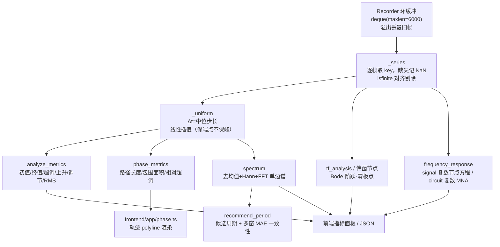
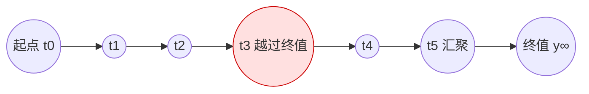
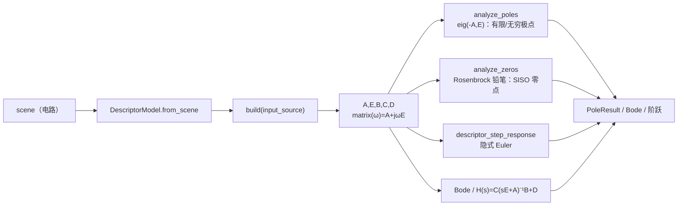

# Netlab 分析子系统数学原理（ANALYSIS_MATH）

> **定位**：本文解释 `netlab/core/compute/analysis.py` 及其相邻模块（`transfer.py`、`circuit/descriptor.py`、`circuit/descriptor_analysis.py`）中“从录制数据到分析结论”的数学定义、判定阈值与实现边界。它是父文档 `netlab/docs/MATH.md` 指向的「分析数学」专题，承接原复数频响章节（R39）的展开与补充；两者冲突时以源码结论为准。
>
> **写法约定**：公式按实现给出，不美化也不夸大；代码片段统一标 `文件:行号`，行号会随重构漂移，若对不上请以函数名检索。凡涉及“是否已接入服务端”这类状态性陈述，均以当前工作树与 git 提交为准，并在 §7.5 集中交代。
>
> **一句话数据流**：`Recorder` 记录仿真/硬件帧 → `_series` 逐帧取值并剔除 NaN → `_uniform` 均匀重采样 → 各分析函数（时域指标 / 频谱 / 周期推荐 / 相图 / 频响）→ 前端渲染或返回 JSON。

---

## 0. 符号与约定

| 符号 | 含义 | 出处 |
| --- | --- | --- |
| $t_i, v_i$ | 第 $i$ 个采样时刻与取值（已对齐、已去 NaN） | `analysis.py:61` `_series` |
| $\Delta t$ | 均匀重采样的时间步长，取正差分的**中位数** | `analysis.py:83` `_uniform` |
| $v_0,\ v_\infty$ | 初值、终值（终值取末段均值或直流增益） | `analysis.py:107` |
| $A=v_\infty-v_0$ | 阶跃幅度（有符号） | `analysis.py:107` |
| $\omega=2\pi f$ | 角频率 | `analysis.py:1130` |
| $H(s),\ H(j\omega)$ | 传递函数、频响 | `transfer.py:310`、`analysis.py:1130` |
| $E,A,B,C,D$ | 描述符系统矩阵（电路小信号） | `circuit/descriptor.py:5` |

**统一的“四相表示”**：一切频响最终都归约为同一组字段——`real` / `imag` / `magnitude` / `phase_deg`（外加 `db`）。幅相与复数的换算是

$$
|H|=\sqrt{\mathrm{Re}^2+\mathrm{Im}^2},\qquad
\angle H=\mathrm{atan2}(\mathrm{Im},\mathrm{Re}),\qquad
H_{\mathrm{dB}}=20\log_{10}|H| .
$$

这正是本专题采用的口径，`analysis.py:1130` 与 `transfer.py:587` 都遵循它。

---

## 1. 数据与采样

### 1.1 Recorder 环缓冲

采集端不是无界数组，而是一个**定长环缓冲（ring buffer）**，用 `collections.deque(maxlen=capacity)` 实现：

- 容量常量：`RECORDER_CAPACITY = 6000`（`simulation.py:37`）；
- 记录器类：`class Recorder`（`simulation.py:112`），持有 `capacity`（`:113`）、`frames`（`:114`）、单调递增的 `seq`（`:115`）、代次标识 `generation`（`:118`，uuid，用于识别“换了仿真/重置”）、以及因溢出被丢弃的最旧帧计数 `dropped`（`:125`）与 `quality` 遥测（`:128`）；
- 构造时 `self.frames = deque(maxlen=self.capacity)`（`simulation.py:146`），因此**写入超过容量时自动丢弃最旧帧（FIFO 覆盖）**；
- 写入接口：`def push(time_value, probes: dict[str, float], sample_dt=None)`（`simulation.py:151`）；`probes` 为空则直接返回，不占帧；否则追加一帧并让 `seq += 1`。

数学上，缓冲里保存的是最近 $C=6000$ 个采样对 $(t_i, \{v^{(k)}_i\})$。溢出语义为“滑动窗口”，即

$$
\text{保留集合}=\{(t_i,v_i): i>\max(0,\,N-C)\},
$$

`dropped` 累计的就是被移出窗口的帧数。这意味着：**窗口外的历史不可回读**，任何长时分析必须以“当前缓冲内的数据”为上限；若需要更长记录，应在 `push` 前降低采样率或外接持久化（本子系统不负责）。

### 1.2 逐帧取值与 NaN 对齐

分析函数取数的统一入口是 `_series(sim, key, t0, t1)`（`analysis.py:61`）：

```python
# analysis.py:61  _series —— 逐帧取 key，取不到记 NaN，再整体剔除
values = [frame["v"].get(key, nan) for frame in frames_in_window]
mask = np.isfinite(values)
return times[mask], values[mask]
```

要点：

1. **逐帧独立取值**：某帧没有该探针键时记为 `NaN`，而不是 0，也不是沿用上一帧——避免把“缺失”误当成“真实为零”。
2. **对齐后剔除**：`mask = isfinite(values)` 同时过滤 `time` 与 `value`，保证输出两条数组长度一致、一一对应。
3. **不同探针可能长度不同**：因为各探针缺失帧不同，所以“同一时间轴”只在单探针内部成立；跨探针比较前必须再对齐（见 §1.3）。

> 设计动机：NaN 是“我不知道这里是多少”的语义载体；把它当 0 会凭空制造阶跃与尖峰，污染后续的超调、RMS、频谱。这套“先记 NaN、后统一剔除”的策略是全文所有分析的前提。

### 1.3 均匀重采样：preserves endpoints, not peaks

FFT 与多数指标都要求**等间隔**采样，而录制帧的时刻可能抖动、缺帧。`_uniform(times, values)`（`analysis.py:83`）负责把任意时刻序列线性重采样到等间隔网格：

$$
\Delta t=\mathrm{median}\{\,t_{i+1}-t_i>0\,\},\qquad
g_k=t_0+k\,\Delta t,\quad k=0,1,\dots,K,\quad K=\lfloor \frac{t_{\text{last}}-t_0}{\Delta t}+\tfrac12\rfloor .
$$

```python
# analysis.py:83  _uniform —— 中位步长 + 等间隔网格 + 线性插值
dt = float(np.median(np.diff(times)))
grid = np.arange(times[0], times[-1] + dt * 0.5, dt)
values = np.interp(grid, times, values)   # 线性插值
```

**语义要点（务必记住）**：

- **保留端点（preserves endpoints）**：网格首点取 $t_0$、末点取 $t_{\text{last}}$，`np.interp` 在两端直接取原值，所以直流/初值与终值不会被平移。
- **不保留峰值（not peaks）**：线性插值是“相邻两点连直线”，若真实信号在采样点之间冲高，插值只会取两端的加权平均，**峰值被削低**。因此均匀化之后计算的超调、峰值时间可能偏保守；若峰值精度重要，应提高录制采样率（`sample_dt` 足够小），而不是指望重采样“还原”峰。
- **不做外推**：`np.interp` 默认对越界返回端点值，本函数网格严格落在 $[t_0,t_{\text{last}}]$ 内，故不触发外推。

这就是本子系统对“preserves endpoints not peaks”的严格含义：**端点忠实、峰不保证**。

### 1.4 分析数据流总览



---

## 2. 时域指标：`analyze_metrics`

入口：`analyze_metrics(sim, keys=None, t0=None, t1=None, *, settle_band=0.02)`（`analysis.py:107`）。它先对每个 `key` 走 §1 的 `_series` + `_uniform`，再按下列定义逐项计算（返回体见 `analysis.py:146–166`，`items[key]` 含 `samples/initial/final/min/max/mean/rms/peak_time/overshoot_pct/rise_time/settling_time/settle_band_pct`）。

### 2.1 初值、终值、幅度

$$
v_0 = v[0],\qquad
v_\infty = \frac{1}{N_\text{tail}}\sum_{i=N-N_\text{tail}}^{N-1} v_i,\qquad
N_\text{tail}=\max\!\big(3,\ \lfloor N/10\rfloor\big),
$$

$$
A = v_\infty - v_0 .
$$

终值用**末段均值**而非最后一点，是为了压掉末端的数值噪声；幅度 $A$ 保留符号，供后续超调方向判断。

### 2.2 超调（overshoot）

$$
v_\text{peak}=
\begin{cases}
\max_i v_i, & A\ge 0,\\[2pt]
\min_i v_i, & A<0,
\end{cases}
\qquad
\text{overshoot}=\max\!(0,\ \frac{v_\text{peak}-v_\infty}{A}\cdot 100\%).
$$

注意分母是**有符号幅度** $A$ 而非 $|v_\infty|$：当 $A>0$ 时 $(v_\text{peak}-v_\infty)>0$ 表示冲过终值；当 $A<0$ 时取最小值、$A$ 为负，比值仍为正。`max(0,·)` 保证欠阻尼不足（没有越过终值）时超调记为 0，而不是负数。

> 退化情形：若 $A\approx 0$（阶跃幅度极小的“近似平线”），该比值被放大甚至发散，结果不可信——这是定义本身的除零敏感点，工程上应确保输入是明确阶跃。

### 2.3 上升时间（rise time，10%→90%）

$$
v_{10\%}=v_0+0.1A,\qquad v_{90\%}=v_0+0.9A,
$$

用线性插值（`_crossing`，`analysis.py:96`）求首次穿越这两条水平线的时刻 $t_{10},t_{90}$，则

$$
t_\text{rise}=t_{90}-t_{10}.
$$

采用 10%–90% 而非 0%–100%，是为了避开初始平段与末端渐近段，使“上升快慢”对噪声不敏感。

### 2.4 调节时间（settling time）

允许带 $=\,$`settle_band`（默认 $0.02$，即 $2\%$）乘以幅度绝对值：

$$
\text{band}=|A|\cdot\texttt{settle\_band},\qquad
\text{outside}=\{\,i:\ |v_i-v_\infty|>\text{band}\,\}.
$$

取**最后一个**越界点 `last_out = max(outside)`，则

$$
t_\text{settle}=t_{\text{last\_out}+1}-t_0 .
$$

即“最后一次离开允许带之后的第一个采样点”相对起点的时刻；若从未越界（`outside` 为空），则 `settle = 0`。这是一种“自起点计时、以最后越界点+1 为界”的保守定义，等价于“此后不再越界”。

### 2.5 RMS 与峰值时刻

$$
\text{RMS}=\sqrt{\frac{1}{N}\sum_{i=0}^{N-1} v_i^2},
\qquad
t_\text{peak}=t_{\arg\max_i v_i}\ (\text{或}\ \arg\min_i v_i).
$$

峰值时刻与超调同向：$A\ge0$ 取 `argmax`，否则取 `argmin`。RMS 用全体样本（不去均值），因此包含直流分量——它是“信号总有效值”，不是“纹波有效值”。

---

## 3. 相图指标：`phase_metrics`

### 3.1 定义式

入口：`phase_metrics(xs, ys, times=None)`（`analysis.py:170`）。先做长度校验与掩码

$$
\text{mask}=\mathrm{isfinite}(x)\ \&\ \mathrm{isfinite}(y),
$$

只保留两轴都有限的点，随后：

**路径长度（弧长）**

$$
L=\sum_{i=0}^{n-2}\sqrt{(x_{i+1}-x_i)^2+(y_{i+1}-y_i)^2}
=\sum_i \mathrm{hypot}(\Delta x_i,\Delta y_i),
$$

实现见 `analysis.py:194`。它衡量轨迹“走了多远”，对往复振荡会累加。

**包围面积（Shoelace 鞋带公式）**

$$
S=\frac12\sum_{i=0}^{n-2}\big(x_i\,y_{i+1}-x_{i+1}\,y_i\big),
$$

实现见 `analysis.py:195`。这是**有符号**面积：逆时针为正、顺时针为负；闭合/近闭合轨迹的 $|S|$ 才近似“围出的面积”，开放轨迹的 $S$ 依赖起点与走向，不应直接当几何面积解读。

**相对终值的超调**

$$
y_\infty=y_{n-1},\qquad
y_\text{peak}=
\begin{cases}\max_i y_i,& y_\infty\ge0,\\ \min_i y_i,& y_\infty<0,\end{cases}
\qquad
\text{overshoot}=\max\!(0,\ \frac{y_\text{peak}-y_\infty}{|y_\infty|}\cdot100\%).
$$

注意与 §2.2 的差异：这里分母用 $|y_\infty|$（无幅度概念，直接用终值绝对值），因此“相对终值”的超调更贴近相图中“是否冲过目标水平”的直观。

返回体（`analysis.py:201–218`）含 `points`、`path_length`、`enclosed_area`、`x_min..y_max`、`x_final`、`y_final`、`y_peak`、`overshoot_pct`，可选 `t_start/t_end`。

### 3.2 相图渲染：`frontend/app/phase.ts`

`phase_metrics` 只产出几何量，真正把轨迹画出来的是前端纯函数 `frontend/app/phase.ts:1`（约 375 行）。它的取数优先级是：

1. 键 `n:vx:vy`（节点 $n$ 的 $v_x$ 对 $v_y$）优先；
2. 其次 `vx`/`vy`；
3. 最后回退 `x1`/`x2`。

渲染细节：维护一条 `trail`（默认 360 点）做渐隐轨迹，光标/播放游标高亮当前点，坐标轴按量纲前缀 `m` 自动缩放。也就是说，**相图 = 把 $(x_i,y_i)$ 序列映射成一条 polyline**，而 §3.1 的 $L$、$S$ 是对同一条 polyline 的数值摘要。

### 3.3 相图/轨迹示意



图中红色点表示“冲过终值”的相图超调点；整条有向折线的总长即 $L$，若轨迹首尾近似闭合，则鞋带面积 $|S|$ 近似围出的环面积。

---

## 4. 频谱与周期推荐

### 4.1 `spectrum`：FFT、窗函数与双轴

入口：`spectrum(sim, key, t0=None, t1=None, *, window="hann")`（`analysis.py:222`）。流程：`_series` → `_uniform` → 去均值 → 加窗 → 单边幅值谱。

去均值：`centered = uniform - mean(uniform)`（`analysis.py:233`），压掉直流，使谱峰对应交流成分。

加窗与增益校正（Hann）：

$$
w_n=\tfrac12\!(1-\cos\frac{2\pi n}{N-1}),\qquad
g=\overline{w}=\frac1N\sum_n w_n,\qquad
\hat v_n=(v_n-\bar v)\,w_n .
$$

单边幅值谱（`analysis.py:241`）：

$$
M_k=\frac{2\,|\hat V_k|}{N\,g},\qquad \hat V_k=\sum_{n=0}^{N-1}\hat v_n\,e^{-j2\pi kn/N}=\mathrm{rfft}(\hat v)_k,
$$

频率轴 `freqs = rfftfreq(N, dt)`（`analysis.py:242`），相位 `phase_deg = degrees(angle(rfft))`（`:243`）。

要点与坑：

- **窗增益校正**：除以 $\bar w$ 补偿加窗造成的能量衰减，使幅值回到“近似真实正弦幅值”。不加窗（`window!="hann"`）时 `gain=1`。
- **单边化因子 2**：把负频率能量折到正频率，故乘 2；但实现是**对所有频点统一乘 2**（`analysis.py:241` 的 `2.0/(N*g)`），严格说 $k=0$（直流）与 $k=N/2$（Nyquist，偶数长度）不应乘 2。由于第 0 点已被去均值几乎清零、Nyquist 通常能量很小，这个近似在工程上可接受，但读 DC 幅值时要知道它偏高 2 倍。
- **峰提取**：`top = argsort(mag[1:])[::-1][:5] + 1`（`analysis.py:244`）——**跳过 DC（索引 0）**，取前 5 个交流峰，附 `freq/magnitude/phase_deg`。
- **来源标注**：返回体 `source` 明确写“录制数据 FFT（去均值 + Hann 窗 + 幅度增益校正）；不是运行点线性化结果”（`analysis.py:262`）。这句话很重要：**它描述的是“实际波形里有哪些频率成分”，而不是“系统的 Bode 频响”**；后者见 §6。

### 4.2 `recommend_period`：FFT 候选 + 多窗口 MAE 一致性

入口：`recommend_period(sim, key, ...)`（`analysis.py:288`）。单看 FFT 最大峰容易误判（谐波、噪声、非整周期），因此本函数在“候选周期”上再做**时域平移一致性**验证。

**步骤一：FFT 候选**。对 `spectrum` 的每个峰，若 `freq>0`，候选周期

$$
T=\frac1f,\qquad \text{cycles}=\frac{\text{span}}{T},\qquad \text{span}=g_{K}-g_0,
$$

要求 `cycles ≥ 2`（至少容纳两个完整周期，否则谈不上周期）。

**步骤二：单窗平移评分** `_shift_score(grid, values, period)`（`analysis.py:266`）：把信号整体平移一个周期后与原信号比较，

$$
\tilde v(t)=\mathrm{interp}(t+T;\ t, v),\qquad
\sigma=\mathrm{std}\big(v[\text{mask}]\big)\ \text{或}\ 1,\qquad
\text{mae}=\frac{\mathrm{mean}\big|v[\text{mask}]-\tilde v[\text{mask}]\big|}{\sigma},
$$

$$
\text{score}=\max(0,\ 1-\text{mae}).
$$

若周期正确，平移后波形应与原波形几乎重合，`mae→0`、`score→1`。掩码要求 `|mask| ≥ max(8, len//3)`，否则样本不足直接返回 `None`（避免短窗误判）。

**步骤三：多窗一致性**。窗口集合 `_period_windows(size)`（`analysis.py:279`）为

$$
\{(0,N)\}\ \cup\ \{(0,\,0.65N),\ (0.35N,\,N)\}\quad(N\ge24),
$$

即“全窗 + 前后两个 65% 重叠子窗”。对每个窗口分别算 `score`，取**均值**作为最终得分、取离散度 `score_std` 作为稳定性度量。只有均值 `score ≥ 0.75` 才保留（`analysis.py:324`），再按 `(−score, cycles)` 排序，返回 `period/score/score_std/cycles/mae/windows/candidates[:3]/period_std/diagnosis`（`analysis.py:345–357`）。

> 设计思想：FFT 只提供“可能是什么周期”的假设，多窗平移 MAE 才是“这个周期是否在整段/两端都自洽”的证伪环节。两个条件都满足，推荐才可信。

---

## 5. 传递函数与 Bode

### 5.1 `math_forms`：只呈现，不求解

`math_forms(sim)`（`analysis.py:360`）遍历 `scene.nodes`，取 `COMPUTE_FORMULAS.get(node.kind)`，返回每个节点的 `id/name/kind/formula/params`。它是一张“当前工程里各计算节点对应哪条数学式”的**说明书**，不做任何数值求解——想真正求解请走 §5.5 或 §6。

### 5.2 `TransferFunction`：表示、零极点、稳定性

核心数据结构：`@dataclass(frozen=True) class TransferFunction`（`transfer.py:310`），以**降幂系数**保存分子 `num`、分母 `den`：

$$
H(s)=\frac{b_m s^m+\dots+b_0}{a_n s^n+\dots+a_0}.
$$

`__post_init__` 校验分母非零、阶数不超过 `MAX_ORDER`、且为真有理式（$m\le n$）。关键成员：

- `order` = $n$（`transfer.py:340`）；`gain` = $b_0/a_0$（`:351`，分母常数项为 0 时返回 `inf`）；
- `poles()` = `np.roots(den)`（`:358`），`zeros()` 类似（`:363`）；
- `stability()`（`:370`）依据极点实部判稳（左半平面稳定）；
- `to_state_space()`（`:385`）转**可控标准型**：$A$ 的次对角线为 1、末行取 $-a_{n-1..0}$，$B$ 末元为 1，$C$ 取严格分子系数、$D$ 取直通项；
- `at(s)`（`:419`）求单点值，`frequency_response(omega)`（`:422`）返回 $(|H|,\angle H)$（相位弧度）；
- 构造入口：`from_coefficients`（`:488`）、`from_zpk`（`:506`）、`parse_expression`（`:530`）、`from_params`（`:548`）。

> 复数层约定：本专题规定 `complex128` 只出现在分析边界；`as_real` 的虚部容差为 $10^{-12}\cdot\max(1,|\mathrm{real}|)$。传函求值内部用复数，落盘前按此容差折回实数。

### 5.3 `bode_data`：幅值 dB 与相位 unwrap

`bode_data(tf, *, omega=None, points=240)`（`transfer.py:587`）在正频率网格上计算：

$$
\omega_k\in(0,\infty),\qquad (|H_k|,\angle H_k)=\texttt{tf.frequency\_response}(\omega_k),
$$

$$
M^{\mathrm{dB}}_k=20\log_{10}|H_k|\ \ (\text{截断到 }[-400,400]),\qquad
\varphi_k=\mathrm{unwrap}(\angle H_k)\ \text{再转度}.
$$

返回 `omega` 与 `frequency_hz = omega/2π`。两个细节：**dB 截断**防止 $\log 0$ 产生 $-\infty$ 破坏绘图；**相位 unwrap** 消除 $\pm\pi$ 跳变，使相位曲线连续，便于读延迟/阶数。

### 5.4 阶跃响应与汇总：`step_response` / `_step_metrics` / `analyze`

- `step_response(...)`（`transfer.py:692`）：离散化（默认 `zoh`）后数值求单位阶跃响应；
- `_step_metrics(time, values, *, stable, dc_gain)`（`transfer.py:612`）：终值优先取 `dc_gain`，否则取末 5% 均值；超调按终值符号取 `max/min`；**峰值时刻仅在 `overshoot > 0.05` 时给出**（`:651`），避免把单调/过阻尼响应的终点采样误报成峰值；`crossing(level)` 用线性插值；
- `analyze(tf, ...)`（`transfer.py:788`）：把 Bode + 阶跃 + 零极点 + 稳定性汇总成一个返回体。

> 不稳定系统（`stable=False`）时，`_step_metrics` 直接返回各项 `None`（`transfer.py:617–626`）——因为“终值/超调”对发散响应无意义，硬算会误导。

### 5.5 `tf_analysis` 入口（signal 分支）

`tf_analysis(...)`（`analysis.py:830`）是 s 域分析的统一入口，输入优先级为：`node`（仿真里的 `transfer_function` 节点）> `expr` > `numerator/denominator` > `zeros/poles`。参数含 `mode="signal"`、`step_dt=1e-5`、`step_duration=5e-3`、`f_start=1`、`f_stop=1e6`、`points=240`、`delay_pade_order=3` 等。

关键逻辑：

```python
# analysis.py:865-879  模式分流
if mode not in ("signal", "circuit"):
    raise AnalysisError(...)
if mode == "circuit":
    return _circuit_tf_analysis(sim, input_source=..., output=..., ...)
# 否则走 signal：解析 transfer_function 节点 / 表达式 / 系数 / 零极点
```

`node` 分支要求 `scene.mode == "signal"` 且节点 `kind == "transfer_function"`（`analysis.py:908–917`）；错误统一抛 `AnalysisError`，服务层映射为 422。信号流层面的 `transfer_function` 节点由 `math_forms`（§5.1）给出公式、由本函数负责数值求解。

---

## 6. 频响：`frequency_response`

统一入口：`frequency_response(sim, input, output, *, f_start=1, f_stop=1e6, points=241, scale="log", input_field="voltage", output_field="voltage")`（`analysis.py:1130`）。它按 `sim.scene.mode` 分流：`signal` 走复数节点方程，`circuit` 复用复数 MNA。

### 6.1 signal：逐频稠密复数矩阵求解

`_signal_frequency_response`（`analysis.py:1042`）对**每个频率** $\omega=2\pi f$ 单独组一个 $n\times n$ 复数稠密矩阵并求解：

1. 建立节点名到下标的映射 `index`（`:1068`），`dt = sim.config.dt`（`:1069`）；
2. 输入行取单位行、右端置 1；其余节点行由“本节点频域增益 $g(j\omega)$ + 各入边权累加”构成；
3. 节点频域增益 `_node_frequency_gain(node, omega)`：`gain/lag/integrate/transfer_function/state_space` 等写成对应的 $g(j\omega)$；
4. 边权 `_edge_frequency_weight(edge, dt, omega)`（`analysis.py:1026`）：

$$
w_e(j\omega)=
\begin{cases}
1, & \text{pass}\\
\text{gain}, & \text{scale}
\end{cases}
\qquad\text{再乘}\quad e^{-j\omega\,dt}\ \text{（当边带延迟）}.
$$

5. `np.linalg.solve` 解出节点复向量 $y$，取输出分量即 $H(j\omega)$（`:1071` 起）。

**非线性拒答**：若网络含 `expression / clip / deadband / saturate / lookup / table / piecewise` 节点（`analysis.py:1053–1066`），直接抛 `AnalysisError("网络含非线性节点 …，不适用线性频响")`——线性频响只对线性时不变网络成立，不静默降级。

### 6.2 circuit：复数 MNA（`complex_mna`）

`_circuit_frequency_response`（`analysis.py:1102`）调用仿真层的 `sim.ac_sweep(frequencies, input_source, probes)`（`simulation.py:881` → `scene.ac_sweep` → `circuit/solver.py:969`），返回每个探针的复数值。求解器内部用复数 MNA 组装（电容 $j\omega C$、电感 $j\omega L$ 的导纳/阻抗项），标注后端为 `complex_mna`（`analysis.py:1172`）。

**限制（务必如实告知用户）**：

- `ac_sweep` **只支持线性元件**：`R / C / L / 独立源 / 受控源(vcvs,vccs)`；遇到 `diode/zener/led/opamp/comparator/transistor/npn/pnp/nmos/pmos` 等非线性器件，必须先在某个 `operating_point` 附近线性化，否则抛 `ComputeError`，绝不静默当成线性。
- 因此 §6 的频响是**小信号/线性**意义下的 $H(j\omega)$，与 §4.1 的“录制波形 FFT”是两回事：前者是系统性质，后者是信号成分。

### 6.3 延迟：精确 $e^{-j\omega\Delta t}$ 而非 Padé

频响路径中的延迟用**精确复指数** $e^{-j\omega\Delta t}$（`analysis.py:1038`），**不用 Padé 近似**（见本专题复数层约定）。Padé 只在“s 域符号传函”的延迟建模里使用（R37）；频响必须精确，否则高频相位会系统性偏离。频率轴由 `_frequency_axis(f_start, f_stop, points, scale)` 生成，`points` 限于 $2\sim2001$，`scale` 支持 `log/linear`。

---

## 7. 电路小信号：描述符系统 M0–M4

### 7.1 状态方程（M0）

`circuit/descriptor.py` 把线性/开关电路装配成**描述符（descriptor）系统**（`descriptor.py:5`）：

$$
E\,\dot{x}+A\,x=B\,u,\qquad y=C\,x+D\,u .
$$

- 状态 $x$ = 全部非接地节点电压 + 独立电感/电压源/VCVS/运放比较器等支路电流（`descriptor.py:9`）；
- 频域解 $(A+j\omega E)X=B$ **不求逆**（`:10`），直接线性求解，数值更稳。
- 核心 dataclass：`DescriptorSystem`（`descriptor.py:226`），成员 `matrix(omega)=A+jωE`（`:239`）、`solve`（`:243`）、归一化残差 `residual`（`:247`）；装配入口 `from_scene`（`:371`）、`build(input_source)`（`:747`）。

对应的传递函数为

$$
H(s)=C\,(sE+A)^{-1}B+D .
$$

`descriptor.py` 支持的线性元件：`R/C/L/vsource/isource/vcvs/vccs/switch`；非线性器件必须给 `operating_point` 线性化，否则抛 `ComputeError`。

### 7.2 极点（M2）：广义特征值

`analyze_poles(source, E=None)`（`descriptor_analysis.py:283`）解 $\det(A+sE)=0$，用**广义特征值**：

$$
A v=\lambda\,(-E)\,v \quad\Longleftrightarrow\quad \texttt{linalg.eig}(-A,\ E,\ \text{homogeneous\_eigvals=True}),
$$

返回 $\alpha,\beta$ 对；用相对容差 `_FINITE_BETA_TOL` 判 $\beta\approx0$ 为**无穷极点**，否则 $\lambda=\alpha/\beta$ 为**有限极点**。返回 `PoleResult`（有限极点列表、无穷极点个数、逐点残差）。若矩阵铅笔 $(A,E)$ 奇异，抛 `ComputeError`（不静默给假结果）。

### 7.3 零点（M3）：Rosenbrock 系统矩阵

`analyze_zeros(source, E, B, C, D)`（`descriptor_analysis.py:424`）用 **Rosenbrock 系统矩阵**把传输零点化为广义特征值问题。构造一对铅笔 $P_0,P_1$（由 $\begin{bmatrix}A&B\\C&D\end{bmatrix}$ 变形，`:500` 附近），对其做与 §7.2 相同的广义特征值分解，取有限广义特征值即 SISO 有限传输零点。**MIMO 情形抛 `UnsupportedAnalysisError`**（当前只做 SISO）。

### 7.4 描述符阶跃（M4）：隐式 Euler

`descriptor_step_response(model, input_source, probe, *, t_end, dt=1e-4)`（`descriptor_analysis.py:668`）。对规则 index-1 描述符系统做**隐式 Euler**：

$$
(E+\Delta t\,A)\,x_{k+1}=E\,x_k+\Delta t\,B,\qquad
x_0=0,
$$

```python
# descriptor_analysis.py:697-701  隐式 Euler 一步
lhs = system.E + dt * system.A
rhs = system.E @ x + dt * system.B
x = np.linalg.solve(lhs, rhs)
```

输出仅支持**非接地节点电压探针**（`c` 在该节点置 1，`:685–690`），否则抛 `UnsupportedAnalysisError`；系统奇异由 `np.linalg.LinAlgError` 明确报出。返回 `{"probe","times","values","dt"}`。

### 7.5 接入状态（关键，如实说明）

关于“电路小信号这整套是否已接进分析与服务端”，**当前工作树的真实情况**是：

- **已实现且有测试**：`descriptor.py` + `descriptor_analysis.py` 提供 M0–M4；仓库有 `test_descriptor_dc / linearization / nonlinear / poles_zeros / rlc / step` 与 `test_analysis_circuit_bypass.py`。
- **已接入后端分析入口**：`analysis.tf_analysis(mode="circuit")` 会在 `analysis.py:867` 分流到 `_circuit_tf_analysis(...)`（`analysis.py:686`），后者经 `DescriptorModel.from_scene → build → analyze_poles / analyze_zeros / build_output_matrices / descriptor_step_response` 产出极点、零点与阶跃，并附 Bode。
- **已接入服务端 API**：`netlab/server_analysis/__init__.py:160` 注册 `POST /api/analysis/tf`，请求模型 `mode: Literal["signal","circuit"]="signal"`（`:30`），可传 `input_source/output/operating_point` 等；git 提交 `d482d47` 的说明即“feat(analysis): 电路小信号旁路分析接入 /api/analysis/tf”。
- **前端也已接入电路「小信号旁路」入口**：`frontend/app/ac_analysis.ts:575-587` 的请求体显式传 `mode: "circuit"`、`input_source`、`output` 等字段并 `POST /api/analysis/tf`；通用 `frontend/app/analysis.ts:108-112` 仍走 signal 负载。两条入口并存，**UI 层已暴露电路小信号入口**。

> 一句话结论：**能力已实现、已测试，后端 `/api/analysis/tf` 与前端「小信号旁路」入口均已接入。** 若文档/任务书说“尚未接入 analysis.py/服务端 API/前端面板”，那是过时说法（以 `d482d47`、`server_analysis/__init__.py:30,160` 与 `frontend/app/ac_analysis.ts:575-587` 为准）。

### 7.6 描述符分析数据流



---

## 8. 复核清单与未覆盖 / 不确定项

### 8.1 已核对的关键行号（写文档时逐一对照源码）

| 主题 | 位置 |
| --- | --- |
| Recorder 容量常量 | `simulation.py:37` |
| `class Recorder` / `__post_init__` / `push` | `simulation.py:112 / 146 / 151` |
| `_series` / `_uniform` / `_crossing` | `analysis.py:61 / 83 / 96` |
| `analyze_metrics` | `analysis.py:107`（返回 `:147–166`） |
| `phase_metrics` | `analysis.py:170`（`L:194`、`S:195`、返回 `:201–218`） |
| `spectrum` | `analysis.py:222`（幅值 `:241`、峰 `:244`） |
| `_shift_score` / `_period_windows` / `recommend_period` | `analysis.py:266 / 279 / 288` |
| `math_forms` | `analysis.py:360` |
| `tf_analysis` / `_circuit_tf_analysis` | `analysis.py:830 / 686` |
| `_edge_frequency_weight` / `_signal_frequency_response` | `analysis.py:1026 / 1042` |
| `_circuit_frequency_response` / `frequency_response` | `analysis.py:1102 / 1130` |
| `TransferFunction` / `bode_data` / `step_response` / `analyze` | `transfer.py:310 / 587 / 692 / 788` |
| `DescriptorSystem` / `from_scene` / `build` | `circuit/descriptor.py:226 / 371 / 747` |
| `analyze_poles` / `analyze_zeros` / `descriptor_step_response` | `circuit/descriptor_analysis.py:283 / 424 / 668` |
| 电路 AC 求解 | `circuit/solver.py:969` `ac_sweep` |
| 相图渲染 | `frontend/app/phase.ts:1` |
| 前端 tf 请求 | `frontend/app/analysis.ts:108–112`（signal）、`frontend/app/ac_analysis.ts:575-587`（circuit 旁路） |

### 8.2 未覆盖 / 不确定项（写作时未展开，需后续补）

1. **`_node_frequency_gain` 的完整映射**：本文只列出 `gain/lag/integrate/transfer_function/state_space` 写成 $g(j\omega)$ 的结论，未逐类贴出 `analysis.py` 内每个 `kind` 的具体表达式（行号在 `_signal_frequency_response` 内，随实现变动），建议读者以函数体为准。
2. **`recommend_period` 的分支细节**：如 `period_std` 的具体统计口径、`diagnosis` 文案生成逻辑，本文按“多窗 score 均值 + 标准差”概述，未逐行复述。
3. **`step_response` 的离散化细节**：默认 `zoh`，本文未展开零阶保持矩阵推导；`method` 还支持其他离散化名，具体见 `transfer.py:692` 附近。
4. **前端渲染的像素级行为**：`phase.ts` 的渐隐/游标/量纲缩放在本文只作概述，未逐行核对坐标变换常数。
5. **MIMO 零点**：`analyze_zeros` 目前仅 SISO，MIMO 抛 `UnsupportedAnalysisError`；多入多出传输零点尚无实现。
6. **非线性线性化路径**：`operating_point` 的构造与雅可比线性化细节位于 `descriptor.py` / `descriptor_analysis.py` 的更深处（如 `linearize` 相关函数），本文只说明“需提供 `operating_point`，否则报错”。

### 8.3 给调用方的三条硬提醒

1. **FFT ≠ 频响**：§4.1 的 `spectrum` 分析的是“录到的信号里有什么频率”，§6 的 `frequency_response` 才是“系统的传输特性”。别把二者混为一谈。
2. **重采样会削峰**：分析前若信号峰很尖，§1.3 的线性重采样会低估超调/峰值；要么提高采样率，要么在原始帧上直接算峰。
3. **电路小信号需线性化**：非线性器件必须给工作点，否则 `ac_sweep` / 描述符装配会明确报错，不会给你一个“看起来正常”的错误答案。
