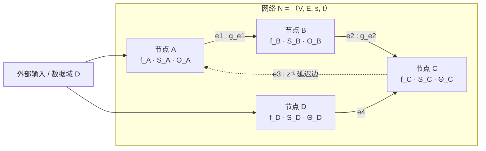
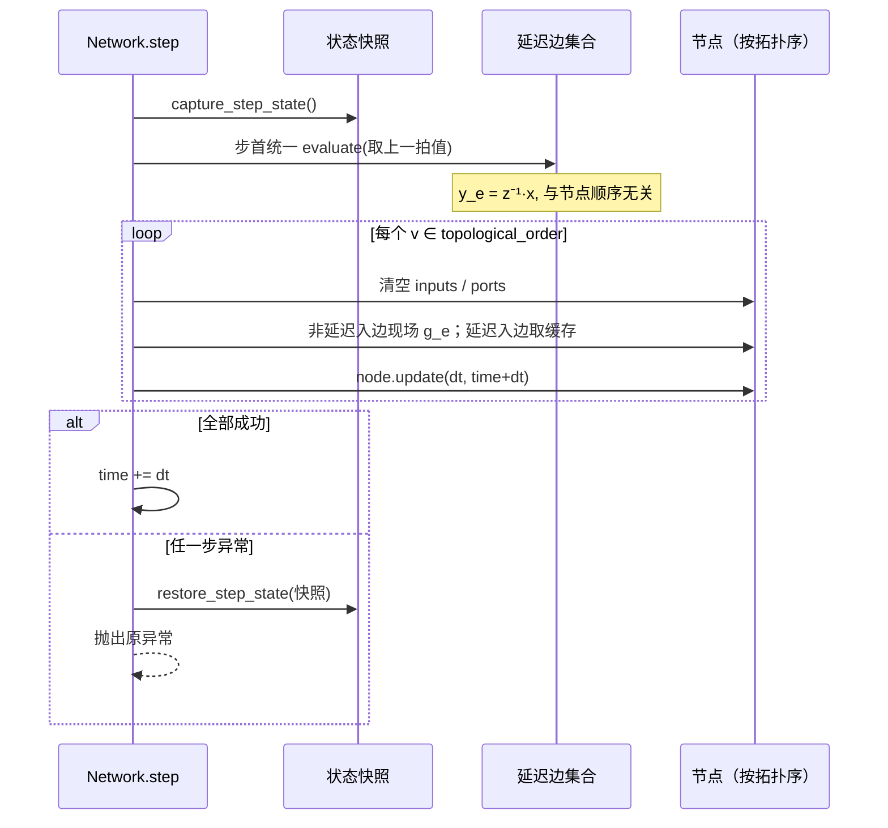
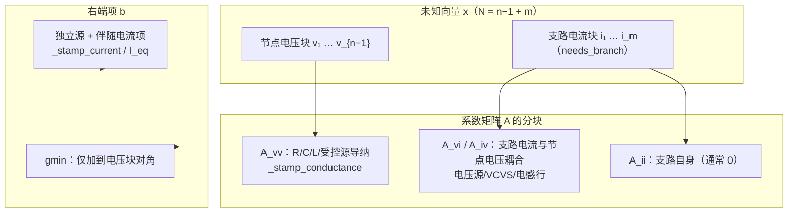
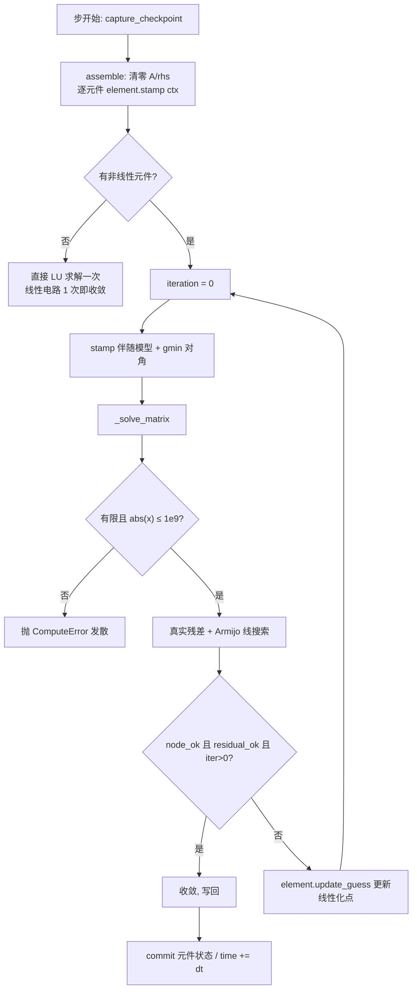

# Netlab 数学架构（ARCHITECTURE_MATH）

> 范围：本文描述 **架构层的数学**——网络如何形式化、一步一步如何求值、电路模式如何装配与求解、数值边界在哪里。
> 它**不**逐个推导元件/节点/连接的公式细节；那些属于 `ELEMENT_*` 系列。本文只负责把"算子、拓扑顺序、状态与参数、组装契约"讲清楚，并给出可核对的源码位置。
>
> 约定：正文中的 `file:line` 均指向当前工作树（`NetlabHome/`）下的实现。若行号随重构漂移，以函数名 + 文件名为准。

---

## 0. 符号与约定

| 记号 | 含义 | 代码对应 |
| --- | --- | --- |
| `V` | 节点集合 | `Network.nodes`（`core/model/graph.py:372`） |
| `E` | 有向连接（边）集合 | `Network.connections`（`graph.py:373`） |
| `s : E → V` | 边的源映射 | `Connection.source`（`graph.py:293`） |
| `t : E → V` | 边的目标映射 | `Connection.target`（`graph.py:294`） |
| `In(v)` / `Out(v)` | 节点 v 的入边 / 出边集合 | 拓扑排序时由 `_incoming` 收集（`graph.py:660`） |
| `D` | 数据域：一条"记录"（字符串键 → 标量或数组） | `NodeData` / `NodeInputs` |
| `Y_v = ∏_{p∈Out(v)} D` | 节点 v 的输出记录空间（按输出端口分解） | `Node.data`（`graph.py:166`） |
| `S_v, S_e` | 节点 / 连接的局部状态空间 | `Node.state`、`Connection.state` |
| `Θ_v, Θ_e` | 节点 / 连接的参数空间 | `Node.params`、`Connection.params` |
| `M_e` | 连接方法标识（kind） | `Connection.kind`（`graph.py:298`） |
| `z^{-1}` | 单步延迟算子 | `Connection.delay`（`graph.py:299`） |
| `Φ_Δt` | 全网一拍推进算子 | `Network.step`（`graph.py:700`） |

一条边 e 的**载荷空间**记为 `Y_e`，它是 `D` 的子集（按 `source_port` 选取源节点输出的某些字段）。这是 R20/Q8 的端口模型：`source_port` 引用源节点输出字段，`target_port` 指定目标节点接收的输入端。

---

## 1. 网络的形式化

### 1.1 网络是一个带端口的有限有向多重图

**定义 1.1（网络）** 一个网络是六元组

```
N = (V, E, s, t, Port, delay)
```

其中 `V`、`E` 有限；`s, t : E → V`；`Port ⊆ {(v, p) | v ∈ V, p ∈ Ports(v)}` 是节点端口集合，且每条边绑定一对端口 `(source_port, target_port)`；`delay : E → {0,1}` 标记该边是否为单步延迟边。

节点 v 的**输出记录空间**为 `Y_v = ∏_{p∈Out(v)} D`，一条入边 e 给 v 的输入记录属于 `Y_e`。节点还各自携带状态 `S_v` 与参数 `Θ_v`，边携带状态 `S_e`、参数 `Θ_e` 与方法 `M_e`。

这一"图 + 端口 + 每节点/边局部状态参数"的结构，直接对应 `graph.py` 的三个数据类：`ComputeContext`（`graph.py:149`）、`Node`（`graph.py:164`）、`Connection`（`graph.py:291`）。

### 1.2 节点计算算子

**定义 1.2（节点算子）** 对 `v ∈ V`，其计算算子

```
f_v : (∏_{e∈In(v)} Y_e) × S_v × Θ_v × Y_v → Y_v × S_v
     (inputs, state, params, data) ↦ (data', state')
```

`f_v` 是**纯映射**：它读取入边载荷、自身状态、参数与当前数据，产出一条"数据差分"并合并进 `data`，同时返回新的 `state`。代码里 `Node.update(self, dt, time)`（`graph.py:221`）正是这个算子的一次调用：没有 `compute` 也没有 `handler` 时是恒等映射（直接返回）；否则调用计算实现，把返回字典差分合并进 `data`。

> 注意 `f_v` 依赖时间步长 `dt` 与时间 `time`（离散系统的显式时钟），因此严格写为 `f_v(·; dt, time)`，它们作为算子的"外部参数"而非节点参数。

### 1.3 连接算子

**定义 1.3（连接算子）** 对 `e ∈ E`，其传递算子

```
g_e : Y_{s(e)} × S_e × Θ_e × M_e × D → Y_e × S_e
     (x_src, state, params, method, dt) ↦ (y_e, state')
```

实现签名是 `Connection.evaluate(self, dt, time)`（`graph.py:332`），内部调用

```
method(source.view, target.view, params_or_source_params, state, dt)
```

即除了源视图外还传入**目标只读视图**（供少数需要目标上下文的连接方法使用），并返回新的载荷写入 `Connection.output`、返回给 `Network.step`。方法标识 `M_e` 决定了 concrete 的 `method` 实现，见 §3 的 12 种注册表。

### 1.4 延迟算子 `z^{-1}`

**定义 1.4（延迟边）** 若 `delay(e)=1`，则 e 在第 k 拍输出

```
y_e[k] = g_e(x_{s(e)}[k-1], ...) = (z^{-1} ∘ g_e)(x[k])
```

即"上一拍的源值经 g_e 传递"。代码在 `Network.step` 的**步首**统一求值所有延迟边（`graph.py:721-730`）：此时所有节点仍持有第 k−1 拍的值，故输出严格等于 `z^{-1}`；空载荷按 0 处理，不注入空字典以免目标节点误判配置错误。

### 1.5 全网步算子与拓扑序

**定义 1.5（全网状态与步算子）**

```
X = ( ∏_{v∈V} (Y_v × S_v) ) × ( ∏_{e∈E} (Y_e × S_e) )
Φ_Δt : X → X
```

`Φ_Δt` 的实现就是 `Network.step(dt)`（`graph.py:700`）：在一条**拓扑序** `π = (v_1, …, v_n)` 上按序施加 `f_v`，非延迟边在其目标节点被访问时现场 `g_e` 求值，延迟边取步首缓存的载荷。

**命题 1.1（拓扑序存在性）** 设 `G = (V, E')` 为仅保留 `enabled` 且非延迟边的子图。则 `G` 存在拓扑序当且仅当 `G` 无有向环。

*证明（要点）*。若存在环 `v_1 → v_2 → … → v_k → v_1`，则要求 `π(v_1) < π(v_2) < … < π(v_k) < π(v_1)`，矛盾。反之若 `G` 无环，Kahn 算法每次取入度为 0 的节点即可输出全序；若某步无入度 0 节点而仍有剩余节点，则剩余子图必有环（有限有向图每个非空子图含源点或环）。∎

失败时抛 `ComputeError`，提示"网络中存在代数环 … 请把环上的一条连接设为"单步延迟"，或在电路模式下求解"（`graph.py:660` 的 `topological_order`，其 `ready` 用栈实现、结果缓存于 `self._order`）。

### 1.6 把 SCC 收缩成 DAG

对信号流网络，若存在直接馈通的环，我们既不强行改拓扑，也不一律报错，而是**按状态断点 + 强连通分量收缩**得到一张 DAG：

- **断点集** `B = { v | stateful(v) ∧ ¬direct_feedthrough(v) }`：这类节点的当前输出只取上一拍状态，可在本拍内先算，不需要当前输入（`graph.py:576-578`）。
- 在**非断点**节点诱导的直接馈通子图上求 Tarjan SCC（`_strongly_connected_components`，`graph.py:501` 迭代式实现，避免深链爆栈）。
- 把每个 SCC 与每个断点各作为一个"超级节点"，在**分量图**上建边并做 Kahn 拓扑排序（`solver_plan`，`graph.py:568`，分量图排序见 `:604-621`）。

**命题 1.2（收缩图无环）** 商图 `G/∼`（`u∼v` 当且仅当 `u,v` 在同一 SCC）是 DAG。

*证明（要点）*。若商图有环 `C_1 → C_2 → … → C_k → C_1`，则任取各分量内节点可拼接出一条回到起点的有向路径，于是这些节点两两互相可达，应属于同一 SCC，与"不同分量"矛盾。∎

一个分量被标为**代数环**当且仅当它不是断点且（`|C|>1` 或含自环）（`graph.py:631-636`）。这类分量在 `solve_algebraic=True` 时于本拍内联立求解（`_step_solved`，`graph.py:750`；线性走 `_solve_linear_stage` `graph.py:983`、非线性走 `_solve_nonlinear_stage` `graph.py:893`）；否则退回默认的拓扑序 + 自动 `z^{-1}` 行为。

### 1.7 计算上下文与 handler 分支

`ComputeContext`（`graph.py:149`）是传给节点算子的只读+状态上下文，字段为

```
name, inputs, data, state, params, dt, time, ports
```

其中 `inputs` 以**入边为键**、`ports` 按**目标端口分组**（R20/Q8）。`Node.update` 对三类实现分支（`graph.py:226-253`）：

1. `compute is not None`：无法证明用户回调只读，**全量深拷贝** `inputs/ports/data`（`trusted=False`）；
2. `handler is not None and trusted`：内置 handler 已审计不改入参，走浅拷贝快路径（`inputs` 直接引用、`data=dict(self.data)`）；
3. 其余（用户 handler）：深拷贝。

无论哪条路径，`state` 都传入隔离副本 `_state_snapshot(self.state)`（S-04，`graph.py:253`），保证一旦计算失败不会留下"半改状态"。

### 1.8 一步是事务

**命题 1.3（整步原子性）** 设步首快照 `X₀ = capture_step_state()`。若 `Φ_Δt` 执行中抛出任意异常，则 `restore_step_state(X₀)` 后全局状态恰为 `X₀`；否则状态为 `Φ_Δt(X₀)`。因此每步只有"全部成功"或"完全不变"两种结果。

*证明（要点）*。`capture_step_state`（`graph.py:1061`）记录了 `time`、每个节点的 `(data, state, inputs, ports)` 深拷贝、每条连接的 `(state, output)`；`restore_step_state`（`graph.py:1083`）原地 `clear()+update()` 回覆。`Network.step` 用 `try/except BaseException` 包住整步，失败先回滚再抛出（`graph.py:718-720` 之后的 `except`）。对语句做归纳即得原子性。∎





---

## 2. 节点 kind 注册表（22 种）

节点计算方式集中在 `core/compute/computes.py`。它不是插件运行时，而是**受控实现注册表**：服务端只执行这里注册的 `factory`，绝不执行用户提交的代码（模块 docstring 明确声明）。

### 2.1 注册表结构

**定义 2.1（计算规格）** 每条 `ComputeSpec`（`computes.py:43`）为

```
kind, label, group, description,
params : tuple[ParamSpec, ...],
factory : Factory,
outputs, notes, formula, source, editable, builtin, addable
```

`COMPUTE_SPECS: dict[str, ComputeSpec]`（`computes.py:63`）是全局注册表，`register(spec)`（`computes.py:128`）在重复 `kind` 时抛 `RuntimeError`。`addable=False` 的 kind（模块类）不可由用户手动创建。

**接口契约**：`factory(params) → NodeCompute`；`NodeCompute.__call__(ctx) → NodeData`，返回的字典差分合并进 `Node.data`；`params` 由 `ParamSpec` 校验（类型/范围/默认值）。

### 2.2 分类表（按 `group` 字段，实测 8 组）

| kind | label（职责） | group | 源位置 |
| --- | --- | --- | --- |
| `manual` | 手动数据源 | 基础 | `computes.py:181` |
| `sum` | 输入求和 | 基础 | `computes.py:210` |
| `gain` | 比例放大 | 基础 | `computes.py:248` |
| `lag` | 一阶惯性 | 动态 | `computes.py:296` |
| `integrate` | 积分器 | 动态 | `computes.py:348` |
| `signal` | 信号发生器 | 动态 | `computes.py:389` |
| `expression` | 表达式求值 | 高级 | `computes.py:445` |
| `abc_dq` | 三相→dq 变换 | 变换 | `computes.py:531` |
| `pll` | 锁相环 | 变换 | `computes.py:644` |
| `pi` | PI 控制器 | 控制 | `computes.py:713` |
| `state_space` | 状态空间模型 | 高级 | `computes.py:749` |
| `transfer_function` | 传递函数 | 高级 | `computes.py:815` |
| `clip` | 限幅 | 基础 | `computes.py:890` |
| `oscillator` | 振荡器 | 矢量 | `computes.py:1048` |
| `nonlinear_plant` | 非线性被控对象 | 矢量 | `computes.py:1128` |
| `sliding_mode` | 滑模控制 | 矢量 | `computes.py:1184` |
| `vector_transform` | 矢量坐标变换 | 矢量 | `computes.py:1238` |
| `module_input` | 模块输入端口 | 模块 | `computes.py:1318` |
| `module_output` | 模块输出端口 | 模块 | `computes.py:1333` |
| `block` | 子模块封装 | 模块 | `computes.py:1353` |
| `if_signal_to_vector` | 信号→矢量接口 | 接口 | `computes.py:1403` |
| `if_vector_to_signal` | 矢量→信号接口 | 接口 | `computes.py:1461` |

> 任务描述里把分类粗分为"基础 / 控制 / 矢量 / 模块"；**源码的实际 `group` 是 8 组**（基础、动态、高级、变换、控制、矢量、模块、接口）。上表以源码为准，粗分类只是其中四类的合并视角：基础≈基础+动态，控制≈控制+高级+变换，矢量≈矢量，模块≈模块+接口。

### 2.3 职责分层（不展开公式）

- **基础层**：`manual/sum/gain/clip` —— 无状态代数运算，输出只依赖本拍输入与参数，`stateful=False`、`direct_feedthrough=True`。
- **动态层**：`lag/integrate/signal` —— 含状态，`stateful=True`，是天然的"状态断点"候选（见 §1.6）。
- **控制层**：`pi/pll/abc_dq` —— 控制律与坐标变换，内部多为动态 + 代数组合。
- **矢量化层**：`oscillator/nonlinear_plant/sliding_mode/vector_transform` —— 多通道矢量信号，接口按矢量字段约定。
- **模块/接口层**：`module_input/module_output/block/if_*` —— 子图封装与端口类型适配，`addable` 受控。

具体公式与参数语义留给对应的 `ELEMENT_*` 文档；本文只保证"注册表 → 接口 → 分类"这条骨架可核对。

---

## 3. 连接 kind 注册表（12 种）

连接方法集中在 `core/compute/methods.py`，同样是受控注册表。

### 3.1 注册表结构与接口

**定义 3.1（方法规格）** `MethodSpec`（`methods.py:26`）字段：`kind, label, group, description, params, factory, outputs, notes, formula, source, editable, builtin`。注册表 `METHOD_SPECS: dict[str, MethodSpec]`（`methods.py:41`），`register` 在 `:44`。

**接口契约**：`method(source_view, target_view, params, state, dt) → dict`。对函数而言端点数据与参数**只读**——`Connection.evaluate` 传入的是 `NodeView` 与 `MappingProxyType` 包装的只读映射（`graph.py:336-345`）。

### 3.2 分类表

| kind | label（职责） | group | 源位置 |
| --- | --- | --- | --- |
| `scale` | 比例传递 | 信号 | `methods.py:76` |
| `delay` | 单步延迟 | 信号 | `methods.py:131` |
| `tf` | 传递函数 | 信号 | `methods.py:216` |
| `integrator` | 积分传递 | 动态 | `methods.py:295` |
| `clamp` | 限幅传递 | 信号 | `methods.py:343` |
| `pass` | 直通传递 | 模块 | `methods.py:394` |
| `resistor` | 电阻 | 电路 | `methods.py:435` |
| `capacitor` | 电容 | 电路 | `methods.py:470` |
| `inductor` | 电感 | 电路 | `methods.py:505` |
| `diode` | 二极管 | 电路 | `methods.py:544` |
| `vector` | 矢量传递 | 矢量 | `methods.py:610` |
| `vector_diffusion` | 矢量扩散 | 矢量 | `methods.py:660` |

公式汇总在 `METHOD_FORMULAS`（`methods.py:708`）。具体数学式交给 `ELEMENT_*`，本文只讲接口与求值时机。

### 3.3 只读视图与每边独立状态

- **只读视图**：`Node.view` 在节点构造时缓存 `NodeView(name, MappingProxyType(data))`（`graph.py:216-217`）；`Connection` 在 `__post_init__` 里缓存 `_params_view = MappingProxyType(self.params)`，并按 `source_port` 生成 `_source_params`（`graph.py:315-330`）。`MappingProxyType` 会随底层字典更新，故每步无需重新分配包装对象。
- **每边独立参数/状态**：`Connection.params` 与 `Connection.state` 是**每条边各自的字典**（`graph.py:296-297`），所以同一种 kind 的两条边互不共享状态；这使"两条串联积分边"能各自维护历史。
- **首拍空值**：`_read(node, field)`（`methods.py:51`）在延迟边步首先于节点求值时处理"源/目标 data 尚未产生"的首拍情况——按 0 处理；若字段存在但类型不对，仍交给读取层报错，不静默吞掉。

### 3.4 延迟边求值时机与 auto_delay

**命题 3.1（延迟边交换性）** 若 e 为延迟边，则对任意节点处理顺序，其第 k 拍输出都等于 `g_e(x[k-1])`。

*证明（要点）*。延迟边在步首统一 `evaluate`，此时 `capture_step_state()` 之后、任何 `f_v` 施加之前，所有 `Node.data` 仍是第 k−1 拍值；`g_e` 只读源视图，故结果与随后节点顺序无关。∎

**显式 delay vs auto_delay**（场景编辑层，`core/model/scene_edit.py:280-304`）：

- **电路模式**：`delay` 不被支持（节点电压法按拍内联立），显式 `delay=True` 直接 `ValidationError`；`delay` 被强制置 `False`。
- **信号模式**：若某条连接会形成代数环，且场景 `auto_delay=True`，装配器自动把该边设为单步延迟并标 `auto_delay=True`（运行期可见的标记）；若开启 `solve_algebraic`，则不改写、交给 SCC 求解；否则抛 `ConflictError` 提示设 `delay=True` 或启用求解。
- **显式 `delay=True`**：无论是否成环都保持单步延迟，是用户在工程里写死的语义。

`Network.auto_delayed_connections`（`graph.py:564`）可列出所有由自动逻辑加上的延迟边，供 UI/报告区分"用户延迟"与"防环延迟"。

---

## 4. 存储与传递

### 4.1 `data` / `state` 的读写规则

- `Node.data`（`graph.py:166`）是节点当前输出记录；`Node.update` 把计算返回的**差分字典**合并进去（`graph.py:216-219`）。`data` 与 `state` 保持引用语义，与场景记录共享同一份字典，界面无需额外同步（`graph.py:190-196`）。
- `Node.state`（`graph.py:174`）只在节点算子内部演进；`Node.update` 对非 trusted 路径传入隔离副本，成功后才写回，失败丢弃。
- `Connection.output`（`graph.py:306`）保存该边本拍载荷；`Connection.state`（`graph.py:297`）保存边级历史（如积分/延迟）。

### 4.2 `_view` 只读视图

`Node._view = NodeView(name, MappingProxyType(data))`（`graph.py:186, 217`）。所有连接方法只能读 `source.view`/`target.view`，无法原地修改上游 `data`。参数侧同理用 `_params_view`/`_source_params`（`graph.py:319-330`）。视图对象在构造时缓存，`MappingProxyType` 跟随底层字典更新，故"一步内多次读取"零额外分配。

### 4.3 每步事务快照与整步回滚

见 §1.8：`capture_step_state`（`graph.py:1061`）/`restore_step_state`（`graph.py:1083`）实现整步快照回滚。`Network` 还保留 `_last_step_snapshot`（`graph.py:384`），供上层超时回滚复用，避免每步再做一次 Scene 级全量深拷贝。

### 4.4 延迟边缓存

`Network.step` 内的 `delayed_payloads: dict[Connection, NodeData]`（`graph.py:724`）是延迟边的"上一拍值缓存"：步首统一求值一次后，按目标节点顺序反复读取，避免重复计算；空载荷不入字典，目标侧按 0 处理（`graph.py:727-730`）。`self._delayed` 由 `topological_order` 末尾缓存（`graph.py:695-696`），只在结构变化时失效（`invalidate`，`graph.py:395`）。

### 4.5 三类核心数据结构的类定义（源码）

网络的数学对象 `N=(V,E,s,t,Port,delay)` 在代码里就是三个 `@dataclass`/普通类：`Node`、`Connection`、`Network`。下面按 `graph.py` 的当前定义给出**忠实节选**（省略以 `...` 标出的方法体与私有辅助字段；完整实现见 `netlab/core/model/graph.py`）。

**节点 `Node`**（`graph.py:164`）：`data` 是当前输出记录，`state` 是跨步状态，`params` 是参数，`inputs`/`ports` 是本步入边载荷，`kind` 选择计算规格，`compute` 或 `handler` 提供计算算子。

```python
# netlab/core/model/graph.py:164 （节选）
@dataclass(eq=False)
class Node:
    name: str
    data: NodeData = field(default_factory=dict)
    compute: NodeCompute | None = None
    inputs: NodeInputs = field(default_factory=dict)      # 每条入边一个键
    ports: NodeInputs = field(default_factory=dict)       # 按目标端口分组
    kind: str = "manual"
    params: dict[str, Any] = field(default_factory=dict)
    state: dict[str, Any] = field(default_factory=dict)
    handler: Callable[[ComputeContext], NodeData] | None = None
    trusted: bool = False          # 内置已审计算子才可走浅拷贝快路径
    linear: bool = True            # R36 求解语义标签
    stateful: bool = False
    direct_feedthrough: bool = True
    time_varying: bool = False
    nonlinear: bool = False
    _view: NodeView | None = None

    @property
    def view(self) -> NodeView: ...                       # graph.py:205 只读视图
    def set_data(self, values: NodeData, *, replace: bool = False) -> None: ...
    def update(self, dt: float = 1.0, time: float = 0.0) -> None: ...  # graph.py:221
```

**连接 `Connection`**（`graph.py:291`）：`method` 即连接算子 `g_e`；`source`/`target` 是两端节点；`params`/`state` 为边级参数与历史；`delay`/`auto_delay` 标记延迟边；`source_port`/`target_port` 是端口绑定。

```python
# netlab/core/model/graph.py:291 （节选）
@dataclass(eq=False)
class Connection:
    name: str
    source: Node
    target: Node
    method: ConnectionCompute
    params: dict[str, Any] = field(default_factory=dict)
    state: dict[str, Any] = field(default_factory=dict)
    kind: str = "custom"
    delay: bool = False
    auto_delay: bool = False        # 仅运行期可见，不写入工程
    enabled: bool = True
    source_port: str = ""
    target_port: str = ""
    output: NodeData = field(default_factory=dict)

    def evaluate(self, dt: float, time: float = 0.0) -> NodeData: ...   # graph.py:332
```

**网络 `Network`**（`graph.py:362`）：持有节点表、连接表与仿真时钟；`invalidate()` 在结构变化时丢弃拓扑缓存；`step(dt)` 推进一拍；`capture_step_state()/restore_step_state()` 提供整步事务快照。

```python
# netlab/core/model/graph.py:362 （节选）
class Network:
    def __init__(self, *, auto_delay: bool = False,
                 solve_algebraic: bool = False,
                 clock: SimClock | None = None) -> None:
        self.nodes: list[Node] = []
        self.connections: list[Connection] = []
        self._clock = clock if clock is not None else SimClock()
        self.auto_delay = auto_delay
        self.solve_algebraic = bool(solve_algebraic)
        self._order: list[Node] | None = None
        self._incoming: dict[Node, list[Connection]] | None = None
        self._delayed: list[Connection] | None = None

    def add_node(self, node: Node) -> Node: ...                        # graph.py:400
    def connect(self, source: Node, target: Node, method: ..., **kwargs: Any) -> Connection: ...  # graph.py:432
    def topological_order(self) -> list[Node]: ...                     # graph.py:660
    def step(self, dt: float = 1.0) -> None: ...                       # graph.py:700
    def capture_step_state(self) -> dict[str, Any]: ...                # graph.py:1061
    def restore_step_state(self, snapshot: Mapping[str, Any]) -> None: ...  # graph.py:1083
```

一句话对照：`Node` 定义“点怎么算”，`Connection` 定义“边怎么传”，`Network` 定义“按什么顺序把点和边串成一步”。

---

## 5. 电路模式：MNA、Newton 与积分

电路模式不再是信号流的一拍前推，而是**每一拍解一次节点电压法（MNA）方程**。核心实现：`core/compute/circuit/solver.py`。

### 5.1 MNA 方程 `A x = b`

设非接地节点电压 `v_1…v_{n-1}`，以及需要支路电流的元件（独立电压源、VCVS、独立电感等）的支路电流 `i_1…i_m`。未知向量

```
x = [ v_1, …, v_{n-1}, i_1, …, i_m ]ᵀ ,   A ∈ ℝ^{N×N}, N = (n-1) + m
```

对每个非接地节点写 KCL（流出电流代数和 = 0），对每个电压型支路写"支路电压方程"`v_a − v_b = V`。`A` 的每一行/列由元件 **stamp** 累加得到。基尔霍夫电流方程的矩阵形式即 `A x = b`，其中 `b` 汇集独立源与伴随电流项。

### 5.2 索引构建 `_build_index`

`CircuitSolver._build_index`（`solver.py:162`）：

1. 恰好一个接地节点，否则报错（`solver.py:165-170`）；
2. 未知量 = 非接地节点 id + 各元件 `internal_nodes`，id 冲突报错（`solver.py:171-179`）；
3. 先校验元件端点/控制端点存在，避免 KeyError 潜伏（`solver.py:181-194`）；
4. **按物理 id 排序** `sorted(unknown)` 建 `self.index = {id: pos}`，使均衡/消元顺序与 dict 插入历史无关（`solver.py:195-198`）；
5. 支路元件按 `branch_width` 追加电流未知量到矩阵尾部：`element.branch_index = len(unknown) + offset`（`solver.py:200-215`）；
6. `matrix_size = len(unknown) + branch_count`，并初始化 `solution/_matrix/_rhs`（`solver.py:215-226`）。

### 5.3 稀疏判定 `_decide_sparse`

`_decide_sparse`（`solver.py:234`）返回 `matrix_size > options.sparse_threshold`，默认阈值 **512**（`stamps.py:40-44` 注释：≤400 节点时 LIL 反而更慢，故默认 512）。`SolverOptions.sparse` 支持 `"auto" / "on" / "off"`：`"auto"` 按阈值，`"on"/"off"` 强制。

### 5.4 元件 stamp 契约：`StampContext`

**定义 5.1（盖章上下文）** `StampContext`（`stamps.py:56`）字段：

```
A, rhs, index: dict[str,int], solution, dt, time, iteration,
mode: "tran" | "dc" | "ac", omega = 0.0
```

方法 `voltage(node_id) -> float` 读取当前解（缺省/接地按 0）。两个盖章原语：

- `_stamp_conductance(ctx, a, b, g)`（`stamps.py:75`）：`A[a,a]+=g, A[b,b]+=g, A[a,b]-=g, A[b,a]-=g`（缺省端=地跳过）；
- `_stamp_current(ctx, a, b, value)`（`stamps.py:87`）：`rhs[a]-=value, rhs[b]+=value`。

每个元件 `CircuitElement.stamp(ctx)`（抽象于 `elements.py:58`）只通过这些原语写 `A/rhs`，不直接访问矩阵形状。这就是"元件只依赖盖章契约、求解器负责装配"的解耦：新增元件无需改求解器。

矩阵按"节点电压块 / 支路电流块"分块装配：



装配流程：`_blank_matrix()` 清零 → 逐元件 `stamp(ctx)` 累加 → （Newton 迭代）在电压未知量对角加 `gmin`（`solver.py:654-656`）→ `_solve_matrix` 解一次。

### 5.5 Newton 迭代：`F(x)=0`

非线性元件使 `A`、`b` 依赖解 `x`，方程变为 `F(x) = A(x)·x − b(x) = 0`。Newton 迭代

```
J(x_k) · Δx_k = −F(x_k),      x_{k+1} = x_k + α_k Δx_k
```

**Jacobian 的实际装配方式（重要）**：netlab **不做全网有限差分**。线性元件的 stamp 直接把常数写入 `A`；非线性元件由各自 `stamp` 写入**解析小信号伴随模型**，并用 `update_guess` 更新线性化点。数学上，这等于把精确解析导数 `∂I/∂v` 作为 Jacobian 的非零块逐元件装配（比有限差分更精确，且天然稀疏）。例如二极管：

```
I(v) = I_s ( e^{v/(n V_T)} − 1 )
g(v) = dI/dv = (I_s/(n V_T)) · e^{v/(n V_T)}
伴随模型：I(v) ≈ I(v₀) + g(v₀)(v − v₀) = g·v + [I(v₀) − g·v₀]
```

对应 `elements.py:539-545`（`_conductance` 返回 `(current, conductance)`）与 `elements.py:547-553`（`stamp` 写入 `g` 与偏移电流）。运放用 `tanh` 饱和的解析斜率 `slope = gain·(1−tanh²)`（`elements.py:642-648`），再盖入 `A/rhs`。`update_guess(ctx)`（`elements.py:61, 556`）做迭代点更新与电压限幅（pnjlim 类），把下一次线性化点拉回稳定区。

**Armijo 线搜索**：`_line_search_solution`（`solver.py:571`）从 `α=1` 起最多回溯 8 次，`candidate = base + α·(full − base)`；非有限或 `ComputeError` 则 `α ← α/2`；接受判据

```
residual(accepted) ≤ max(1e-15, current_residual · (1 − 1e-4·α))
```

（Armijo 常数 `1e-4`）。这保证目标函数单调下降，避免 Newton 全步越界。

**收敛判据**：`_tolerance(new, old)`（`solver.py:477`）对电压量用 `vntol`、对电流量用 `abstol`，再加 `reltol·max(|new|,|old|)`；`node_ok = all(|Δx| ≤ tol)`，`residual_ok` 用 `residual_tol`（若 >0）否则 `residual_safety_tol`（1e-8），两者同时满足且 `iteration>0` 才收敛（`solver.py:678-695`）。真实残差由 `_true_residual`（`solver.py:533`）在**未加 gmin 的物理方程**上重新计算，`_residual_metric`（`solver.py:555`）给出相对量。

**发散保护**：解非有限即报错；`max|x| > MAX_ABS_VOLTAGE = 1e9` 报"仿真已发散"（`solver.py:658-661`）。`_check_floating`（`solver.py:873`）在首次迭代做悬空节点检测。

**策略回退**：`_newton_with_strategies`（`solver.py:426`）先在 `gmin=1e-3` 下做 gmin stepping（10 轮×0.1 递减），失败再做 source stepping（源从 0 斜坡到 1，10 步），每次试验用元件状态快照回滚。



### 5.6 瞬态积分：BE / Trap / Gear2

积分方法在 `CircuitSolver.__init__` 校验，仅允许 `"trapezoidal" / "backward_euler" / "gear2"`（`solver.py:121`）。元件 `prepare(dt, time)` 把微分方程转成**伴随模型** `i = G·v + I_eq`。

**电容**（`elements.py:135-159`）：

| 方法 | `G` | `I_eq` |
| --- | --- | --- |
| 后向欧拉 BE | `C/dt` | `−G·v_n` |
| 梯形 Trap | `2C/dt` | `−G·v_n − i_n` |
| Gear2(BDF2) | `1.5C/dt` | `C·(−2v_n + 0.5v_{n−1})/dt` |

**电感**（`Inductor`，`elements.py:209` 起，`prepare` 见 `:240-255`）：

| 方法 | `G` | `I_eq` |
| --- | --- | --- |
| BE | `dt/L` | `i_n` |
| Trap | `dt/(2L)` | `i_n + G·v_n` |
| Gear2 | `dt/(1.5L)` | `(2i_n − 0.5i_{n−1})/1.5` |

Gear2 需要两步合法历史 `(v_{n-1}, dt)`；若首步或 `dt` 变化则 `_gear_ready=False`，本步**回退后向欧拉**避免 BDF2 失真（`elements.py:144-156`）。电容/电感在 `dc` 模式分别开路/短路、在 `ac` 模式用 `jωC` / `1/(jωL)`（`elements.py:162-168, 267`）。

### 5.7 DC 工作点 `operating_point`

`operating_point`（`solver.py:903`）求 `F(x)=0` 的直流解：`time=0`、元件值取 `waveform_value(params, 0)`、猜值 `x=0`，调 `_newton_with_strategies(1e-9, guess, mode="dc")`；不收敛抛 `ComputeError("直流工作点在 N 次 Newton 迭代内未收敛（后向残差 …，最大残差节点 …）")`。`mode="dc"` 下电容开路、电感短路（见上表 stamp 分支），因此工作点只由电阻网络与源决定。

### 5.8 AC 小信号 `ac_sweep`

`ac_sweep`（`solver.py:969`）只支持**线性/受控源**元件集合

```
AC_KINDS = {resistor, capacitor, inductor, vsource, isource, vcvs, vccs, switch}   # solver.py:890
```

其余（二极管、BJT、MOS、运放等）显式 `ComputeError`，**不做静默线性化**。每个频点：选中独立源设单位激励（1 V / 1 A），其余源置零；电容 `jωC`、电感 `1/(jωL)`；解一次复数 MNA 得到各探针的 `magnitude / phase_deg / db`。频率须正有限且严格递增。该路径**不改瞬态状态**（只读探针）。

### 5.9 描述符模型：非线性的小信号入口

`solver.py` 的 AC 路径不处理非线性；非线性器件的频响走 `core/compute/circuit/descriptor.py` 的**描述符模型**：

```
E ẋ + A x = B u
y = C x + D u
```

状态 `x` 含非接地节点电压 + 独立电感/独立电压源/VCVS/运放支路电流。频域解 `(A + jωE) X = B`（`descriptor.py:239-245`），不显式求逆。支持元件 `SUPPORTED_KINDS`（`descriptor.py:32`），非线性器件 `NONLINEAR_KINDS`（`:46`）可在**给定直流工作点**按各自解析小信号模型线性化（`LINEARIZABLE_NONLINEAR_KINDS`，`:63`）；**未给工作点时显式抛 `ComputeError`，不静默降级**。入口 `DescriptorModel.from_scene(...)` / `.linearize(op)` / `.frequency_response(...)`（`descriptor.py:260`）。

> 任务描述里"非线性由 descriptor M0–M4 处理"中的 **M0–M4 是 `UNIFIED_SIM_MATH_SPEC.md` 的里程碑编号**（M0 数学地基、M1 纵切闭环…），不是 descriptor 的算法步骤。正确的表述是：*descriptor 模型在给定工作点对非线性器件做解析线性化*。

### 5.10 状态空间模型

`state_space` 节点承载 `x' = A x + B u, y = C x + D u`（`core/compute/statespace.py`）。矩阵形状校验：`A` 方阵 `n×n`、`B` 为 `n×m`、`C` 为 `p×n`、`D` 为 `p×m`，且 `m,p ≤ 6`、元素绝对值 `≤ 1e9`（`statespace.py:75-97`）。

离散化 `cont2discrete`（`linalg.py:129`）支持 `zoh / forward / backward / tustin`：
- **ZOH**：`A_d = expm(M·dt)[:n,:n]`，`B_d = expm(M·dt)[:n,n:]`，其中 `M = [[A, B],[0,0]]`（`linalg.py:113-126`，`expm` 用 Higham 13 阶 Padé 缩放平方）；
- **前向欧拉**：`A_d = I + dt·A, B_d = dt·B`；
- **后向欧拉**：`A_d = (I − dt·A)^{-1}, B_d = (I − dt·A)^{-1}·dt·B`；
- **Tustin**：双线性变换（`linalg.py:158`）。

推进一步 `StateSpaceModel.step`（`statespace.py:168`）：`y = C x + D u`，`x_next = A_d x + B_d u`；离散化结果按 `(dt, method)` 缓存（`statespace.py:132-139`）。非有限即报"状态空间模型发散"。

---

## 6. 数值限制、复杂度与代码索引

### 6.1 硬性上限（`core/common/limits.py:15-25`）

| 常量 | 值 | 作用 |
| --- | --- | --- |
| `MAX_NODES` | 400 | 单场景节点数上限 |
| `MAX_EDGES` | 1200 | 单场景连接数上限 |
| `MAX_FIELDS` | 64 | 记录字段数 |
| `MAX_STRING` | 400 | 字符串长度 |
| `MAX_DEPTH` | 8 | JSON 嵌套深度 |
| `MAX_ARRAY` | 256 | 数组长度 |
| `MAX_MATRIX` | 12 | 矩阵阶数（状态空间/参数矩阵） |
| `MAX_NUMBER` | 1e15 | 数值绝对值 |
| `MAX_NAME` | 32 | 名称长度 |
| `MAX_PRECOMPUTE_STEPS` | 200 000 | 单次预计算步数 |

这些上限同时保护计算耗时与内存，并防止 NaN/Inf、过深嵌套撑爆仿真状态。

### 6.2 复杂度

- **稠密 MNA**：一次 LU 分解 `O(N³)`，回代 `O(N²)`；`N = (n−1) + m`。线性电路矩阵只依赖 `dt` 与参数，首拍分解后**复用 LU**（`_solve_matrix`，`solver.py:714`，缓存校验 `_lu_matrix` 相等 + `_cached_dt==dt`）。
- **稀疏后端**：`_solve_sparse`（`solver.py:804`）用 `splu`，复杂度取决于**填充（fill-in）**与排序；默认阈值 512，低于阈值稠密更快。
- **Newton**：每迭代一次装配 + 一次线性解，`max_iter=60`（`stamps.py:19`）。非线性电路每迭代矩阵变化，LU 缓存失效。
- **AC 扫频**：每个频点一次复数解 `O(N³)`（`ac_sweep`，`solver.py:969`）；描述符模型同样是每频点一次 `np.linalg.solve`（`descriptor.py:243`）。
- **图算法**：Kahn 拓扑排序 `O(V+E)`；Tarjan SCC `O(V+E)`（迭代式，避免递归深度限制）。

### 6.3 迭代上限与策略

| 参数 | 默认值 | 位置 |
| --- | --- | --- |
| `MAX_NEWTON_ITERATIONS` | 60 | `stamps.py:12-16` |
| `gmin` | 1e-3，`gmin_steps=10` | `SolverOptions` `stamps.py:19` |
| `src_steps` | 10 | 同上 |
| `reltol / vntol / abstol` | 见 `SolverOptions` | `stamps.py:19` |
| `residual_safety_tol` | 1e-8 | `stamps.py:19` |
| `pivot_tol` | 1e-14 | `stamps.py:19` |
| `sparse_threshold` | 512 | `stamps.py:40-44` |

### 6.4 代码索引表

| 概念 | 文件:行 |
| --- | --- |
| `ComputeContext` | `core/model/graph.py:149` |
| `Node` / `Node.update` | `graph.py:164` / `graph.py:221` |
| `Node.view`（只读） | `graph.py:186, 216-217` |
| `Connection` | `graph.py:291` |
| `Connection.evaluate` | `graph.py:332` |
| `Network` / `Network.__init__` | `graph.py:362` / `graph.py:365` |
| `_state_snapshot` | `graph.py:75` |
| `_enabled_edges` | `graph.py:494` |
| `_strongly_connected_components`（Tarjan） | `graph.py:501` |
| `algebraic_cycles` | `graph.py:548` |
| `auto_delayed_connections` | `graph.py:564` |
| `solver_plan`（SCC 收缩 DAG） | `graph.py:568` |
| `topological_order`（Kahn） | `graph.py:660` |
| `Network.step` | `graph.py:700` |
| `Network._step_solved` | `graph.py:750` |
| `_solve_nonlinear_stage` / `_solve_linear_stage` | `graph.py:893` / `graph.py:983` |
| `capture_step_state` / `restore_step_state` | `graph.py:1061` / `graph.py:1083` |
| `reset_state` | `graph.py:1106` |
| `ComputeSpec` / `COMPUTE_SPECS` | `core/compute/computes.py:43` / `:63` |
| `MethodSpec` / `METHOD_SPECS` | `core/compute/methods.py:26` / `:41` |
| `_read`（边首拍空值） | `methods.py:51` |
| `METHOD_FORMULAS` | `methods.py:708` |
| `CircuitSolver.__init__` | `core/compute/circuit/solver.py:121` |
| `_build_index` | `solver.py:162` |
| `_decide_sparse` | `solver.py:234` |
| `step` / `_step_locked` | `solver.py:318` / `:372` |
| `_newton_with_strategies` | `solver.py:426` |
| `_tolerance` | `solver.py:477` |
| `_true_residual` / `_residual_metric` | `solver.py:533` / `:555` |
| `_line_search_solution`（Armijo） | `solver.py:571` |
| `_newton_solve` | `solver.py:609` |
| `_solve_matrix` / `_solve_sparse` | `solver.py:714` / `:804` |
| `_check_floating` | `solver.py:873` |
| `AC_KINDS` | `solver.py:890` |
| `operating_point` / `ac_sweep` | `solver.py:903` / `:969` |
| `StampContext` / `SolverOptions` | `core/compute/circuit/stamps.py:56` / `:19` |
| `_stamp_conductance` / `_stamp_current` | `stamps.py:75` / `:87` |
| 电容伴随模型 `prepare` | `core/compute/circuit/elements.py:135` |
| 电感伴随模型 `Inductor.prepare` | `elements.py:209 / 240-255` |
| 二极管 `_conductance` / `stamp` | `elements.py:539` / `:547` |
| 运放 `_evaluate` / `stamp` | `elements.py:642` / `:~688` |
| `DescriptorSystem` / `DescriptorModel` | `core/compute/circuit/descriptor.py:226` / `:260` |
| `StateSpaceModel` / `step` | `core/compute/statespace.py:59` / `:168` |
| `cont2discrete` / `zoh_discretize` | `core/compute/linalg.py:129` / `:113` |
| `limits` 常量 | `core/common/limits.py:15-25` |

---

## 7. 边界与未决

- 本文只描述**架构层**；节点/连接/元件的具体公式、参数与数值例子见 `ELEMENT_*`。§2、§3 的表格已给出 22 + 12 个注册 kind 的官方 `group`，公式一律不在此展开。
- **Newton Jacobian**：实现采用"解析小信号伴随模型逐元件盖章 + `update_guess` 迭代点更新"，**不是对全网做有限差分**。若后续要引入显式有限差分诊断，应作为独立工具，不改变本条语义。
- **auto_delay 持久化**：`auto_delay` 在运行期是"防环自动延迟"的标记（`graph.py:300` 注释称其仅运行期可见），但 `scene_edit`/`scene_io` 会把该标记写进边记录；两者口径是否统一，需在 ELEMENT/场景文档中再确认。
- **AC 与非线性**：`solver.ac_sweep` 明确只支持线性元件；非线性频响只能走 `descriptor` 且在给定工作点线性化，二者不可混用。
