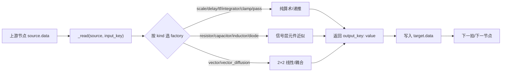
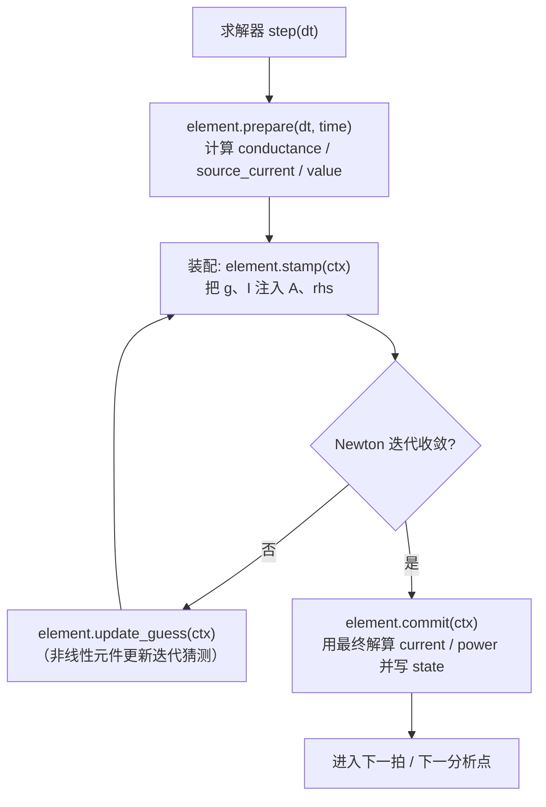
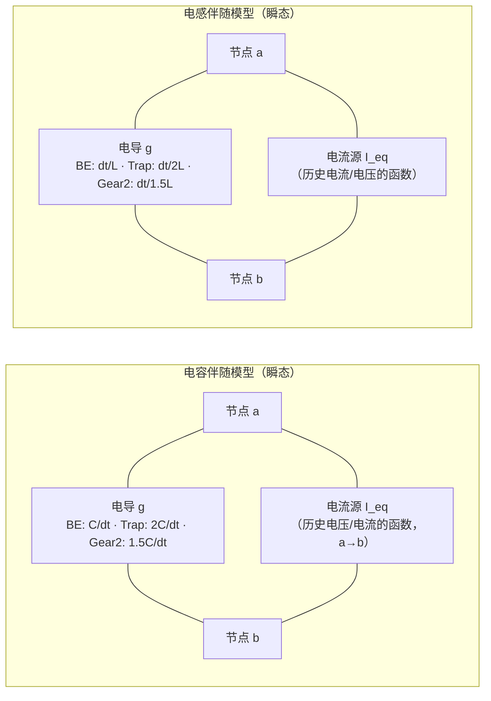
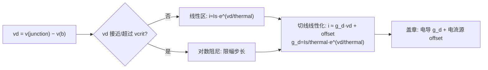

# Netlab 元件与信号流数学说明

> 本文档是 Netlab 计算内核的**数学底稿**，面向需要理解「仿真到底在解什么方程」的读者。
> 全篇分两编：
>
> - **第一编** 讲信号流连接方法（`netlab/core/compute/methods.py`）——12 种 `kind` 的逐拍递推与参数含义。这是「数据流」层面的运算，元素之间靠节点数据搬运，不建立矩阵。
> - **第二编** 讲电路元件模型（`netlab/core/compute/circuit/elements.py`）——真正的 MNA（改进节点分析）盖章（stamp），求解器把每个元件贡献的导纳、电流源注入 `A x = b`，再解线性系统。
>
> 两编共用一套物理常量（`K_BOLTZMANN` 等，见 `netlab/core/compute/circuit/stamps.py`）与同一份步长 `Δt` 语义。凡引用源码处以 `文件:行号` 标注；行号来自当前工作树，若日后改动请以函数名为准。

---

## 0. 阅读约定

- **时间离散**：仿真步长记为 `Δt`（代码里为 `dt`）。第 `k` 步的状态写作下标 `k`，上一步为 `k-1`。
- **算子**：`z⁻¹` 表示单位延迟，即 `y[k] = x[k-1]`；`s` 为拉普拉斯算子。
- **信号层 vs 电路层**：
  - 信号层（第一编）把「元件」抽象成一个 `Method` 函数，读 `source.data`、写 `target.data`，**只在节点数据上做算术**，不涉及节点电压/支路电流的概念。
  - 电路层（第二编）每个元件往 MNA 矩阵里盖章，最终由 `CircuitSolver` 解 `A·x = b`，`x` 里既有节点电压也有支路电流。
- **状态容器**：方法用 `state: dict` 存跨步记忆；元件用 `self.state` 与 `self.iteration_guess` 分别存「已提交状态」与「Newton 迭代猜测值」。

---

# 第一编 信号流连接方法

## 1.1 方法框架

每个方法由 `MethodSpec` 描述并注册进 `METHOD_SPECS`（`methods.py:41`），`register()`（`methods.py:44`）把规格塞进注册表。运行时 `prepare_method`（`methods.py:687`）按 `kind` 取出 `factory`，用参数构造一个闭包 `method(source, target, params, state, dt) -> NodeData`；`method_catalog()`（`methods.py:695`）则把 `METHOD_SPECS` 转成前端可读的字典清单。

一个 `Method` 的签名固定为：

```python
# netlab/core/compute/methods.py:687 附近（prepare_method 内构造）
def method(source, target, _params, _state, _dt) -> NodeData:
    ...
```

读输入统一走 `_read(source, key)`（`methods.py:51`）：若 `source.data` 里没有该字段，返回 `0.0`（空节点视作零）。写输出则是返回一个 `dict`，键为输出字段名。

方法按 `group` 分成三类：`信号`（scale/delay/tf/integrator/clamp/pass）、`电路`（resistor/capacitor/inductor/diode）、`矢量`（vector/vector_diffusion）。这 12 种 `kind` 是信号层能表达的全部运算。

> 关于拓扑：除 `delay` 外，方法节点参与拓扑排序（保证上游先算）；`delay` 故意**不参与**拓扑排序，因为它读的是上一拍的 `source.data`，允许成环反馈。`vector_diffusion` 的「双向耦合」也应靠 `delay` 边打断代数环（见其 `description` 提示）。



*图 1　信号流方法的数据通路。*

## 1.2 十二种 kind 逐项说明

下面每种方法给出四件事：**数学定义**、**参数（`ParamSpec` 名称 / 默认 / 范围）**、**内部 state**、**边界与错误**，末尾附**代码锚点**（factory 行号与注册行）。参数默认值取自 `methods.py` 中 `ParamSpec`/`float_param` 的实参。

### 1.2.1 `scale` —— 线性缩放

**定义**（逐拍代数式，无状态）：

$$
y = \text{offset} + \text{gain}\cdot x
$$

**参数**

| 名称 | 类型 | 默认 | 说明 |
|---|---|---|---|
| `input_key` | text | `"value"` | 输入字段，留空/`auto` 自动匹配，优先 `value` |
| `output_key` | text | `"value"` | 输出字段，留空/`auto` 写 `value` |
| `gain` | float | `1.0` | 增益 |
| `offset` | float | `0.0` | 偏置 |

**内部 state**：无。**边界**：无显式限幅，`x` 缺失按 `0.0`。**代码锚点**：`_scale_factory`（`methods.py:61`），注册 `kind="scale"`（`methods.py:76`）。

### 1.2.2 `delay` —— 单位延迟 / z⁻¹

**定义**：

$$
y[k] = x[k-1]
$$

实现上，`delay` 在**步首统一求值**：读 `source.data` 的当前值（此时上游节点仍是上一拍的结果），写进 `state["value"]`，输出即上一拍的值。因此它是严格的单步延迟，且**不进入拓扑排序**，可构成反馈环。

**参数**

| 名称 | 类型 | 默认 | 说明 |
|---|---|---|---|
| `input_key` | text | `"value"` | 输入字段 |
| `output_key` | text | `"value"` | 输出字段 |
| `initial` | float | `0.0` | 首拍初值（`state` 未建立时用） |

**内部 state**：`state["value"]` 保存上一拍取值。**边界**：首拍用 `initial`。**代码锚点**：`_delay_factory`（`methods.py:104`），注册（`methods.py:131`）。

### 1.2.3 `tf` —— 传递函数

**定义**：连续域给定有理传递函数

$$
H(s) = \frac{B(s)}{A(s)} = \frac{b_0 + b_1 s + \cdots}{a_0 + a_1 s + \cdots}
$$

代码用 **Tustin（双线性）变换** 把 `s` 离散化：

$$
s \approx \frac{2}{\Delta t}\,\frac{1 - z^{-1}}{1 + z^{-1}}
$$

即 `tustin_tf(num, den, dt)`（来自 `netlab.core.compute.linalg`）代入后得到离散系数，并按 `dt` 缓存。离散域（`domain="discrete"`）则直接以 `den[0]` 归一化后使用。

离散化后用 **直接 II 型转置（Direct Form II Transposed）** 递推（`a[0]=1` 归一）：

$$
\begin{aligned}
y[k] &= b_0\,u[k] + s_0[k-1] \\
s_i[k] &= b_{i+1}\,u[k] + s_{i+1}[k-1] - a_{i+1}\,y[k]
\end{aligned}
$$

**参数**

| 名称 | 类型 | 默认 | 说明 |
|---|---|---|---|
| `domain` | choice | `"continuous"` | `continuous` / `discrete` |
| `numerator` | list | `[1.0]` | 分子系数 b（升幂） |
| `denominator` | list | `[1.0, 1.0]` | 分母系数 a（升幂） |
| `discretization` | choice | `"tustin"` | 离散化方式 |
| `input_key` | text | `"value"` | 输入字段 |
| `output_key` | text | `"value"` | 输出字段 |

**内部 state**：`state["s"]` 为直接 II 型转置的状态向量。**边界与错误**：非有限值或 `|y| > 1e15` 判定为发散，抛 `ComputeError`。**代码锚点**：`_tf_factory`（`methods.py:159`），注册（`methods.py:216`）。

### 1.2.4 `integrator` —— 带限幅积分器

**定义**（前向欧拉 + 双侧限幅）：

$$
y_{k+1} = \operatorname{clip}\!\bigl(y_k + \text{gain}\cdot x_k\cdot \Delta t,\ [\ell, u]\bigr)
$$

**参数**

| 名称 | 类型 | 默认 | 说明 |
|---|---|---|---|
| `input_key` | text | `"value"` | 输入字段 |
| `output_key` | text | `"value"` | 输出字段 |
| `gain` | float | `1.0` | 积分增益 |
| `initial` | float | `0.0` | 初值 |
| `lower` | float | `-1e6` | 下限 ℓ |
| `upper` | float | `1e6` | 上限 u |

**内部 state**：`state["y"]` 累计值。**边界与错误**：`lower > upper` 直接抛 `ComputeError`（限幅下限不能大于上限）。**代码锚点**：`_integrator_factory`（`methods.py:272`），注册（`methods.py:295`）。

### 1.2.5 `clamp` —— 限幅传递

**定义**：

$$
y = \min\!\bigl(u,\ \max(\ell,\ x)\bigr)
$$

**参数**

| 名称 | 类型 | 默认 | 说明 |
|---|---|---|---|
| `input_key` | text | `"value"` | 输入字段 |
| `output_key` | text | `"value"` | 输出字段 |
| `minimum` | float | `-10.0` | 下限 ℓ |
| `maximum` | float | `10.0` | 上限 u |

**内部 state**：无。**边界与错误**：`minimum > maximum` 抛 `ComputeError`（限幅下限不能大于上限）。**代码锚点**：`_clamp_factory`（`methods.py:325`），注册（`methods.py:343`）。

### 1.2.6 `pass` —— 模块端口透传

**定义**：不做数学运算，只把上游的**有限数值字段**搬运到输出；布尔与文本视为配置而非信号，被跳过；最多搬 `max_fields` 个字段。

$$
y.\text{key} = x.\text{key}\quad (x.\text{key}\in\mathbb{R}\ \text{且有限})
$$

**参数**

| 名称 | 类型 | 默认 | 范围 |
|---|---|---|---|
| `max_fields` | int | `16` | 1 ~ 32 |

**内部 state**：无。**边界**：超过 `max_fields` 截断；`bool`/非数值跳过。**代码锚点**：`_pass_factory`（`methods.py:372`），注册（`methods.py:394`）。

### 1.2.7 `resistor` —— 信号层电阻

**定义**（把两端电压差换成电流）：

$$
i = \frac{v_{\text{src}} - v_{\text{tgt}}}{R},\qquad v_{\text{src}} = x[\texttt{voltage}]
$$

输出 `current`、`voltage_difference`、`power`。

**参数**

| 名称 | 类型 | 默认 | 说明 |
|---|---|---|---|
| `R` | float | `1000.0` Ω | 电阻，必须为正 |
| `input_key` | text | `"voltage"` | 输入电压字段 |

**内部 state**：无。**边界与错误**：`R` 为负/零应视为非法参数（由 `validate_params` 挡在构造期）。**代码锚点**：`_resistor_factory`（`methods.py:417`），注册（`methods.py:435`）。

### 1.2.8 `capacitor` —— 信号层电容（后向欧拉）

**定义**（信号层一阶近似，后向欧拉为主）：

$$
i_k = C\,\frac{v_k - v_{k-1}}{\Delta t}
$$

**参数**

| 名称 | 类型 | 默认 | 说明 |
|---|---|---|---|
| `C` | float | `1e-6` F | 电容 |
| `input_key` | text | `"voltage"` | 输入电压字段 |

**内部 state**：`state["voltage"]` 存上一拍电压 `v_{k-1}`。**边界**：首拍 `v_{k-1}=0`。**代码锚点**：`_capacitor_factory`（`methods.py:450`），注册（`methods.py:470`）。

### 1.2.9 `inductor` —— 信号层电感（后向欧拉）

**定义**：

$$
i_k = i_{k-1} + \frac{v\cdot \Delta t}{L}
$$

即 `i += v·dt/L` 后写回状态；输出为当前电流。

**参数**

| 名称 | 类型 | 默认 | 说明 |
|---|---|---|---|
| `L` | float | `1e-3` H | 电感 |
| `initial` | float | `0.0` A | 初始电流 |
| `input_key` | text | `"voltage"` | 输入电压字段 |

**内部 state**：`state["current"]` 存 `i_{k-1}`。**代码锚点**：`_inductor_factory`（`methods.py:484`），注册（`methods.py:505`）。

### 1.2.10 `diode` —— 信号层二极管（Shockley，指数截断）

**定义**（肖克利方程，指数在 40 处截断防溢出）：

$$
i = I_s\,\bigl(e^{\,u} - 1\bigr),\qquad u = \min\!\bigl(40,\ \frac{v}{n V_T}\bigr),\quad V_T = k_B T
$$

其中热电压按 `thermal = K_BOLTZMANN * T` 计算（`n` 已并入分母的 `n`，即 `v/(n·thermal)`）。

**参数**

| 名称 | 类型 | 默认 | 范围 |
|---|---|---|---|
| `Is` | float | `1e-12` A | —— |
| `n` | float | `1.0` | 发射系数 |
| `temperature` | float | `300` K | 200 ~ 500 |

**内部 state**：无（纯代数）。**边界**：指数参数上限 40，避免 `exp` 溢出成 `inf`。**代码锚点**：`_diode_factory`（`methods.py:520`），注册（`methods.py:542`）。

### 1.2.11 `vector` —— 2×2 线性矢量变换

**定义**：

$$
\begin{bmatrix} n_x \\ n_y \end{bmatrix}
= M \begin{bmatrix} x \\ y \end{bmatrix} + \begin{bmatrix} o_x \\ o_y \end{bmatrix},
\quad M\in\mathbb{R}^{2\times 2}
$$

另输出 `magnitude = \sqrt{n_x^2 + n_y^2}`。

**参数**

| 名称 | 类型 | 默认 | 说明 |
|---|---|---|---|
| `matrix` | 2×2 matrix | 单位阵 | M |
| `input_x` | text | `"x"` | 输入 x 字段 |
| `input_y` | text | `"y"` | 输入 y 字段 |
| `output_x` | text | `"x"` | 输出 x 字段 |
| `output_y` | text | `"y"` | 输出 y 字段 |
| `offset_x` | float | `0.0` | 偏置 o_x |
| `offset_y` | float | `0.0` | 偏置 o_y |

**内部 state**：无。**代码锚点**：`_vector_factory`（`methods.py:578`），注册（`methods.py:608`）。

### 1.2.12 `vector_diffusion` —— 矢量扩散耦合

**定义**（按起点与终点的矢量差加权）：

$$
d_x = g\,(x_{\text{src}} - x_{\text{tgt}}),\qquad
d_y = g\,(y_{\text{src}} - y_{\text{tgt}}),\qquad
\text{distance} = \sqrt{d_x^2 + d_y^2}
$$

**参数**

| 名称 | 类型 | 默认 | 说明 |
|---|---|---|---|
| `gain` | float | `0.2` | 耦合增益 g |
| `input_x` | text | `"x"` | x 字段 |
| `input_y` | text | `"y"` | y 字段 |
| `output_x` | text | `"dx"` | 输出 d_x |
| `output_y` | text | `"dy"` | 输出 d_y |

**内部 state**：无。**边界**：这是**解耦的显式差分**，双向连接时必须经由 `delay` 边打断代数环（`description` 明确提示「建议设为单步延迟」）。**代码锚点**：`_vector_diffusion_factory`（`methods.py:633`），注册（`methods.py:658`）。

## 1.3 方法公式速查

`METHOD_FORMULAS`（`methods.py:708`）里维护了一份人读公式表，与上面逐项定义一致（要点摘录）：

| kind | 公式 |
|---|---|
| `scale` | `y = offset + gain · x[input_key]` |
| `delay` | `y[k] = x[k-1]` |
| `tf` | `H(s)=B(s)/A(s) → Tustin` |
| `integrator` | `y += gain·x·dt`（限幅） |
| `clamp` | `y = clip(x, min, max)` |
| `resistor` | `i = (v_src − v_tgt) / R` |
| `capacitor` | `i = C·(v[k] − v[k-1]) / dt` |
| `inductor` | `i[k] = i[k-1] + v·dt/L` |
| `diode` | `i = Is·(exp(v/(n·Vt)) − 1), Vt = k_B·T/q；指数在 40 处截断` |
| `vector` | `[nx;ny] = M[x;y] + offset` |
| `vector_diffusion` | `dx = gain·(x_src − x_tgt)`（dy 同理） |

---

# 第二编 电路元件模型

第一编是「函数式」的标量/矢量递推；第二编进入**真正的电路仿真**：每个元件往 MNA 方程组里盖章，求解器解出节点电压与支路电流。理解本编的关键是三条契约：`prepare → stamp → commit`。

## 2.1 MNA 与 stamp 契约

### 2.1.1 求解上下文 `StampContext`

所有盖章都通过 `StampContext`（`stamps.py:56`）进行，它携带：

```python
# netlab/core/compute/circuit/stamps.py:56
class StampContext:
    A: np.ndarray          # MNA 系数矩阵
    rhs: np.ndarray        # 右端向量 b
    index: dict[str, int]  # 节点名 → 矩阵下标
    solution: np.ndarray   # 上一轮解 x
    dt: float
    time: float
    iteration: int
    mode: str = "tran"     # tran / dc / ac
    omega: float = 0.0      # ac 角频率 rad/s
    def voltage(self, node_id: str) -> float: ...
```

`mode` 是**三态开关**：`"tran"` 瞬态、`"dc"` 直流工作点、`"ac"` 小信号交流。同一份 `stamp` 代码要能按 `mode` 走不同分支（例如电容 DC 开路、AC 用 `jωC`）。

### 2.1.2 两个基础盖章原语

整个第二编只反复调用两个原语，务必先记牢：

**电导盖章** `_stamp_conductance(ctx, a, b, g)`（`stamps.py:75`）：在节点 a、b 之间放一个电导 g，向矩阵贡献

$$
A[a,a]\!+\!\!=g,\quad A[b,b]\!+\!\!=g,\quad A[a,b]\!-\!\!=g,\quad A[b,a]\!-\!\!=g
$$

（端点接地/索引为 `None` 时跳过对应项。）

**电流源盖章** `_stamp_current(ctx, a, b, value)`（`stamps.py:87`）：一支从 a 流向 b、大小为 `value` 的独立电流源，对 KCL 右端的贡献是

$$
\text{rhs}[a] \mathrel{-}= value,\qquad \text{rhs}[b] \mathrel{+}= value
$$

### 2.1.3 元件生命周期



*图 2　元件 stamp 生命周期：prepare → stamp → (Newton 迭代) → commit。*

- `prepare(dt, time)`（`elements.py:54`）：把 `self.dt`、`self.time` 存下，算出本拍的等效电导/等效电流源（线性元件在此定型；非线性元件在 `stamp` 里按猜测值现算）。
- `stamp(ctx)`（抽象，`elements.py:58`）：唯一必须实现的方法，把元件方程塞进 `A`、`rhs`。
- `update_guess(ctx)`（`elements.py:61`）：仅非线性元件重写，用上一轮解更新 `iteration_guess`。
- `commit(ctx)`（`elements.py:64`）：Newton 收敛、拿到最终解之后调用，计算 `current/voltage_difference/power` 写入 `self.result`，并更新跨步 state（如 `v_prev`、`i_prev`）。

> 基类 `CircuitElement` 定义于 `elements.py:16`，字段 `kind/label/needs_branch/nonlinear/output_fields=("current","voltage_difference","power")`。`needs_branch=True` 的元件（电压源、VCVS、运放、DFlipFlop 等）会额外占一行矩阵（支路电流未知量），`self.branch_index` 指向它。

## 2.2 无源线性元件

### 2.2.1 电阻 `Resistor`（`elements.py:87`）

方程 $i = g\,v,\ g = 1/R$，与 `mode` 无关。`stamp` 直接 `_stamp_conductance(a, b, 1/R)`（`elements.py:95`），`commit`（`elements.py:98`）算 `current = g·v`、`power`。

### 2.2.2 电容 `Capacitor`（`elements.py:108`）

电容的电流—电压关系是微分方程 $i = C\,dv/dt$，需要按时间积分格式离散成「等效电导 + 等效电流源」的伴随模型（companion model）。`prepare`（`elements.py:135`）按 `self.integration` 分支：

**后向欧拉（BE）**

$$
i_k = \frac{C}{\Delta t}(v_k - v_{k-1})
\;\Longrightarrow\;
g = \frac{C}{\Delta t},\quad I_{\text{eq}} = -g\,v_{k-1}
$$

即 $i_k = g\,v_k + I_{\text{eq}}$。

**梯形法（Trapezoidal）**

$$
i_k = \frac{2C}{\Delta t}(v_k - v_{k-1}) - i_{k-1}
\;\Longrightarrow\;
g = \frac{2C}{\Delta t},\quad I_{\text{eq}} = -g\,v_{k-1} - i_{k-1}
$$

**Gear2（二阶后向差分）**

$$
i_k = \frac{C}{\Delta t}\Bigl(\tfrac{3}{2}v_k - 2v_{k-1} + \tfrac{1}{2}v_{k-2}\Bigr)
\;\Longrightarrow\;
g = \frac{1.5C}{\Delta t},\quad I_{\text{eq}} = \frac{C(-2v_{k-1} + 0.5 v_{k-2})}{\Delta t}
$$

Gear2 需要两步历史（`v_prev`、`v_older`）；若历史不足或 `dt` 变化，`prepare` 自动回退到 BE（用 `_gear_ready`/`gear_dt` 判定）。

**三态盖章**（`stamp`，`elements.py:161`）：

| mode | 行为 |
|---|---|
| `dc` | 直接 `return`，视作**开路**（稳态电容无电流） |
| `ac` | `_stamp_conductance(a, b, 1j·ω·C)`（复导纳） |
| `tran` | `_stamp_conductance(a, b, g)` + `_stamp_current(a, b, I_eq)` |

`commit`（`elements.py:172`）：DC 下 `current=0`；BE 下 `i = g(v−v_{prev})`；Gear2 下 `i = g·v + I_eq`；梯形下 `i = g(v−v_{prev}) − i_{prev}`。最后更新 `v_prev`。



*图 3　电容 / 电感的伴随模型：都是「等效电导 g 并联等效电流源 I_eq」，差别只在 g 与 I_eq 的系数。*

### 2.2.3 电感 `Inductor`（`elements.py:209`）

电感关系 $v = L\,di/dt$，离散成 $i = g\,v + I_{\text{eq}}$。`prepare`（`elements.py:235`）：

**BE**：
$$
i_k = i_{k-1} + \frac{\Delta t}{L}v_k
\;\Longrightarrow\;
g = \frac{\Delta t}{L},\quad I_{\text{eq}} = i_{k-1}
$$

**梯形**：
$$
i_k = i_{k-1} + \frac{\Delta t}{2L}(v_k + v_{k-1})
\;\Longrightarrow\;
g = \frac{\Delta t}{2L},\quad I_{\text{eq}} = i_{k-1} + g\,v_{k-1}
$$

**Gear2**：
$$
i_k = \frac{2 i_{k-1} - 0.5 i_{k-2}}{1.5} + \frac{\Delta t}{1.5 L}v_k
\;\Longrightarrow\;
g = \frac{\Delta t}{1.5L},\quad I_{\text{eq}} = \frac{2 i_{k-1} - 0.5 i_{k-2}}{1.5}
$$

**三态盖章**（`stamp`，`elements.py:258`）：`dc` 与 `ac`（ω=0）都用 `DC_CONDUCTANCE = 1.0e5` S，`ac`（ω≠0）用 `1/(jωL)`，`tran` 用 g + I_eq。`commit` 见 `elements.py:273`。

### 2.2.4 DC 电感「1e5 S 短路近似」的说明与限制

`Inductor.DC_CONDUCTANCE = 1.0e5`（`elements.py:209` 类体）代表直流下电感对理想短路（约 10 µΩ）的近似。它带来三点需要使用者心里有数：

1. **不是理想短路**：1e5 S 对应 10 µΩ，仍是一个有限大电导。若电路要求「绝对零压降」的短路回路，会引入微小但非零的压降。
2. **数值病态风险**：1e5 与其它元件电导（如 1 kΩ⇒1e-3 S）相差 8 个数量级，矩阵条件数变差；`_solve_matrix`（`solver.py:714`）的 `pivot_tol=1e-14` 与缩放（`scaling=True`）用于缓解，但极端网络仍可能精度吃紧。
3. **完成电流通路**：设立 `DC_CONDUCTANCE` 的目的是让电感在 DC 下有确定的电流通路，避免悬空节点（`_check_floating`，`solver.py:873` 会因悬空抛 `ComputeError`）。它不能替代「理想导线」的严格语义。

## 2.3 独立源与跨域元件

### 2.3.1 电压源 `VoltageSource`（`elements.py:308`）

`needs_branch=True`，引入支路电流未知量。`prepare`（`elements.py:317`）用 `_source_value`（`elements.py:301`）取波形值；梯形法取 `0.5·(waveform(t−dt)+waveform(t))`，其余取 `waveform(t)`，再乘 `source_scale`。

`stamp`（`elements.py:321`）盖章（支路行 `row`，端节点 a、b）：

$$
A[a,row]\!+\!\!=1,\ A[row,a]\!+\!\!=1,\ A[b,row]\!-\!\!=1,\ A[row,b]\!-\!\!=1,\ \text{rhs}[row]=value\cdot scale
$$

`current` 取 `solution[branch_index]`（`elements.py:333`）。这组符号的含义是：支路方程 `v(a) − v(b) = value`，同时把支路电流注入两端节点的 KCL。

### 2.3.2 电流源 `CurrentSource`（`elements.py:377`）

`prepare`（`elements.py:385`）取波形值，`stamp`（`elements.py:389`）调 `_stamp_current(a, b, value)`，`current = value`。

### 2.3.3 跨域桥：`SensorElement` / `ActuatorSource` / `ActuatorCurrent`

- `SensorElement`（`elements.py:346`）是**高阻采样**：在 a、b 各挂 1e-12 S 对地泄漏（`stamp`，`elements.py:352`），几乎不扰动工作点，`commit` 输出 `voltage`/`value`，用于把电路量喂给信号层。
- `ActuatorSource`（`elements.py:366`，继承 `VoltageSource`）与 `ActuatorCurrent`（`elements.py:399`，继承 `CurrentSource`）是**受控驱动**：`prepare` 里 `value = state["drive"]`，让信号层能驱动电路侧源。

## 2.4 受控源

### 2.4.1 VCVS（压控电压源，`elements.py:435`）

`needs_branch=True`，增益 `gain`，控制端 `control_a = pin("IN+", "control_source")`、`control_b = pin("IN-", "control_target")`。支路方程：

$$
v(a) - v(b) = \text{gain}\cdot\bigl(v(c_a) - v(c_b)\bigr)
$$

`stamp`（`elements.py:446`）在支路行 `row` 上放 `+1/−1`（端电压）、`−gain/+gain`（控制电压），`rhs[row]=0`。

### 2.4.2 VCCS（压控电流源，`elements.py:477`）

跨导 `gm`。电流 $i = g_m\,(v_{c_a} - v_{c_b})$，方向由 a→b。`stamp`（`elements.py:487`）把 `gm` 盖章在「控制节点 × 输出节点」的四个位置上：`A[a,c_a]+=gm, A[b,c_a]-=gm, A[a,c_b]-=gm, A[b,c_b]+=gm`。`current = (v_ca − v_cb)·gm`。

## 2.5 开关 `Switch`（`elements.py:409`）

二态电阻模型：闭合用 `ron`、断开用 `roff`，`conductance = 1/(ron 或 roff)`（`elements.py:420`）。参数必须为正（`ron<=0 or roff<=0` 抛 `ComputeError`）。`stamp`（`elements.py:422`）就是一条 `_stamp_conductance`；`commit`（`elements.py:425`）算 `i = v·g`、`power`。这是**线性**开关，没有理想零阻/无穷阻。

## 2.6 非线性器件

非线性元件的共性：`stamp` 时用当前迭代猜测 `iteration_guess` 计算工作点的小信号导纳 `g_d = ∂i/∂v` 与等效电流源偏置，把非线性方程**在猜测点线性化**（Newton 法），`update_guess` 用新解更新猜测，直到收敛。

### 2.6.1 二极管 `Diode`（`elements.py:509`）

**Shockley 方程**：

$$
i = I_s\bigl(e^{\,v_d/(nV_T)} - 1\bigr),\qquad V_T = k_B T
$$

代码把 `n` 并进 `thermal = K_BOLTZMANN · temperature · emission`（`elements.py:520`），故指数参数是 `vd/thermal`，并在 60 处截断（`min(60, ...)`，`elements.py:540`）。

**小信号电导**：

$$
g_d = \frac{\partial i}{\partial v_d} = \frac{I_s}{nV_T}e^{\,v_d/(nV_T)} = \frac{I_s}{\text{thermal}}e^{v_d/\text{thermal}}
$$

下限 `1e-15`（`elements.py:544`）。

**Newton 线性化 + 盖章**（`elements.py:547`）：取猜测 `vd0`，算 `i0, g_d`，偏置 `offset = i0 − g_d·vd0`，然后

$$
\text{stamp: } \_stamp\_conductance(\text{junction}, b, g_d),\quad \_stamp\_current(\text{junction}, b, \text{offset})
$$

即把二极管等效为「电导 `g_d` 并联电流源 `offset`」。若有串联电阻 `rs>0`（`elements.py:521`），先额外盖 `1/rs` 于 `a→junction`，引脚 a 与内部节点 `__<name>__junction` 分开。

**限幅（防指数过冲）** `_limit`（`elements.py:561`）：

$$
v_{\text{crit}} = V_T\ln\!\frac{V_T}{\sqrt{2}\,I_s}
$$

若 `vnew > vcrit` 且 `|vnew − vold| > 2V_T`，则用对数阻尼把步长压回（`vold>0` 时 `vnew = vold + V_T·ln(1 + (vnew−vold)/V_T)`，否则 `vnew = V_T·ln(vnew/V_T)`）。`update_guess`（`elements.py:556`）用 `_limit(新vd, 旧vd)`，`commit`（`elements.py:578`）把 `vd = v(junction) − v(b)` 写回状态。



*图 4　二极管的分段行为与 Newton 限幅：指数区用切线线性化，越界时先对数阻尼再线性化。*

### 2.6.2 运放 `OpAmp`（`elements.py:597`）

`needs_branch=True, nonlinear=True`，输出字段额外含 `vout`。器件节点（有 V+/V− 引脚）模型为单端推挽：

$$
v(\text{OUT}) - v(\text{ref}) = lo + \text{span}\cdot\frac{1 + \tanh\!\bigl(A\,u/\text{span}\bigr)}{2},\quad u = v(\text{IN+}) - v(\text{IN-})
$$

`_rails`（`elements.py:634`）：接线轨时 `lo=0, span=v(V+)−v(V-)`；否则 `lo=vee, span=vcc−vee`。`_evaluate`（`elements.py:642`）给出 `value` 与斜率 `slope = A·(1−tanh²)/2`（旧「边=元件」模型则 `value = span·tanh(A·u/span)`，`slope=A(1−tanh²)`）。

`_dynamic`（`elements.py:657`）叠加一阶带宽与压摆率：`τ = 1/(2π·GBW)`，`alpha = 1 − e^{−dt/τ}`，`value = prev + (value−prev)·alpha`，再按 `±slew_rate·dt` 钳位。`slew_rate`/`gbw` 均为 0 时退化为静态增益。

`stamp`（`elements.py:688`）在支路行盖章：

$$
A[row,c_i] \mathrel{-}= slope,\quad A[row,d_i] \mathrel{+}= slope,\quad \text{rhs}[row] = value - slope\cdot u
$$

即 `v(OUT) − v(ref) ≈ value + slope·(u − u0)` 的线性化。`commit`（`elements.py:708`）写 `state["vout"]`。

### 2.6.3 比较器 `Comparator`（`elements.py:720`，继承 `OpAmp`）

在运放基础上加**迟滞**（`hysteresis`），用 `state["hys_level"]` 记住上一次输出方向（施密特触发），避免输入抖动导致反复翻转。

### 2.6.4 稳压二极管 `Zener`（`elements.py:769`，继承 `Diode`）

正向仍是 PN 结指数；反向往击穿方向叠加一个 **softplus 平滑的击穿支路**（`_conductance`，`elements.py:780`）：

$$
x = -\frac{v_d + V_z}{0.1},\quad
i_{\text{rev}} = -\frac{0.1\,\ln(1+e^{x})}{r_{\text{dyn}}},\quad
g_{\text{rev}} = \frac{1}{r_{\text{dyn}}}\cdot\frac{e^{x}}{1+e^{x}}
$$

`Vz` 为击穿电压，`r_dyn = max(1e-3, ron)`（默认 0.5）为动态电阻。softplus 让击穿区连续可导，Newton 更稳。

### 2.6.5 D 触发器 `DFlipFlop`（`elements.py:796`）

行为级数字元件：`needs_branch=True`，输出端 a−b 作为电压源；`clk` 上升沿把 `D` 采样进 `state["q"]`。参数 `vth`（阈值，默认 2.5）、`vhigh`（默认 5.0）、`vlow`（默认 0.0）。它不参与连续域的牛顿线性化，只在离散事件上更新 `q`。

## 2.7 三态 stamp 汇总

为便于对照，把主要元件在 `dc / ac / tran` 下的盖章行为汇总如下：

| 元件 | `dc` | `ac` | `tran` |
|---|---|---|---|
| Resistor | `1/R` | `1/R` | `1/R` |
| Capacitor | 开路（return） | `jωC` | `g`（BE/Trap/Gear2）+ `I_eq` |
| Inductor | `1e5` S | `1/(jωL)`（ω=0 用 `1e5`） | `g` + `I_eq` |
| VoltageSource | 支路方程 `v=waveform(0)` | 同左（AC 单位激励） | `v=waveform(t)` |
| CurrentSource | `_stamp_current` | `_stamp_current` | `_stamp_current` |
| VCVS / VCCS | 固定增益盖章 | 同左 | 同左 |
| Switch | `1/(ron 或 roff)` | 同左 | 同左 |
| Diode / Zener | Newton 线性化（`g_d`+`offset`） | 不支持（非线性） | Newton 线性化 |
| OpAmp / Comparator | Newton 线性化（`slope`+`rhs`） | 不支持（非线性） | Newton 线性化 |

## 2.8 求解器如何使用这些 stamp

`solver.py` 的 `CircuitSolver` 是舞台调度者，它不关心具体元件方程，只负责：`prepare → stamp → 解线性系统 → 迭代/收敛判定 → commit`（瞬态路径）。

### 2.8.1 瞬态主循环

`step(dt)`（`solver.py:318`）做**检查点**后进入 `_step_locked`（`solver.py:372`）：调用每个元件 `prepare(dt, time)`，再由 `_newton_with_strategies`（`solver.py:426`）/`_newton_solve`（`solver.py:609`）装配 `A`、`rhs` 并求解；收敛后逐元件 `commit`。若抛异常，`restore_last_step_checkpoint`（`solver.py:330`）回滚。首次进入梯形积分前，`_initialize_reactive_currents`（`solver.py:336`）用 BE 预测器给出 `i(0+)`。

矩阵求解 `_solve_matrix`（`solver.py:714`）会在矩阵未变时复用 LU 缓存；`_check_floating`（`solver.py:873`）在装配后检查悬空节点并抛 `ComputeError`。

### 2.8.2 直流工作点 `operating_point`（`solver.py:903`）

直流工作点求的是**所有动态元件取稳态**（电容开路、电感短路）时的节点电压：

1. 打检查点，`time=0`；
2. 各源按 `waveform(0)` 取值；
3. 以**零初值**调用 `_newton_with_strategies(1e-9, zeros, mode="dc")`——`mode="dc"` 让每个元件的 `stamp` 走 DC 分支（电容 `return` 开路、电感用 `1e5` S 短路）；
4. 收敛后在新 `StampContext(mode="dc")` 上逐元件 `commit`，得到各元件的 `current` 等结果；
5. 汇总 `node_voltages`、`elements`、`iterations`、`residual`，`finally` 中恢复检查点。

关键点：DC 里**电感不是开路而是 `1e5` S 短路**、**电容不是短路而是开路**——这正是 2.2.4 讨论的近似生效的地方。

### 2.8.3 小信号交流 `ac_sweep`（`solver.py:969`）

交流扫频先在工作点附近做小信号线性化，然后对每个频点：

1. 校验元件是否属于 `AC_KINDS`（`solver.py:890`）——只有 `resistor/capacitor/inductor/vsource/isource/vcvs/vccs/switch` 支持；非线性器件（Diode/OpAmp 等）不在集合内，遇到即报「不支持」；
2. 逐点设置 `ctx.omega`，`mode="ac"`，让元件的 `stamp` 走 AC 分支（电容 `jωC`、电感 `1/(jωL)`）；
3. 被选中的独立源取**单位激励**（`solver.py:978` 附近描述），其余置零，解出该频点的复响应。

因为 AC 依赖复导纳，`stamp` 里的 `1j*omega*C`、`1/(1j*omega*L)` 直接写进 `A`（NumPy 复数矩阵），无需另设伴随电流源。

---

## 附录 A　常量与默认选项

| 常量 / 选项 | 值 | 来源 |
|---|---|---|
| `K_BOLTZMANN` | `8.617333262e-5` eV/K（代码注释口径） | `stamps.py` |
| `MAX_NEWTON_ITERATIONS` | `60` | `stamps.py` |
| `NEWTON_ABS_TOL` | `1e-6` | `stamps.py` |
| `NEWTON_REL_TOL` | `1e-9` | `stamps.py` |
| `MAX_ABS_VOLTAGE` | `1e9` | `stamps.py` |
| `SolverOptions.gmin` | `1e-3` | `stamps.py:19` |
| `SolverOptions.pivot_tol` | `1e-14` | `stamps.py:19` |
| `Inductor.DC_CONDUCTANCE` | `1.0e5` S | `elements.py:209` |
| 默认集成方式 | `trapezoidal` | `elements.py:23` |

> 说明：`K_BOLTZMANN` 的数值是「eV/K」量级口径；数值计算时热电压按 `thermal = K_BOLTZMANN * temperature`（再乘发射系数）使用，单位与电压一致，故公式里 `v/thermal` 无量纲。若需要 SI 精确值请自行换算（`q ≈ 1.602e-19 C`）。

## 附录 B　未覆盖 / 需进一步核对项

- `Switch` 内部只有 `ron/roff/closed` 三参数与线性电导，未涉及更细的寄生电容模型（源码 `elements.py:409` 确认无额外状态）。
- `Zener` 的动态电阻取 `max(1e-3, ron)`，其中 `ron` 复用参数名（默认 0.5 Ω）；与 `Switch.ron` 语义不同，勿混用。
- `DFlipFlop` 的时序细节（亚稳态、建立/保持）未在源码中建模，仅上升沿采样。
- `catalog.py` 的 `ELEMENT_SPECS` 逐条 `presets` 未在本文展开；参数默认值以 `catalog.py` 的 `ElementSpec` 为准。
- `ac_sweep` 的完整频点循环体（`solver.py:969` 之后）本文只描述行为，未逐行引用；具体单位激励选择逻辑请以源码为准。

---

*文档结束。若源码行号漂移，请按文中函数名/类名检索定位。*
